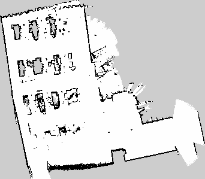

# NAV-017-R16：弱特征场地建图离线审计

日期：2026-10-20。用户指定约2026-10-19 22:30的建图工程，反馈建筑直角走廊被画成约100°～120°。这是现场反馈，不是本轮尺量或角度真值；WiFi和页面文字已由用户确认暂不再处理。

## 读取的数据与边界

三个原工程均保留在 `src/carcar_navigation/maps/mapping_sessions/`：`20261019_223428_554ad0d6`、`20261019_223449_1e336f2f`、`20261019_223507_5ec7cfe3`。使用本机SLAM Toolbox 2.6.10的Karto反序列化接口只读提取；未打开串口、启动ROS节点或修改原工程。源码、构建环境与执行入口见本目录及[手册33.20](../../操作手册.md#weak-feature-mapping)。

这些是SLAM已接纳的关键帧及保存时优化后的位姿，不能还原所有原始扫描、实时丢帧、每次闭环前后状态或IMU。它们可复核范围设置及输入分布，不能作为完整故障回放或独立真值。原工程是否对应用户指的具体拐角，还需现场对照。

## 可重复的读回

三个工程导出的 `scans.csv` 逐字节一致。以下为最后一个工程；数据见[scans.csv](scans.csv)、[原始输出](final_stdout.txt)。

| 项目 | 离线读回 |
|---|---|
| 接纳扫描 | 637帧，时间跨度952.882秒 |
| 序列化激光使用阈值 | 3m；设备声明上限12m，不等同12m场地可靠距离 |
| 有效测距定义 | 有限值，0.1m≤距离<设备声明上限 |
| 全部有效值 / ≤3m / ≤6m | 407149 / 277397 / 368886 |
| 每帧≤3m的最小值 / 第10百分位 / 中位数 | 130 / 229 / 464 |
| 每帧≤6m的最小值 / 第10百分位 / 中位数 | 457 / 492 / 599 |
| 轮式 / SLAM校正后路径长度 | 100.136 / 97.869m，均为推算值 |
| 轮式 / SLAM校正后累计有符号转角 | −96.698° / −299.915°，均为推算值 |
| 相邻关键帧航向校正量的最大变化 | 8.698°，ID630；不是实物转角误差 |

点数增加不证明几何约束增加：一条平墙可能贡献很多点，却仍难以区分沿墙平移；重复结构也可能给出错误但集中的匹配。轮式与SLAM航向有明显差异，只能证明两种估计不同，不能认定其中任意一种是真值，也不能仅由此改轮距。

## 保存地图的显示含义

来源是该工程的 `map.pgm`，坐标为保存时 `map`，原点为(−6.12, −8.84, 0)，分辨率0.05m/像素；342×299像素覆盖约17.10×14.95m栅格范围。黑色为占据、白色为空闲、灰色为未知。这是静态最终快照，没有当前激光、车位或实时状态。浏览器窗口显示大小不等于地图物理大小，也不是相机视场；与建筑尺寸比较须先确认对应墙体和方向。

## 当前选择与未完成项

先提供独立6m候选，只改变 `max_laser_range`，原3m默认、匹配阈值、闭环、轮式里程计和停车期限保留。候选仅支持新建并使用独立保存目录；序列化图含原激光阈值，不能用载入旧图冒充6m重建试验。原始有效回波有更远信息，足以支持开展这一对照，尚不足以宣布地图变形已解决。

当前网页门控检查会话、雷达、里程计和地图新鲜度，没有证明建图几何可信；`CURRENT`也不是弱特征质量保证。长期防护应由经过验证的质量监控触发告警、撤销遥控授权并关闭SLAM扫描转发，冻结当前候选，显式人工确认后恢复。恢复时要重新核对坐标，不能只把网页车标拖回原位；连续性失效则回到错位前的独立工程，已有坏图保留作证据。该质量保护尚未实现，也不能承诺完全预防。

如果3m/6m同路比较仍发生角度变形，先用实物90°转角和回到起点真值复核轮式转角/打滑、扫描时间与TF，再评估已校正 `angular_velocity.z` 的独立融合候选。不引入姿态、加速度或磁力计，也不直接替换现有TF所有者。弱特征区域自身仍没有足够约束时，评估固定且不对称的几何地标；反光板或相机标记另需兼容传感器/算法，现系统不会因贴标记而自动利用。

复核/验收计划统一[手册33.20](../../操作手册.md#weak-feature-mapping)，实际结果只维护[测试记录](../../测试记录.md#nav-017-r16)。

## 官方依据与适配

- [SLAM Toolbox 2.6.10激光输入](https://github.com/SteveMacenski/slam_toolbox/blob/2.6.10/src/laser_utils.cpp)及[Karto有效点生成](https://github.com/SteveMacenski/slam_toolbox/blob/2.6.10/lib/karto_sdk/include/karto_sdk/Karto.h)：固定版本的范围阈值用于选择测距点；本审计只调用安装接口，没有复制实现。安装包元数据声明LGPL，细项见[固定版许可证](https://github.com/SteveMacenski/slam_toolbox/blob/2.6.10/LICENSE)。诊断工具仅本地链接，不打包分发上游二进制。
- [固定版工具说明](https://github.com/SteveMacenski/slam_toolbox/blob/2.6.10/README.md)：区分保存栅格和位姿图；闭环及图编辑能参与修图，但不保证错误图自动恢复。图编辑属于有证据的调试手段。
- [SICK官方定位方案](https://www.sick.com/media/docs/8/08/708/flyer_localization_solutions_mobile_platforms_en_im0102708.pdf)：工业方案有自然轮廓与辅助地标/里程计的组合。这是公开产品能力说明，不是本小车、A1或当前软件已具备同等能力/认证的证明。

## 工具限制与失败记录

离线小工具只读取可信的本仓库数据，不接入正式bringup；两份Karto对象会持有各自反序列化的同名传感器，因此单次进程将其交由OS统一回收，避免2.6.10析构重复注销。不能直接把该生命周期方式移入常驻节点。

初版独立编译遇到Karto宏与OpenCV `forEach`冲突、缺Eigen/TBB链接，已按现有依赖修正。最初只载Dataset以及随后销毁Mapper/Dataset时出现Karto异常；修正为先载Mapper并限定为单次只读进程后退出0，完整导出成功。这些工具失败保留为本段摘要，不记为故障回放通过。候选参数传递回归在实现前因未知 `--slam-params` 失败，原始红灯见[tools_red.txt](tools_red.txt)。

最终目标包构建和72项回归通过，见[构建日志](package_build.log)、[回归日志](package_test.log)及[junit](junit/)。补充启动检查首轮误选域241，Fast DDS拒绝域端口，见[失败原文](candidate_startup.log)；换为有效域216、localhost18094及硬件关闭后启动STANDBY，参数读回配置路径与false，见[退出记录](candidate_startup_r2.log)。没有为候选启动真实硬件或切换日常8080服务。
