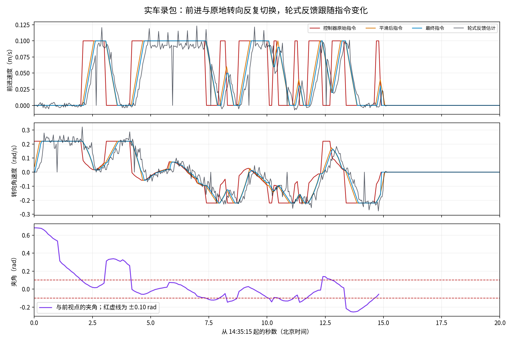
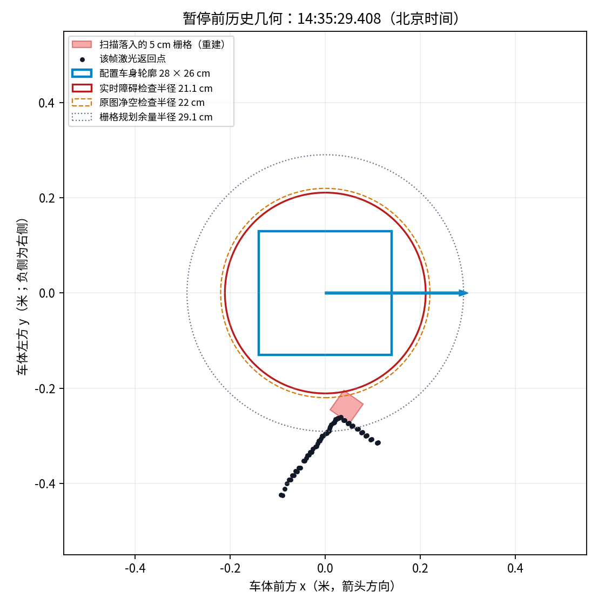
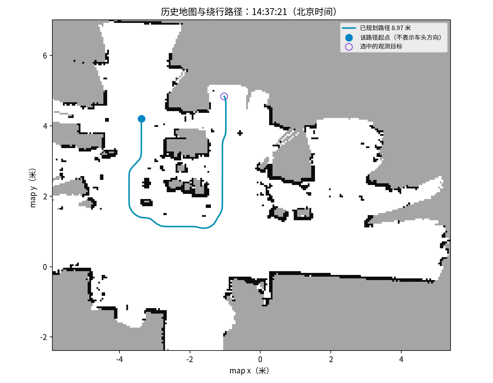

# NAV-018-STUTTER-001：实车停顿、贴边暂停、绕路与恢复锁停

日期：2026-11-02，时间均为 Asia/Shanghai。范围为用户正在运行的任务只读监看、关闭录包分片离线分析、故障证据保全和改进建议；没有修改正式算法、参数、系统配置，没有代发运动、继续、接管、恢复或结束请求。

任务 `f35630a46437f3ed410f8c8b7d585ad3`，正式发布仍为 `my_nav_carcar_return_nearby_release`。自主启动由操作者在网页完成；本轮进程与参数实读已核对。起初0.10m/s，用户后来在同任务选择0.18m/s；本文运动量化窗口为调速之前，不能外推到最高档。

## 结论与证据强度

| 现象 | 本轮结论 | 证据边界 |
|---|---|---|
| 同一目标内反复前进、转向 | 原始RPP已交替输出前进与零线速度转向；0.10rad（约5.73°）门槛频繁触发，平滑器及轮式反馈跟随变化 | 直接观测；不是仅凭网页动画判断。未证明每一次停顿都来自此条件 |
| 右侧静态物体触发“动态障碍”暂停 | 规划器返回START_BLOCKED，实时激光层含静态物体；当前矩形车身与规划圆包络的判定不同，5cm栅格量化进一步侵占余量 | 按扫描时刻TF重建可复现圆与障碍格相交；原始ObstacleLayer内部格与规划调用瞬时车位未单独录制，不能宣称唯一触发格已被直接读回 |
| 目标看似近，路径绕很远 | 14:37:20目标直线距离2.428m，路径8.968m；正式选点评分未使用真实可行路径长度 | 已量化；直线和用户红箭头经过未知区，不能视为已知安全捷径 |
| 检查失败且手动接管被禁用 | 两次错误回环被撤销，恢复后仍有定位多解；FAULT/RECOVERING下手动接管被后端明确禁止，并依赖完整健康状态 | 直接读回能力字段、恢复结果、请求账本和源码；不是简单前端按钮故障 |
| 偶发底盘时序异常 | 14:35:12.692底盘记录last_cmd_age_s=0.343、watchdog_stopped=true，约23ms后恢复 | 独立问题，不能归为所有走停的原因；发生在附加只读录包启动附近，采集负载与原系统调度贡献未隔离 |

## 1. 前进与转向反复切换

关闭的正式分片覆盖14:31:05～14:38:21。固定目标`895111ae…`、`86773eb1…`分别有30、12次原始指令“前进→原地转向→前进”组合。这里的“前进”定义为vx>0.025m/s，“转向”为|vx|<0.005m/s且|wz|>0.03rad/s，统计排除无目标及非EXPLORING状态。

附加观察包的161组前视点／原始速度配对中，73个非末端原地转向样本全部满足|前视方向角|>0.10rad。实际读回`use_rotate_to_heading=true`、`rotate_to_heading_min_angle=0.10`、`rotate_to_heading_angular_vel=0.22`；这是前一次降转速之后仍保留的模式切换条件。原始速度为0或0.10m/s来回切换，平滑器只能限制加减速，无法消除上游反复切换。

下图数据来自14:35:15起约20秒真实录包。横轴为北京时间起点后的秒数；上两图分别是车体前进速度和绕竖轴角速度；红线为RPP命令，橙线为平滑后命令，蓝线为最终命令，灰线为轮式估计。下图为车体坐标系下与前视点的夹角，红虚线±0.10rad。发送命令、轮式估计和独立实物真值不是同一种证据。

[统计数据](analysis-summary.json)保留逐目标分段。监督器最大控制间隔80.5ms；原录包中超过0.3秒的两次最终命令接收间隔均在启动MANUAL／零输出阶段。另有上表底盘0.343秒看门狗事件，不能用监督器定时正常证明整条链路完全无延迟。

## 2. 贴边暂停与三个不同的安全范围

14:35:29.408、29.839、30.387，规划器先后报告`START_BLOCKED`。14:35:30.589监督器进入PAUSED，近场停车框`inside=false,count=0`，传感器健康。14:36:34.222操作者继续请求后恢复探索；代理没有代发该请求。

本轮有效参数：

- 配置矩形footprint为28×26cm；用于描述导航中的车身投影，不是重新测量实物尺寸。
- 实时障碍规划检查采用足迹外接圆加2cm，半径21.10497cm；静态物体被实时激光看见后也属于该障碍层。
- 原始SLAM地图检查半径22cm；栅格规划掩膜再加一个5cm格的对角余量，半径约29.071cm。
- 局部代价图窗口3×3m，局部膨胀半径20cm、衰减系数5；全局膨胀半径30cm、衰减系数3。窗口尺寸与膨胀距离是不同参数，读回没有“窗口突然缩小”的证据。

首次拒绝前的扫描距离配置矩形最近约13.11cm，未发现点进入矩形。将两束右侧扫描按各自时刻的`map→odom→base_footprint`变换投到当时5cm全局栅格后，均落入格[49,82]。该格到最近监督器车中心的边缘距离为20.8246cm，小于21.1050cm圆包络，离线几何可重现相交。

这解释了“人看还有间隔、软件却认为起点受阻”如何发生。完整实时障碍层未单独发布，合成代价图还混有静态层和禁行掩膜；不得把合成图中车身下的254格直接都当成实物。规划调用内部车位与监督器采样有毫秒差异，毫米级余量须保留这一限制。

下图来自14:35:29.408附近历史数据，转换到车体坐标系，横纵单位均为米、等比例显示；蓝矩形是配置footprint，蓝箭头指车头，黑点为激光，红方格为上述扫描重建落格，三圆分别表示实时障碍、原图和规划余量。红格与安全圆相交不等于红格与车身矩形相交。

[逐束重建](scan-grid-reconstruction.json)、[邻近时刻及合成图对照](pause-geometry-summary.json)。

## 3. 绕路是选目标与走路径两层问题

14:37:20.342路径起点约[-3.371,4.205]，目标[-1.026,4.837]，真实路径8.968m，端点直线2.428m，比例3.693。它先回到下方已知区域再绕到另一侧。图为当时SLAM数据，`map`坐标、米制等比例；白色已知自由区、黑色占用、灰色未知，青色路径和紫色目标不是未来完整探索计划。

正式explore_lite先用直线距离、前沿长度及方向偏好选目标，再交给Smac规划实际路径。`potential_scale=0.001`、`gain_scale=1.0`、`orientation_scale=0.8`；前沿基础分数为`potential_scale * min_distance * resolution - gain_scale * size * resolution`，没有真实绕行距离、实际可见未知面积或重复访问成本。因此“隔障碍直线近，但需要绕行”的候选未被充分惩罚。方向偏好存在，不能说当前完全没有方向代价。

用户红线属于“继续当前通道再向右扩展”的探索策略。向右延伸部分当时为灰色未知，且上端可见占用边，尚未证实整条线物理可通行。正确优化是把当前通道另一端的可达观测点纳入收益／真实行程比较，逐步揭示未知；不能允许路径直接穿越灰区来制造效率提升。

## 4. 恢复后整组按钮失去操作空间

后续与贴边暂停不同，是地图完整性故障：

1. 14:47:24第一次错误回环被撤销。候选校正最大平移1.638m，扫描匹配命中率从100%降到19.54%，均值残差从0.0104m升到0.1758m；这是候选地图校正量，不能称车辆实体移动了1.6m。
2. 自动取消并停稳后恢复。旁路候选曾达到唯一性检查，恢复图档后的扫描验证期间再次遇到错误回环。
3. 14:47:36第二次校正最大1.669m，命中率97.85%→34.41%，残差0.0144m→0.1607m，撤销后进入FAULT。
4. 用户后续五次重新检查都已到达车端，每次约25秒后失败。最新候选命中率90%、残差约0.048m，但`unique=false`、`global_sample_margin≈-0.0195`、合格多帧数0；局部吻合尚可仍不表示位置唯一。具体竞争位置未输出，不能仅据此断言哪两个物体被混淆。
5. 正式监督器在FAULT仅允许`save_done/recheck/halt`，`manual`被直接拒绝；接管能力还依赖完整`healthy()`。恢复期间前端按能力字段禁用重复检查与接管，失败后重新检查又可用。因此主要是后端操作准入设计过于捆绑，网页同时保留旧故障原因和当前恢复标题又加重误解。

14:50:39只读状态为网关FAILED、监督器FAULT、`recovery_pending=false`、`operator_check=FAILED`、输出[0,0]、轮式still=true；雷达0.078s、轮式0.012s。当时检查已结束且运动被锁停，不应描述为车辆正在不可控地运动；实体是否完全停稳仍由现场判断。

**后续阶段变化及更正：** 14:52:53左右原始雷达不再更新，约两秒后网关的轮式缓存也停更。14:53:28六帧读回仍显示零输出／still，但网页年龄已达35.46s／33.44s，因此[该次状态采样](latest-zero-check.json)不能作为新鲜轮式停稳验收。14:58:15雷达年龄321.57s、轮式319.55s，重新检查因扫描过期被禁用；网关和硬件进程仍在、两个串口设备仍存在、该窗口未读到USB断开记录。

**直接话题复核发现网关观测问题：** `/wheel/odometry`独立订阅收到14:59:46.311的新帧，底盘诊断仍为encoder_odometry_active；15:00:37网页却显示轮式年龄461.648s。因此早先“轮式停更”只对网页缓存成立，不能作为驱动停发结论。正式`web_gateway.cpp:update_state`在输入超过2秒时将`accepting_=false`，其轮式／扫描回调随即丢弃后续数据，混淆了冻结控制与停止只读观测。恢复成功处理虽有重新打开接收逻辑，但故障期间网页年龄已不能正确反映真实传感器恢复。[直接话题与缓存对照](sensor-cache-check.json)。

同期`/scan`独立六秒订阅超时，无新消息。用户随后明确答复14:52:53左右“关闭过电源／动力”，所以雷达停更须归入人工断电后的阶段；具体开关与供电路径未细分，不推断为USB故障，也不能将先前软件FAULT归因于这次断电。这一传感器／网关阶段晚于两次回环及五次重定位失败。即使停止输入由人工断电触发，网关仍应保持只读观测，以正确显示其他仍在发布的设备和之后的恢复情况。

[恢复时序](recovery-summary.json)。保存工程`20261102_144741_31fc45e8`四项文件指纹正确，但`diagnostic_only=true,review_required=true`，不能发布为可靠导航地图。故障前可信检查点95另复制至本次证据目录并核验四项SHA256，[保全结果](preservation.json)。

## 5. 建议的实施顺序与验收边界

当前只形成诊断和方案，以下尚未实施／部署，不把它们当作当前已有能力。

1. **先改善故障操作闭环。** 地图冻结、全局定位失败、底盘控制健康分开表达；故障后持续接收只读扫描／轮式并显示真实年龄，不让`accepting_`关闭观测；始终提供取消恢复、明确超时／失败终态、保存诊断并结束。新增受限手动接管应先取消全部导航／恢复并确认停稳，再仅依赖新鲜原始扫描、轮式、通信和方向碰撞检查，以按住使能、限速、断连停车方式操控；继续冻结写图及自动导航，不能只把按钮改为可点或复用已关闭入图门的旧手动链路。
2. **再修复可重复的回环恢复失败。** 用本轮前后图档和原始扫描离线复现两次回环；评估拒绝约束的隔离／冷却及恢复阶段的回环处理，保留正常回环、错误回环和多解反例。优化重定位先验与候选可解释性，不直接关闭唯一性或放宽残差门槛。
3. **统一跟踪和规划的安全几何，提前离墙。** 在保持实物足迹和硬碰撞保护的基础上，明确圆包络、栅格量化、执行扫掠范围的对应关系。把“更希望离墙远一点”放入软代价场及规划偏好，核验窄通道仍可达；局部20cm膨胀不足以在全部21.1cm圆检查触发前提供稳定的减速余量，是需回放验证的候选解释。全局30cm软代价与约29.1cm硬掩膜接近，走得通的区域内离墙偏好可能很弱，仍需同图比较确认。
4. **解除行驶中反复转正。** 分开起步大角对准和正常跟踪小角纠偏，采用不同进入／退出门槛或路径接入机制，保留转弯扫掠碰撞预测。不能只把0.10rad调大就上线，因为原门槛承担近未知区的切角保护。量化同目标切换次数、短进距离、路径误差和最小净空，并用当前73个转向样本及历史近边界反例复验。
5. **最后改善选点及连续探索。** 先对候选观测点计算真实路径代价，再比较有效可见未知收益、转向与回访成本；保留当前通道方向的适度承诺，允许有收益依据的回访。动态障碍应按不影响路线／可绕行／短时阻挡／当前车位危险分级；短时等待及有界重规划通过新鲜度、停稳和路径检查后可自动恢复，不能在真正受阻时盲目重试。现有未验收连续探索和近障短退候选不直接合入。

所有阶段先用本轮离线证据复现并验证，再按既有发布／受看护验收边界落地。当前未放宽任何安全门槛。

## 6. 成熟接口参考

本轮核对与已安装Nav2对应的1.1.20源码，未引入依赖或复制第三方实现：

- [RPP模式切换](https://github.com/ros-navigation/navigation2/blob/1.1.20/nav2_regulated_pure_pursuit_controller/src/regulated_pure_pursuit_controller.cpp)：`shouldRotateToPath`比较前视角与门槛，`rotateToHeading`将线速度置零；解释实测，不代表仅换控制器就能解决所有问题。
- [InflationLayer代价计算](https://github.com/ros-navigation/navigation2/blob/1.1.20/nav2_costmap_2d/include/nav2_costmap_2d/inflation_layer.hpp)：致命障碍、内切半径与外侧指数衰减分开；扩展外侧软代价不等于把整片区域置为禁止通行。
- [Smac二维路径代价](https://github.com/ros-navigation/navigation2/blob/1.1.20/nav2_smac_planner/src/node_2d.cpp)：真实路径搜索会累计栅格代价；与探索选点直接使用直线距离是不同层。
- [Rotation Shim](https://github.com/ros-navigation/navigation2/blob/1.1.20/nav2_rotation_shim_controller/src/nav2_rotation_shim_controller.cpp)：有独立进入／退出门槛、主跟踪器和碰撞检查，可作为隔离验证候选；尚未替换本项目控制器。
- [Nav2行为树](https://github.com/ros-navigation/navigation2/blob/1.1.20/nav2_bt_navigator/behavior_trees/navigate_to_pose_w_replanning_and_recovery.xml)：有界重试与等待可复用；示例中的清图、旋转、倒车不能直接搬入本项目安全边界。

本地原始证据目录`log/nav018_stutter_20261102/`：关闭分片副本、90秒HTTP状态、84秒独立ROS观察包、实际参数、完整日志快照、可信检查点、离线分析程序均保留。`paused-geometry`及`pause-status-143710`命名产生在获知暂停后，但实际捕获时操作者已恢复EXPLORING，不能误用为暂停时刻；真正暂停几何来自已关闭正式分片14:35:29数据。复现命令统一见[操作手册58节](../../操作手册.md#nav-018-stutter-001-operation)。
