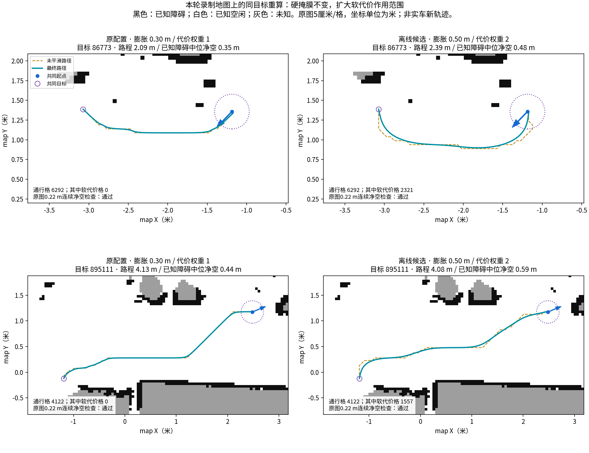

# NAV-018-STABILITY-001：自动建图稳定性优化实施记录

状态：独立候选实施、软件回归进行中。正式8080保持待命；本记录不表示已发布或已完成实车运动验收。

用户已批准实现、适配、构建、回归、备份和通过部分的8080待命部署。现场上电、实际运动和自动短退启用仍由操作者独立验收。原工程、可信检查点、失败图档和录包保留。

## 基线与故障区分

源码基线为 `/home/jetson/luhao/my_nav_carcar_point_navigation`，实施目录为 `/home/jetson/luhao/my_nav_carcar_stability_20261102`。独立副本建立时960个文件SHA一致并建立Git初始检查点。正式发布原路径仍是 `my_nav_carcar_return_nearby_release`。原根工作区源码较旧，不能整包覆盖正式发布。

14:52:53附近雷达、随后轮式反馈停止，操作者已确认关闭过电源／动力。此事实不能解释更早的两次错误回环，也不能解释上位机故障后停止缓存新观测的独立软件缺陷。后者已经用实际网关协议复现并修正：冻结地图写入和自动运动时，运行中的只读观测接收仍继续。

## 贴边分层证据

历史运行参数为全局软膨胀0.30米、衰减3.0，局部0.20米、衰减5.0，RPP近障减速距离0.30米。原图硬检查圆半径0.22米；5厘米栅格规划额外保留一个整格对角余量，因此规划圆约0.291米。矩形footprint为0.28×0.26米。软代价格不会自动成为禁行格；不能把网页颜色覆盖范围直接当作车身或不可通行宽度。

本轮闭合录包含最终 `/plan`，缺少与之匹配的 `/unsmoothed_plan` 和预测弧线，因此不能从历史录包单独断言Smac平滑或RPP切角是主因。离线对照采用同一历史原始地图、起点和目标，运行本机1.1.20真实InflationLayer与两个真实SubcellSmacPlanner实例，分别捕获未平滑和最终路径。硬掩膜及连续0.22米检查保持。

| 历史样本 | 原配置可通行格／带软代价格（静态重建） | 0.50米候选可通行格／带软代价格 | 原／候选路径中位参考点净空 | 原／候选路径长度 |
|---|---:|---:|---:|---:|
| 86773 | 6292／0 | 6292／2321 | 0.348／0.480米 | 2.094／2.387米 |
| 895111 | 4122／0 | 4122／1557 | 0.443／0.594米 | 4.128／4.080米 |

表中候选为0.50米、衰减3.0、两个规划器cost_travel_multiplier均为2.0。另测0.50／3.0／1.0，净空中位数分别为0.464／0.539米。两样本、三配置、两规划器共12条路径都通过硬净空审查。第一样本路径增加约14%，因此净空收益不能替代探索效率验收。

**静态重建与历史在线master必须区分：** 实际记录的全局master中，样本86773为6228个可通行格、214个软代价格（3.44%，图龄0.107秒）；895111为4080／142（3.48%，图龄0.571秒）。静态重建不包含当时全部实时障碍层，不能把上表零值说成历史在线master零值。两组证据均支持有效软梯度覆盖较窄；差异来自哪些层仍属推断，未作逐格因果归属。

图来自历史map坐标系的静态离线重建；路径可在同一子图中比较，非实车实时轨迹。三组名义宽度0.65／0.75／0.90米的直通道场景中，三配置、两规划器共18条规划均通过，可通行格数分别保持88／352／528，没有因软膨胀扩大而封死通道。此结果不代表所有实物通道已验收。

观测点新增已知实体障碍距离场的有界软偏好，0.45米以后不再奖励更远离障碍；未知区域不作为该距离场的障碍源。原连通性、视线、任务半径和硬净空筛选保留。10项观测点检查通过，包括窄门、地图增长、起点亚格余量、未知边界与奖励上限。

局部膨胀0.20／0.30／0.35米在贴墙、窄通道、已知直角和两条历史路径共15次Shim＋RPP闭环中均完成且满足硬净空；这批样本耗时一致，尚不能据此宣称减速流畅性得到改善。

官方依据：[Humble Smac](https://api.nav2.org/nav2-humble/html/md_nav2_smac_planner_README.html)、[Humble简单平滑器实现](https://api.nav2.org/nav2-humble/html/smoother_8cpp_source.html)。前者要求存在非零代价梯度才能让代价权重影响路线；后者不读取w_cost。当前未因猜测修改平滑器权重或进一步缩小前视。

## 已接入候选的故障恢复与控制

- 只读观测继续更新；定位失败、写图冻结与人工控制资格分开反馈。
- 受限人工接管沿用原task_id、request_id、operation_epoch、所有权、死手和单一速度出口。先取消恢复与导航，等待真实取消终态、冻结回执和轮式停稳；方向扫掠检查通过后最多0.05米/秒、0.10弧度/秒。未知方向、过期数据和断连保持零输出。重新检查通过仍由人工选择继续。
- 两次实际错误回环分别涉及158→591与159→592，不能只隔离一个重复约束就宣称恢复已解决。冻结图验证阶段临时关闭回环优化，恢复普通建图后恢复原参数；保留扫描匹配、正常回环、唯一性和多帧门槛。实际第二恢复边界回放中，未保护候选产生约1.669米错误修正；冻结验证候选无回环，匹配命中率0.97849、残差0.01438米。真实SLAM Toolbox＋AMCL恢复进程回归通过。
- 网页候选增加中止恢复、受限接管、分项原因、验证帧数与时间预算；规划器阻塞证据区分原图与实时障碍层，不再将所有实时层回波称作动态物体。

## 尚在验证的候选与失败证据

控制器比较使用本机Nav2 1.1.20真实RPP、Rotation Shim＋RPP、MPPI DiffDrive，以及真实速度平滑器和0.20秒执行延迟。Shim对短路径采样长度作项目适配。初轮MPPI短返程进展超时，尚无替换资格；所有候选的完整重复、负载和实际验收尚未结束。

原生1.1.20 Collision Monitor的APPROACH分支对max_points=0在初始检查使用“>=”，导致空点集也被判立即碰撞。该配置候选失败并保留，未启用；没有通过改为1来忽略单个未来回波。项目候选改在现有监督器中使用连续圆形扫掠、原图未知拒绝、独立激光端点、延迟及制动预测审查最终速度。三控制器临时障碍第一轮闭环通过，尚需完整安全与实时性回归；不把软件加速度配置视为实物制动测量。

自动等待／重新规划与短退使用独立开关。短退候选适配既有Nav2 BackUp动作，单次≤0.25米、速度≤0.03米/秒、累计≤0.75米、最多6次、总预算≤45秒；正式默认关闭。后方观测、扫掠与制动、取消终态、轮式有符号进展和停稳都须验证。适配回归进行中。

探索真实路径成本排序、四场景新旧各三轮、浏览器实际运行、并行负载及完整发布验收尚未完成。未通过的部分不得随已通过部分上线。

原始证据目录：`log/nav018_stability_20261102`。适用操作入口将在实施结束时统一写入操作手册；本文件不复制启动命令。

## 0.343秒底盘看门狗的追加定位

闭合录包14:35:12.1～14:35:13.1窗口中，`/mapping/cmd_vel`共20条，最大录包接收间隔51.4毫秒；底盘诊断最大接收间隔365.0毫秒，轮式反馈355.6毫秒。14:35:12.692诊断显示上次命令龄期0.343秒、驱动更新间隔0.329533秒、轮式采样间隔0.338529秒、采样读取延迟9.014毫秒，进入encoder_timing_recovery。该时刻前后上游仍发送约−0.22弧度/秒转向命令。

这将问题范围收敛到底盘进程接收／回调／调度环节，排除了该窗口中上位监督器整段停止发布速度这一解释。不能只凭附加录包接近启动时间就断言录包是唯一原因，也没有证据证明串口硬件故障。底盘现有Python单线程执行器的具体阻塞来源缺少当时进程跟踪；需要后续受看护负载观察。原0.3秒超时未改。只读提取程序和逐条时间在证据目录watchdog_window.py、watchdog-window.json。

控制器99次闭环补充：RPP33／33、改进Shim＋RPP33／33完成且安全；MPPI30／33，三个固定随机种子的短返程均进展超时，阻止替换。两条历史路径RPP／Shim耗时分别24.1／20.9秒、59.2／53.8秒，长路径反复走停2／0；MPPI历史路径中位数也没有优于Shim。测得控制计算最大值RPP0.905毫秒、Shim0.986毫秒、MPPI11.364毫秒；最终扫掠检查最大1.097毫秒。此数据来自独立闭环，完整SLAM／网页／快照／录包并行负载门槛尚待验证。三组MPPI固定种子产生不同轨迹，未把同一次噪声样本重复冒充多组随机对照。

等待／短退适配补充：27项几何、26项动作身份与轮式验证、5项真实Nav2 BackUp服务器、16项监督器集成全部通过，共74项；4项前向执行扫掠另通过。默认短退关闭的有界等待／重规划经过单独检查，后方未知／盲区、障碍进入、预算、取消后迟到成功、制动尾部与严格停稳交接均覆盖。
