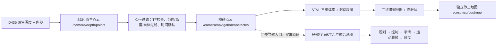

# 操作手册

最后更新：2026-10-25。当前学习／局部重构使用[38节](#38-链路学习与建图状态模块重构maint-002)，静止／单点入口分别见35.8／35.6；平板建图继续使用[33节](#33-平板随行建图nav-017)。机器／地址以现场读回为准，运动仍须满足当轮现场前提。

当前完整流程：19节主机RViz、31节有效STVL、33节平板建图、34节维护、35节巡检、36节相机优化、37节代理及38节链路学习。其余底层／旧实验专题保留原编号入口，完整命令和安全条件迁入[操作专题归档](archive/操作专题原文_20261014.md)，不要把历史候选当当前默认。测试结果只见[测试记录](测试记录.md)。

## 1. 四路编码器 A/B 对调后的连续键盘控制（MOTOR-015）

完整专题与安全/停止步骤：[归档原文](archive/操作专题原文_20261014.md#1-四路编码器-ab-对调后的连续键盘控制motor-015)。原测试资产和参数保留；是否适用当前实车以路线和台账为准。

<a id="11-构建"></a>
<a id="12-启动板载-pid-驱动"></a>
<a id="13-连续键盘控制"></a>
<a id="14-提速后的首次地面验收"></a>
<a id="15-rqt-在线临时调节板载-pid"></a>
<a id="16-将调优后的-pid-写入控制板-flash"></a>
<a id="17-逐轮正向动作确认测试左上右上左下右下"></a>
<a id="18-纯轮式编码器-odom-首次标定odom-001"></a>
<a id="181-构建"></a>
<a id="182-四轮输出轴-10-圈计数与方向"></a>
<a id="183-填入实测值后的-odom-验收"></a>

## 2. D435 低负载预览

完整专题与安全/停止步骤：[归档原文](archive/操作专题原文_20261014.md#2-d435-低负载预览)。原测试资产和参数保留；是否适用当前实车以路线和台账为准。


## 3. 整车模型离线检查

完整专题与安全/停止步骤：[归档原文](archive/操作专题原文_20261014.md#3-整车模型离线检查)。原测试资产和参数保留；是否适用当前实车以路线和台账为准。


## 4. 雷达

完整专题与安全/停止步骤：[归档原文](archive/操作专题原文_20261014.md#4-雷达)。原测试资产和参数保留；是否适用当前实车以路线和台账为准。

<a id="41-构建"></a>
<a id="42-启动"></a>
<a id="43-观察"></a>
<a id="44-停止"></a>

## 5. IMU 静止与人工旋转检查（IMU-001/IMU-002）

完整专题与安全/停止步骤：[归档原文](archive/操作专题原文_20261014.md#5-imu-静止与人工旋转检查imu-001imu-002)。原测试资产和参数保留；是否适用当前实车以路线和台账为准。

<a id="51-构建与环境准备"></a>
<a id="52-隔离驱动启动方式-a脚本方式-b完整命令"></a>
<a id="方式-a使用脚本启动推荐"></a>
<a id="方式-b完整原生命令启动"></a>
<a id="53-话题诊断与单发布者确认"></a>
<a id="54-水平静止-30-秒采样与日志保存"></a>
<a id="方式-a使用采样脚本推荐自动校验发布者并保存日志"></a>
<a id="方式-b完整原生命令执行"></a>
<a id="55-水平缓慢逆时针旋转-15-秒采样与轴向确认阶段二"></a>
<a id="方式-a使用旋转采样脚本推荐"></a>
<a id="方式-b完整原生命令执行-1"></a>
<a id="56-停止与恢复检查"></a>
<a id="方式-a使用脚本检查"></a>
<a id="方式-b原生检查命令"></a>
<a id="57-异常处置"></a>

## 6. SLAM Toolbox 建图链路冒烟验证（NAV-001）

完整专题与安全/停止步骤：[归档原文](archive/操作专题原文_20261014.md#6-slam-toolbox-建图链路冒烟验证nav-001)。原测试资产和参数保留；是否适用当前实车以路线和台账为准。

<a id="61-依赖安装与版本确认"></a>
<a id="62-工作区构建"></a>
<a id="63-串口状态与硬件安全确认"></a>
<a id="64-三终端独立启动"></a>
<a id="终端-1启动底盘驱动与模型-tf"></a>
<a id="终端-2启动激光雷达"></a>
<a id="终端-3启动-slam-toolbox-异步建图"></a>
<a id="65-只读链路诊断与观察"></a>
<a id="方式-a自动化链路检查脚本推荐"></a>
<a id="方式-b原生诊断命令与可视化"></a>
<a id="66-正常停止顺序"></a>
<a id="67-异常恢复与故障排查"></a>

## 7. 低速受控运动建图、回访一致性与地图保存验证（NAV-002）

完整专题与安全/停止步骤：[归档原文](archive/操作专题原文_20261014.md#7-低速受控运动建图回访一致性与地图保存验证nav-002)。原测试资产和参数保留；是否适用当前实车以路线和台账为准。

<a id="71-构建与环境准备"></a>
<a id="72-场地与地面标线准备"></a>
<a id="73-串口状态与电源门禁检查"></a>
<a id="74-六终端独立启动与链路检查"></a>
<a id="终端-1启动底盘驱动与整车模型-tf"></a>
<a id="终端-2启动激光雷达-1"></a>
<a id="终端-3启动-slam-toolbox-与专用-rviz"></a>
<a id="终端-4链路检查与-rosbag-记录"></a>
<a id="终端-5启动连续低速键盘控制"></a>
<a id="终端-6检查点采样与地图操作终端"></a>
<a id="75-四阶段受控运动执行步骤"></a>
<a id="阶段-0s0-起点基线"></a>
<a id="阶段-1s1-直线前进-10-m"></a>
<a id="阶段-2s2-原地逆时针旋转-360"></a>
<a id="阶段-3s3-沿原路径后退-10-m-返回起点"></a>
<a id="76-地图保存"></a>
<a id="77-正常停机顺序"></a>
<a id="78-地图离线单独重载与格式验证"></a>
<a id="79-异常处置与故障恢复"></a>

## 8. 静态地图定位与低速单点导航（NAV-003）

完整专题与安全/停止步骤：[归档原文](archive/操作专题原文_20261014.md#8-静态地图定位与低速单点导航nav-003)。原测试资产和参数保留；是否适用当前实车以路线和台账为准。

<a id="81-依赖安装与工程构建"></a>
<a id="82-地图独立重载前置检查"></a>
<a id="83-六终端独立启动与链路检查"></a>
<a id="终端-1底盘驱动与机器人模型发布"></a>
<a id="终端-2激光雷达驱动"></a>
<a id="终端-3静态地图定位"></a>
<a id="终端-4nav2-差速自主导航链路"></a>
<a id="rqt实时调整导航速度上限"></a>
<a id="终端-5链路只读诊断与-rosbag-数据录制"></a>
<a id="终端-6目标发送与位姿采样操作终端"></a>
<a id="84-原地定位与代价地图观察阶段一"></a>
<a id="85-短距离单点到点任务阶段二"></a>
<a id="851-直线到点约-10-m"></a>
<a id="852-转向到点含约-90-转角"></a>
<a id="853-旋转方向异常的最小复现与判别"></a>
<a id="86-停车与超时安全检查阶段三"></a>
<a id="861-行驶中取消目标停车"></a>
<a id="862-速度源中断与看门狗超时"></a>
<a id="87-障碍阻断安全停车阶段四"></a>
<a id="88-正常停机顺序"></a>

## 9. NAV-004：扩大建图与新地图重载

完整专题与安全/停止步骤：[归档原文](archive/操作专题原文_20261014.md#9-nav-004扩大建图与新地图重载)。原测试资产和参数保留；是否适用当前实车以路线和台账为准。

<a id="91-构建包含导航包"></a>
<a id="92-启动顺序共-4-个终端"></a>
<a id="93-建图路线要求"></a>
<a id="94-地图质量检查保存前目视验证"></a>
<a id="95-保存新地图带时间戳成对保存"></a>
<a id="96-独立重载验证新地图动态基线"></a>
<a id="97-停止与恢复"></a>

## 10. NAV-005：全局膨胀对照与雷达错位诊断

完整专题与安全/停止步骤：[归档原文](archive/操作专题原文_20261014.md#10-nav-005全局膨胀对照与雷达错位诊断)。原测试资产和参数保留；是否适用当前实车以路线和台账为准。

<a id="101-构建"></a>
<a id="102-启动使用新地图navigation-视图"></a>
<a id="103-扩展链路诊断含时间戳与-tf-变化"></a>
<a id="104-雷达错位诊断顺序"></a>
<a id="105-全局膨胀对照试验"></a>
<a id="106-录包含新增话题"></a>
<a id="107-停止与恢复"></a>

## 11. NAV-006：Groot BT 日志桥接与状态观察

完整专题与安全/停止步骤：[归档原文](archive/操作专题原文_20261014.md#11-nav-006groot-bt-日志桥接与状态观察)。原测试资产和参数保留；是否适用当前实车以路线和台账为准。

<a id="111-groot-1-本机构建首次一次性操作"></a>
<a id="112-构建桥接节点"></a>
<a id="113-启动桥接节点导航链路-active-后"></a>
<a id="114-启动-groot-并连接"></a>
<a id="115-验证同步状态"></a>
<a id="116-中途接入说明"></a>
<a id="117-失联检测"></a>
<a id="118-停止顺序"></a>

## 12. NAV-007/NAV-010/NAV-011：实验定位恢复、垃圾桶绕障与终端状态会话录包

完整专题与安全/停止步骤：[归档原文](archive/操作专题原文_20261014.md#12-nav-007nav-010nav-011实验定位恢复垃圾桶绕障与终端状态会话录包)。原测试资产和参数保留；是否适用当前实车以路线和台账为准。

<a id="121-实验边界与当前约束"></a>
<a id="122-构建与离线检查"></a>
<a id="123-实车启动前安全检查"></a>
<a id="124-五终端启动"></a>
<a id="1241-导航会话分析时间线与离线回看工具-nav_log_tool"></a>
<a id="125-参数快照观察和录包"></a>
<a id="126-验收顺序和停止回退"></a>

## 13. 导航受阻目标排查与提取命令 (NAV-008 / NAV-011 诊断工具)

完整专题与安全/停止步骤：[归档原文](archive/操作专题原文_20261014.md#13-导航受阻目标排查与提取命令-nav-008--nav-011-诊断工具)。原测试资产和参数保留；是否适用当前实车以路线和台账为准。

<a id="131-查看历史受阻目标点清单-只读"></a>
<a id="132-诊断最新一次的导航失败现场"></a>
<a id="133-一键提取重放命令"></a>

## 14. NAV-012：墙角绕行、进展停滞识别与有序脱困实验 (套餐 B + 进阶恢复)

完整专题与安全/停止步骤：[归档原文](archive/操作专题原文_20261014.md#14-nav-012墙角绕行进展停滞识别与有序脱困实验-套餐-b--进阶恢复)。原测试资产和参数保留；是否适用当前实车以路线和台账为准。

<a id="141-适用范围"></a>
<a id="142-完整构建与启动步骤"></a>
<a id="步骤-1全量构建与环境加载"></a>
<a id="步骤-2启动底盘与模型-tf-终端-1"></a>
<a id="步骤-3启动雷达驱动-终端-2"></a>
<a id="步骤-4启动实验定位-终端-3板上不要开-rviz"></a>
<a id="步骤-5启动-nav-012-实验导航-终端-4"></a>
<a id="步骤-6下发测试导航目标-终端-5"></a>
<a id="143-状态观察与诊断命令-只读"></a>
<a id="144-现场会话归档与时间线审查"></a>
<a id="145-停止与异常处置"></a>

## 15. Rosmaster 板载声光指示器测试（DRV-004）

完整专题与安全/停止步骤：[归档原文](archive/操作专题原文_20261014.md#15-rosmaster-板载声光指示器测试drv-004)。原测试资产和参数保留；是否适用当前实车以路线和台账为准。

<a id="151-适用范围安全边界与串口互斥要求"></a>
<a id="152-构建步骤"></a>
<a id="153-启动与运行步骤"></a>
<a id="选项-a离线校验模式-默认-dry-run无需实车硬件"></a>
<a id="选项-b实车硬件测试模式-连接控制板现场执行"></a>
<a id="选项-c独立关停声光模式-复位恢复"></a>
<a id="154-应急处置与故障排查"></a>

## 16. 导航状态观测与多维停车阻断归因诊断（NAV-013）

完整专题与安全/停止步骤：[归档原文](archive/操作专题原文_20261014.md#16-导航状态观测与多维停车阻断归因诊断nav-013)。原测试资产和参数保留；是否适用当前实车以路线和台账为准。

<a id="161-适用范围"></a>
<a id="162-实时观测命令-只读"></a>
<a id="1-实时查看导航聚合状态与停车归因诊断"></a>
<a id="2-实时跟随终端单行-1-hz-摘要"></a>
<a id="163-离线会话停车与阻断归因审查命令"></a>
<a id="1-查看会话列表录包状态与分类"></a>
<a id="2-查看-7-列停车与阻断时间线及多维归因分析"></a>
<a id="3-查看会话内所有故障超时与拒绝事件汇总"></a>
<a id="164-轻量化日志与按需录包"></a>

## 17. 导航声光提示与停车原因诊断系统（NAV-014）

完整专题与安全/停止步骤：[归档原文](archive/操作专题原文_20261014.md#17-导航声光提示与停车原因诊断系统nav-014)。原测试资产和参数保留；是否适用当前实车以路线和台账为准。

<a id="171-适用范围与核心能力"></a>
<a id="172-构建与全套回归测试命令"></a>
<a id="173-启动导航与声光指示集成-多终端操作流"></a>
<a id="终端-1启动底盘驱动与整车模型-tf-1"></a>
<a id="终端-2启动激光雷达-2"></a>
<a id="终端-3启动实验定位与定位健康门控板上不要开-rviz"></a>
<a id="终端-4启动实验导航链路与声光指示系统"></a>
<a id="终端-5只读全链路验收"></a>
<a id="终端-6可选-rqt-参数界面"></a>
<a id="可选参数启动示例"></a>
<a id="174-实时观测与诊断命令"></a>
<a id="175-独立底盘驱动安全隔离与转发规范特例说明"></a>
<a id="176-异常排查与急停恢复"></a>
<a id="177-使用-rqt-实时调节代价地图膨胀参数区域半径递减程度"></a>
<a id="1-启动-rqt-动态调参界面"></a>
<a id="2-核心膨胀参数与-rqt-节点路径对照表"></a>
<a id="3-命令行快速动态修改替代-rqt-脚本"></a>

## 18. NAV-012 回调、恢复监督与速度联锁修复

完整专题与安全/停止步骤：[归档原文](archive/操作专题原文_20261014.md#18-nav-012-回调恢复监督与速度联锁修复)。原测试资产和参数保留；是否适用当前实车以路线和台账为准。

<a id="181-范围流程与边界"></a>
<a id="182-构建与隔离离线验证"></a>
<a id="183-启动与只读观察"></a>
<a id="184-实车验收停止与回退"></a>
<a id="185-开源来源版本与适配"></a>

## 19. Ubuntu 主机 RViz 联调

用途：车上继续跑底盘、雷达、定位和导航；Ubuntu 22.04 电脑只显示地图并点初始位姿/目标。不改固件、不改串口、不在 Jetson 上启动 `rviz2`。V2.0 是主机改为 Ubuntu 开发之前的最后一次快照；此后按本节联调。

RViz 配置可依据当前话题、QoS、性能和诊断需求直接优化，无需在每次修改前逐项征求确认；每次交付必须列出实际显示组件、话题、`Fixed Frame`、QoS 和关键视觉参数，便于现场核对。项目内 `navigation_lite.rviz` 是当前配置真源，Hao 的 `~/navigation_lite.rviz` 是同步副本。

### 19.0 两台机器与终端分工（2026-10-07 当前台式机已核对）

2026-10-07：用户确认有两台电脑，笔记本hao@bao在公司，当前使用台式机luhao@Hao；本地输出确认hostname=Hao、wlp4s0f0=192.168.5.17/24。此前bao地址192.168.5.36不可达不代表台式机不可用；旧文档将Hao标为Windows/历史入口的说法不适用于当前现场。切换电脑或DHCP变化时，以下在眼前Ubuntu电脑本地终端执行，不先SSH；只查看机器名和IPv4地址，不修改网络或小车硬件。预期看到当前主机名及局域网地址，忽略lo及Docker网桥；多地址时保留完整输出供核对。命令立即退出，异常Ctrl+C，无需回滚。

```bash
cd "$HOME"
hostname
ip -4 -br address
```

Cursor的项目工作区和车上节点在 **Jetson**，用户当前坐在台式机 **Hao** 前面。不要把Hao本机终端当成已经登录上车。

| 角色 | 用户 / 主机名 | 当前地址 | 日常干什么 |
|---|---|---|---|
| 车 | `jetson@xiaozhu` | `192.168.5.11` | 底盘、雷达、定位、导航；不要开 `rviz2` |
| 当前联调台式机 | `luhao@Hao` | `192.168.5.17/24`（2026-10-07本地读取） | 当前Ubuntu开发/RViz主机，DHCP变化时重新核对 |
| 笔记本（本轮不在现场） | `hao@bao` | 历史 `192.168.5.36`，当前未核对 | 用户确认在公司，不使用旧地址推断当前显示状态 |
| 图形会话 | `Hao` 本地X11桌面 | 本轮读到 `DISPLAY=:1`、`XAUTHORITY=/run/user/1000/gdm/Xauthority` | RViz在用户已登录桌面运行，不在Jetson启动；不要沿用bao的:0 |
| 车上→当前电脑 | 本轮免密SSH已连通 | `ssh -i /home/jetson/.ssh/id_ed25519 luhao@192.168.5.17` | 只读核对hostname/IP/RViz，旧渲染结论不代表当前状态 |

Hao 本机要跑车上节点时，每个窗口先：

```bash
ssh jetson@192.168.5.11
```

登录后再 `cd /home/jetson/luhao/my_nav_carcar` 并按第 12.4 / 18.3 节启动。RViz 窗口**不要** SSH。

| Hao 本机窗口 | 先做什么 | 再跑什么 |
|---|---|---|
| 1～5 | `ssh jetson@192.168.5.11` | 第 12.4 节终端 1～5（底盘、雷达、实验定位、实验导航、诊断） |
| 6 | 不要 SSH | [第 19.4 节](#194-电脑上确认连通并打开轻量-rviz) 本机轻量 RViz |

### 19.1 必须对齐的环境

| 项目 | 车上现在的值 | 电脑上也要一样 |
|---|---|---|
| 系统 | Ubuntu 22.04 | Ubuntu 22.04 |
| ROS | Humble | Humble |
| Wi‑Fi | `小泽` | 同一 Wi‑Fi，不要用手机热点另一张网 |
| 地址 | `192.168.5.11`（`xiaozhu`） | `192.168.5.36`（`bao`，以当时 `ip a` 为准） |
| ROS 域 | `ROS_DOMAIN_ID=31` | `export ROS_DOMAIN_ID=31` |
| 本机隔离 | `ROS_LOCALHOST_ONLY=0` | 同样设为 0，或干脆不设 |
| DDS | 默认 Fast DDS | 先不要改 `RMW_IMPLEMENTATION` |

车上 `~/.bashrc` 已写入域号 31 和 `ROS_LOCALHOST_ONLY=0`，无需再改系统服务。电脑每个新终端先：

```bash
source /opt/ros/humble/setup.bash
export ROS_DOMAIN_ID=31
export ROS_LOCALHOST_ONLY=0
```

可写进电脑的 `~/.bashrc`，避免忘。域号不一致时，`ros2 topic list` 是空的。

### 19.2 电脑上最少安装

不要一上来克隆整车工程。先装桌面版 Humble 和 RViz：

```bash
sudo apt update
sudo apt install ros-humble-desktop ros-humble-rviz2 ros-humble-nav2-msgs
```

`ros-humble-desktop` 已含 RViz、常用消息和 TF。点目标和看地图够用。

若 `apt` 提示锁被 `unattended-upgr` 占用，等它自己结束后再装。不要删 `/var/lib/dpkg/lock-frontend`，也不要 `kill -9`。车上代理没有 Hao 的 sudo，装包由 Hao 本机执行。

### 19.3 车上怎么开（不要再起 RViz）

底盘、雷达、实验导航仍按[第 12.3～12.4 节](archive/操作专题原文_20261014.md#123-实车启动前安全检查)和[第 18.3 节](archive/操作专题原文_20261014.md#183-启动与只读观察)。定位必须显式关闭板上 RViz：

```bash
cd /home/jetson/luhao/my_nav_carcar
source /opt/ros/humble/setup.bash && source install/setup.bash
export ROS_DOMAIN_ID=31
export ROS_LOCALHOST_ONLY=0
ros2 launch carcar_navigation localization_experimental.launch.xml \
  map:=$(pwd)/src/carcar_navigation/maps/nav004_20260914_093032.yaml \
  use_rviz:=false
```

Jetson 上不要再开 `rviz2`，也不要用 VNC 看三维窗口。声光、倒车、联锁仍在车上；终端 4 的一行中文摘要仍可在车上或 SSH 里看。

### 19.4 电脑上确认连通并打开轻量 RViz

电脑和车都上电、导航起来后，Hao 上先写 Fast DDS 单播发现（Wi‑Fi 组播对 Nav2 多进程经常只发现到一部分节点）。地址按当时 `ip a` 改；车上仍是 `192.168.5.11`，域 31 对应端口 `15150`：

```bash
cat > ~/fastdds_wifi.xml << 'EOF'
<?xml version="1.0" encoding="UTF-8" ?>
<profiles xmlns="http://www.eprosima.com/XMLSchemas/fastRTPS_Profiles">
  <participant profile_name="wifi_peer" is_default_profile="true">
    <rtps>
      <builtin>
        <initialPeersList>
          <locator>
            <udpv4>
              <address>192.168.5.11</address>
              <port>15150</port>
            </udpv4>
          </locator>
        </initialPeersList>
      </builtin>
    </rtps>
  </participant>
</profiles>
EOF
```

同一台电脑只开一个 `rviz2`。若已经有窗口，先关掉再开。旧的 `ros2` 守护进程会缓存半截图，开之前停掉：

```bash
source /opt/ros/humble/setup.bash
export ROS_DOMAIN_ID=31
export ROS_LOCALHOST_ONLY=0
export FASTRTPS_DEFAULT_PROFILES_FILE=$HOME/fastdds_wifi.xml
ros2 daemon stop
ros2 topic info /map -v
```

这里要看 **Publisher count 是否为 1**（`map_server`）。只看 `ros2 topic list` 不够：本机 RViz 订阅 `/map` 后，列表里也会出现这个名字。再：

```bash
ros2 topic echo /localization_monitor/ready --qos-durability transient_local --once
```

`data: true` 后再点目标。未给 **2D Pose Estimate** 时这里是 `false`，属正常。

首次使用或车模文件缺失时，把轻量配置和车模实体文件拷到电脑。以下命令在 Hao 本机执行，读取 Jetson 工作区并写入 Hao 的 `~/navigation_lite.rviz` 和 `~/ros_overlay/carcar_description/`，不改车上文件、不启动硬件；再次执行会用车上同名文件更新本地副本。异常可按 Ctrl+C 停止，删除这两个本地副本即可恢复到执行前无覆盖的状态：

```bash
mkdir -p ~/ros_overlay/carcar_description
scp jetson@192.168.5.11:/home/jetson/luhao/my_nav_carcar/src/carcar_navigation/rviz/navigation_lite.rviz ~/navigation_lite.rviz
rsync -aL jetson@192.168.5.11:/home/jetson/luhao/my_nav_carcar/install/carcar_description/ ~/ros_overlay/carcar_description/
find ~/ros_overlay/carcar_description/share/carcar_description/meshes -type f -name '*.stl'
```

当前构建产物实测有 10 个 STL，其中包含 `mecanum_wheel_left.stl` 和 `mecanum_wheel_right.stl`；没有列出时不要启动 RViz，先检查复制错误。然后在同一 Hao 本机终端启动 RViz：

```bash
source /opt/ros/humble/setup.bash
export AMENT_PREFIX_PATH=$HOME/ros_overlay/carcar_description:/opt/ros/humble
export FASTRTPS_DEFAULT_PROFILES_FILE=$HOME/fastdds_wifi.xml
export ROS_DOMAIN_ID=31
export ROS_LOCALHOST_ONLY=0
export QT_QPA_PLATFORM=xcb
rviz2 -d ~/navigation_lite.rviz
```

Fixed Frame 为 `map`。预置显示：Grid、Map（`/map`，Reliable + Transient Local）、Global/Local Costmap（Reliable + Transient Local）、LaserScan（`/scan`，Best Effort）、AMCL Pose（Reliable）、Odometry（`/wheel/odometry`，Best Effort）、Global/Local Plan（Reliable）、Footprint、RobotModel（`/robot_description`，Reliable + Transient Local）、精简 TF（不展开全部连杆）。全局路径 `/plan` 使用青色 Billboard、宽 0.04 m；局部路径 `/local_plan` 使用亮黄色 Billboard、宽 0.07 m、`Z=0.08 m`，并只保留最新轨迹。帧率保持 15。车模网格在 Hao 上还需本机有 `carcar_description`（可把车上 `install/carcar_description` 拷到 `~/ros_overlay/carcar_description` 并加入 `AMENT_PREFIX_PATH`）。用 **2D Pose Estimate**（`/initialpose`）和 **2D Goal Pose**（`/goal_pose`）。不要改用完整 `navigation.rviz`。

2026-09-30 当前 `hao@bao` 已用硬件 OpenGL 4.6 短时打开 RViz，无需强制 Mesa 软件渲染；真实 OccupancyGrid 着色仍待实际地图画面确认。2026-09-18 旧 `luhao@Hao` 上的 `llvmpipe` 曾能收到 `259×230` 的 `/map`，但 `indexed_8bit_image` 链接失败，Map / Costmap 橙灯、主视图只剩格子；这是旧电脑的历史显示问题，不能据此判断新电脑地图为空。若新电脑出现相同着色错误，先查话题发布者与消息，再单独处理显卡显示。

### 19.5 若电脑上看不到话题

按这个顺序查：

1. 电脑 `ip a` 是否也是 `192.168.5.x`，能否 `ping 192.168.5.11`
2. 两边 `echo $ROS_DOMAIN_ID` 都是 `31`
3. Hao 是否已加载 `FASTRTPS_DEFAULT_PROFILES_FILE=$HOME/fastdds_wifi.xml`，且 XML 里车上地址、端口与第 19.4 节一致
4. 暂时关掉两边防火墙：`sudo ufw disable`（通了再按需打开）
5. 电脑不要开 VPN
6. 车上 `ros2 node list` 里应有 `/amcl`、`/bt_navigator`，且 **只有一个** `/rviz`；Hao 上 `ps -C rviz2` 只能有一行
7. Map 橙灯且日志有 `GLSL link result`：先核对地图话题有发布者和消息，再按第 19.4 节检查渲染；不能仅凭橙灯判断地图为空

`ros2 topic info /map -v` 的 Publisher count 仍为 0 时，把电脑 IP、该命令输出和 `ps -C rviz2` 发回即可。

### 19.6 远程桌面还能否连车上 GNOME

可以。车上 `x11vnc.service` 仍在监听 `192.168.5.11:5901`，开机自启，密码见桌面文档 [`/home/jetson/Desktop/系统配置维护记录.md`](file:///home/jetson/Desktop/系统配置维护记录.md)。电脑换成 Ubuntu 22.04 后：

```bash
sudo apt install tigervnc-viewer
xtigervncviewer 192.168.5.11:5901
```

或打开自带的 Remmina，协议选 VNC，服务器填 `192.168.5.11:5901`。这只用来看板上桌面、终端或紧急操作。日常点目标用本节的本机轻量 RViz，不要经 VNC 画三维窗口。

### 19.7 旧 `luhao@Hao` 的软件渲染记录（历史，不作当前入口）

以下命令仅记录 2026-09-18 旧 `luhao@Hao` 的实际操作；该地址当前不是 `hao@bao`，不要在新电脑上执行本节旧的远程打开命令。新电脑的静止深度画面用第 19.11 节，常规轻量 RViz 用第 19.4 节。旧机曾因 NVIDIA 内核与用户态不一致而需 Mesa `llvmpipe`，且 OccupancyGrid 着色失败；新电脑已用硬件 OpenGL 4.6 短时打开 RViz，真实栅格着色待现场验证。

从车上检查 Hao 是否能看见车上的地图发布者：

```bash
ssh -o BatchMode=yes -i /home/jetson/.ssh/id_ed25519 luhao@192.168.5.17 \
  'source /opt/ros/humble/setup.bash
   export ROS_DOMAIN_ID=31 ROS_LOCALHOST_ONLY=0
   export FASTRTPS_DEFAULT_PROFILES_FILE=$HOME/fastdds_wifi.xml
   ros2 daemon stop >/dev/null
   ros2 topic info /map -v'
```

Publisher count 应为 1。从车上在 Hao 桌面用软件渲染打开轻量 RViz（会占用 Hao 屏幕；先杀掉旧窗口，只留一个）：

```bash
ssh -o BatchMode=yes -i /home/jetson/.ssh/id_ed25519 luhao@192.168.5.17 \
  'export DISPLAY=:1 XAUTHORITY=/run/user/1000/gdm/Xauthority
   source /opt/ros/humble/setup.bash
   export AMENT_PREFIX_PATH=$HOME/ros_overlay/carcar_description:/opt/ros/humble
   export FASTRTPS_DEFAULT_PROFILES_FILE=$HOME/fastdds_wifi.xml
   export ROS_DOMAIN_ID=31 ROS_LOCALHOST_ONLY=0
   export QT_QPA_PLATFORM=xcb __GLX_VENDOR_LIBRARY_NAME=mesa
   export LIBGL_ALWAYS_SOFTWARE=1 GALLIUM_DRIVER=llvmpipe
   killall -q rviz2 || true
   sleep 1
   nohup rviz2 -d $HOME/navigation_lite.rviz >/tmp/rviz2_lite.log 2>&1 &
   disown'
```

覆盖目录缺失时统一按[第 19.4 节](#194-电脑上确认连通并打开轻量-rviz)从 Hao 本机复制，避免维护第二套复制命令。Hao 本机自己开 RViz 仍用第 19.4 节那组环境变量。重启 Hao 后若 `glxinfo -B` 已是 NVIDIA，可去掉 `LIBGL_*` 四行再试。

### 19.8 日常六终端开发与导航复测（2026-09-20 实测入口）

这是后续开发本车的固定入口：Hao 的 1～5 号终端分别 SSH 到 Jetson，运行底盘、雷达、实验定位、实验导航和只读诊断；6 号终端留在 Hao 本机运行轻量 RViz。2026-09-20 用户现场确认，这套跨机启动、DDS 通信和实体车模加载流程可以完整走通。该结论只确认开发环境与启动链路，不代表 NAV-012-R6 突发障碍绕行已经实车通过。

终端 1 会打开控制板串口，终端 2 会启动雷达电机，终端 4 收到目标后会驱动车轮。开始前清空车周围区域，保持 12 V 电机开关可立即触及；异常运动先断开 12 V，再停止终端。所有 Launch 正常停止均使用一次 `Ctrl+C`，不要直接关闭 SSH 窗口。

#### 19.8.0 代码更新后的构建（仅在代码发生变化时）

用途：在启动硬件前编译当前导航、底盘和 Bringup，并运行导航 C++ 回归。它只写 Jetson 工作区的 `build/`、`install/`、`log/`，不打开串口、不启动雷达和电机。执行前先正常停止旧导航和底盘；异常按 `Ctrl+C`，保留输出排查，构建或测试失败时不要进入实车启动。

先在 Hao 任意终端登录 Jetson：

```bash
ssh jetson@192.168.5.11
```

确认提示符变为 `jetson@xiaozhu` 后执行：

```bash
cd /home/jetson/luhao/my_nav_carcar
conda deactivate 2>/dev/null || true
source /opt/ros/humble/setup.bash
CMAKE_BUILD_PARALLEL_LEVEL=2 colcon build --symlink-install \
  --packages-select carcar_description carcar_navigation carcar_bt_monitor carcar_base carcar_bringup \
  --executor sequential
source install/setup.bash
ROS_DOMAIN_ID=211 ROS_LOCALHOST_ONLY=1 colcon test \
  --packages-select carcar_description carcar_navigation carcar_bt_monitor \
  --executor sequential --event-handlers console_direct+
colcon test-result --test-result-base build/carcar_navigation --verbose
colcon test-result --test-result-base build/carcar_description --verbose
```

预期所有包构建成功且测试无失败。测试域 211 仅作用于该条命令，不用于实车。

#### 19.8.1 第 1～5 号终端共同的 SSH 步骤

Hao 的第 1～5 号终端都先分别执行下面一行，等待登录完成后再复制各自章节的车上命令：

```bash
ssh jetson@192.168.5.11
```

每个终端都必须看到 `jetson@xiaozhu`，不能在 `luhao@Hao` 提示符下执行车上 Launch。第 6 号终端禁止 SSH。

#### 19.8.2 终端 1：底盘、轮式里程计和模型 TF

用途：确认控制板串口存在且未被旧驱动占用，然后打开真实底盘串口并发布启动零速度、轮式里程计、整车描述和 TF。它会连接电机控制板；异常运动先断 12 V，再按 `Ctrl+C`。预期无串口占用错误，静止时速度为零。

```bash
cd /home/jetson/luhao/my_nav_carcar
conda deactivate 2>/dev/null || true
source /opt/ros/humble/setup.bash
source install/setup.bash
export ROS_DOMAIN_ID=31
export ROS_LOCALHOST_ONLY=0
test -e /dev/myserial || { echo '控制板串口不存在，停止启动'; exit 1; }
if fuser /dev/myserial >/dev/null 2>&1; then
  echo '控制板串口已被其他进程占用，停止启动'
  fuser -v /dev/myserial
  exit 1
fi
ros2 launch carcar_bringup robot.launch.xml
```

#### 19.8.3 终端 2：RPLIDAR A1

用途：打开雷达串口、启动雷达电机并发布 `/scan`，不主动驱动车轮。确认终端 1 正常后执行；预期雷达持续旋转且没有串口反复重连，停止使用 `Ctrl+C`。

```bash
cd /home/jetson/luhao/my_nav_carcar
conda deactivate 2>/dev/null || true
source /opt/ros/humble/setup.bash
source install/setup.bash
export ROS_DOMAIN_ID=31
export ROS_LOCALHOST_ONLY=0
ros2 launch carcar_lidar lidar.launch.xml
```

#### 19.8.4 终端 3：实验定位

用途：加载当前地图、AMCL 和只读定位健康门控，不在 Jetson 打开 RViz。未在 Hao RViz 给出初始位姿时 `/localization_monitor/ready=false` 属正常；停止使用 `Ctrl+C`。

```bash
cd /home/jetson/luhao/my_nav_carcar
conda deactivate 2>/dev/null || true
source /opt/ros/humble/setup.bash
source install/setup.bash
export ROS_DOMAIN_ID=31
export ROS_LOCALHOST_ONLY=0
ros2 launch carcar_navigation localization_experimental.launch.xml \
  map:=/home/jetson/luhao/my_nav_carcar/src/carcar_navigation/maps/nav004_20260914_093032.yaml \
  use_rviz:=false
```

#### 19.8.5 终端 4：实验导航、联锁和会话记录

用途：启动 Smac 2D、DWB、恢复监督、最终速度联锁和导航日志。当前实验上限为 `0.30 m/s`，前进预测 1.7 s；旧任务失败后，新目标会先确认旧动作结束、车辆停稳和输入健康，再获得新的有限恢复额度。发送目标后会真实驱动车轮；必须在空旷区域操作，异常运动先断 12 V。专项复测开启持续原始录包，每 1 GiB 分卷，磁盘低于 2 GiB 时只停止录包；日常不需还原路径几何时可把最后一项改为 `false`。

```bash
cd /home/jetson/luhao/my_nav_carcar
conda deactivate 2>/dev/null || true
source /opt/ros/humble/setup.bash
source install/setup.bash
export ROS_DOMAIN_ID=31
export ROS_LOCALHOST_ONLY=0
ros2 launch carcar_navigation navigation_experimental.launch.xml \
  record_raw_bag:=true
```

预期联锁初始保持关闭、最终速度为零，并显示会话日志和原始 rosbag 正在记录。完成终端 5 和 RViz 检查前不要发送目标。

#### 19.8.6 终端 5：只读链路与恢复诊断

用途：只读检查生命周期、雷达、轮式里程计、定位门控、最终速度发布者和当前会话配置，然后持续观察恢复事件；不会发布运动指令。`ros2 topic echo` 按 `Ctrl+C` 只会停止观察，不会停止导航。

```bash
cd /home/jetson/luhao/my_nav_carcar
conda deactivate 2>/dev/null || true
source /opt/ros/humble/setup.bash
source install/setup.bash
export ROS_DOMAIN_ID=31
export ROS_LOCALHOST_ONLY=0
ros2 run carcar_navigation check_nav_link
CARCAR_LATEST_SESSION=$(find log/nav_sessions -mindepth 1 -maxdepth 1 -type d | sort | tail -1)
echo "$CARCAR_LATEST_SESSION"
grep -nE 'SmacPlanner2D|max_observe_replans' "$CARCAR_LATEST_SESSION/active_config.yaml"
ros2 param get /rosmaster_base max_linear_x
ros2 param get /controller_server FollowPath.max_vel_x
ros2 param get /controller_server FollowPath.sim_time
ros2 param get /velocity_smoother max_velocity
ros2 topic info /cmd_vel --verbose
ros2 topic echo /recovery/status
```

预期配置包含 `nav2_smac_planner/SmacPlanner2D` 和 `recovery.max_observe_replans: 1`；未加底盘速度覆盖时，四项参数查询依次得到 `0.18`、`0.30`、`1.7` 和含 `0.30` 的数组；实际前进速度受底盘 `0.18 m/s` 限制；`/cmd_vel` 只有 `navigation_motion_gate` 一个发布者。用 Hao RViz 给出初始位姿后，先按 `Ctrl+C` 停止 echo，再重新执行 `ros2 run carcar_navigation check_nav_link`；只有 `/localization_monitor/ready=TRUE` 才能发送目标。

#### 19.8.7 终端 6：Hao 本机轻量 RViz

本终端始终保留在 `luhao@Hao`，不要 SSH。车模首次使用、模型更新或 `ros2 pkg prefix carcar_description` 报 `Package not found` 时，先执行下面的同步命令。它读取 Jetson 安装目录，写入 Hao 用户目录，不改车上文件、不启动硬件；中途可按 `Ctrl+C`，重新执行即可恢复完整副本。

```bash
mkdir -p /home/luhao/ros_overlay/carcar_description
scp jetson@192.168.5.11:/home/jetson/luhao/my_nav_carcar/src/carcar_navigation/rviz/navigation_lite.rviz \
  /home/luhao/navigation_lite.rviz
rsync -aL --info=progress2 \
  jetson@192.168.5.11:/home/jetson/luhao/my_nav_carcar/install/carcar_description/ \
  /home/luhao/ros_overlay/carcar_description/
find /home/luhao/ros_overlay/carcar_description/share/carcar_description/meshes \
  -type f -name '*.stl'
```

预期列出实体 STL，包含左右麦克纳姆轮、新相机支架和两件舵机固定脚；不再以旧模型的 7 个文件作为验收数量。日常启动 RViz 执行：

```bash
source /opt/ros/humble/setup.bash
export AMENT_PREFIX_PATH=/home/luhao/ros_overlay/carcar_description:/opt/ros/humble
export FASTRTPS_DEFAULT_PROFILES_FILE=/home/luhao/fastdds_wifi.xml
export ROS_DOMAIN_ID=31
export ROS_LOCALHOST_ONLY=0
export QT_QPA_PLATFORM=xcb
export __GLX_VENDOR_LIBRARY_NAME=mesa
export LIBGL_ALWAYS_SOFTWARE=1
export GALLIUM_DRIVER=llvmpipe
ros2 daemon stop
ros2 pkg prefix carcar_description
ros2 topic info /map -v
rviz2 -d /home/luhao/navigation_lite.rviz
```

模型包前缀应为 `/home/luhao/ros_overlay/carcar_description`，`/map` 的 Publisher count 应为 1。刚停止 daemon 后若短暂出现 `Unknown topic '/map'`，等待发现完成再检查；RViz 后来收到 `259×230` 地图也可证明跨机通信已建立。配置文件名必须是 `navigation_lite.rviz`，不能写成 `navigation_lite.rvizion`。Hao 当前使用 llvmpipe 时，`indexed_8bit_image` 报错属于已知栅格着色问题；它与 `Package [carcar_description] does not exist` 是两个独立故障，后者必须通过实体覆盖目录解决。

RViz 打开后先用 **2D Pose Estimate** 给出真实位置和车头方向，等终端 5 确认定位门控为 TRUE，再用 **2D Goal Pose**。实车突发障碍复测使用能达到雷达扫描平面的纸箱，从侧面在车前约 0.8～1.0 m 放入；人员和手不得进入车道。

轻量配置中的 Global Plan 为青色 `0.04 m` Billboard；Local Plan 为亮黄色 `0.07 m` Billboard，并抬高 `0.08 m` 避免被车模和地图遮住。`/local_plan` 保持 Reliable、Volatile、Depth 1，只显示最新局部轨迹。正常行驶时 1.7 s 预测在 `0.30 m/s` 上限下最长约 0.51 m；低速、停车和原地旋转时自然更短。

#### 19.8.8 正常停止和异常恢复

正常停止：不再发送目标并确认车辆停住；终端 4 `Ctrl+C` 停导航和速度联锁，终端 3 停定位，终端 2 停雷达，终端 1 最后停底盘；终端 5 停只读 echo，终端 6 关闭 RViz。异常运动：先物理断开 12 V 电机电源，再停止终端 4，最后依次停止其余终端。SSH 意外断开时底盘既有 0.30 秒命令看门狗应停车，但不能用它代替物理急停。

### 19.9 Hao 到 Jetson 的专用免密 SSH

用途：让 Hao 的新终端通过别名 `jetson` 或地址 `192.168.5.11` 直接登录车上。下面只读写两端用户目录中的 `~/.ssh/config`、专用 Ed25519 密钥和 `authorized_keys`，不保存登录密码，不修改 `/etc/ssh/` 或 SSH 服务，也不启动硬件。首次备份车上密钥清单和送入公钥时会在终端交互询问现有密码；输入内容不回显。中途异常可按 `Ctrl+C`，按末尾回滚步骤恢复备份。

**当前状态（2026-09-30）**：新电脑 `hao@bao` 已完成安装。`~/.ssh/config` 使用专用 `/home/hao/.ssh/id_ed25519_jetson`，并设置 `IdentitiesOnly yes`；Jetson 的 `authorized_keys.bao_20260930.backup` 保留了安装前完整内容。`ssh -o BatchMode=yes jetson` 与 `ssh -o BatchMode=yes 192.168.5.11` 都已返回 `jetson@xiaozhu`，没有密码交互。反向 `jetson → hao@bao` 的密钥登录也已实测。日常只需在 `bao` 新终端执行 `ssh jetson`，不需要重复运行下面的首次安装命令。旧 `luhao@Hao` 的授权键保留。

首次安装在 Hao 本机执行：

```bash
set -e
umask 077
mkdir -p /home/hao/.ssh
test -e /home/hao/.ssh/config.backup || \
  cp -p /home/hao/.ssh/config /home/hao/.ssh/config.backup
test -e /home/hao/.ssh/id_ed25519_jetson || \
  ssh-keygen -t ed25519 -N '' \
    -C 'hao@bao to jetson@xiaozhu' \
    -f /home/hao/.ssh/id_ed25519_jetson
ssh jetson@192.168.5.11 \
  'umask 077; mkdir -p ~/.ssh; test -e ~/.ssh/authorized_keys.bao_20260930.backup || cp -p ~/.ssh/authorized_keys ~/.ssh/authorized_keys.bao_20260930.backup'
ssh-copy-id -i /home/hao/.ssh/id_ed25519_jetson.pub jetson@192.168.5.11
awk '
  /^Host[[:space:]]/ {
    skip=($0=="Host jetson" || $0=="Host jetson 192.168.5.11")
  }
  !skip {print}
' /home/hao/.ssh/config > /home/hao/.ssh/config.new
cat >> /home/hao/.ssh/config.new <<'EOF'
Host jetson 192.168.5.11
    HostName 192.168.5.11
    User jetson
    IdentityFile /home/hao/.ssh/id_ed25519_jetson
    IdentitiesOnly yes
EOF
mv /home/hao/.ssh/config.new /home/hao/.ssh/config
chmod 600 /home/hao/.ssh/config /home/hao/.ssh/id_ed25519_jetson
chmod 644 /home/hao/.ssh/id_ed25519_jetson.pub
```

验证命令禁止密码交互，只读取远端用户名和主机名，不改任何文件。两行都应输出 `jetson@xiaozhu`；任何一行提示 `Permission denied` 都表示免密配置尚未成功：

```bash
ssh -o BatchMode=yes jetson 'printf "%s@%s\n" "$USER" "$(hostname)"'
ssh -o BatchMode=yes 192.168.5.11 'printf "%s@%s\n" "$USER" "$(hostname)"'
```

回滚会在同一条仍有效的 SSH 连接中恢复 Jetson 的 `authorized_keys`，随后恢复 Hao 配置并删除这把专用私钥；不会影响项目代码或硬件。若备份原本为空，回滚后 Jetson 将不再接受这把密钥，后续连接会重新要求密码：

```bash
set -e
ssh -i /home/hao/.ssh/id_ed25519_jetson jetson@192.168.5.11 \
  'cp -p ~/.ssh/authorized_keys.bao_20260930.backup ~/.ssh/authorized_keys && chmod 600 ~/.ssh/authorized_keys'
cp -p /home/hao/.ssh/config.backup /home/hao/.ssh/config
rm -f /home/hao/.ssh/id_ed25519_jetson \
  /home/hao/.ssh/id_ed25519_jetson.pub
```

### 19.10 Hao 查看 D435 静止 TF

本组只在 **Hao 本机**执行，不 SSH。先按第 19.4 节准备 `~/fastdds_wifi.xml`，并关闭旧 RViz；本轮没有地图、定位和导航，不执行该节的 `/map` 或定位就绪检查。先按第 27 节启动模型、相机与独立雷达。

下面从 Jetson 读取专用配置和已构建的车模，更新 Hao 的本地副本，不改变车上配置、不启动执行器。重复运行会覆盖同名本地副本，先备份已有专用 RViz。预期车模 STL 可列出；复制失败 Ctrl+C，保留本地备份，先解决网络或路径问题。IP 变更时按第 19.0 节核对，不另改域号。

```bash
cd "$HOME"
mkdir -p ~/ros_overlay/carcar_description
if test -f ~/camera_tf_verify.rviz; then cp ~/camera_tf_verify.rviz ~/camera_tf_verify.rviz.backup; fi
scp jetson@192.168.5.11:/home/jetson/luhao/my_nav_carcar/src/carcar_camera/rviz/camera_tf_verify.rviz ~/camera_tf_verify.rviz
rsync -aL jetson@192.168.5.11:/home/jetson/luhao/my_nav_carcar/install/carcar_description/ ~/ros_overlay/carcar_description/
find ~/ros_overlay/carcar_description/share/carcar_description/meshes -type f -name '*.stl'
```

下面只设置本终端 ROS/图形环境并启动本机查看。`ros2 daemon stop` 清本机发现缓存，不停车上节点；当前 `hao@bao` 默认使用硬件 OpenGL。相机与雷达按第 27 节完整启动时，预期主画面有半透明车模、零高度网格、原始深度点云、红色激光，RGB 面板有场景；Fixed Frame 为 `base_footprint`。网络或 OpenGL 异常 Ctrl+C，按第 19.5 节排查；关闭窗口即停止显示，不控制车体。

```bash
cd "$HOME"
source /opt/ros/humble/setup.bash
export AMENT_PREFIX_PATH=$HOME/ros_overlay/carcar_description:/opt/ros/humble
export FASTRTPS_DEFAULT_PROFILES_FILE=$HOME/fastdds_wifi.xml
export ROS_DOMAIN_ID=31
export ROS_LOCALHOST_ONLY=0
export QT_QPA_PLATFORM=xcb
ros2 daemon stop
rviz2 -d ~/camera_tf_verify.rviz
```

专用配置：RobotModel `/robot_description` 为 Reliable + Transient Local；原始点云 `/camera/depth/points`、LaserScan `/scan`、Image `/camera/camera/color/image_raw` 均 Best Effort + Volatile，队列深度 1；TF 只显示车体、相机、雷达关键帧。网格格距 0.02 m，点云按转换后的 Z 高度着色（-0.05～0.35 m），帧率 10。Views 预存 `Top XY`、`Side XZ`、`Front YZ`，另保留 Select 与 Measure 工具。本配置没有导航目标工具。

### 19.11 Hao 查看静止深度 Costmap

查看此前验证的 B 候选时，先按第 30.2 节确认/启动 Jetson 深度单流，再按第 30.6 节显式启动 `depth_costmap_native_clearing_candidate.yaml`；不要用第 28 节的 A 默认参数代替。关闭 Hao 上已有 RViz 后，在当前 `hao@bao` 本机运行以下命令，不 SSH；网络配置和车模覆盖沿用第 19.10 节，新电脑默认使用硬件 OpenGL。它读取车上 RViz 配置并保存本地备份，不改车上文件或硬件；再次执行更新本地副本。复制失败 Ctrl+C，先排查网络；窗口报错关闭即可恢复，已有 TF 专用配置保留。本节用于目视确认实时显示，不替代 Costmap CSV/健康审计，也不证明已经接入真实 Nav2 `local_costmap` 或可以移动避障。

```bash
cd "$HOME"
if test -f ~/depth_costmap_static.rviz; then
  cp -p ~/depth_costmap_static.rviz ~/depth_costmap_static.rviz.backup_$(date +%Y%m%d_%H%M%S)
fi
scp jetson@192.168.5.11:/home/jetson/luhao/my_nav_carcar/src/carcar_navigation/rviz/depth_costmap_static.rviz ~/depth_costmap_static.rviz
source /opt/ros/humble/setup.bash
export AMENT_PREFIX_PATH=$HOME/ros_overlay/carcar_description:/opt/ros/humble
export FASTRTPS_DEFAULT_PROFILES_FILE=$HOME/fastdds_wifi.xml
export ROS_DOMAIN_ID=31
export ROS_LOCALHOST_ONLY=0
export QT_QPA_PLATFORM=xcb
ros2 daemon stop
rviz2 -d ~/depth_costmap_static.rviz
```

当前 `hao@bao` 已在本地 X11 用硬件 OpenGL 4.6 短时打开此配置，故本节不强制软件渲染；真实 Costmap 栅格能否着色仍需现场确认。预期出现半透明车模、蓝色深度障碍输入及黄色已标记体素；只有独立雷达已运行时才有红色 `/scan`。B 深度层应为 active，有障碍时应有黄色体素。Fixed Frame `base_footprint`；PointCloud2 障碍输入 Best Effort/Volatile、Depth 1，黄色体素 Reliable/Volatile、Depth 1，RobotModel Reliable/Transient Local。原始点云默认隐藏，体素转换仅显示已标记格，无膨胀圈。可选 Map `/costmap/costmap` Reliable/Transient Local 默认关闭；若 OccupancyGrid 着色器失败并显示橙色状态，不能凭 RViz 栅格颜色判断地图为空，应另查 Costmap 话题/审计结果。保存 Top XY、Side XZ、Front YZ 和测量工具，不带导航目标工具。

图像默认使用 `Depth Image Reference`：`/camera/camera/depth/image_rect_raw`，Best Effort/Volatile、Depth 1、raw 传输、Normalize Range 开启，显示深度距离灰度图。`RGB Scene Reference` 保留但默认关闭，话题为 `/camera/camera/color/image_raw`、相同 QoS。第 30.2 节的 `enable_color: false` 不产生 RGB，所以旧 RGB 面板的 `No Image` 不代表深度断流；不要为消除该提示直接启用曾有 UVC 异常的彩色联合流。更新配置后按本节复制并重新打开 RViz；若没有启动深度驱动，深度面板也会无图。深度图用于对照物体轮廓和无效深度区域，不能替代彩色实物辨认。

静止入口下保持车体与相机不动。关于手动转车、孤立黄点以及二维/三维判据，见第 30.4 节；在 RViz 里拖动观察视角不影响实体车体姿态。

### 19.12 当前Ubuntu主机查看低带宽地面侧视

配合第30.15节。先关闭其他RViz，车模覆盖沿用第19.10节。2026-10-07现场为台式机luhao@Hao/192.168.5.17，笔记本bao在公司；以下在当前主机本地桌面执行：读取车上专用配置、备份并更新本地同名文件，随后仅显示限流预览，不驱动硬件。预期侧视地面、半透明车模和零高度网格可见；复制失败保留备份，显示异常关闭窗口。关闭窗口或Ctrl+C只停止显示。

```bash
cd "$HOME"
if test -f ~/camera_floor_current_20261007.rviz; then
  cp -p ~/camera_floor_current_20261007.rviz ~/camera_floor_current_20261007.rviz.backup_$(date +%Y%m%d_%H%M%S)
fi
scp jetson@192.168.5.11:/home/jetson/luhao/my_nav_carcar/src/carcar_camera/rviz/camera_floor_current_20261007.rviz ~/camera_floor_current_20261007.rviz
source /opt/ros/humble/setup.bash
export AMENT_PREFIX_PATH=$HOME/ros_overlay/carcar_description:/opt/ros/humble
export FASTRTPS_DEFAULT_PROFILES_FILE=$HOME/fastdds_wifi.xml
export ROS_DOMAIN_ID=31 ROS_LOCALHOST_ONLY=0 QT_QPA_PLATFORM=xcb
rviz2 -d ~/camera_floor_current_20261007.rviz --ros-args -r __node:=camera_floor_current_rviz
```

配置使用`base_footprint`，`/camera/debug/points`为Best Effort/Volatile/队列1、Z着色、默认Side XZ，保留Top XY与Front YZ；机器人模型Reliable/Transient Local。今天的独立配置关闭了旧体素显示，原`camera_floor_check.rviz`保留；不订阅原生深度图、RGB、全量点云或地图。预览最高1 Hz、最多8000点，仅用于看方向；测量继续读取全量原始点。2026-10-07本轮无地图/原生图像/RGB/录包/构建，加入此跨机显示后完整600秒健康PASS，详见NAV-016-R2；其他显示负载另行验收。调角期间零旋转TF仅作计算参考，显示的地面斜率不能直接当成实体角度或标定结论。

### 19.13 当前台式机深度图负载单变量对照（NAV-016-R2）

仅用于定位跨机显示负载，不作为日常导航配置。先在Jetson停止独立静态地图，保持相机与过滤器不重启；关闭主机旧RViz，核对深度图和标障点云均0订阅，按30.17完成无头健康窗口并保留失败数据。只有该窗口完成后再增加本组显示订阅；不要在600秒窗口中途改变负载，构建/录包亦分开。

下面在当前台式机luhao@Hao的本地终端执行，读取Jetson专用RViz候选并保存本地副本，随后只订阅深度图；不修改系统/网络文件、不打开串口或动作接口。若同名候选已存在，先保存时间戳备份，避免覆盖旧资产。预期Image组件接收深度灰度图；必须同时由Jetson另一个终端按30.17运行相同健康窗口，图像可见不算健康通过。先做60秒复现，最终通过必须600秒；异常关闭窗口或Ctrl+C，恢复为无显示订阅，然后按原STVL配置另行验证恢复显示。

```bash
cd "$HOME"
if test -f ~/depth_image_load_candidate.rviz; then
  cp -p ~/depth_image_load_candidate.rviz ~/depth_image_load_candidate.rviz.backup_$(TZ=Asia/Shanghai date +%Y%m%d_%H%M%S)
fi
scp jetson@192.168.5.11:/home/jetson/luhao/my_nav_carcar/src/carcar_camera/rviz/depth_image_load_candidate.rviz ~/depth_image_load_candidate.rviz
source /opt/ros/humble/setup.bash
export ROS_DOMAIN_ID=31 ROS_LOCALHOST_ONLY=0 RMW_IMPLEMENTATION=rmw_fastrtps_cpp
export FASTRTPS_DEFAULT_PROFILES_FILE=$HOME/fastdds_wifi.xml
export QT_QPA_PLATFORM=xcb
rviz2 -d ~/depth_image_load_candidate.rviz
```

候选仅启用`Depth Image Load Probe`，话题`/camera/camera/depth/image_rect_raw`，Best Effort/Volatile/Keep Last 1、raw传输、Queue Size 1、帧率6、Fixed Frame `camera_depth_optical_frame`。不订阅原始/标障点云、三维体素和二维地图，蓝/黄色点不在本组观察范围。退出候选后，恢复原STVL显示的完整入口见31.3，当前台式机地址以19.0为准。

## 20. NAV-012-R8：持续录包、自适应恢复、State Lattice 与 EKF 对照

完整专题与安全/停止步骤：[归档原文](archive/操作专题原文_20261014.md#20-nav-012-r8持续录包自适应恢复state-lattice-与-ekf-对照)。原测试资产和参数保留；是否适用当前实车以路线和台账为准。

<a id="201-范围安全与执行顺序"></a>
<a id="202-构建与离线检查"></a>
<a id="203-持续原始录包与证据检查"></a>
<a id="204-smac-2d-恢复基线实测"></a>
<a id="205-state-lattice-独立对照"></a>
<a id="206-官方-robot_localization-ekf-独立对照"></a>

## 21. D435 外参标定与深度避障实验

完整专题与安全/停止步骤：[归档原文](archive/操作专题原文_20261014.md#21-d435-外参标定与深度避障实验)。原测试资产和参数保留；是否适用当前实车以路线和台账为准。

<a id="211-固定依赖与构建"></a>
<a id="212-标定前只读检查"></a>
<a id="213-启动外参标定"></a>
<a id="214-采集三个校准板位和一个留出板位"></a>
<a id="215-候选-tf-静止验收与正式回填"></a>
<a id="216-阶段一静止点云数据通路与-30-分钟稳定性"></a>
<a id="217-静止-costmap降级恢复和低速导航"></a>
<a id="218-停止异常恢复与回退"></a>

## 22. DRV-005：S1 PWM 舵机 0°～270° 连续往返（实机已停用）

完整专题与安全/停止步骤：[归档原文](archive/操作专题原文_20261014.md#22-drv-005s1-pwm-舵机-0270-连续往返实机已停用)。原测试资产和参数保留；是否适用当前实车以路线和台账为准。

<a id="221-构建与离线预览"></a>
<a id="222-历史实机启动命令现会拒绝执行"></a>
<a id="223-停止与恢复"></a>

## 23. DRV-006：S1 舵机中位键盘调角

完整专题与安全/停止步骤：[归档原文](archive/操作专题原文_20261014.md#23-drv-006s1-舵机中位键盘调角)。原测试资产和参数保留；是否适用当前实车以路线和台账为准。

<a id="231-构建与离线预览"></a>
<a id="232-实机按键测试"></a>
<a id="233-停止与异常恢复"></a>

## 24. 新舵机相机结构模型与 TF 离线检查

完整专题与安全/停止步骤：[归档原文](archive/操作专题原文_20261014.md#24-新舵机相机结构模型与-tf-离线检查)。原测试资产和参数保留；是否适用当前实车以路线和台账为准。

<a id="241-在-hao-主机只看新版车模"></a>
<a id="242-windows-系统下临时在-jetson-桌面看车模"></a>

## 25. description 更新后的纯激光导航回归（2026-09-26）

完整专题与安全/停止步骤：[归档原文](archive/操作专题原文_20261014.md#25-description-更新后的纯激光导航回归2026-09-26)。原测试资产和参数保留；是否适用当前实车以路线和台账为准。

<a id="251-范围与启动顺序"></a>
<a id="252-终端-5新版-tf-与静止检查"></a>
<a id="253-现场回归项目与判定"></a>
<a id="254-保存结果停止与进入深度阶段的条件"></a>

## 26. NAV-012-R10 数据恢复与直角弯净空对照

完整专题与安全/停止步骤：[归档原文](archive/操作专题原文_20261014.md#26-nav-012-r10-数据恢复与直角弯净空对照)。原测试资产和参数保留；是否适用当前实车以路线和台账为准。

<a id="261-目的保护与离线构建"></a>
<a id="262-终端-1固定-018-ms-底盘上限"></a>
<a id="263-终端-4先对照后候选"></a>
<a id="264-终端-5实际参数停车原因与录包"></a>
<a id="265-现场验收停止与回退"></a>

## 27. D435 不用标定板的静止 TF 粗校验（TF-006）

完整专题与安全/停止步骤：[归档原文](archive/操作专题原文_20261014.md#27-d435-不用标定板的静止-tf-粗校验tf-006)。原测试资产和参数保留；是否适用当前实车以路线和台账为准。

<a id="271-目的前提与终端分工"></a>
<a id="272-终端-1构建及启动"></a>
<a id="273-终端-2独立雷达"></a>
<a id="274-终端-3通路发布者与证据"></a>
<a id="275-场景视角与判断"></a>
<a id="276-候选调整停止与回退"></a>

## 28. D435 静止深度 Costmap 标障与清障（NAV-015-P2A）

完整专题与安全/停止步骤：[归档原文](archive/操作专题原文_20261014.md#28-d435-静止深度-costmap-标障与清障nav-015-p2a)。原测试资产和参数保留；是否适用当前实车以路线和台账为准。

<a id="281-前提范围与分工"></a>
<a id="282-终端-3构建及启动独立地图"></a>
<a id="283-终端-5先检查再启用"></a>
<a id="284-现场测试与证据"></a>
<a id="285-停止清理与下一阶段"></a>
<a id="286-低箱缺失时的只读深度快照"></a>
<a id="287-地面俯仰候选复测tf-006-r1"></a>
<a id="288-有蓝点黄色但移走后残留清障候选复测"></a>

## 29. S1 启动平视命令与相机支架同步调试（DRV-006-R1）

完整专题与安全/停止步骤：[归档原文](archive/操作专题原文_20261014.md#29-s1-启动平视命令与相机支架同步调试drv-006-r1)。原测试资产和参数保留；是否适用当前实车以路线和台账为准。

<a id="291-准备与构建jetson"></a>
<a id="292-先验证底盘自动平视jetson终端a"></a>
<a id="293-独占键盘与同步模型jetson终端ab"></a>
<a id="294-回零停止与下一步"></a>
<a id="295-当前姿态逐档测量对照2026-10-07"></a>
<a id="296-小方块原始与过滤点数对照"></a>
<a id="297-不摆目标的空场选角"></a>

## 30. D435 平视后静止体素复测续测入口

完整专题与安全/停止步骤：[归档原文](archive/操作专题原文_20261014.md#30-d435-平视后静止体素复测续测入口)。原测试资产和参数保留；是否适用当前实车以路线和台账为准。

<a id="301-准备和构建hao-登录后在-jetson-执行"></a>
<a id="302-深度单流与独立静止-costmapjetson-终端-ab"></a>
<a id="303-参数空场和箱子时间对照jetson-终端-c"></a>
<a id="304-停止与边界"></a>
<a id="305-nav-015-p2c原生地面裁剪隔离回放"></a>
<a id="306-原生裁剪候选静止现场复测仅离线四场景对照满足门槛后"></a>
<a id="307-完整二维地图补审与轻量静止录包"></a>
<a id="308-2026-10-01-零星体素只读统计复查"></a>
<a id="309-零星体素的手动定位测试不摆盒不录包"></a>
<a id="3010-pcl-半径离群点影子对照不接管-costmap"></a>
<a id="3011-黄点闪烁离线取证与滤波器对照只读-bag不接硬件"></a>
<a id="3012-官方时域滤波候选对照单变量实验未采纳"></a>
<a id="3013-清障射线覆盖审计只读-bag"></a>
<a id="3014-标障点云时间确认候选已完成-1-组静止-ab未推广"></a>
<a id="3015-落地后的地面测量与独立外参候选tf-006-r3"></a>
<a id="3016-保持当前舵机姿态分距离地面验收与转正门槛"></a>
<a id="3017-相机独占点云超时定位与十分钟健康窗口"></a>
<a id="永久退出旧比赛服务的开机自启sys-001"></a>

## 31. STVL 深度导航主线（NAV-016）

### 31.1 依赖与构建

本节是新的 STVL 入口，旧第28～30节保留作原生 VoxelLayer 对照。所有车上命令在Jetson执行；当前Hao台式机本地终端先按第19节登录Jetson，笔记本bao本轮不在现场。先停止旧相机、地图和导航，避免重复设备与速度发布者。本轮部署的是实验参数，不代表相机外参或移动避障已通过。

下面只下载固定版本官方 ARM64 包并解包到用户目录，不运行安装脚本、不修改 `/etc`、不升级系统 Nav2、不接触硬件。代理已完成这一组；只有迁移或依赖丢失时才重跑。预期两个库存在且 SHA256 核验通过；下载失败 Ctrl+C，修复网络后重试。恢复时关闭使用该前缀的节点、在新终端只加载原有 ROS 工作区即可，旧测试入口不依赖这套新插件。

```bash
cd /home/jetson/luhao/my_nav_carcar
mkdir -p /home/jetson/.local/share/carcar_stvl_humble/debs
cd /home/jetson/.local/share/carcar_stvl_humble/debs
apt-get download ros-humble-spatio-temporal-voxel-layer=2.3.4-1jammy.20260910.011906 ros-humble-openvdb-vendor=2.3.4-1jammy.20260307.134715
sha256sum --check <<'SUMS'
e3f12d02ebf22dada9c990f1fc572ff0921f566e9e8ffa68c869bcdfc538cba9  ros-humble-spatio-temporal-voxel-layer_2.3.4-1jammy.20260910.011906_arm64.deb
160b4adff4c7c705b109880df65a3a6dc4e97912c9ecd5205d88edd28ec58e0f  ros-humble-openvdb-vendor_2.3.4-1jammy.20260307.134715_arm64.deb
SUMS
# 仅在上面两个文件都显示 OK 后继续。
dpkg-deb -x ros-humble-spatio-temporal-voxel-layer_2.3.4-1jammy.20260910.011906_arm64.deb /home/jetson/.local/share/carcar_stvl_humble
dpkg-deb -x ros-humble-openvdb-vendor_2.3.4-1jammy.20260307.134715_arm64.deb /home/jetson/.local/share/carcar_stvl_humble
```

下面读取源码、写入工作区构建/安装/测试产物，不启动相机或执行器。预期两包构建成功、测试无失败。集成测试使用隔离域211/212/213/215和 localhost，合成点云、地图和速度不进入实车域31。编译失败停止，不进入启动步骤；按 Ctrl+C 中断后可修正并重建。用户目录前缀没有顶层 `local_setup`，colcon 的相关警告不代表库加载失败。

```bash
cd /home/jetson/luhao/my_nav_carcar
conda deactivate 2>/dev/null || true
source /opt/ros/humble/setup.bash
source install/setup.bash
STVL_PREFIX=/home/jetson/.local/share/carcar_stvl_humble/opt/ros/humble
export AMENT_PREFIX_PATH="$STVL_PREFIX:$AMENT_PREFIX_PATH"
export CMAKE_PREFIX_PATH="$STVL_PREFIX:$CMAKE_PREFIX_PATH"
export LD_LIBRARY_PATH="$STVL_PREFIX/lib:$STVL_PREFIX/opt/openvdb_vendor/lib:$LD_LIBRARY_PATH"
export CMAKE_BUILD_PARALLEL_LEVEL=2 MAKEFLAGS=-j2
colcon build --packages-select carcar_camera carcar_navigation --parallel-workers 1 --cmake-args -DBUILD_TESTING=ON
source install/setup.bash
colcon test --packages-select carcar_camera carcar_navigation --executor sequential --return-code-on-test-failure --event-handlers console_direct+
colcon test-result --test-result-base build/carcar_camera --verbose
colcon test-result --test-result-base build/carcar_navigation --verbose
```

首轮值：线性衰减，本地2 s／全局5 s，体素2 cm，阈值1；近源0.85 m／最低1.5 cm，普通源2 m／最低5 cm，高度上限26 cm。二维导航网格沿用原有5 cm，独立静态网格2 cm。参数都是实验值，修改体素、衰减或启用设置后重启；不要通过运行时 enabled 切换旧监督流程。

### 31.2 静止相机与独立地图

**2026-10-07 前提更新：**用户回答相机姿态“调过，或目前不确定”。下面10月5日固定外参不能作为当前有效标定，先按30.15～30.16节重新测量并保存当前姿态的独立候选；未完成前仅可静止查看数据及清除时序，不能据旧TF验收地面高度、2 cm目标或启动移动导航。RGB参照与衰减候选见31.6节。

车体落地并保持不动，轮子动力隔离，相机保持当前已测姿态。先按[30.17节](archive/操作专题原文_20261014.md#3017-相机独占点云超时定位与十分钟健康窗口)确认相机独占及旧服务状态；永久停用并验证成功后只需检查，不必每次临时stop，再确认不存在其他 RealSense 和 robot_state_publisher；本组读取USB相机并发布模型、TF、点云，不打开底盘串口、不驱动轮子或舵机。显式使用10月5日的独立地面候选，只适用于保持当时实际姿态的静止实验；固定 TF 不会锁住真实舵机。预期过滤器 HEALTHY、原始时间持续推进；姿态改变、TF或USB异常时先停地图，再 Ctrl+C 退出相机，至少等5秒后重启。

沿用CAM-003-R1已测的16 MiB共享内存配置，显式加载仅影响本终端新ROS进程；不改变系统配置或点云采样。如需恢复，停止本组进程并在未加载该环境变量的新终端启动旧入口。

Jetson 终端A：

```bash
cd /home/jetson/luhao/my_nav_carcar
conda deactivate 2>/dev/null || true
source /opt/ros/humble/setup.bash
source install/setup.bash
export ROS_DOMAIN_ID=31 ROS_LOCALHOST_ONLY=0
export FASTRTPS_DEFAULT_PROFILES_FILE=$PWD/src/carcar_camera/config/fastdds_camera_shm_candidate.xml
ros2 launch carcar_camera camera_tf_verify.launch.xml \
  camera_tilt_dynamic:=false use_rviz:=false \
  camera_extrinsics_file:=$PWD/src/carcar_description/config/camera_extrinsics_floor_candidate_20261005.yaml \
  driver_params_file:=$PWD/src/carcar_camera/config/d435_navigation.yaml \
  filter_params_file:=$PWD/src/carcar_camera/config/depth_filter_stvl_experimental.yaml
```

下面只读取点云/TF并更新独立地图，不启动导航或发布速度。预期 `/costmap/costmap`、原生 PointCloud2 `/costmap/voxel_grid` 和 `/costmap/depth_stvl/diagnostics` 持续发布；不启动旧 VoxelGrid 转换器。异常按 Ctrl+C 停止本入口，保留相机诊断后退出A。

Jetson 终端B：

```bash
cd /home/jetson/luhao/my_nav_carcar
source /opt/ros/humble/setup.bash
source install/setup.bash
STVL_PREFIX=/home/jetson/.local/share/carcar_stvl_humble/opt/ros/humble
export AMENT_PREFIX_PATH="$STVL_PREFIX:$AMENT_PREFIX_PATH"
export LD_LIBRARY_PATH="$STVL_PREFIX/lib:$STVL_PREFIX/opt/openvdb_vendor/lib:$LD_LIBRARY_PATH"
export ROS_DOMAIN_ID=31 ROS_LOCALHOST_ONLY=0
ros2 launch carcar_navigation depth_costmap_stvl_static.launch.xml use_rviz:=false
```

下面只查看软件状态，不改参数或硬件；预期 active、体素尺寸0.02、衰减2.0、`source_current=true` 且序号推进。两条诊断各观察8秒后自动结束，检查输入健康与地图序号推进；查询不符合预期时停止B，不继续摆物验收。

Jetson 终端C：

```bash
cd /home/jetson/luhao/my_nav_carcar
source /opt/ros/humble/setup.bash
source install/setup.bash
export ROS_DOMAIN_ID=31 ROS_LOCALHOST_ONLY=0
ros2 lifecycle get /costmap/costmap
ros2 param get /costmap/costmap depth_stvl.voxel_size
ros2 param get /costmap/costmap depth_stvl.voxel_decay
timeout --foreground --signal=INT 8s ros2 topic echo /costmap/depth_stvl/diagnostics
timeout --foreground --signal=INT 8s ros2 topic echo /camera/navigation/diagnostics
```

### 31.3 bao 查看与静止验收

下面在当前Ubuntu电脑的**本地桌面**执行，不进入Jetson SSH。电脑IP可能变化，先按[第19节](#194-电脑上确认连通并打开轻量-rviz)确认同网和SSH可达；若连接不上，先恢复网络，不把无显示判为清障失败。它读取车上已构建车模和两个 RViz 配置，更新本地副本，并加载项目内固定的Fast DDS单播发现配置（车地址192.168.5.11、域31），不改变车上文件或驱动执行器。该配置只影响本终端的新ROS进程，不覆盖旧 `~/fastdds_wifi.xml`；恢复时关闭本窗口并在新终端加载旧配置。同名旧 RViz 先备份；网络/复制异常会停止本组，也可Ctrl+C，再检查第19节网络；旧显示配置和DDS文件可用同名.backup恢复，车模只是安装副本，可重新复制。静止配置默认蓝色过滤点、黄色三维体素及二维地图同时可见；未用于本轮的雷达/深度图显示默认关闭；导航配置以二维为主，三维点默认关闭。

```bash
(
set -e
cd "$HOME"
mkdir -p ~/ros_overlay/carcar_description
if test -f ~/carcar_stvl_fastdds_wifi.xml; then cp -p ~/carcar_stvl_fastdds_wifi.xml ~/carcar_stvl_fastdds_wifi.xml.backup; fi
if test -f ~/depth_costmap_stvl_static.rviz; then cp -p ~/depth_costmap_stvl_static.rviz ~/depth_costmap_stvl_static.rviz.backup; fi
if test -f ~/navigation_stvl_lite.rviz; then cp -p ~/navigation_stvl_lite.rviz ~/navigation_stvl_lite.rviz.backup; fi
scp jetson@192.168.5.11:/home/jetson/luhao/my_nav_carcar/src/carcar_navigation/config/fastdds_rviz_wifi.xml ~/carcar_stvl_fastdds_wifi.xml
scp jetson@192.168.5.11:/home/jetson/luhao/my_nav_carcar/src/carcar_navigation/rviz/depth_costmap_stvl_static.rviz ~/depth_costmap_stvl_static.rviz
scp jetson@192.168.5.11:/home/jetson/luhao/my_nav_carcar/src/carcar_navigation/rviz/navigation_stvl_lite.rviz ~/navigation_stvl_lite.rviz
rsync -aL jetson@192.168.5.11:/home/jetson/luhao/my_nav_carcar/install/carcar_description/ ~/ros_overlay/carcar_description/
source /opt/ros/humble/setup.bash
export AMENT_PREFIX_PATH=$HOME/ros_overlay/carcar_description:/opt/ros/humble
export FASTRTPS_DEFAULT_PROFILES_FILE=$HOME/carcar_stvl_fastdds_wifi.xml
export ROS_DOMAIN_ID=31 ROS_LOCALHOST_ONLY=0 QT_QPA_PLATFORM=xcb
rviz2 -d ~/depth_costmap_stvl_static.rviz
)
```

静止验收：后方有墙和空旷各测移除；持续可见障碍保持60秒，空场观察120秒。2×2×2 cm物体先测0.5 m，再测0.8 m，并记录相对于光心的实际斜距；不得外推到2 m。记录摆稳和完全移走时刻，手部进出不计稳定区间。移走后本地三维点、二维致命格及膨胀区域应在3秒内恢复基线；家具仍在相机内时应保持。遮挡试验应记录“多久失去观测、多久过期”，不能把过期解释为空闲证明。

下面读取静态点云、地图、健康诊断并写入新的录包目录，不驱动硬件；预期能复核移除时间和对应区域。`timeout` 10分钟后结束录包，也可 Ctrl+C 提前停止；磁盘不足立即停止，不删除历史包。RViz保持运行，以覆盖多订阅者工况。

Jetson 终端C：

```bash
cd /home/jetson/luhao/my_nav_carcar
source /opt/ros/humble/setup.bash
source install/setup.bash
export ROS_DOMAIN_ID=31 ROS_LOCALHOST_ONLY=0
mkdir -p log/stvl_acceptance
STVL_BAG_DIR="$PWD/log/stvl_acceptance/static_$(date +%Y%m%d_%H%M%S)"
df -h "$PWD"
timeout --signal=INT --kill-after=10s 600s ros2 bag record -o "$STVL_BAG_DIR" \
  /camera/navigation/obstacles /camera/navigation/healthy /camera/navigation/diagnostics \
  /costmap/costmap /costmap/voxel_grid /costmap/depth_stvl/diagnostics /tf /tf_static
```

预期10分钟诊断无失效；记录更新耗时、序号间隔和进程内存变化，不只看颜色。静止显示QoS：输入 Best Effort/Volatile/队列1；STVL点云 Reliable/Volatile/队列1；二维图 Reliable/Transient Local/队列1，Decay Time（显示衰减时间）为0，由真实地图决定消失。

### 31.4 导航链路与低速移动（静止及外参验收后）

先结束31.2的地图和相机，关闭旧导航。底盘启动会发送S1平视命令，可能改变之前相机姿态；必须在启动后按第30.15节复核相机平面、光心和固定TF，若不一致，停止导航并修订独立外参后重测，不直接沿用静止候选。首次仅在轮子动力隔离时验证软件链路。下列底盘入口独占串口，可能驱动舵机；启动零轮速、命令超时停车和退出停车沿用底盘保护，紧急情况现场断电。只有对应外参、停车距离与视野盲区验收完成才接通轮子动力并发送目标。

以下四个终端均在 Jetson。底盘、雷达、定位用现有稳定实现；没有加入IMU融合。预期串口单一占用、轮式odom/TF、scan、map及AMCL正常；异常先取消导航目标并停D，随后按逆序 Ctrl+C，保持电机动力隔离后排查。

终端A（此处默认外参需要在启动姿态下实测通过后才能移动）：

```bash
cd /home/jetson/luhao/my_nav_carcar
source /opt/ros/humble/setup.bash
source install/setup.bash
export ROS_DOMAIN_ID=31 ROS_LOCALHOST_ONLY=0
fuser -v /dev/myserial || true
ros2 launch carcar_bringup robot.launch.xml \
  speed_params_file:=$PWD/src/carcar_base/config/navigation_depth_experimental.yaml \
  camera_tilt_dynamic:=false
```

终端B，仅读取激光串口并发布扫描，不发送运动：

```bash
cd /home/jetson/luhao/my_nav_carcar
source /opt/ros/humble/setup.bash
source install/setup.bash
export ROS_DOMAIN_ID=31 ROS_LOCALHOST_ONLY=0
ros2 launch carcar_lidar lidar.launch.xml
```

终端C，读取地图/雷达/里程计，启动定位，不产生运动目标：

```bash
cd /home/jetson/luhao/my_nav_carcar
source /opt/ros/humble/setup.bash
source install/setup.bash
export ROS_DOMAIN_ID=31 ROS_LOCALHOST_ONLY=0
ros2 launch carcar_navigation localization_experimental.launch.xml \
  map:=$PWD/src/carcar_navigation/maps/nav004_20260914_093032.yaml use_rviz:=false
```

终端D，启动相机、双STVL地图、规划控制及速度联锁。它会响应随后由操作者发送的导航目标，并启用声光提示；限速0.10 m/s，启动无目标时输出零速。健康恢复只恢复仍有效的导航任务，已经取消/失败的任务不会自动重新提交。行为树启用 `recovery.require_perception_health`，故障取消当前控制动作并等待停稳，保持导航任务；等待不消耗普通输入/运动恢复预算，健康恢复后重新规划。取消动作或停稳确认失败仍锁停。相机沿用同一16 MiB共享内存候选。

```bash
cd /home/jetson/luhao/my_nav_carcar
source /opt/ros/humble/setup.bash
source install/setup.bash
STVL_PREFIX=/home/jetson/.local/share/carcar_stvl_humble/opt/ros/humble
export AMENT_PREFIX_PATH="$STVL_PREFIX:$AMENT_PREFIX_PATH"
export LD_LIBRARY_PATH="$STVL_PREFIX/lib:$STVL_PREFIX/opt/openvdb_vendor/lib:$LD_LIBRARY_PATH"
export ROS_DOMAIN_ID=31 ROS_LOCALHOST_ONLY=0
export FASTRTPS_DEFAULT_PROFILES_FILE=$PWD/src/carcar_camera/config/fastdds_camera_shm_candidate.xml
ros2 launch carcar_navigation navigation_depth_stvl.launch.xml
```

bao打开导航配置的命令只读取车上可视化话题，本身不发目标；RViz的目标工具由操作者点击后会驱动车体，因此首次链路检查禁止点击目标。先设置初始位姿、检查定位，再在移动验收条件齐备后发送目标。异常在RViz取消目标并现场停车，关闭窗口只停止显示，不代替取消导航。

```bash
cd "$HOME"
source /opt/ros/humble/setup.bash
export AMENT_PREFIX_PATH=$HOME/ros_overlay/carcar_description:/opt/ros/humble
export FASTRTPS_DEFAULT_PROFILES_FILE=$HOME/fastdds_wifi.xml
export ROS_DOMAIN_ID=31 ROS_LOCALHOST_ONLY=0 QT_QPA_PLATFORM=xcb
rviz2 -d ~/navigation_stvl_lite.rviz
```

下面在Jetson新终端只读核对实际参数和健康状态，不改硬件；预期本地2.0、全局5.0、required_stvl、联锁要求健康。持续echo按Ctrl+C退出后看下一项；异常不发目标，按31.5停止。

```bash
cd /home/jetson/luhao/my_nav_carcar
source /opt/ros/humble/setup.bash
source install/setup.bash
export ROS_DOMAIN_ID=31 ROS_LOCALHOST_ONLY=0
ros2 param get /local_costmap/local_costmap depth_stvl.voxel_decay
ros2 param get /global_costmap/global_costmap depth_stvl.voxel_decay
ros2 param get /depth_layer_supervisor mode
ros2 param get /bt_navigator recovery.require_perception_health
ros2 param get /navigation_motion_gate require_perception_health
ros2 topic echo /camera/navigation/fusion_status
ros2 topic echo /local_costmap/depth_stvl/diagnostics
ros2 topic echo /global_costmap/depth_stvl/diagnostics
```

故障试验先保持轮子动力隔离：分别模拟相机/过滤器退出、源订阅停止、TF缺失、重复/过期时间戳、地图停止和监督器退出，测最终速度话题归零。代理离线故障测试命令统一在31.1，实车拔USB或杀节点需另行现场安排，不自动执行。输入/地图异常目标≤1.1 s，监督器心跳丢失≤0.4 s；这是软件零速输出门槛，真实制动距离须独立测量。恢复要求连续健康3 s、两图各至少两轮更新、重新收到BT授权和新速度。

### 31.5 停止与恢复

先在RViz取消目标，确认车轮停止；紧急情况直接现场断开电机动力。再Ctrl+C停止导航D、定位C、雷达B、底盘A；独立静态试验先停录包/C和地图B，再停相机A。联锁退出发布零速，底盘既有命令超时保护继续兜底；监督器停止不会导致切换为仅激光继续行驶。至少等5秒再重新启动RealSense。下面只检查节点、USB/串口占用，不修改系统或驱动硬件；预期本次节点退出且设备无本次进程占用，异常保留日志并关闭残留入口，不盲目重启。

```bash
cd /home/jetson/luhao/my_nav_carcar
source /opt/ros/humble/setup.bash
source install/setup.bash
export ROS_DOMAIN_ID=31 ROS_LOCALHOST_ONLY=0
ros2 node list
fuser -v /dev/myserial /dev/video0 /dev/video1 /dev/video2 /dev/video3 /dev/video4 /dev/video5 2>&1 || true
```

恢复旧对照入口时关闭所有STVL节点，在新终端按第28～30节启动原配置；不更改已保留的低层测试资产。不要同时启用两个相机驱动、两个代价地图测试或两个最终速度发布者。

### 31.6 RGB 参照、安装角与更快衰减对照（NAV-016-R2）

本轮用户反馈完全移除物体后已经正常消失，但没有提供逐帧耗时和重复次数，不能登记3秒量化验收通过。RGB `No Image` 的实读原因是 `enable_color=false`、彩色话题0发布者；临时开启640×480/6 Hz后已收到带光学坐标与新时间戳的彩色图像。随后健康检查失败，已恢复深度单流及原RGB配置；不把图像可见当成导航健康。当前深度单流短窗也重现超时/时间戳过期，需先恢复30.17节的健康验收。本轮部分检查与工作区构建同时进行，不能用这些窗口给RGB定因。

**安装角先测实际光轴，不能凭舵机命令猜。**主流工程依据与几何推算见[安装角和响应调研](archive/2026-10-07-D435安装角与STVL响应调研.md)。当前模式实读fy=385.1489、cy=237.7028、height=480，垂直视场推算约63.86°；163 mm是历史粗量光心高度，当前姿态改变后重新量测。先比较实际平视与下俯约5°，不把它直接换算成140.5°加5°舵机命令。每个姿态独立测地面与TF，再测试0.5/0.8 m的2 cm正方体及左右边缘；地面工具仅覆盖中央0.5～3 m，0.3～0.5 m另补。角度调整只按第29节执行器安全流程，本节不发送舵机命令；停止地图后调角，机械停稳、测量完成后再启动全新地图。正式导航仍须解决底盘启动S1复位与实体姿态不一致的问题。

**可选RGB只作静止场景参照。**下面在Jetson已有相机运行的终端执行，读取相机并临时启用6 Hz彩色流，可能短暂重配置传感器、增加USB/网络负载，不改系统文件、不动舵机或轮子。车轮动力隔离、未启动导航时才执行；预期彩色话题有1发布者并收到新图像。先确认深度单流健康，再开启；健康检查失败会恢复关闭RGB。Ctrl+C可停止观察，若提前中断，执行下一组恢复命令。Ubuntu主机RViz启用现有 `RGB Scene Reference`：话题 `/camera/camera/color/image_raw`、Best Effort、Volatile、队列1；不另开第二个相机驱动或SDK Viewer。

```bash
cd /home/jetson/luhao/my_nav_carcar
source /opt/ros/humble/setup.bash
source install/setup.bash
export ROS_DOMAIN_ID=31 ROS_LOCALHOST_ONLY=0
export FASTRTPS_DEFAULT_PROFILES_FILE=$PWD/src/carcar_camera/config/fastdds_camera_shm_candidate.xml
ros2 param set /camera/camera rgb_camera.color_profile 640x480x6
ros2 param set /camera/camera enable_color true
ros2 topic info /camera/camera/color/image_raw
timeout --foreground --signal=INT 10s ros2 topic echo /camera/camera/color/image_raw --once --field header
rgb_health_dir="$PWD/log/stvl_rgb_health_$(TZ=Asia/Shanghai date +%Y%m%d_%H%M%S)"
ros2 run carcar_camera depth_health_window --ros-args -p duration_s:=600.0 -p output_dir:="$rgb_health_dir" || ros2 param set /camera/camera enable_color false
```

下面关闭RGB并恢复本轮开启前读到的640×480/30配置，释放彩色流负载，不关闭深度、不修改持久配置。预期enable_color为false、彩色话题发布者消失；相机配置重启后仍取原YAML。恢复时可以重新执行上组，但要重新验收。候选 `d435_navigation_rgb_reference_candidate.yaml` 将6 Hz RGB保存为可选启动参数；通过验收后，31.2相机入口的 `driver_params_file` 才可显式选择它，深度单流默认保留。

```bash
cd /home/jetson/luhao/my_nav_carcar
source /opt/ros/humble/setup.bash
source install/setup.bash
export ROS_DOMAIN_ID=31 ROS_LOCALHOST_ONLY=0
ros2 param set /camera/camera enable_color false
ros2 param set /camera/camera rgb_camera.color_profile 640x480x30
ros2 param get /camera/camera enable_color
```

**衰减先2.0→1.5→1.0秒比较。**新增两份静止候选仅修改 `voxel_decay`，不改近距阈值、采样、体素、地图频率、健康联锁或导航参数。缩短的是旧障碍记忆，不提高首次发现障碍能力；无回波与遮挡不能当作自由空间。当前仍不启用视锥加速清除。待当前姿态TF与数据健康满足静止测试前提后，先在原终端B Ctrl+C停止2秒地图，下组启动全新1.5秒地图，不重启相机、不打开串口或发布速度。预期地图衰减为1.5秒；异常Ctrl+C停止B。进一步测1秒时，先停止B，把同一命令中的候选文件换成 `depth_costmap_stvl_fast_candidate.yaml`；不能靠运行时param set切换STVL。

```bash
cd /home/jetson/luhao/my_nav_carcar
source /opt/ros/humble/setup.bash
source install/setup.bash
STVL_PREFIX=/home/jetson/.local/share/carcar_stvl_humble/opt/ros/humble
export AMENT_PREFIX_PATH="$STVL_PREFIX:$AMENT_PREFIX_PATH"
export LD_LIBRARY_PATH="$STVL_PREFIX/lib:$STVL_PREFIX/opt/openvdb_vendor/lib:$LD_LIBRARY_PATH"
export ROS_DOMAIN_ID=31 ROS_LOCALHOST_ONLY=0
ros2 launch carcar_navigation depth_costmap_stvl_static.launch.xml use_rviz:=false \
  params_file:=$PWD/src/carcar_navigation/config/depth_costmap_stvl_moderate_candidate.yaml
```

另一个Jetson终端只读取本轮地图参数，确认启动值；不改硬件或配置。预期分别为1.5或1.0，错误时Ctrl+C停止B并核对选择文件。

```bash
cd /home/jetson/luhao/my_nav_carcar
source /opt/ros/humble/setup.bash
source install/setup.bash
export ROS_DOMAIN_ID=31 ROS_LOCALHOST_ONLY=0
ros2 param get /costmap/costmap depth_stvl.voxel_decay
```

用31.3相同RViz、记录入口及场景比较，每档至少10次撤障，记录最后有效观测、手完全离开视野和三维/二维/膨胀各自恢复基线的时刻，统计P50/P95/最大值。1.5秒候选目标2秒内、1秒候选目标1.5秒内（待实测，包含5 Hz地图、消息传输和显示延迟）；持续可见障碍保持60秒、空场120秒，不能以平均清除快掩盖丢障。遮挡或离开视野的真实障碍也可能到期，单列记录，不能解读成可安全通行。恢复2秒基线：Ctrl+C停止B，再按31.2原命令启动；旧配置及历史证据保留。全局地图5秒与导航本地2秒本轮未变，静止候选通过后再决定移动候选。

下面只构建工作区并在域212/localhost测试真实插件，不连接D435、底盘或舵机。测试覆盖1.0/1.5秒候选的三维、二维、膨胀过期、同格持续观测保留、激光/静态层保留、输入超时与运行时参数拒绝；预期10个用例通过。失败Ctrl+C停止并保留日志，不进入现场验收。构建步骤复用31.1，不重复维护。

```bash
cd /home/jetson/luhao/my_nav_carcar
source /opt/ros/humble/setup.bash
source install/setup.bash
STVL_PREFIX=/home/jetson/.local/share/carcar_stvl_humble/opt/ros/humble
export AMENT_PREFIX_PATH="$STVL_PREFIX:$AMENT_PREFIX_PATH"
export LD_LIBRARY_PATH="$STVL_PREFIX/lib:$STVL_PREFIX/opt/openvdb_vendor/lib:$LD_LIBRARY_PATH"
export ROS_DOMAIN_ID=212 ROS_LOCALHOST_ONLY=1
build/carcar_navigation/test_stvl_integration --gtest_filter='FastStaticCandidate/*'
```

### 31.7 当前98档普通盒静止验收与显示负载隔离（NAV-016-R2）

**当前显示入口更新：**用户已反馈旧2000点/1 Hz预览稀疏且RViz间歇卡住。新的显示域桥、10000点/1 Hz与域32桌面完整操作改由[31.8](#318-stvl-独立显示域与稠密预览nav-016-r2)维护；本节终端G保留作直接域31失败对照，不再是本轮显示推荐入口。车上相机/过滤/地图仍域31，只有该RViz改域32，其他电脑或车上节点不跟着修改域号。

**当前用户选择：直接人工看图，不进行10次反复反馈。**本轮时间确认候选已完成无显示600秒健康/空场及普通盒60秒保持。车上感知/2秒STVL/预览已运行，台式机Hao轻量RViz已启动；不要重复启动A/B/C/H或重新初始化舵机。直接将盒子放稳、手离开，观察黄色三维体素和二维致命/膨胀区域持续存在；完全移走盒子和手，观察恢复原空场背景，再看是否反复出现无实物新格。三维预览1 Hz会比真实地图晚最多一个刷新周期，肉眼不用于精确P95计时。用户未报告实际效果前不登记人工通过；本次演示完成后可推进轮动力隔离的Nav2静止地图融合，2 cm/边缘/遮挡、跨机600秒与移动验收仍分别保留待验。下方10次流程作为可选量化方法保留，**不再是本轮用户人工观察的前置要求**。

只有窗口需要重新打开时，使用下方终端G完整命令，在Hao本地桌面运行；配置已包括显示和QoS，不需逐项勾选。关闭RViz窗口或Ctrl+C即可结束显示，车上静止环境继续；图像卡住或健康失败时，关闭G，按D留存恢复窗口，不将迟到画面当成正常效果。车上全部环境需要重建时再用A/B/C：A的过滤配置选择下方时间确认候选；不重开已经运行的进程。命令都在本节各终端维护。

目的：用普通盒验证STVL识别、持续保持和自然过期。现场已报告正面15.5×15.5 cm、离相机镜面约1 m，厚度/材质未确认；不要求2 cm方块，但本轮不能替代2 cm最低障碍验收。原始深度定位后固定车体ROI：x=1.07～1.24 m、y=−0.07～0.12 m，周边margin=0.20 m；以后若移至其他位置须重新定义并记录ROI，不用整幅地图是否全空作为目标撤障判据。

前提：四轮落地静止、轮动力隔离、保持本次98档实际姿态。只使用`camera_extrinsics_ground98_reapproach_candidate_20261007.yaml`独立候选，仍verified=false；不启动底盘/键盘或发送舵机指令。启动底盘会复位S1到94，不能带着98档TF直接运动。本组仅读取D435及ROS、写日志/录包，CPU/磁盘/局域网负载会改变，串口和运动接口不参与。异常先停新增显示/录包并保留失败数据，不通过重启或放宽0.50秒门槛获取通过。

本轮同步地图+录包+跨机显示未通过；异步候选已停用，保留文件及失败。先关闭主机RViz，维持无原生图像、同步模式、SHM16 MiB，完成地图+录包健康；之后分别增加STVL低带宽预览和二维显示，每种负载用独立窗口。只变显示/QoS没有通过也要保留。构建不能与健康取证重叠。

**终端A（Jetson，构建及相机）：**先结束旧相机Launch并等待退出，确认没有其他相机程序；原XML会自动重启相机，不能只杀相机子进程。下组构建仅相机包、运行隔离的真实进程预览回归；预期测试通过，有效空帧能转发而畸形缓冲拒绝。失败停在测试步骤，不启动硬件；Ctrl+C终止构建，旧测试资产不删。随后启动固定模型/深度/过滤，原生RGB关闭，不访问串口。相机启动占用USB；Ctrl+C结束整个A并等待设备释放，恢复用相同同步入口及当前实体有效候选，不能用初始化94恢复。

```bash
cd /home/jetson/luhao/my_nav_carcar
source /opt/ros/humble/setup.bash
CMAKE_BUILD_PARALLEL_LEVEL=2 colcon build --symlink-install --packages-select carcar_camera --executor sequential
ctest --test-dir build/carcar_camera -R '^(test_depth_cloud_preview|test_stvl_roi)$' --output-on-failure
source install/setup.bash
export ROS_DOMAIN_ID=31 ROS_LOCALHOST_ONLY=0 RMW_IMPLEMENTATION=rmw_fastrtps_cpp
export FASTRTPS_DEFAULT_PROFILES_FILE="$PWD/src/carcar_camera/config/fastdds_camera_shm_candidate.xml"
export RMW_FASTRTPS_PUBLICATION_MODE=SYNCHRONOUS
ros2 launch carcar_camera camera_floor_check.launch.xml use_rviz:=false \
  camera_extrinsics_file:="$PWD/src/carcar_description/config/camera_extrinsics_ground98_reapproach_candidate_20261007.yaml" \
  filter_params_file:="$PWD/src/carcar_camera/config/depth_filter_stvl_experimental.yaml"
```

**终端B（Jetson，静态STVL）：**STVL依赖和导航包构建复用31.1，构建完成后才开始本组取证。下组只启动独立4×4 m静止地图，5 Hz更新/发布、2 cm体素、2秒线性衰减；不启动导航/底盘。预期地图active、插件source_current=true；异常Ctrl+C停止B。1.5/1秒待本基线通过后按31.6独立重启地图，不运行时改TTL，不周期清图。

```bash
cd /home/jetson/luhao/my_nav_carcar
source /opt/ros/humble/setup.bash
source install/setup.bash
STVL_PREFIX=/home/jetson/.local/share/carcar_stvl_humble/opt/ros/humble
export AMENT_PREFIX_PATH="$STVL_PREFIX:$AMENT_PREFIX_PATH"
export LD_LIBRARY_PATH="$STVL_PREFIX/lib:$STVL_PREFIX/opt/openvdb_vendor/lib:$LD_LIBRARY_PATH"
export ROS_DOMAIN_ID=31 ROS_LOCALHOST_ONLY=0 RMW_IMPLEMENTATION=rmw_fastrtps_cpp
export FASTRTPS_DEFAULT_PROFILES_FILE="$PWD/src/carcar_camera/config/fastdds_camera_shm_candidate.xml"
export RMW_FASTRTPS_PUBLICATION_MODE=SYNCHRONOUS
ros2 launch carcar_navigation depth_costmap_stvl_static.launch.xml use_rviz:=false
```

**终端C（Jetson，限流显示）：**只将完整STVL点云抽样到独立显示话题，最多2000点/1 Hz，不改变地图、过滤或录包源。预览QoS为Best Effort/Volatile/队列1，保留坐标系/时间戳及有效空帧。抽样图不能用来计检测率/体素数。异常Ctrl+C结束C，原STVL继续发布。

```bash
cd /home/jetson/luhao/my_nav_carcar
source /opt/ros/humble/setup.bash
source install/setup.bash
export ROS_DOMAIN_ID=31 ROS_LOCALHOST_ONLY=0 RMW_IMPLEMENTATION=rmw_fastrtps_cpp
export FASTRTPS_DEFAULT_PROFILES_FILE="$PWD/src/carcar_camera/config/fastdds_camera_shm_candidate.xml"
export RMW_FASTRTPS_PUBLICATION_MODE=SYNCHRONOUS
ros2 run carcar_camera depth_cloud_preview --ros-args -r __node:=stvl_voxel_preview \
  -p input_topic:=/costmap/voxel_grid -p output_topic:=/costmap/debug/stvl_voxels \
  -p max_points:=2000 -p max_fps:=1.0
```

**终端D（Jetson，健康）：**完整监控入口30.17。本组只读原始点云时间信息及过滤诊断、保存CSV。保持同一窗口的显示/地图/录包负载不变；预期完整600秒、0异常、整体及每分钟≥5 Hz、接收间隔/采样年龄≤0.50秒。短复现可显式60秒但不能替代600；Ctrl+C中断为未完成/FAIL，不刷新窗口到通过。

```bash
cd /home/jetson/luhao/my_nav_carcar
source /opt/ros/humble/setup.bash
source install/setup.bash
export ROS_DOMAIN_ID=31 ROS_LOCALHOST_ONLY=0 RMW_IMPLEMENTATION=rmw_fastrtps_cpp
export FASTRTPS_DEFAULT_PROFILES_FILE="$PWD/src/carcar_camera/config/fastdds_camera_shm_candidate.xml"
export RMW_FASTRTPS_PUBLICATION_MODE=SYNCHRONOUS
health_window_dir="$PWD/log/stvl_field_health_$(date +%Y%m%d_%H%M%S)"
ros2 run carcar_camera depth_health_window --ros-args \
  -p output_dir:="$health_window_dir" -p duration_s:=600.0
cat "$health_window_dir/summary.txt"
```

**终端E（Jetson，原始地图取证）：**只录过滤点云、STVL真实体素、完整二维代价、诊断及TF，不录原始大点云；有磁盘/ROS负载，须在该负载下验健康。预期8话题持续到达，撤障/空场全部覆盖。Ctrl+C停止并等待metadata生成，禁止删失败包；恢复另用新目录。

```bash
cd /home/jetson/luhao/my_nav_carcar
source /opt/ros/humble/setup.bash
source install/setup.bash
export ROS_DOMAIN_ID=31 ROS_LOCALHOST_ONLY=0 RMW_IMPLEMENTATION=rmw_fastrtps_cpp
export FASTRTPS_DEFAULT_PROFILES_FILE="$PWD/src/carcar_camera/config/fastdds_camera_shm_candidate.xml"
export RMW_FASTRTPS_PUBLICATION_MODE=SYNCHRONOUS
field_bag="$PWD/log/stvl_field_bag_$(date +%Y%m%d_%H%M%S)"
ros2 bag record -o "$field_bag" /camera/navigation/obstacles /camera/navigation/healthy \
  /camera/navigation/diagnostics /costmap/costmap /costmap/voxel_grid \
  /costmap/depth_stvl/diagnostics /tf /tf_static
```

**终端F（Jetson，ROI只读观察）：**盒子放稳后，读取原始/过滤60秒，后者必须持续有目标且时间有效。输入计数为正方形x1.055～1.255、y−0.075～0.125 m，比地图审计ROI稍大，用于记录目标输入，不说成同一裁剪。预期summary measurement_valid=1；frames_ge3只作计数，不能单独判STVL保持。Ctrl+C提前终止无效。撤障记录显式将duration_s设为300，覆盖在场→撤除→空场120秒；相机健康D同时设置300秒，前述完整600秒基线仍独立保留。STVL5 Hz有限窗口不适合原始相机工具的频率门槛，真实体素统一用下方离线depth_stvl_audit，不重映射后靠放宽门槛获取通过。STVL体素话题类型是sensor_msgs/PointCloud2，不使用旧VoxelGrid审计。

```bash
cd /home/jetson/luhao/my_nav_carcar
source /opt/ros/humble/setup.bash
source install/setup.bash
export ROS_DOMAIN_ID=31 ROS_LOCALHOST_ONLY=0 RMW_IMPLEMENTATION=rmw_fastrtps_cpp
export FASTRTPS_DEFAULT_PROFILES_FILE="$PWD/src/carcar_camera/config/fastdds_camera_shm_candidate.xml"
target_window_dir="$PWD/log/stvl_box_hold_$(date +%Y%m%d_%H%M%S)"
ros2 run carcar_camera depth_target_window --ros-args \
  -p output_dir:="$target_window_dir" -p duration_s:=60.0 \
  -p center_x:=1.155 -p center_y:=0.025 -p half_width:=0.10 \
  -p min_z:=0.05 -p max_z:=0.26
cat "$target_window_dir/summary.txt"
```

**终端G（当前台式机Hao本地桌面，单独显示）：**下面读取Jetson配置到主机用户目录并启动本地图形程序，仅增加显示订阅、无线网络和相机发布负载，不在Jetson开RViz。当前地址192.168.5.17须先按19节核对；包资源/桌面环境复用19.12。先关闭旧RViz；已有同名配置先备份，避免覆盖底层资产。该候选关闭原始/过滤点云、RGB和雷达，只显示STVL限流预览及二维地图，Best Effort/Volatile；显示负载验收未通过，不能称默认可用。异常关闭窗口或Ctrl+C，恢复无显示窗口并保留同期失败；不要在健康窗口内开关组件。

先分离三维显示时，将本组远端及本地文件名均替换为`depth_costmap_stvl_voxels_only_candidate.rviz`，它仅关闭二维Map组件，其他设置保持；先做独立60秒复现，再做600秒，不在计时中切换。三维窗口完成并退出后，再使用下方组合配置做独立对照。两份配置均保留，三维抽样用于查看，不作为真实体素计数。

```bash
cd "$HOME"
source /opt/ros/humble/setup.bash
export ROS_DOMAIN_ID=31 ROS_LOCALHOST_ONLY=0 RMW_IMPLEMENTATION=rmw_fastrtps_cpp
test ! -f "$HOME/depth_costmap_stvl_acceptance_lite.rviz" || cp -a "$HOME/depth_costmap_stvl_acceptance_lite.rviz" "$HOME/depth_costmap_stvl_acceptance_lite.rviz.$(date +%Y%m%d_%H%M%S).backup"
scp jetson@192.168.5.11:/home/jetson/luhao/my_nav_carcar/src/carcar_navigation/rviz/depth_costmap_stvl_acceptance_lite.rviz "$HOME/depth_costmap_stvl_acceptance_lite.rviz"
scp jetson@192.168.5.11:/home/jetson/luhao/my_nav_carcar/src/carcar_navigation/config/fastdds_rviz_wifi.xml "$HOME/carcar_stvl_acceptance_fastdds_wifi.xml"
export FASTRTPS_DEFAULT_PROFILES_FILE="$HOME/carcar_stvl_acceptance_fastdds_wifi.xml"
export AMENT_PREFIX_PATH="$HOME/ros_overlay/carcar_description:$AMENT_PREFIX_PATH"
rviz2 -d "$HOME/depth_costmap_stvl_acceptance_lite.rviz" --ros-args -r __node:=stvl_acceptance_lite_rviz
```

**封包后的二维离线审计（E终端）：**只读已封存包，写新CSV及占用格坐标，不接硬件。预期每帧输出ROI致命格、周边膨胀及原始时间；异常Ctrl+C保留输入包，另用新输出名。下组依赖E的field_bag变量，换终端须设为实际包绝对路径。

```bash
cd /home/jetson/luhao/my_nav_carcar
source /opt/ros/humble/setup.bash
source install/setup.bash
audit_csv="$PWD/log/stvl_box_map_audit_$(date +%Y%m%d_%H%M%S).csv"
ros2 run carcar_camera depth_map_audit "$field_bag" "$audit_csv" 1.07 1.24 -0.07 0.12 0.20
```

同一已封存、未压缩包的完整三维体素由新增C++离线入口读取，固定base_footprint及同一ROI、高度0.05～0.26 m，输出每帧体素数、header时间和接收时间。只读bag并写新CSV、不连接ROS或硬件；预期有效空消息计0，旧VoxelGrid类型/错误帧/畸形数据直接失败。Ctrl+C停止，失败CSV只作原始失败证据，保留输入包；恢复使用新文件名。拒绝用显示抽样计数或降低健康门槛替代此入口。

工具同时输出同前缀`_roi_voxels.csv`，逐体素保存原生XYZ及时间，两文件均禁止覆盖。核对卷尺等周边低障碍时，可用同一完整命令明确改ROI为x0.97～1.01、y0.07～0.13、z0～0.05 m，并另用新文件名；此为诊断裁剪，不改STVL或正式过滤阈值。用户后来补充卷尺曾留在地上，旧“空场”前提须修订、旧证据保留；卷尺和盒子移开后重新记录120秒，不能删除卷尺相关帧再把旧空场写通过。

```bash
cd /home/jetson/luhao/my_nav_carcar
source /opt/ros/humble/setup.bash
source install/setup.bash
stvl_audit_csv="$PWD/log/stvl_box_voxel_audit_$(date +%Y%m%d_%H%M%S).csv"
ros2 run carcar_camera depth_stvl_audit "$field_bag" "$stvl_audit_csv" 1.07 1.24 -0.07 0.12 0.05 0.26
```

**时间确认独立对照：**卷尺撤后空场仍出现单帧低点，因此先固定2秒TTL、当前TF与15 mm高度下限，仅对标障输入比较时间确认；不要同时换1.5/1秒TTL。新增`depth_temporal_audit`只读未压缩静止包的`/tf_static`及未启用确认的`/camera/navigation/obstacles`，复用已有`TemporalConfirmation`（2 cm格、最近3帧至少2次命中），输出ROI确认前/后点数与全云点数。它不回放、不发布、不连接相机/串口；仅为离线候选对照，不代表STVL地图或实机健康通过。固定TF才适用，缺TF、畸形点云或时间戳非递增直接失败。不能用于已确认输入，也不能用来证明移动目标保留。Ctrl+C停审计、保留原包，恢复用新的CSV。

```bash
cd /home/jetson/luhao/my_nav_carcar
source /opt/ros/humble/setup.bash
CMAKE_BUILD_PARALLEL_LEVEL=2 colcon build --symlink-install --packages-select carcar_camera --executor sequential
ctest --test-dir build/carcar_camera -R '^(test_temporal_confirmation|test_depth_cloud_preview|test_stvl_roi)$' --output-on-failure
source install/setup.bash
shadow_bag="$PWD/log/stvl_withdraw_actual_20261007_01/tape_removed_empty_bag"
shadow_csv="$PWD/log/stvl_temporal_shadow_$(date +%Y%m%d_%H%M%S).csv"
ros2 run carcar_camera depth_temporal_audit "$shadow_bag" "$shadow_csv" 0.95 1.03 0.06 0.14 0.015 0.05
```

实测入口复用A，将`filter_params_file`改为`depth_filter_stvl_temporal_candidate.yaml`；完整相机重启不应混入参数对照。在A仍运行且原过滤子进程尚在时，可只停止该过滤器，再以独立终端H启动候选，保持相机及模型不变。下面先读取进程参数，核对唯一过滤PID后手填；没有唯一进程就先停止核查，不用广泛`pkill`。停止过滤期间地图输入会失效，静止条件下等候恢复，不发送清图/舵机/车轮命令。候选默认不转正；真实障碍增加确认延迟，2 cm、边缘、遮挡与运动仍须另验。

**终端H（Jetson，只替换过滤器）：**以下启停只影响感知输入，不重开USB、不改实体姿态。构建及离线对照先完成，再启动D/E/F的新固定窗口；本段不能在健康计时中执行。异常Ctrl+C结束H，用末尾基线命令恢复过滤，再另记新窗口，不覆盖失败。

```bash
cd /home/jetson/luhao/my_nav_carcar
source /opt/ros/humble/setup.bash
source install/setup.bash
export ROS_DOMAIN_ID=31 ROS_LOCALHOST_ONLY=0 RMW_IMPLEMENTATION=rmw_fastrtps_cpp
export FASTRTPS_DEFAULT_PROFILES_FILE="$PWD/src/carcar_camera/config/fastdds_camera_shm_candidate.xml"
export RMW_FASTRTPS_PUBLICATION_MODE=SYNCHRONOUS
pgrep -af '/lib/carcar_camera/depth_cloud_filter'
read -r -p '输入刚核对的唯一旧过滤器PID：' old_filter_pid
kill -INT "$old_filter_pid"
while kill -0 "$old_filter_pid" 2>/dev/null; do sleep 1; done
ros2 run carcar_camera depth_cloud_filter --ros-args \
  --params-file "$PWD/src/carcar_camera/config/depth_filter_stvl_temporal_candidate.yaml"
```

H启动后，另一个Jetson终端读取实际参数，并复用D/E/F记录600秒健康及空场；F此时诊断低点，可显式改`center_x:=0.99 center_y:=0.10 half_width:=0.04 min_z:=0.015 max_z:=0.05 duration_s:=600.0`。这组不会更改参数；预期确认开启、2次命中、15 mm和0.5秒保持，后续以完整3D/2D审计判断空场，不能仅看输入零点。Ctrl+C停止读取，H继续运行。

```bash
cd /home/jetson/luhao/my_nav_carcar
source /opt/ros/humble/setup.bash
source install/setup.bash
export ROS_DOMAIN_ID=31 ROS_LOCALHOST_ONLY=0 RMW_IMPLEMENTATION=rmw_fastrtps_cpp
ros2 param get /depth_cloud_filter temporal_confirm_enable
ros2 param get /depth_cloud_filter temporal_confirm_min_hits
ros2 param get /depth_cloud_filter min_obstacle_height
ros2 param get /depth_cloud_filter max_stamp_age_s
```

**H异常后的基线恢复（先Ctrl+C退出候选，等唯一进程结束）：**以下只恢复原过滤参数，不重启相机/模型/地图、不初始化舵机。用D另记恢复健康窗口，不能据恢复修改候选失败；Ctrl+C停止本过滤进程。

```bash
cd /home/jetson/luhao/my_nav_carcar
source /opt/ros/humble/setup.bash
source install/setup.bash
export ROS_DOMAIN_ID=31 ROS_LOCALHOST_ONLY=0 RMW_IMPLEMENTATION=rmw_fastrtps_cpp
export FASTRTPS_DEFAULT_PROFILES_FILE="$PWD/src/carcar_camera/config/fastdds_camera_shm_candidate.xml"
export RMW_FASTRTPS_PUBLICATION_MODE=SYNCHRONOUS
ros2 run carcar_camera depth_cloud_filter --ros-args \
  --params-file "$PWD/src/carcar_camera/config/depth_filter_stvl_experimental.yaml"
```

**可选量化通过范围及门槛（原方案保留，本轮用户已取消重复统计）：**先2秒基线，健康完整600秒通过；普通盒持续可见60秒，ROI中STVL体素及二维致命格持续存在；移走后空场120秒无新假障碍；至少10次撤障，三维、二维致命格、膨胀恢复各自基线均≤3秒，并报告P50/P95/最大值。分别记录最后有效观测时间和现场“物体与手完全离开”事件；聊天到达时刻不能冒充物理动作精确时间。保持/撤障期间出现健康异常的样本保留但不计成功，不反复挑选好帧。若启用时间确认，需在该候选下重新验保持和撤障，不能沿用关闭确认的样本拼成通过。

候选保持通过后可批量记录10次。D/F duration均设600秒，E记录全段；确认8话题订阅及健康开始计时后才通知现场。盒子起始在原位置，第1次完全移走盒子和手并留空15秒，再放回原位置、手离开后放稳15秒；循环到总计移走10次，第10次之后保持空场120秒。先判断各在场段持续标记及各空场段连续清空，再按最后有效目标输入header和各地图自身时间计算；现场须报告实际次数/结束状态，不根据软件跳变自行假定10次实体动作完成。若操作超过窗口或次数不足，保留未完成记录，另开新窗口，不将取证结束后的动作估算到旧包。此操作只移动盒子，车辆/舵机不动作；异常停止摆盒并报告，不用重启相机或清图补救。

普通盒通过只允许推进到轮动力隔离的Nav2地图融合验收，不能宣称2 cm、边缘/遮挡或移动安全通过。真实障碍暂时看不见也会随TTL被遗忘，必须单列遮挡试验；空点云不等于前方可通行。轮式里程计/启动姿态TF/停车联锁未满足时不移动，也不加入IMU融合。停止顺序：先关闭G，再Ctrl+C结束F/D/E等待封包，结束C/B；若启用了独立H也Ctrl+C退出，最后结束A；不发清图或执行器恢复命令。

### 31.8 STVL 独立显示域与稠密预览（NAV-016-R2）

用途：车上相机/过滤/STVL仍在域31，桌面RViz改为域32，通过ROS 2 `domain_bridge`单向转发5个显示话题。这样远端RViz不会直接加入相机所在的DDS域；仅桥接预览、二维地图、TF和车模，不桥接原始深度、过滤大点云、速度、目标、参数调用或导航动作。无线网络本身仍可能丢包，不能把桥接当作网络修复；以车上完整600秒健康与桌面实际接收分别验证。本轮新预览仍1 Hz，最多10000点；当前约3400体素时无抽样，高于上限仍会均匀抽样，不用预览计检测率或精确清除耗时。地面不属于标障体素、同一个2 cm体素合并多点，黄色图不应等同原始稠密点云。

复用官方C++ `domain_bridge` **0.5.0**（ROS Humble二进制0.5.0-1jammy.20260910.004028，arm64，Apache-2.0），来源：[固定版本](https://github.com/ros2/domain_bridge/tree/0.5.0)。原包不改；本项目只新增单向YAML/QoS与XML启动封装。TF动态/静态使用Reliable，以匹配Humble TF监听器；点云及二维用Best Effort/Volatile/depth1。依赖下载到用户目录解包，不用sudo、不改`/etc`或系统默认，原2000点/直接域31显示资产和失败日志保留。完整数据见NAV-016-R2。

前提：按31.7运行车上当前姿态候选、时间确认过滤及独立2秒地图，不能重复启动；轮动力隔离、相机静止，不启动底盘或舵机。以下新增负载仅用于显示，Ctrl+C能停止；构建/解包先完成，再开始健康窗口。当前代理已启动本组，用户只看Hao现有窗口即可，需要重建时再执行以下步骤。

**终端I（Jetson，依赖及只读显示桥）：**下载固定官方二进制、核对SHA256并解包到`~/.local/share/carcar_domain_bridge_humble`，随后构建导航包以安装新增配置/XML。预期哈希核对成功、构建成功、域桥持续运行；下载/构建失败就停在此处，不覆盖既有包或启动硬件。Ctrl+C退出桥，源相机/地图继续，域32显示停止更新；恢复用同一命令，不清图。哈希不符不能继续解包。

```bash
cd /home/jetson/luhao/my_nav_carcar
source /opt/ros/humble/setup.bash
bridge_download_dir="$PWD/log/domain_bridge_dependency_$(date +%Y%m%d_%H%M%S)"
mkdir -p "$bridge_download_dir"
cd "$bridge_download_dir"
apt download ros-humble-domain-bridge=0.5.0-1jammy.20260910.004028
echo '9b2ec177d8c59d5d679d59433a9b3b094667f88b779304846095785e6aeea38c  ros-humble-domain-bridge_0.5.0-1jammy.20260910.004028_arm64.deb' | sha256sum -c -
test "$(sha256sum ros-humble-domain-bridge_0.5.0-1jammy.20260910.004028_arm64.deb | cut -d ' ' -f 1)" = 9b2ec177d8c59d5d679d59433a9b3b094667f88b779304846095785e6aeea38c || exit 1
mkdir -p "$HOME/.local/share/carcar_domain_bridge_humble"
dpkg-deb -x ros-humble-domain-bridge_0.5.0-1jammy.20260910.004028_arm64.deb "$HOME/.local/share/carcar_domain_bridge_humble"
cd /home/jetson/luhao/my_nav_carcar
source install/setup.bash
STVL_PREFIX="$HOME/.local/share/carcar_stvl_humble/opt/ros/humble"
export AMENT_PREFIX_PATH="$STVL_PREFIX:$AMENT_PREFIX_PATH"
export LD_LIBRARY_PATH="$STVL_PREFIX/lib:$STVL_PREFIX/opt/openvdb_vendor/lib:$LD_LIBRARY_PATH"
CMAKE_BUILD_PARALLEL_LEVEL=2 colcon build --symlink-install --packages-select carcar_navigation --executor sequential
source install/setup.bash
BRIDGE_PREFIX="$HOME/.local/share/carcar_domain_bridge_humble/opt/ros/humble"
export AMENT_PREFIX_PATH="$BRIDGE_PREFIX:$AMENT_PREFIX_PATH"
export LD_LIBRARY_PATH="$BRIDGE_PREFIX/lib:$LD_LIBRARY_PATH"
export ROS_DOMAIN_ID=31 ROS_LOCALHOST_ONLY=0 RMW_IMPLEMENTATION=rmw_fastrtps_cpp
export FASTRTPS_DEFAULT_PROFILES_FILE="$PWD/src/carcar_camera/config/fastdds_camera_shm_candidate.xml"
export RMW_FASTRTPS_PUBLICATION_MODE=SYNCHRONOUS
display_bridge_config="$PWD/src/carcar_navigation/config/stvl_display_domain_bridge_candidate.yaml"
# 需要31.9的两路参照图时，启用下面这一行；普通体素/二维对照保持上一行。
# display_bridge_config="$PWD/src/carcar_navigation/config/stvl_display_image_bridge_candidate.yaml"
# 三窗配准参照（31.11）：
# display_bridge_config="$PWD/src/carcar_navigation/config/stvl_display_aligned_image_bridge_candidate.yaml"
# 三窗与原生深度点云预览（31.14）：
# display_bridge_config="$PWD/src/carcar_navigation/config/stvl_display_depth_cloud_bridge_candidate.yaml"
ros2 launch carcar_navigation stvl_display_bridge_candidate.launch.xml config_file:="$display_bridge_config"
```

**终端J（Jetson，仅显示预览）：**先Ctrl+C退出31.7的旧终端C，核对旧预览进程已结束；不停止相机/过滤/地图。同名预览只能有一个。下组以10000点/1 Hz替换2000点候选，其余不变，保留字段、时间和有效空帧。预期黄色体素更完整，地图本身不改变；Ctrl+C退出J。异常保留数据，恢复旧C（2000点）作对照，不能提高超时门槛。

```bash
cd /home/jetson/luhao/my_nav_carcar
source /opt/ros/humble/setup.bash
source install/setup.bash
export ROS_DOMAIN_ID=31 ROS_LOCALHOST_ONLY=0 RMW_IMPLEMENTATION=rmw_fastrtps_cpp
export FASTRTPS_DEFAULT_PROFILES_FILE="$PWD/src/carcar_camera/config/fastdds_camera_shm_candidate.xml"
export RMW_FASTRTPS_PUBLICATION_MODE=SYNCHRONOUS
ros2 run carcar_camera depth_cloud_preview --ros-args -r __node:=stvl_voxel_preview \
  -p input_topic:=/costmap/voxel_grid -p output_topic:=/costmap/debug/stvl_voxels \
  -p max_points:=10000 -p max_fps:=1.0
```

**终端K（Hao本地桌面，仅显示）：**先关闭旧域31 RViz。本组读取项目配置到当前主机用户目录，已有同名文件先备份；增加Wi-Fi/显示负载，不在Jetson运行RViz、不启动执行器。当前Hao=192.168.5.17，改变地址先核对19节。RViz配置复用31.7已保存的轻量显示，QoS不需逐项调整；只有该进程域32。异常关闭窗口或Ctrl+C，车上地图继续；恢复时重新运行本组，回退旧直接域31仅作31.7失败对照。

```bash
cd "$HOME"
source /opt/ros/humble/setup.bash
for display_file in depth_costmap_stvl_acceptance_lite.rviz carcar_stvl_display_domain32_candidate.xml; do
  test ! -f "$HOME/$display_file" || cp -a "$HOME/$display_file" "$HOME/$display_file.$(date +%Y%m%d_%H%M%S).backup"
done
scp jetson@192.168.5.11:/home/jetson/luhao/my_nav_carcar/src/carcar_navigation/rviz/depth_costmap_stvl_acceptance_lite.rviz "$HOME/depth_costmap_stvl_acceptance_lite.rviz"
scp jetson@192.168.5.11:/home/jetson/luhao/my_nav_carcar/src/carcar_navigation/config/fastdds_rviz_domain32_candidate.xml "$HOME/carcar_stvl_display_domain32_candidate.xml"
export ROS_DOMAIN_ID=32 ROS_LOCALHOST_ONLY=0 RMW_IMPLEMENTATION=rmw_fastrtps_cpp
export FASTRTPS_DEFAULT_PROFILES_FILE="$HOME/carcar_stvl_display_domain32_candidate.xml"
export AMENT_PREFIX_PATH="$HOME/ros_overlay/carcar_description:$AMENT_PREFIX_PATH"
rviz2 -d "$HOME/depth_costmap_stvl_acceptance_lite.rviz" --ros-args -r __node:=stvl_domain32_rviz
```

**观察/停止：**车上继续用31.7终端D的完整600秒健康命令，域31保持原值；整个窗口保持I/J/K，不并行构建、不录原生图像、不刷新到通过。桌面可看黄色体素及二维障碍的放/撤变化；出现红色状态时看具体Display错误，不把地图卡住当作SSH掉线。关闭K→Ctrl+C退出I/J→停止D；如果还需结束车上环境，按31.7结束B/H/A。关闭显示不会恢复或改变任何实体舵机角度；移动导航仍等待启动姿态TF与原有运动前提。

### 31.9 RGB 与深度压缩参照窗口（NAV-016-R2）

用途：用户需要认出现场实物并与黄色体素/二维障碍对应。深度及RGB各输出320×240/1 Hz显示参照，经显示域32单向桥接；不把原生640×480图像全帧跨Wi-Fi发送。新增小型C++`image_reference_preview`使用现有OpenCV压缩和标准`CompressedImage`协议，弥补原生图像压缩入口未在编码前限流/缩小的显示负载需求，不实现感知算法。深度16UC1毫米映射为0～3 m的8位灰度PNG（近亮、远暗、无效0也为黑），RGB为BGR8/JPEG质量70；原始测距、CameraInfo、点云和TF不改变。两路保留各自采样时间，不做RGB/深度配准或同步，不可据此量取毫米高度或逐像素证明同一表面；黄色体素仍是2 cm地图格，与稠密深度像素不同。

当前显示依赖：[image_transport_plugins Humble](https://github.com/ros-perception/image_transport_plugins/tree/humble)。Hao缺少`compressed_image_transport`时，RViz不能解码，命令行能收到压缩消息仍会“No Image”。本轮补齐官方Humble包**2.5.5-1jammy.20260908.002726/amd64**，BSD许可证，不改插件代码。Humble RViz从话题`/compressed`后缀推断传输，配置必须填完整`/camera/debug/{depth,rgb}_reference/compressed`；旧的独立`Transport Hint`字段无效。失败基础话题配置保存在原证据目录，不改写为成功。

前提：31.7相机/固定候选/时间确认过滤/2秒地图和31.8稠密预览已运行。原生RGB初始关闭，当前操作只新增RGB采集和显示，不涉及串口/执行器。**先构建及部署全部依赖，再计时**；新窗口必须在实际RViz两路订阅建立后开始，不能把仅发布/命令行接收的窗口称为两图渲染验收。当前代理已启动各组件，用户只看现有RViz，不需要重复启动。

**终端L（Jetson，构建及两路预览）：**构建相机/导航包、检查真实像素压缩/尺寸/颜色/无效缓冲单测，再启动两个只读显示节点。原图会在本地ROS中增加发布负载，须独立验健康。预期测试PASS、两个输出存在；Ctrl+C退出L即可结束显示预览，相机及STVL继续。旧独立深度/RGB预览进程须先结束，不能与该Launch重复启动。

```bash
cd /home/jetson/luhao/my_nav_carcar
source /opt/ros/humble/setup.bash
source install/setup.bash
STVL_PREFIX="$HOME/.local/share/carcar_stvl_humble/opt/ros/humble"
export AMENT_PREFIX_PATH="$STVL_PREFIX:$AMENT_PREFIX_PATH"
export LD_LIBRARY_PATH="$STVL_PREFIX/lib:$STVL_PREFIX/opt/openvdb_vendor/lib:$LD_LIBRARY_PATH"
CMAKE_BUILD_PARALLEL_LEVEL=2 colcon build --symlink-install --packages-select carcar_camera carcar_navigation --executor sequential
ctest --test-dir build/carcar_camera -R '^test_image_reference$' --output-on-failure
source install/setup.bash
export ROS_DOMAIN_ID=31 ROS_LOCALHOST_ONLY=0 RMW_IMPLEMENTATION=rmw_fastrtps_cpp
export FASTRTPS_DEFAULT_PROFILES_FILE="$PWD/src/carcar_camera/config/fastdds_camera_shm_candidate.xml"
export RMW_FASTRTPS_PUBLICATION_MODE=SYNCHRONOUS
ros2 launch carcar_camera image_reference_preview.launch.xml
```

终端I的桥接完整命令只维护在31.8，将其中`display_bridge_config`选为`stvl_display_image_bridge_candidate.yaml`。先Ctrl+C退出旧5话题桥再启动7话题桥；车上域31和其他参数不变。深度参照先单独建立订阅并做D的60秒对照，RGB尚未开启时相应窗口No Image是正常状态，不算RGB已通过。

**RGB采集开启（另一个Jetson终端）：**只在当前RGB关闭时改为640×480/6 Hz，再启用RGB；不重启整个相机进程、不改深度模式/滤波、相机姿态或导航参数。会占用额外USB/CPU并启动RGB传感器，预期参数实读成功和真实彩色图像到达。失败执行下方恢复，保留失败，不提高0.5秒门槛。不要开启原640×480/30 Hz配置。

```bash
cd /home/jetson/luhao/my_nav_carcar
source /opt/ros/humble/setup.bash
source install/setup.bash
export ROS_DOMAIN_ID=31 ROS_LOCALHOST_ONLY=0 RMW_IMPLEMENTATION=rmw_fastrtps_cpp
export FASTRTPS_DEFAULT_PROFILES_FILE="$PWD/src/carcar_camera/config/fastdds_camera_shm_candidate.xml"
ros2 param get /camera/camera enable_color
ros2 param get /camera/camera rgb_camera.color_profile
ros2 param set /camera/camera rgb_camera.color_profile 640x480x6
ros2 param set /camera/camera enable_color true
ros2 param get /camera/camera enable_color
ros2 param get /camera/camera rgb_camera.color_profile
```

需要全部退出后恢复同样RGB配置时，31.7终端A的`camera_floor_check.launch.xml`已支持`driver_params_file`参数，选择`src/carcar_camera/config/d435_navigation_rgb_reference_candidate.yaml`；默认仍是原深度单流配置。该Launch只读相机/模型，不初始化94舵机，不覆盖正式默认。

**终端M（Hao本地桌面，补齐插件并打开两图）：**固定包只解到用户目录，所需cv_bridge/OpenCV已在本机核对存在；不sudo安装、不改系统文件。先关闭31.8窗口，已有同名候选先备份。预期ROS找到用户目录插件、RViz两路压缩订阅建立；依赖缺失/哈希不符就停止，不把白窗算成功。关闭窗口或Ctrl+C停止显示，车上地图继续；恢复用本组重开。

```bash
cd "$HOME"
source /opt/ros/humble/setup.bash
image_plugin_download_dir="$HOME/stvl_image_plugin_$(date +%Y%m%d_%H%M%S)"
mkdir -p "$image_plugin_download_dir"
cd "$image_plugin_download_dir"
apt download ros-humble-compressed-image-transport=2.5.5-1jammy.20260908.002726
test "$(sha256sum ros-humble-compressed-image-transport_2.5.5-1jammy.20260908.002726_amd64.deb | cut -d ' ' -f 1)" = af9a9f7f87bc2e0d1b72809ddd39d627ee3a5611aa148571815cd63267ba27a1 || exit 1
mkdir -p "$HOME/.local/share/carcar_image_transport_humble"
dpkg-deb -x ros-humble-compressed-image-transport_2.5.5-1jammy.20260908.002726_amd64.deb "$HOME/.local/share/carcar_image_transport_humble"
cd "$HOME"
test ! -f "$HOME/depth_costmap_stvl_image_reference_candidate.rviz" || cp -a "$HOME/depth_costmap_stvl_image_reference_candidate.rviz" "$HOME/depth_costmap_stvl_image_reference_candidate.rviz.$(date +%Y%m%d_%H%M%S).backup"
scp jetson@192.168.5.11:/home/jetson/luhao/my_nav_carcar/src/carcar_navigation/rviz/depth_costmap_stvl_image_reference_candidate.rviz "$HOME/depth_costmap_stvl_image_reference_candidate.rviz"
scp jetson@192.168.5.11:/home/jetson/luhao/my_nav_carcar/src/carcar_navigation/config/fastdds_rviz_domain32_candidate.xml "$HOME/carcar_stvl_display_domain32_candidate.xml"
IMAGE_PREFIX="$HOME/.local/share/carcar_image_transport_humble/opt/ros/humble"
export AMENT_PREFIX_PATH="$IMAGE_PREFIX:$HOME/ros_overlay/carcar_description:$AMENT_PREFIX_PATH"
export LD_LIBRARY_PATH="$IMAGE_PREFIX/lib:$LD_LIBRARY_PATH"
export ROS_DOMAIN_ID=32 ROS_LOCALHOST_ONLY=0 RMW_IMPLEMENTATION=rmw_fastrtps_cpp
export FASTRTPS_DEFAULT_PROFILES_FILE="$HOME/carcar_stvl_display_domain32_candidate.xml"
ros2 pkg prefix compressed_image_transport
rviz2 -d "$HOME/depth_costmap_stvl_image_reference_candidate.rviz" --ros-args -r __node:=stvl_image_reference_rviz
```

**订阅核对（Jetson只读，显示域32）：**预期两份输出均有发布者`stvl_display_bridge_32`及订阅者`stvl_image_reference_rviz`、Best Effort匹配；没有RViz订阅不能宣布窗口开启成功。只读检查不动硬件，Ctrl+C停止；实际屏幕仍以用户观察为准。随后车上域31复用31.7 D完整600秒健康命令，不在计时中修改组件。

```bash
cd /home/jetson/luhao/my_nav_carcar
source /opt/ros/humble/setup.bash
export ROS_DOMAIN_ID=32 ROS_LOCALHOST_ONLY=0 RMW_IMPLEMENTATION=rmw_fastrtps_cpp
ros2 topic info -v /camera/debug/depth_reference/compressed
ros2 topic info -v /camera/debug/rgb_reference/compressed
```

**恢复深度单流（Jetson）：**先关闭M、Ctrl+C结束L的参照图节点，再关闭RGB采集并恢复原640×480/30 Hz关闭状态；RGB传感器会停止，可能短暂改变SDK调度，另用D记录恢复健康，不把该变化混入原窗口。深度/模型/TF/STVL及舵机保持，普通体素显示恢复31.8。整车环境若全部结束，再按31.8停止I/J和31.7 B/H/A，不发送执行器恢复命令。

```bash
cd /home/jetson/luhao/my_nav_carcar
source /opt/ros/humble/setup.bash
source install/setup.bash
export ROS_DOMAIN_ID=31 ROS_LOCALHOST_ONLY=0 RMW_IMPLEMENTATION=rmw_fastrtps_cpp
export FASTRTPS_DEFAULT_PROFILES_FILE="$PWD/src/carcar_camera/config/fastdds_camera_shm_candidate.xml"
ros2 param set /camera/camera enable_color false
ros2 param set /camera/camera rgb_camera.color_profile 640x480x30
ros2 param get /camera/camera enable_color
ros2 param get /camera/camera rgb_camera.color_profile
```

### 31.10 深度噪点定位与高置信度测距候选（NAV-016-R2）

当前使用官方SDK High Accuracy（预设3）与既有3帧至少2帧时间确认，TTL仍2秒；不叠加空间/SDK时域/补洞/降采样。官方预设提高匹配置信度，代价是深度覆盖降低。未观测不等于空闲，当前只供静止观察；小目标、遮挡和移动仍需另验。空间滤波候选保留用于独立比较，不能同时启用后把效果归给其中一项。当前深度与RGB视场不同，侧边深度观测可能超出RGB画面；不依据RGB缺物删除体素。

**终端N（Jetson，构建、备份、在现有唯一相机上切换）：**读取指定序列号的高级测距设置，先保存完整JSON，再改变测距预设；不启动第二路采集，不动串口、车轮、舵机，不切换高级模式或复位USB。SDK配置会影响实际测距结果，因此必须保留备份。已有候选在运行时不重复执行切换；异常先停止试验，按下方终端R恢复。构建期间不把健康窗口作验收，构建完成后再开始记录。备份失败时停止，不继续改预设。

```bash
cd /home/jetson/luhao/my_nav_carcar
source /opt/ros/humble/setup.bash
export CMAKE_BUILD_PARALLEL_LEVEL=1
colcon build --packages-select carcar_camera --executor sequential --parallel-workers 1
source install/setup.bash
export ROS_DOMAIN_ID=31 ROS_LOCALHOST_ONLY=0 RMW_IMPLEMENTATION=rmw_fastrtps_cpp
export FASTRTPS_DEFAULT_PROFILES_FILE="$PWD/src/carcar_camera/config/fastdds_camera_shm_candidate.xml"
export RMW_FASTRTPS_PUBLICATION_MODE=SYNCHRONOUS
noise_session="$PWD/log/stvl_noise_filter_manual_$(date +%Y%m%d_%H%M%S)"
mkdir -p "$noise_session"
ros2 param dump /camera/camera > "$noise_session/camera_before.yaml"
ros2 run carcar_camera depth_device_settings save 213222078719 "$noise_session/device_before.json" && {
  ros2 param set /camera/camera spatial_filter.enable false
  ros2 param set /camera/camera depth_module.visual_preset 3
  ros2 param get /camera/camera depth_module.visual_preset
}
```

**终端O（Jetson，健康及边缘只读取证）：**读取原始深度、过滤诊断，记录600秒；不发布控制。异常不会清零重计，Ctrl+C为未完成，保留结果。边缘快照扩大只读CSV范围，不扩大导航接受范围。两个盒子在场时不要把整片CSV拟合成地面；原地面工具仍按中央窗口解释。每次转向或移物后须另存新场景，不能沿用旧坐标ROI声称滤波改进。

```bash
cd /home/jetson/luhao/my_nav_carcar
source /opt/ros/humble/setup.bash
source install/setup.bash
export ROS_DOMAIN_ID=31 ROS_LOCALHOST_ONLY=0 RMW_IMPLEMENTATION=rmw_fastrtps_cpp
export FASTRTPS_DEFAULT_PROFILES_FILE="$PWD/src/carcar_camera/config/fastdds_camera_shm_candidate.xml"
export RMW_FASTRTPS_PUBLICATION_MODE=SYNCHRONOUS
noise_observation="$PWD/log/stvl_noise_observe_$(date +%Y%m%d_%H%M%S)"
ros2 run carcar_camera depth_health_window --ros-args -p duration_s:=600.0 -p output_dir:="$noise_observation/health600"
ros2 run carcar_camera depth_snapshot --ros-args -p output_dir:="$noise_observation/edge_snapshot" -p require_color:=true -p central_half_width:=0.9 -p sample_frames:=3 -p sample_interval_ms:=1000
```

**终端P（Jetson，保存同场景120秒，结束后离线审计）：**记录静态TF、输入、原生体素、二维地图和低带宽参照。只在车体停稳、相机固定且待判区域经现场确认后比较；转向片段不得作为单变量去噪证据。录包约数百MiB，磁盘不足或场景变化时Ctrl+C封包保留。示例ROI仅对应本轮转向前左侧样本，不作为后来场景的通用区域。timeout返回124表示定时停止录包，不是判定测试失败；以metadata和审计内容为准。完整体素和二维效果分别审计，不能只看RViz预览。

```bash
cd /home/jetson/luhao/my_nav_carcar
source /opt/ros/humble/setup.bash
source install/setup.bash
export ROS_DOMAIN_ID=31 ROS_LOCALHOST_ONLY=0 RMW_IMPLEMENTATION=rmw_fastrtps_cpp
export FASTRTPS_DEFAULT_PROFILES_FILE="$PWD/src/carcar_camera/config/fastdds_camera_shm_candidate.xml"
export RMW_FASTRTPS_PUBLICATION_MODE=SYNCHRONOUS
noise_bag_root="$PWD/log/stvl_noise_bag_$(date +%Y%m%d_%H%M%S)"
mkdir -p "$noise_bag_root"
timeout --signal=INT --kill-after=10s 120s ros2 bag record -o "$noise_bag_root/bag" --max-cache-size 10000000 /tf_static /camera/navigation/obstacles /camera/navigation/diagnostics /costmap/voxel_grid /costmap/costmap /camera/debug/rgb_reference/compressed /camera/debug/depth_reference/compressed
ros2 run carcar_camera depth_stvl_audit "$noise_bag_root/bag" "$noise_bag_root/left_voxels.csv" 0.98 1.08 0.60 0.73 0.0 0.26
ros2 run carcar_camera depth_map_audit "$noise_bag_root/bag" "$noise_bag_root/left_map.csv" 0.98 1.08 0.60 0.73 0.0
```

**终端R（Jetson，恢复已备份Custom）：**恢复会改变相机深度高级参数，必须使用本机同序列号的切换前JSON。仅把visual_preset设回0不会恢复原Custom参数。以下是本轮实际回滚备份，保留不覆盖；恢复后另读回JSON并比较。若恢复报错，保留报错停止对照，勿反复复位；不以默认配置替代备份。Ctrl+C只停止命令/采集，不能撤销已经写入的测距设置。关闭图像/域桥/地图和恢复RGB按31.8～31.9各终端Ctrl+C及RGB恢复段操作；不停止或启动执行器。

```bash
cd /home/jetson/luhao/my_nav_carcar
source /opt/ros/humble/setup.bash
source install/setup.bash
export ROS_DOMAIN_ID=31 ROS_LOCALHOST_ONLY=0 RMW_IMPLEMENTATION=rmw_fastrtps_cpp
export FASTRTPS_DEFAULT_PROFILES_FILE="$PWD/src/carcar_camera/config/fastdds_camera_shm_candidate.xml"
export RMW_FASTRTPS_PUBLICATION_MODE=SYNCHRONOUS
noise_restore_json="$PWD/log/stvl_noise_filter_20261007_01/device_custom_before.json"
ros2 param set /camera/camera spatial_filter.enable false
ros2 param set /camera/camera depth_module.visual_preset 0
ros2 run carcar_camera depth_device_settings restore 213222078719 "$noise_restore_json"
noise_readback="$PWD/log/device_restore_readback_$(date +%Y%m%d_%H%M%S).json"
ros2 run carcar_camera depth_device_settings save 213222078719 "$noise_readback"
cmp "$noise_restore_json" "$noise_readback"
ros2 param get /camera/camera depth_module.visual_preset
```

**终端A冷启动替换（只在旧相机完整退出后执行）：**独立High Accuracy YAML保存了当前流与测距配置，通过现有XML加载；不会隐式启动执行器。现有相机运行时不重复启动；旧终端A先Ctrl+C，确认驱动退出且释放视频设备，至少等5秒。下列启动后还需按31.7开启唯一静止地图、31.8～31.9开启图像与显示桥；不新增导航运动入口。Ctrl+C关闭本终端节点，恢复测距设置仍使用终端R。

```bash
cd /home/jetson/luhao/my_nav_carcar
source /opt/ros/humble/setup.bash
source install/setup.bash
export ROS_DOMAIN_ID=31 ROS_LOCALHOST_ONLY=0 RMW_IMPLEMENTATION=rmw_fastrtps_cpp
export FASTRTPS_DEFAULT_PROFILES_FILE="$PWD/src/carcar_camera/config/fastdds_camera_shm_candidate.xml"
export RMW_FASTRTPS_PUBLICATION_MODE=SYNCHRONOUS
ros2 launch carcar_camera camera_floor_check.launch.xml use_rviz:=false driver_params_file:="$PWD/src/carcar_camera/config/d435_navigation_high_accuracy_rgb_candidate.yaml" filter_params_file:="$PWD/src/carcar_camera/config/depth_filter_stvl_temporal_candidate.yaml" camera_extrinsics_file:="$PWD/src/carcar_description/config/camera_extrinsics_ground98_reapproach_candidate_20261007.yaml"
```

### 31.11 深度配准到 RGB 的显示参照（NAV-016-R2）

用途：原生深度视场约79.44°，RGB约55.56°，31.9两路原生参照不能逐像素对照。新增第三窗`Depth Aligned To RGB`，复用已安装的ROS Humble `depth_image_proc` 3.0.9 C++ RegisterNode（BSD），按原生深度内参、RGB内参和两光心之间的厂内TF投影；本项目只适配显示目标网格，`reference_camera_info`以标准CameraInfo binning指定320×240，保留K/P和采样时间，避免先投到640×480再缩小造成规则空洞。来源与实现：[RegisterNode固定版本](https://github.com/ros-perception/image_pipeline/blob/3.0.9/depth_image_proc/src/register.cpp)、[image_geometry 3.2.1](https://github.com/ros-perception/vision_opencv/blob/3.2.1/image_geometry/src/pinhole_camera_model.cpp)。不复制算法，不改变导航原生深度/点云，不把导航视场裁成RGB范围，不填充无回波深度。

**三窗视场与用途（2026-10-08修订）：**用户已接受原生深度比RGB视野更宽的解释。三窗等大布局只统一屏幕显示尺寸，不能让不同镜头具有相同视场。

| 窗口 | 图像坐标与范围 | 应怎样使用 |
|---|---|---|
| 左：`Depth Wide FOV Reference` | 深度光学坐标系，保留原生宽视场，仅缩小显示 | 与STVL体素观察对应实物；侧边可能有RGB看不到的有效深度，不据RGB缺物删除障碍 |
| 中：`Depth Aligned To RGB` | 把有效深度按两镜头内参和光心TF重投影到RGB网格，超出目标图像边界的深度不显示 | 对照右图中停稳物体的有效轮廓；仅用于显示，不作为导航点云来源 |
| 右：`RGB Scene Reference` | 独立RGB镜头，当前视场较窄 | 认物和配准参照；以后做RGB识别时再匹配相应网格的深度 |

当前导航实验层是 **STVL 2.3.4**，原生 Nav2 `VoxelLayer` 是保留的旧对照入口。导航输入继续来自原生深度生成的 `/camera/depth/points`，经现有过滤成为 `/camera/navigation/obstacles`，保留宽视场但仍执行原有距离、高度和自体过滤；不为了RGB显示裁窄导航视场。配准并非把图片简单拉伸或中心裁剪，原生深度与RGB范围差异本身不能说明TF错误，也不能据此认定整套安装TF已标定。不调整舵机/安装TF来消除镜头视场差异。

[D435官方规格](https://www.realsenseai.com/products/stereo-depth-camera-d435/)列出深度87°×58°、RGB69°×42°，是型号/HD参考；本项目当前深度与RGB均640×480/6 Hz，不直接套用这组参考值。按已保存CameraInfo用 `2×atan(尺寸/(2×焦距))` 估算当前覆盖角：

| 当前原生流 | 尺寸 | fx / fy（像素） | 水平 / 垂直覆盖角（约） |
|---|---|---|---|
| 深度 | 640×480 | 385.1489 / 385.1489 | 79.4° / 63.9° |
| RGB | 640×480 | 607.5086 / 606.4273 | 55.6° / 43.2° |

这是本机内参推算，不是机械测角或完整标定验收；改变流模式后要重新读取CameraInfo。原始证据及官方版本区别见[显示比例与配准依据](archive/2026-10-08-D435图像显示比例与配准依据.md)。

三路显示均320×240/1 Hz，配准窗保留深度采样时间，RGB仍为各自最近帧，并非严格同步；不拿移动物体的两张最近帧测配准误差。当前灰度预览把无效深度0和达到/超过3 m显示上限的值均映射为黑色，不能从黑色证明故障、空闲或导航过滤成功；导航高度/距离过滤不直接作用于这张原生图。需要区分时读取对应原生16UC1深度值及健康诊断，取证入口仍见31.10，不另写一套命令。纹理、阴影不应在深度中复现；High Accuracy会保留真实缺测，不为画面美观开启补洞。配准CameraInfo含binning，旧depth_snapshot不支持此显示网格，不将其用于安装外参拟合。

前提：31.7静止相机/地图、31.9原生深度与RGB压缩参照已启动，RGB有真实输入；31.8域桥依赖与31.9桌面解码插件已部署。先Ctrl+C退出旧配准/配准预览，不能启动两个同话题发布者。无需结束相机或地图，不动舵机、车轮、系统文件。

**终端S（Jetson，构建、验证与配准显示）：**构建新增C++适配和XML；测试在独立域91用合成内参、已知TF与深度点驱动真实RegisterNode，检验输出尺寸和投影位置，是离线回归，不是实机几何验收。发行版配准组件单独进程运行，避免与项目OpenCV4.10混用ABI。预期构建和测试通过，Launch启动三个只读显示节点。错误时Ctrl+C退出本终端，原生两图及地图继续；修复后重新启动本入口，勿重启相机以掩盖失败。

```bash
cd /home/jetson/luhao/my_nav_carcar
source /opt/ros/humble/setup.bash
export CMAKE_BUILD_PARALLEL_LEVEL=1
colcon build --packages-select carcar_camera --executor sequential --parallel-workers 1
source install/setup.bash
ctest --test-dir build/carcar_camera -R '^(test_reference_camera_info|test_image_reference)$' --output-on-failure
export ROS_DOMAIN_ID=31 ROS_LOCALHOST_ONLY=0 RMW_IMPLEMENTATION=rmw_fastrtps_cpp
export FASTRTPS_DEFAULT_PROFILES_FILE="$PWD/src/carcar_camera/config/fastdds_camera_shm_candidate.xml"
export RMW_FASTRTPS_PUBLICATION_MODE=SYNCHRONOUS
ros2 launch carcar_camera image_reference_alignment.launch.xml max_width:=320 max_fps:=1.0
```

**终端I显示桥替换：**桥接完整启动命令只维护在31.8终端I。先Ctrl+C结束旧桥，将`display_bridge_config`选择为`stvl_display_aligned_image_bridge_candidate.yaml`后启动（8个显示话题）。它新增第三路压缩预览，导航数据域31不变；退出桥停止域32更新，不结束地图。不要让旧7话题桥与新桥并行。

**终端T（Hao本地桌面）：**先关闭旧RViz窗口；读取新增配置到主机用户目录，已有同名配置备份。只启动本机图形显示、增加Wi-Fi负载，不在Jetson启动RViz。当前主机为用户确认的`luhao@Hao/192.168.5.17`；不沿用不在现场的bao。预期原生宽视场、RGB配准深度、RGB三窗都有图，体素和二维地图继续显示。异常关闭窗口或Ctrl+C；退回31.9双图入口，原有资产保留。

```bash
cd "$HOME"
source /opt/ros/humble/setup.bash
test ! -f "$HOME/depth_costmap_stvl_aligned_image_reference_candidate.rviz" || cp -a "$HOME/depth_costmap_stvl_aligned_image_reference_candidate.rviz" "$HOME/depth_costmap_stvl_aligned_image_reference_candidate.rviz.$(date +%Y%m%d_%H%M%S).backup"
scp jetson@192.168.5.11:/home/jetson/luhao/my_nav_carcar/src/carcar_navigation/rviz/depth_costmap_stvl_aligned_image_reference_candidate.rviz "$HOME/depth_costmap_stvl_aligned_image_reference_candidate.rviz"
scp jetson@192.168.5.11:/home/jetson/luhao/my_nav_carcar/src/carcar_navigation/config/fastdds_rviz_domain32_candidate.xml "$HOME/carcar_stvl_display_domain32_candidate.xml"
IMAGE_PREFIX="$HOME/.local/share/carcar_image_transport_humble/opt/ros/humble"
export AMENT_PREFIX_PATH="$IMAGE_PREFIX:$HOME/ros_overlay/carcar_description:$AMENT_PREFIX_PATH"
export LD_LIBRARY_PATH="$IMAGE_PREFIX/lib:$LD_LIBRARY_PATH"
export ROS_DOMAIN_ID=32 ROS_LOCALHOST_ONLY=0 RMW_IMPLEMENTATION=rmw_fastrtps_cpp
export FASTRTPS_DEFAULT_PROFILES_FILE="$HOME/carcar_stvl_display_domain32_candidate.xml"
rviz2 -d "$HOME/depth_costmap_stvl_aligned_image_reference_candidate.rviz" --ros-args -r __node:=stvl_aligned_image_reference_rviz
```

**终端U（Jetson，只读核对）：**检查配准输入元数据和实际输出尺寸、frame；核对相机TF。预期目标内参binning=2，输出320×240且frame为camera_color_optical_frame。tf2_echo持续打印，Ctrl+C退出；这些命令不控制硬件。正式健康使用30.17已有完整600秒命令，构建结束且实际三窗订阅建立后计时，不在窗口内改设置。停止顺序T→I→S；只需恢复旧双图时按31.9重新启动显示桥与RViz，不清地图。

```bash
cd /home/jetson/luhao/my_nav_carcar
source /opt/ros/humble/setup.bash
source install/setup.bash
export ROS_DOMAIN_ID=31 ROS_LOCALHOST_ONLY=0 RMW_IMPLEMENTATION=rmw_fastrtps_cpp
export FASTRTPS_DEFAULT_PROFILES_FILE="$PWD/src/carcar_camera/config/fastdds_camera_shm_candidate.xml"
export RMW_FASTRTPS_PUBLICATION_MODE=SYNCHRONOUS
ros2 topic echo /camera/debug/rgb_reference/camera_info --once
ros2 topic echo /camera/debug/depth_rgb_registered/image_rect --once --field width
ros2 topic echo /camera/debug/depth_rgb_registered/image_rect --once --field height
ros2 topic echo /camera/debug/depth_rgb_registered/image_rect --once --field header
ros2 run tf2_ros tf2_echo camera_color_optical_frame camera_depth_optical_frame
```

### 31.12 三个图像窗口等大显示

用途（NAV-016-R2，2026-10-08）：用户已明确误解来自三个窗口大小不同。新增 `depth_costmap_stvl_equal_image_panels_candidate.rviz`，将原生深度、RGB配准深度、RGB固定在底部同一行；使用Qt 5.15.3生成的 `QMainWindow State` 保存窗格布局，复用RViz官方恢复接口。只修改显示布局，相机内参、测距、导航点云、TF和STVL算法保持。三路仍为320×240/1 Hz、Best Effort、Volatile、队列2；体素仍是10000点/1 Hz预览，固定坐标系 `base_footprint`，三维刷新15 Hz，主窗口默认1920×1080。

旧RViz图像渲染区高度实读212、80、146像素，图片等比缩放后屏幕大小仍不同。新配置在Hao恢复后为613×351、614×351、613×351；等分造成1像素宽差，三幅4:3图像均由相同高度限制，显示缩放一致。留边用于保持宽高比，不能拉伸原图填满窗格。原生深度的视场仍比RGB宽，只有中间配准深度与右侧RGB适合比较停稳物体的有效轮廓。原生宽视场与黄色体素继续用于判断RGB范围之外的障碍。

前提：先核对唯一静止相机/模型/过滤/STVL进程。全部退出时按31.7 A/B恢复，A选择31.10的 `d435_navigation_high_accuracy_rgb_candidate.yaml` 与31.7的 `depth_filter_stvl_temporal_candidate.yaml`，外参仍为 `camera_extrinsics_ground98_reapproach_candidate_20261007.yaml`；SDK备份/恢复按31.10。三路图像分别按31.9 L、31.11 S恢复，320目标网格不变；31.8 I选择8话题 `stvl_display_aligned_image_bridge_candidate.yaml`，J保持10000点/1 Hz。不重复启动或沿用旧PID，不开启底盘/舵机。

**终端V（Jetson，安装新增RViz资产）：**读取源码并构建导航包、安装配置，不启动硬件或修改系统文件。构建期间不计健康验收；预期构建成功且安装目录有新配置。失败时Ctrl+C停止构建，旧资产保留；修复后再计健康窗口。

```bash
cd /home/jetson/luhao/my_nav_carcar
source /opt/ros/humble/setup.bash
source install/setup.bash
STVL_PREFIX="$HOME/.local/share/carcar_stvl_humble/opt/ros/humble"
export AMENT_PREFIX_PATH="$STVL_PREFIX:$AMENT_PREFIX_PATH"
export LD_LIBRARY_PATH="$STVL_PREFIX/lib:$STVL_PREFIX/opt/openvdb_vendor/lib:$LD_LIBRARY_PATH"
CMAKE_BUILD_PARALLEL_LEVEL=1 colcon build --packages-select carcar_navigation --executor sequential --parallel-workers 1
test -f install/carcar_navigation/share/carcar_navigation/rviz/depth_costmap_stvl_equal_image_panels_candidate.rviz
```

**终端W（Hao本地桌面，替换显示）：**先关闭旧RViz窗口。下组下载新增配置，已有同名文件先备份；只在用户目录写入RViz与本进程DDS配置，读取ROS和既有图像插件，增加显示负载，不访问串口/执行器。预期底部三窗等大、三路持续更新、中央体素/二维地图可见。No Image、订阅缺失或健康失败时关闭窗口/Ctrl+C并保留证据，车上静止数据继续；旧31.11入口可恢复。显示组件名字参与Qt布局恢复，不随意改名；拖乱后关闭，用同一命令重开。

```bash
cd "$HOME"
source /opt/ros/humble/setup.bash
equal_display_backup_stamp="$(date +%Y%m%d_%H%M%S)"
for display_file in depth_costmap_stvl_equal_image_panels_candidate.rviz carcar_stvl_equal_images_domain32.xml; do
  test ! -f "$HOME/$display_file" || cp -a "$HOME/$display_file" "$HOME/$display_file.$equal_display_backup_stamp.backup"
done
scp jetson@192.168.5.11:/home/jetson/luhao/my_nav_carcar/src/carcar_navigation/rviz/depth_costmap_stvl_equal_image_panels_candidate.rviz "$HOME/depth_costmap_stvl_equal_image_panels_candidate.rviz"
scp jetson@192.168.5.11:/home/jetson/luhao/my_nav_carcar/src/carcar_navigation/config/fastdds_rviz_domain32_candidate.xml "$HOME/carcar_stvl_equal_images_domain32.xml"
IMAGE_PREFIX="$HOME/.local/share/carcar_image_transport_humble/opt/ros/humble"
export AMENT_PREFIX_PATH="$IMAGE_PREFIX:$HOME/ros_overlay/carcar_description:$AMENT_PREFIX_PATH"
export LD_LIBRARY_PATH="$IMAGE_PREFIX/lib:$LD_LIBRARY_PATH"
export ROS_DOMAIN_ID=32 ROS_LOCALHOST_ONLY=0 RMW_IMPLEMENTATION=rmw_fastrtps_cpp
export FASTRTPS_DEFAULT_PROFILES_FILE="$HOME/carcar_stvl_equal_images_domain32.xml"
rviz2 -d "$HOME/depth_costmap_stvl_equal_image_panels_candidate.rviz" --ros-args -r __node:=stvl_equal_image_panels_rviz
```

观察：三窗的有效图像区域应等大，视场及颜色内容差异不等于窗口比例错误。订阅核对复用31.9只读命令，新增配准话题为 `/camera/debug/depth_rgb_reference/compressed`，三路订阅者均应为 `stvl_equal_image_panels_rviz`。健康完整命令复用30.17/31.10，本次60秒只算短窗，不能替代新320配准模式600秒验收。无需重复摆盒或10次撤障。

停止/恢复：关闭W或Ctrl+C先结束显示，恢复旧布局按31.11 T重开；需要全部结束时按31.8、31.7依次退出桥、预览/配准、地图、相机/模型，不发布执行器复位。停止相机不会自动恢复SDK高级测距设置；需要回退测距候选时才按31.10 R完整恢复JSON。若要恢复本组覆盖的用户目录文件，下组只将本终端留存时间戳的完整备份复制回原文件，不影响硬件；先结束W，预期原文件恢复，复制失败就停止，不改用其他未知备份。之后重新运行相应显示启动入口。

```bash
cd "$HOME"
for display_file in depth_costmap_stvl_equal_image_panels_candidate.rviz carcar_stvl_equal_images_domain32.xml; do
  test ! -f "$HOME/$display_file.$equal_display_backup_stamp.backup" || cp -a "$HOME/$display_file.$equal_display_backup_stamp.backup" "$HOME/$display_file"
done
```

官方依据与适用版本见[显示比例与配准依据](archive/2026-10-08-D435图像显示比例与配准依据.md)，结果统一登记NAV-016-R2。

### 31.13 D435 到 Nav2 的数据链路与必要知识

本节按2026-10-08当前源码、候选参数与已有现场记录解释数据用途，不新增启动命令；构建/静止启停沿用31.7～31.12，移动入口只在31.4既有验收前提满足后使用。最初只读核对未见相机、过滤、独立STVL地图或Nav2规划/控制进程，不推断退出原因。随后用户请求打开点云，按31.14恢复静止相机/过滤/STVL及显示；没有启动规划、控制或底盘运动。

#### 静止链路与完整导航的区别

已进行现场观察的是独立静止地图：相机、TF模型、点云过滤、STVL和RViz；没有规划/控制/底盘运动。`/costmap/costmap` 是独立测试地图，不会自动转接给后来启动的导航服务器。完整导航入口 `navigation_depth_stvl.launch.xml` 已实现，让局部/全局地图各自订阅相同深度障碍输入，但移动避障还未验收。



1. **从深度图片变成点云。** 原生16UC1深度图存毫米深度，CameraInfo内参说明像素如何对应相机射线，SDK据此输出XYZ三维测量点。当前静止候选深度640×480/6 Hz、High Accuracy=3；SDK空间/时域/补洞关闭。RGB和彩色配准图是旁路显示，不作为导航点云来源。输入话题由相机XML remap为 `/camera/depth/points`，保留深度光学坐标与采样时间。
2. **先判断哪些点像障碍。** `depth_cloud_filter` 用采样时刻的TF，把点换算到 `base_footprint` 判断离地高度、自体包络与时间确认；拒绝无效/过期输入。当前静止候选源光心斜距0.3～2 m、离地1.5～26 cm、排除车身，2 cm格内最近3帧至少2帧命中才标障。原始XYZ/header仍以光学坐标发布，后续STVL依据TF放进地图；不能把“用车体坐标筛选”误解为输出已改成车体坐标。
3. **STVL保存带时间的三维障碍。** `carcar_navigation::MonitoredStvlLayer` 动态链接上游STVL 2.3.4，本项目只加消费健康诊断。静止图体素2 cm、线性衰减2秒，近源0.85 m内接收1.5～26 cm、普通源2 m内接收5～26 cm。因此2 cm小目标只有近源配置适用，不是整个2 m范围都已保证检出。本轮源均 `marking:true, clearing:false`，不启视锥加速；移物后没有新点继续更新，旧观测靠时间衰减退出。过滤器仍发布 `/camera/navigation/clearing`，但本轮STVL未使用它，不应套用旧VoxelLayer逐射线清除的解释。
4. **三维障碍变成二维导航代价。** 体素按配置的柱门槛产生地面XY障碍位置，二维地图标为不可通行；膨胀层在周围生成逐渐减小的代价，帮助路径保持距离。黄色盒块是RViz三维体素显示；二维致命/膨胀颜色由costmap显示色表决定，膨胀区域不是实物尺寸。静止图4×4 m、二维格2 cm、更新/发布5 Hz，膨胀半径0.20 m。格子尺寸表示记录分辨率，不证明同尺寸物体可可靠探测。
5. **进入完整导航后地图各有职责。** 当前代码局部地图以odom为坐标系、二维格5 cm、更新5 Hz，深度体素2 cm/衰减2秒；全局以map为坐标系、二维格5 cm、更新3 Hz，深度体素2 cm/衰减5秒。全局融合静态地图、激光ObstacleLayer、STVL及膨胀层供规划器选路径；局部融合激光、STVL及膨胀供DWB控制器检查短时轨迹、生成速度。深度接入的是避障代价，不是把RGB送入AMCL，也不修改原静态地图文件。
6. **数据健康控制能否运动。** 完整入口启用 `depth_layer_supervisor` 的 `required_stvl` 模式：既看相机新鲜度，又看局部/全局STVL确实消费新数据、推进更新序号。经连续3秒健康恢复才允许 `/navigation/perception_motion_allowed`；运动联锁要求0.30秒内持续允许心跳，异常/失联锁停，BT感知等待中保留有效任务，取消任务不会自动重发。正常控制速度经 `/cmd_vel_nav` → 平滑器 `/cmd_vel_smoothed_raw` → 联锁 `/cmd_vel` → 底盘。仅RViz能显示或点云话题有发布者不能证明这个运动联锁已实车验收。

#### 当前必须分清的知识点

- **TF与像素配准负责不同问题。** 深度/RGB光心之间的TF用于两镜头像素对照；车体与相机的安装TF用于判断一个点离地多高、在车前还是车侧。前者画面对应不证明后者已标定。只考虑角误差，距离1 m处1°偏差约造成1.7 cm高度误差，已接近本项目2 cm目标高度。
- **深度光学轴与车体轴不同。** 光学系通常X右、Y下、Z前；车体系X前、Y左、Z上。先通过TF再判断离地高度，不能直接把原深度点的Z当作离地高度。
- **测量、过滤、记忆、显示有不同频率与用途。** 相机6 Hz采样、地图3/5 Hz更新、域桥预览1 Hz限流，预览/压缩图只供人看。导航在车上域31消费完整输入；域32只接显示桥，RViz不是避障算法，也不能按1 Hz截图精确计撤障耗时。
- **黑色缺测、过滤掉的点与衰减掉的体素都不直接证明空闲。** 黑色判读见31.11；过滤有具体范围和高度门槛；衰减表示观测变旧，遮挡中的真实物体也会被遗忘。必须结合健康、有效观测与场景解释。

#### 舵机角度的证据层级

当前姿态的权威记录是硬件台账及测试记录NAV-016-R2，软件候选为 `src/carcar_description/config/camera_extrinsics_ground98_reapproach_candidate_20261007.yaml`。截至上次有效测量，最后发送命令98档；2026-10-07近距水平地面30帧拟合下俯约4.7217°，退出后6帧约4.7232°，软件pitch设0.082409473941 rad。98是控制板命令值，不是相对平视98°；估计的是光轴相对水平面的姿态，不是舵机输出轴机械角反馈。

该候选仍 `verified:false`、`servo_position_feedback:false`、`command_angle_repeatability_verified:false`，且高度为地面一致性补偿，x/y/roll/yaw未完整标定。一轮98往返接近不能抵消94同档曾变化的失败。相机/车体实体姿态、供电或初始化改变后，旧角度不能自动沿用。最初核对时相机未运行，后续为点云显示恢复静止相机，但没有重新做角度拟合，所以只能回答“有约下俯4.72°的历史数据推算，尚无当前精确机械角确认”。可以保持当前实体位置用于静止候选联调，不称避障最优。重新核对角度应优先保持舵机不动做只读近距水平地面拟合，按29.7/30.15已有完整操作及安全前提执行，不启动键盘或底盘制造新姿态。

`navigation_depth_stvl.launch.xml` 不会自动选择本次安装候选；移动前须显式加载与实物姿态相符的TF并验证。底盘启动可能发送S1=94，必须核对启动后实体姿态，不能把静止98候选直接用于已复位姿态。完整导航仍受31.4既有验收门槛约束。

源码入口：`src/carcar_camera/src/depth_cloud_filter.cpp`、`src/carcar_camera/config/depth_filter_stvl_temporal_candidate.yaml`、`src/carcar_navigation/config/depth_costmap_stvl_static.yaml`、`src/carcar_navigation/config/nav2_depth_stvl_experimental.yaml`、`src/carcar_camera/src/depth_layer_supervisor.cpp`、`src/carcar_navigation/include/carcar_navigation/navigation_motion_gate.hpp`。成熟框架来源及固定版本见[STVL接入依据](archive/D435_STVL接入依据_20261006.md)；本轮重读[固定STVL衰减实现](https://github.com/SteveMacenski/spatio_temporal_voxel_layer/blob/92896fe9ea994260bf34f1fa7b7735f3804cfc6f/spatio_temporal_voxel_layer/src/spatio_temporal_voxel_grid.cpp)及[Nav2 Humble膨胀层接口](https://api.nav2.org/nav2-humble/html/classnav2__costmap__2d_1_1InflationLayer.html)，未照搬其他发行版参数或新增算法。

### 31.14 打开原生深度点云预览

用途：应用户要求，在Hao的RViz中央三维窗显示相机原生测量点，保留底部等大的三幅图像、黄色STVL体素和二维地图。点云是测量到的表面点；体素是算法保存的离散障碍记忆，两者不能混看为同一数据。新增 `depth_costmap_stvl_depth_cloud_preview_candidate.rviz` 与9话题 `stvl_display_depth_cloud_bridge_candidate.yaml`，原配置保留。

**怎么看：**左侧Displays勾选 **Depth Cloud Preview 1Hz**，取消勾选即可隐藏。它订阅 `/camera/debug/points`，是 `/camera/depth/points` 的最多8000点/1 Hz均匀抽样旁路，不是经过导航高度过滤的障碍输入。XYZ仍为深度光学系，RViz通过TF放到 `base_footprint`；颜色按该固定坐标系的Z高度着色，固定范围−0.05～0.35 m，超范围颜色饱和，不是RGB实物颜色。点大小2像素、透明度0.75、Decay Time=0不累积历史帧；黄色方块 **STVL Timed Voxels** 是另一显示项。窗口透视缩放不是距离测量，三张图像仍320×240/1 Hz；每路最新帧不保证严格同步。

前提：相机与车体保持固定、轮动力隔离。31.7 A已经自带唯一 `depth_cloud_preview` 原生旁路，不重复启动它。若车上静止进程全部退出，SDK先按31.10备份，再按31.12前提恢复相机/模型/过滤、STVL、三路图像及10000点体素预览。沿用当前候选安装TF，不启动底盘/舵机；无重新角度拟合，不新增实物角度确认。构建复用31.12 V；显示桥完整命令只在31.8 I，将其选择为本节9话题配置，先Ctrl+C结束旧桥，保持一个桥实例。车上域31不变，域32仅增加抽样点云，不桥接全量原始点云或控制接口。

**终端X（Hao本地桌面，打开点云配置）：**先关闭旧RViz窗口。下组读取项目配置、ROS环境和既有显示插件，只在主机用户目录写入备份与显示配置；增加Wi-Fi/图形显示负载，不访问串口或驱动执行器。预期中央彩色测量点、黄色体素和底部三图可见。异常关闭窗口/Ctrl+C停止显示，保留报错，按31.12 W恢复三图布局；车上静止数据继续运行。已有同名文件先完整备份，不覆盖唯一历史副本。

```bash
cd "$HOME"
source /opt/ros/humble/setup.bash
cloud_display_backup_stamp="$(date +%Y%m%d_%H%M%S)"
for display_file in depth_costmap_stvl_depth_cloud_preview_candidate.rviz carcar_stvl_cloud_domain32.xml; do
  test ! -f "$HOME/$display_file" || cp -a "$HOME/$display_file" "$HOME/$display_file.$cloud_display_backup_stamp.backup"
done
scp jetson@192.168.5.11:/home/jetson/luhao/my_nav_carcar/src/carcar_navigation/rviz/depth_costmap_stvl_depth_cloud_preview_candidate.rviz "$HOME/depth_costmap_stvl_depth_cloud_preview_candidate.rviz"
scp jetson@192.168.5.11:/home/jetson/luhao/my_nav_carcar/src/carcar_navigation/config/fastdds_rviz_domain32_candidate.xml "$HOME/carcar_stvl_cloud_domain32.xml"
IMAGE_PREFIX="$HOME/.local/share/carcar_image_transport_humble/opt/ros/humble"
export AMENT_PREFIX_PATH="$IMAGE_PREFIX:$HOME/ros_overlay/carcar_description:$AMENT_PREFIX_PATH"
export LD_LIBRARY_PATH="$IMAGE_PREFIX/lib:$LD_LIBRARY_PATH"
export ROS_DOMAIN_ID=32 ROS_LOCALHOST_ONLY=0 RMW_IMPLEMENTATION=rmw_fastrtps_cpp
export FASTRTPS_DEFAULT_PROFILES_FILE="$HOME/carcar_stvl_cloud_domain32.xml"
rviz2 -d "$HOME/depth_costmap_stvl_depth_cloud_preview_candidate.rviz" --ros-args -r __node:=stvl_depth_cloud_preview_rviz
```

**终端Y（Hao，只读观察）：**下组读取点云发布/订阅QoS、采样坐标及预览点数，帮助区分没桥接、QoS不匹配和缺TF；不修改硬件或参数。预期域32一个桥发布者、一个RViz订阅者均Best Effort/Volatile，frame为 `camera_depth_optical_frame`，height=1且width不超过8000。只有抽样点数，不能据此计算完整目标检出率。命令完成自动退出，等待过久Ctrl+C停止，检查31.8的桥配置和RViz状态，勿启动底盘排错。

```bash
cd "$HOME"
source /opt/ros/humble/setup.bash
export ROS_DOMAIN_ID=32 ROS_LOCALHOST_ONLY=0 RMW_IMPLEMENTATION=rmw_fastrtps_cpp
export FASTRTPS_DEFAULT_PROFILES_FILE="$HOME/carcar_stvl_cloud_domain32.xml"
ros2 topic info -v /camera/debug/points
ros2 topic echo /camera/debug/points --once --field header
ros2 topic echo /camera/debug/points --once --field width
ros2 topic echo /camera/debug/points --once --field height
```

健康取证完整命令仍维护在30.17，实际点云订阅建立后计时；60秒只算新增显示负载短窗，不替代600秒或目标避障验收。停止X即可停止主机订阅；全部停止沿用31.12顺序，不发送舵机复位。仅回到三图时先关X，将31.8 I改回8话题桥并按31.12 W重开；配置回退保持原资产。需要恢复本节覆盖的用户目录文件时，下组仅复制本终端留存时间戳的备份，先关X；预期恢复旧内容，备份不存在或失败时停下保留当前文件，不选未知备份。

```bash
cd "$HOME"
for display_file in depth_costmap_stvl_depth_cloud_preview_candidate.rviz carcar_stvl_cloud_domain32.xml; do
  test ! -f "$HOME/$display_file.$cloud_display_backup_stamp.backup" || cp -a "$HOME/$display_file.$cloud_display_backup_stamp.backup" "$HOME/$display_file"
done
```

实际画面、QoS与短窗健康结果统一登记NAV-016-R2。

### 31.15 断电或硬件移动后重新核对平视角

2026-10-08用户反馈发生断电/重启或不确定硬件动了哪里，确认四轮落在水平瓷砖、轮动力隔离，要求重启相关进程并重新确定相机平视角。历史键盘最后目标 **146.5°**，实际板端命令 **98**（原始日志 `log/stvl_ground_angle_20261007_01/keyboard.log` 与 `reapproach_step5_command.txt`）。这两个数是程序目标和完整下发值；无位置反馈，断电/重启后不能把它们当当前位置。旧相机光轴下俯约4.72°是另一项历史地面估算。

**为何换显示参考：**原安装候选已补偿俯仰，倾斜相机看到的地面也会在RViz中摆平。因此本次使用 `camera_extrinsics_floor_reference_20261007.yaml` 的零roll/pitch/yaw参考，而非旧4.72°补偿。参考高度165 mm仍是历史粗量，只影响地面相对网格的上下偏移，不把地面与网格重合作为验收；观察的是地面是否平行以及数值斜率。该参考不是当前已标定TF，车模相机在软件中画成水平也不代表实物水平。

当前显示使用 `camera_floor_zero_pitch_reference_20261008.rviz`，默认侧视XZ；可在Views选择保存的 **Side XZ**，避免透视旋转误导。灰网格为 `base_footprint` 的Z=0参考、格宽2 cm；彩色散点来自原生深度8000点/1 Hz抽样，按固定坐标系Z高度着色（−0.05～0.35 m），不是RGB颜色。测量继续用原始数据。零参考下 `atan(slope_x)` 给近距地面推算俯仰；仅在水平、空净地面且拟合偏差小、连续帧一致时才解释为相机角。沿左右方向的斜率另检查横滚，地面无法确认yaw及完整x/y安装位置。

前提：停止旧相机/模型、图像预览、STVL、显示桥与RViz，等待USB释放，禁止只杀会自动重启的相机子进程；保留原日志。断电后查看当前进程，不沿用旧PID。相机/支架保持停稳，水平地面前方约0.5～1.2 m中央无盒、卷尺、脚或手。正常步骤不发舵机/车轮命令，不启动底盘或键盘。当前代理恢复的是相机/模型/过滤/抽样点云与4话题显示桥；过滤输出不供导航使用，STVL/导航暂关。

**终端A（Jetson，零旋转参考相机）：**构建按31.7 A在采样之前完成，SDK高级设置备份/回退仅按31.10执行，不重复维护命令。以下读取候选驱动、USB和参考TF，启动静止模型与相机，不占控制串口；预期640×480/6 Hz点云与唯一模型持续发布。启动异常Ctrl+C停止整个Launch，保留日志和未完成采样，不放宽健康门槛，不用底盘初始化恢复。再启动前确认USB无人占用。

```bash
cd /home/jetson/luhao/my_nav_carcar
source /opt/ros/humble/setup.bash
source install/setup.bash
export ROS_DOMAIN_ID=31 ROS_LOCALHOST_ONLY=0 RMW_IMPLEMENTATION=rmw_fastrtps_cpp
export FASTRTPS_DEFAULT_PROFILES_FILE="$PWD/src/carcar_camera/config/fastdds_camera_shm_candidate.xml"
export RMW_FASTRTPS_PUBLICATION_MODE=SYNCHRONOUS
ros2 launch carcar_camera camera_floor_check.launch.xml use_rviz:=false \
  camera_extrinsics_file:="$PWD/src/carcar_description/config/camera_extrinsics_floor_reference_20261007.yaml" \
  filter_params_file:="$PWD/src/carcar_camera/config/depth_filter_stvl_temporal_candidate.yaml" \
  driver_params_file:="$PWD/src/carcar_camera/config/d435_navigation_high_accuracy_rgb_candidate.yaml"
```

**终端B（Jetson，仅显示桥）：**官方domain_bridge0.5.0用户目录依赖按31.8部署。下组仅桥接抽样点云、TF/静态TF和车模四个话题，域31→32；不桥接地图、控制接口或全量点云。增加局域网负载，不驱动执行器。预期主机可订阅 `/camera/debug/points`；Ctrl+C停止B只停止显示转发。异常保留报错并检查唯一桥实例，原显示桥不并行运行。

```bash
cd /home/jetson/luhao/my_nav_carcar
source /opt/ros/humble/setup.bash
source install/setup.bash
BRIDGE_PREFIX="$HOME/.local/share/carcar_domain_bridge_humble/opt/ros/humble"
export AMENT_PREFIX_PATH="$BRIDGE_PREFIX:$AMENT_PREFIX_PATH"
export LD_LIBRARY_PATH="$BRIDGE_PREFIX/lib:$LD_LIBRARY_PATH"
export ROS_DOMAIN_ID=31 ROS_LOCALHOST_ONLY=0 RMW_IMPLEMENTATION=rmw_fastrtps_cpp
export FASTRTPS_DEFAULT_PROFILES_FILE="$PWD/src/carcar_camera/config/fastdds_camera_shm_candidate.xml"
export RMW_FASTRTPS_PUBLICATION_MODE=SYNCHRONOUS
ros2 launch carcar_navigation stvl_display_bridge_candidate.launch.xml \
  config_file:="$PWD/src/carcar_camera/config/floor_reference_display_bridge_candidate.yaml"
```

**终端C（Hao本地桌面，零俯仰参考显示）：**先关旧RViz；下组只在主机用户目录备份/下载显示配置，读取ROS和既有车模覆盖，运行本机图形显示。预期Preview Depth Height状态OK、侧视可对照地面斜率；当前不显示旧地图或三张图像。异常关闭窗口/Ctrl+C，车上相机继续；旧三图资产保留，姿态重新确认之前不恢复其旧补偿TF。

```bash
cd "$HOME"
source /opt/ros/humble/setup.bash
level_display_backup_stamp="$(date +%Y%m%d_%H%M%S)"
for display_file in camera_floor_zero_pitch_reference_20261008.rviz carcar_floor_reference_domain32.xml; do
  test ! -f "$HOME/$display_file" || cp -a "$HOME/$display_file" "$HOME/$display_file.$level_display_backup_stamp.backup"
done
scp jetson@192.168.5.11:/home/jetson/luhao/my_nav_carcar/src/carcar_camera/rviz/camera_floor_zero_pitch_reference_20261008.rviz "$HOME/camera_floor_zero_pitch_reference_20261008.rviz"
scp jetson@192.168.5.11:/home/jetson/luhao/my_nav_carcar/src/carcar_navigation/config/fastdds_rviz_domain32_candidate.xml "$HOME/carcar_floor_reference_domain32.xml"
export AMENT_PREFIX_PATH="$HOME/ros_overlay/carcar_description:$AMENT_PREFIX_PATH"
export ROS_DOMAIN_ID=32 ROS_LOCALHOST_ONLY=0 RMW_IMPLEMENTATION=rmw_fastrtps_cpp
export FASTRTPS_DEFAULT_PROFILES_FILE="$HOME/carcar_floor_reference_domain32.xml"
rviz2 -d "$HOME/camera_floor_zero_pitch_reference_20261008.rviz" --ros-args -r __node:=floor_zero_pitch_reference_rviz
```

**定量观察：**TF只读核对复用31.11 U，将两个frame改为 `base_link camera_link`，预期RPY全0；图中物理角仍由深度拟合推算。采样/拟合完整命令只维护29.5 E，先清场，sample_frames=30且保持参考TF，输出新目录；同时用30.17健康命令，duration_s=60作配套短窗。采样失败、RMS明显高于原近距约1 mm水平、场景不净或帧间不一致时保留结果，不给可靠角度、不裁掉异常高度来制造成功。短窗健康不能代替角度、重复性或600秒验收。

若当前角度接近平视且地面拟合可靠，先记录当前姿态，不为取得一个“已下发档位”而重新初始化。若需要实际调舵机，使用29.5已有C++入口及安全前提，明确它启动会下发平视默认目标140.5°／板端94，并刷新底盘零运动；执行器可能突然转动，现场保持扫掠无遮挡、可立即切断舵机实际电源，异常先断电再q/Ctrl+C。每次只变一个板端档，停稳后重新测量；调角期间不启STVL。回到相同命令仍需检查角度是否重复，最后记录键盘目标、板端命令、地面推算和现场反馈四项。

2026-10-08用户随后明确授权逐步试探并逐步记录下发值。清场后重启当前姿态30帧估计下俯约6.21°、当前命令未知；使用既有C++键盘初始化第一步140.5°／板端94后，6帧估计约0.10°，保持该档30帧复测约0.094°，作为本次近平视基线。用户确认相机转动停稳、无碰撞/异响、车轮未动；键盘正常q退出、不追加S1命令。每步在独立目录保存完整下发话题缓存、键盘目标日志、原始点CSV、地面拟合与配套健康；汇总 `log/stvl_level_recheck_20261008_01/servo_steps/angle_log.csv`。日期与现场条件、可靠角度范围和退出后复测状态以测试记录NAV-016-R2为准；不得用旧档位线性角度模型代替实际测量。

停止/恢复：先关C，再Ctrl+C B、采样/健康，最后A；当前代理运行的Launch可按下面检查并结束，它只匹配零参考相机与本节4话题桥。它会释放USB并停止点云，舵机实体保持，不发复位；无匹配则不执行kill。若异常退出保留日志，恢复按A/B/C重开，不启动底盘。姿态通过后另存新安装候选再恢复31.14显示/静止地图，不能无条件加载旧4.72°候选。用户目录配置覆盖回退按31.14相同备份复制方式执行，文件名使用本节两个文件和 `level_display_backup_stamp`。

```bash
cd /home/jetson/luhao/my_nav_carcar
source /opt/ros/humble/setup.bash
level_camera_pid="$(pgrep -f '^/usr/bin/python3 /opt/ros/humble/bin/ros2 launch carcar_camera camera_floor_check.launch.xml .*camera_extrinsics_floor_reference_20261007.yaml' || true)"
level_bridge_pid="$(pgrep -f '^/usr/bin/python3 /opt/ros/humble/bin/ros2 launch carcar_navigation stvl_display_bridge_candidate.launch.xml .*floor_reference_display_bridge_candidate.yaml' || true)"
test -z "$level_bridge_pid" || kill -INT $level_bridge_pid
test -z "$level_camera_pid" || kill -INT $level_camera_pid
```

剩余验收按顺序推进：当前姿态/保持与重启重复性 → 正确TF下的地面误标与2 cm小障碍/边缘/遮挡 → 轮动力隔离的Nav2全局/局部地图与感知失联联锁 → 低速移动停车。RViz画面认可作为定性现场反馈，不替代这些不同测试；不恢复用户取消的10次逐次撤障反馈要求。历史失败和本次全部原始证据统一见NAV-016-R2。

### 31.16 94档近平视与100刷新率的静止STVL验收

范围：2026-10-08用户指定RViz的 **Global Options → Frame Rate=100**，选择只验静止STVL的标障、撤障、空地误标和数据健康，不启动Nav2运动链路。它是RViz尝试渲染的刷新率，相机仍640×480/6 Hz、三张压缩图与抽样点云仍1 Hz、地图仍5 Hz；官方Humble实现见[VisualizationManager](https://github.com/ros2/rviz/blob/humble/rviz_common/src/rviz_common/visualization_manager.cpp)。新配置 `depth_costmap_stvl_level94_acceptance_100fps_candidate.rviz` 固定保存100；项目AGENTS记录后续新/修改配置同样保存100，旧低刷新测试资产与失败保留，不将100误用为舵机目标。

本轮保持键盘目标140.5°／板端94，不再打开串口。新 `camera_extrinsics_level94_ground_candidate_20261008.yaml` 根据本次30帧中央近距地面平面计算roll/pitch与高度一致性补偿：roll约0.291386°、pitch约0.093673°、光心参考补偿高度158.830166 mm，base_link下z128.830166 mm。x/y/yaw沿用参考，verified=false，重复性与完整安装标定仍待。高度不是尺量，补偿不改变实物角度；旧98档候选不用于当前94姿态。独立C++证据工具与原始30帧全部保留，无高度删点；离线校验只算离线，实时复核结果见NAV-016-R2。

**怎么看：**固定系 `base_footprint`，灰网格参考地面；Depth Cloud Preview 1Hz为最多8000点的原生测量，颜色按固定系Z高度、无历史累积，不是RGB颜色。STVL Timed Voxels黄色立体方块为最多10000点/1 Hz障碍记忆；2 cm体素合并多点，不要求逐点一致。二维致命格与周围膨胀代价是规划障碍投影，膨胀不是盒子实物尺寸。底部原生宽视场、RGB配准深度、RGB均320×240/1 Hz，等高布局保持原图比例；近帧不严格同步，黑色不等于可通行。不能把原生彩色散点、真实墙体或墙原有膨胀当盒子撤走后的残留。

| 部分 | 现场操作及观察 | 本轮通过判据 | 不算通过的情况 |
|---|---|---|---|
| 安装参考 | 相机/车体固定，读取新候选下干净水平地面 | 中央近场高度接近0、拟合稳定，确认当前板端94有记录 | 靠旧98补偿或只看车模水平；近场结果外推边缘/2 m |
| 空地基线 | 保持盒子、人、手、卷尺离开已确认空地120秒 | 所验证区域无持续/反复新体素或二维致命格；原始低地面点允许存在 | 墙体也要求清空；原生散点当标障；未确认实物就判假障碍 |
| 普通盒保持 | 此前约15.5 cm正面盒子，镜头前约0.7 m放稳，手退出60秒 | 原始/过滤输入持续有效，目标三维体素及二维致命格持续存在，位置与实物相符 | 仅膨胀区域存在、盒子未动却持续掉标、TF位置明显错开 |
| 自然撤障 | 完全移走盒子和手，保持该区域空净120秒 | 目标体素、二维致命格及新增膨胀恢复原基线；真实原生地图数据量化目标≤3秒 | 用1 Hz截图精确计时、关闭显示/清图/重启冒充清除、消失后反复重生 |
| 组合健康 | 当前固定显示组合及录包600秒，不在窗口改参数/重启 | 原生点云≥5 Hz，接收间隔≤0.5秒，诊断0异常；STVL source_current持续true、更新序号持续推进 | 仅RViz状态OK、只有发布者、短窗冒充600秒、失败后只留好帧 |

STVL仍2秒线性衰减、clearing=false，旧观测的时间衰减机制来自[固定2.3.4实现](https://github.com/SteveMacenski/spatio_temporal_voxel_layer/blob/92896fe9ea994260bf34f1fa7b7735f3804cfc6f/spatio_temporal_voxel_layer/src/spatio_temporal_voxel_grid.cpp)。3秒为本项目静止目标的验收门槛，需考虑过滤确认、地图更新时间并用原生header审计；聊天反馈到达时间不作为实物撤除精确时间，不从单次观测给P95。遮挡时真实障碍也可能过期，不据自然衰减通过判遮挡安全。此轮普通盒不替代2 cm、边缘、材质/盲区及低速移动验收，不恢复用户取消的10次逐次反馈。

前提：四轮落地、水平地面、轮动力隔离、当前94姿态固定；相机/过滤/唯一模型及显示桥不重复启动。源相机与过滤沿用31.15参数，新模型必须使用本节94候选。当前代理已切换唯一模型并恢复地图/显示，用户直接观察现有Hao窗口。若冷启动，按31.7 A构建/安全说明后用下组新姿态入口；依赖安装按31.1/31.8。SDK备份/恢复只按31.10，模型标定和健康取证不与构建同时进行。

**终端A（Jetson，仅静止感知）：**读取USB、发布模型/点云，保留既有候选测距与时间确认过滤，不访问控制串口。预期唯一模型加载94新候选，原生/过滤持续更新；启动异常Ctrl+C退出整个Launch，保留日志，不能启动底盘初始化来恢复姿态。此处不加载旧98候选。

```bash
cd /home/jetson/luhao/my_nav_carcar
source /opt/ros/humble/setup.bash
source install/setup.bash
export ROS_DOMAIN_ID=31 ROS_LOCALHOST_ONLY=0 RMW_IMPLEMENTATION=rmw_fastrtps_cpp
export FASTRTPS_DEFAULT_PROFILES_FILE="$PWD/src/carcar_camera/config/fastdds_camera_shm_candidate.xml"
export RMW_FASTRTPS_PUBLICATION_MODE=SYNCHRONOUS
ros2 launch carcar_camera camera_floor_check.launch.xml use_rviz:=false \
  camera_extrinsics_file:="$PWD/src/carcar_description/config/camera_extrinsics_level94_ground_candidate_20261008.yaml" \
  filter_params_file:="$PWD/src/carcar_camera/config/depth_filter_stvl_temporal_candidate.yaml" \
  driver_params_file:="$PWD/src/carcar_camera/config/d435_navigation_high_accuracy_rgb_candidate.yaml"
```

地图完整命令只维护31.7 B，体素预览31.8 J、9话题桥31.8 I选择31.14候选，图像预览31.9 L与配准31.11 S。使用这些入口的实际参数，不更改体素TTL、高度或健康门槛。先启动各源并确认订阅，再开始600秒计时。

**终端C（Hao本地桌面，100刷新配置）：**先关旧RViz。以下只下载用户目录显示/DDS配置，已有文件完整备份；读取ROS和现有图像插件、车模覆盖，增加主机GPU/网络负载，不访问串口或驱动硬件。预期Frame Rate显示100、三图和地图持续更新；实际fps可低于设定值。异常关闭窗口/Ctrl+C，保留失败，本轮不擅自把100降低；源数据继续，恢复使用同一入口。旧显示资产保留。

```bash
cd "$HOME"
source /opt/ros/humble/setup.bash
stvl100_backup_stamp="$(date +%Y%m%d_%H%M%S)"
for display_file in depth_costmap_stvl_level94_acceptance_100fps_candidate.rviz carcar_stvl100_domain32.xml; do
  test ! -f "$HOME/$display_file" || cp -a "$HOME/$display_file" "$HOME/$display_file.$stvl100_backup_stamp.backup"
done
scp jetson@192.168.5.11:/home/jetson/luhao/my_nav_carcar/src/carcar_navigation/rviz/depth_costmap_stvl_level94_acceptance_100fps_candidate.rviz "$HOME/depth_costmap_stvl_level94_acceptance_100fps_candidate.rviz"
scp jetson@192.168.5.11:/home/jetson/luhao/my_nav_carcar/src/carcar_navigation/config/fastdds_rviz_domain32_candidate.xml "$HOME/carcar_stvl100_domain32.xml"
IMAGE_PREFIX="$HOME/.local/share/carcar_image_transport_humble/opt/ros/humble"
export AMENT_PREFIX_PATH="$IMAGE_PREFIX:$HOME/ros_overlay/carcar_description:$AMENT_PREFIX_PATH"
export LD_LIBRARY_PATH="$IMAGE_PREFIX/lib:$LD_LIBRARY_PATH"
export ROS_DOMAIN_ID=32 ROS_LOCALHOST_ONLY=0 RMW_IMPLEMENTATION=rmw_fastrtps_cpp
export FASTRTPS_DEFAULT_PROFILES_FILE="$HOME/carcar_stvl100_domain32.xml"
rviz2 -d "$HOME/depth_costmap_stvl_level94_acceptance_100fps_candidate.rviz" --ros-args -r __node:=stvl_level94_acceptance_rviz
```

**取证与停止：**健康600秒完整命令复用30.17、录包复用31.7 E。当前空场输入窗口120秒复用31.7 F，取center_x=0.8、center_y=0、half_width=0.15、min_z=0.015、max_z=0.26；工具半宽上限0.2 m，不以扩大工具限制代替地图全视场审计。盒子放置后按真实位置选择ROI，标明点云输入裁剪与地图裁剪区别，固定后再采保持/撤障；二维/三维审计只使用封存原生bag，完整命令31.7审计段。异常保留失败/未完成包，不选好帧覆盖。

先关闭C，Ctrl+C结束健康/输入窗口与录包，等待封包，再退出桥、预览/配准、STVL，最后相机/模型；停止不发送S1复位。用户目录配置回退按31.14备份复制方法，用本节两文件及 `stvl100_backup_stamp`。需要退回测角时退出地图并按31.15加载零旋转参考；使用新增 `camera_floor_zero_pitch_reference_100fps_candidate.rviz` 保持100，旧10刷新文件作为历史保留。测距设置回退仅按31.10完整JSON恢复，姿态不确定时不恢复旧98候选。

现场反馈、原生数据审计与未通过项统一登记NAV-016-R2。静止各项通过后只能推进轮动力隔离的完整Nav2地图/失联联锁验收；移动仍有独立门槛。

**连续图层诊断补证（Jetson，单独终端）：**源点云健康PASS还不能证明地图持续更新。若更换录包留下时间空档，保留原包，新增整段图层诊断包并与30.17的600秒健康窗配对。以下仅读取诊断、增加少量磁盘负载，不改变感知参数或访问控制串口；预期所有source_current=true、update_seq推进。开始录包后再启健康窗，窗完成再Ctrl+C正常封包；异常原样保留，不能拼接不同启动周期或重置计时。目录使用新时间戳，不覆盖历史失败。

```bash
cd /home/jetson/luhao/my_nav_carcar
source /opt/ros/humble/setup.bash
source install/setup.bash
export ROS_DOMAIN_ID=31 ROS_LOCALHOST_ONLY=0 RMW_IMPLEMENTATION=rmw_fastrtps_cpp
export FASTRTPS_DEFAULT_PROFILES_FILE="$PWD/src/carcar_camera/config/fastdds_camera_shm_candidate.xml"
export RMW_FASTRTPS_PUBLICATION_MODE=SYNCHRONOUS
diagnostic_bag_dir="$PWD/log/stvl_diag600_$(date +%Y%m%d_%H%M%S)"
ros2 bag record -o "$diagnostic_bag_dir" /costmap/depth_stvl/diagnostics \
  /camera/navigation/diagnostics /camera/navigation/healthy
```

本次固定证据目录中C++离线审计的完整复核如下。先确保健康窗/录包均已结束，不在健康窗期间编译；仅读封存包和CSV，写全新审计目录，不回放、不发布、不控制硬件。预期复现60秒保持与撤障约2.54/2.74秒的原生计数及图层诊断；结果只复核该场景，不扩大为完整外参/移动通过。异常Ctrl+C停止，保留输出；重新执行使用新的目录，原始数据不修改。

```bash
cd /home/jetson/luhao/my_nav_carcar
source /opt/ros/humble/setup.bash
source install/setup.bash
evidence_root="$PWD/log/stvl_level94_acceptance_20261008_01"
audit_out="$evidence_root/review_$(date +%Y%m%d_%H%M%S)"
mkdir "$audit_out"
g++ -std=c++17 -O2 "$evidence_root/summarize_hold.cpp" -o "$audit_out/summarize_hold"
g++ -std=c++17 -O2 "$evidence_root/audit_withdraw.cpp" -o "$audit_out/audit_withdraw"
g++ -std=c++17 -O2 \
  $(sed -n 's/^CXX_INCLUDES = //p' build/carcar_camera/CMakeFiles/depth_stvl_audit.dir/flags.make) \
  -isystem /opt/ros/humble/include/diagnostic_msgs "$evidence_root/audit_layer.cpp" \
  -L/opt/ros/humble/lib -Wl,-rpath,/opt/ros/humble/lib \
  -lrosbag2_cpp -lrosbag2_storage -lrclcpp -lrcutils -lrmw \
  -ldiagnostic_msgs__rosidl_typesupport_cpp -o "$audit_out/audit_layer"
ros2 run carcar_camera depth_stvl_audit "$evidence_root/post_reboot_withdraw_bag" \
  "$audit_out/withdraw_stvl.csv" 0.7 1.0 -0.1325 0.1675 0.0 0.26
ros2 run carcar_camera depth_map_audit "$evidence_root/post_reboot_withdraw_bag" \
  "$audit_out/withdraw_map.csv" 0.7 1.0 -0.1325 0.1675 0.2
"$audit_out/summarize_hold" "$evidence_root/box_hold60/frames.csv" \
  "$evidence_root/box_pre_reboot_stvl.csv" "$evidence_root/box_pre_reboot_map.csv"
"$audit_out/audit_withdraw" "$evidence_root/post_reboot_withdraw300/frames.csv" \
  "$evidence_root/post_reboot_empty120/frames.csv" "$audit_out/withdraw_stvl.csv" "$audit_out/withdraw_map.csv"
"$audit_out/audit_layer" "$evidence_root/final_health_diagnostics_bag" "$audit_out/layer.csv"
```

ROI统计是已记录坐标边界内的样本；原生地图列margin为目标区域外围0.2 m环带，不含focus，外围没有致命格不能冒充focus已经清除。清除耗时基准为过滤输入ROI的最后正点header，不是聊天反馈时间或肉眼1 Hz截图。本次重启后只保留窄范围地面一致性复核，SDK/空间过滤的后续取舍见[安装角与STVL依据补充](archive/2026-10-07-D435安装角与STVL响应调研.md#2026-10-08补充低高度误标与过滤方案边界)，运行参数不据调研自动改变。

### 31.17 旧地图加D435导航的分终端复测（2026-10-12）

本节整合今天的入口，历史31.4、31.16命令及失败保留。使用旧地图`nav004_20260914_093032`，纯轮式里程计、差速禁横移、STVL导航限速0.10 m/s。用户反馈：不能确认相机是否被手动挪过，车轮动力可以独立断开；尚未确认已经断开。先执行第一阶段，不直接发导航目标。

相机输入是深度点云，经TF换算到车身坐标、过滤后进入STVL障碍记忆，再投影到Nav2全局/局部代价地图。RGB只作观察，不参与当前避障或定位。旧地图是历史二维环境；AMCL用激光定位。相机不会自动修正旧地图，也不会因为打开RGB窗口就接入导航。

**第一阶段：恢复命令位置并检查实际姿态。**必须现场先断开轮子动力、保留控制板/舵机/Jetson/相机供电；若供电结构不能做到，停止此步骤。四轮放水平地面，支架活动区无人手、线缆拉扯或碰撞，前方0.5～1.2 m中央清空。不要手掰带电舵机。历史目标140.5°/板端94只作为起点，历史近场俯仰0.094°不是当前读回。底盘启动会发送S1=94，随后保持固定，不启动键盘调角。串口同一时间只能一个进程使用。

准备终端（Ubuntu电脑本地）：以下仅远程登录车上，不启动硬件；每个车上终端均先执行这条登录命令。失败检查网络；`exit`退出SSH。RViz终端保留在电脑本地，不SSH。

```bash
ssh jetson@192.168.5.11
```

准备终端（已登录Jetson）：以下读取源码和依赖，更新工作区构建/安装文件，不启动硬件、不修改系统文件。预期构建成功；失败或Ctrl+C中断后修正再构建，不继续启动。插件依赖已部署，不重新下载安装；缺失时按31.1处理。

```bash
cd /home/jetson/luhao/my_nav_carcar
conda deactivate 2>/dev/null || true
source /opt/ros/humble/setup.bash
source install/setup.bash
STVL_PREFIX=/home/jetson/.local/share/carcar_stvl_humble/opt/ros/humble
export AMENT_PREFIX_PATH="$STVL_PREFIX:$AMENT_PREFIX_PATH"
export CMAKE_PREFIX_PATH="$STVL_PREFIX:$CMAKE_PREFIX_PATH"
export LD_LIBRARY_PATH="$STVL_PREFIX/lib:$STVL_PREFIX/opt/openvdb_vendor/lib:$LD_LIBRARY_PATH"
export CMAKE_BUILD_PARALLEL_LEVEL=2 MAKEFLAGS=-j2
colcon build --packages-select carcar_description carcar_base carcar_bringup carcar_lidar carcar_camera carcar_navigation --parallel-workers 1
source install/setup.bash
```

终端1（Jetson）：先只读查看设备使用者和旧进程；预期串口/相机没有旧驱动，不能把`fuser`检查与实际独占混为一谈。若有旧节点，在原启动终端Ctrl+C退出整个Launch，RealSense退出至少等5秒；不要杀会被自动重启的子进程。此组不驱动硬件，Ctrl+C可中止检查。

```bash
cd /home/jetson/luhao/my_nav_carcar
fuser -v /dev/myserial /dev/video0 /dev/video1 /dev/video2 /dev/video3 /dev/video4 /dev/video5 2>&1 || true
pgrep -af 'ros2 launch|rosmaster_node|realsense2_camera_node|depth_cloud_filter|robot_state_publisher' || true
systemctl show ruicom.service -p ActiveState -p SubState -p UnitFileState
```

确认无争用后，终端1执行下组：打开底盘串口、发零轮速并发送S1=94，可能立即转动相机；零运动、0.3秒命令超时停车和退出停车不能代替轮动力隔离。预期相机转动停稳、无异响/碰撞、轮子不动。软件加载零旋转参考用于测角，不用于导航。异常先现场断开相关执行器电源，再Ctrl+C，禁止盲目重启复位。

```bash
cd /home/jetson/luhao/my_nav_carcar
source /opt/ros/humble/setup.bash
source install/setup.bash
export ROS_DOMAIN_ID=31 ROS_LOCALHOST_ONLY=0 RMW_IMPLEMENTATION=rmw_fastrtps_cpp
ros2 launch carcar_bringup robot.launch.xml \
  speed_params_file:="$PWD/src/carcar_base/config/navigation_depth_experimental.yaml" \
  camera_tilt_dynamic:=false \
  camera_extrinsics_file:="$PWD/src/carcar_description/config/camera_extrinsics_floor_reference_20261007.yaml"
```

终端2（Jetson）：只打开唯一D435、发布深度/RGB/过滤数据，不打开控制串口、不发布第二份模型。此时过滤使用测角参考，不能用于导航验收。预期相机持续出数据；异常Ctrl+C退出整个Launch，至少等5秒后再试。High Accuracy候选及SDK备份恢复边界沿用31.10，不同时打开RealSense Viewer。

```bash
cd /home/jetson/luhao/my_nav_carcar
source /opt/ros/humble/setup.bash
source install/setup.bash
export ROS_DOMAIN_ID=31 ROS_LOCALHOST_ONLY=0 RMW_IMPLEMENTATION=rmw_fastrtps_cpp
export FASTRTPS_DEFAULT_PROFILES_FILE="$PWD/src/carcar_camera/config/fastdds_camera_shm_candidate.xml"
export RMW_FASTRTPS_PUBLICATION_MODE=SYNCHRONOUS
ros2 launch carcar_camera camera_navigation.launch.xml start_supervisor:=false \
  driver_params_file:="$PWD/src/carcar_camera/config/d435_navigation_high_accuracy_rgb_candidate.yaml" \
  filter_params_file:="$PWD/src/carcar_camera/config/depth_filter_stvl_temporal_candidate.yaml"
```

终端3（Jetson）：相机停稳、中央空地清净后，仅订阅下发档位和深度/TF，采30帧并写入新证据目录，不调角、不驱动轮子。预期档位94、30帧有效地面、拟合残差低且帧间稳定；约半分钟以上，可Ctrl+C中止，保留失败目录，不删异常帧。`slope_x`是前后地面斜率，零旋转参考下俯仰估算为`atan(slope_x)`；`slope_y`检查左右倾斜，`intercept_m`含参考高度误差，`rms_m`是拟合残差（米）。不能用高度偏移代替俯仰调整。先把本组输出用于现场判读，再决定第二阶段；不自动扫角。

```bash
cd /home/jetson/luhao/my_nav_carcar
source /opt/ros/humble/setup.bash
source install/setup.bash
export ROS_DOMAIN_ID=31 ROS_LOCALHOST_ONLY=0 RMW_IMPLEMENTATION=rmw_fastrtps_cpp
export FASTRTPS_DEFAULT_PROFILES_FILE="$PWD/src/carcar_camera/config/fastdds_camera_shm_candidate.xml"
export RMW_FASTRTPS_PUBLICATION_MODE=SYNCHRONOUS
servo_pose_dir="$PWD/log/nav016_pose_$(TZ=Asia/Shanghai date +%Y%m%d_%H%M%S)"
mkdir -p "$servo_pose_dir"
timeout --signal=INT 6s ros2 topic echo /hardware/camera_servo/board_command_sent \
  std_msgs/msg/Int32 --once --qos-durability transient_local \
  --qos-reliability reliable --qos-depth 1 | tee "$servo_pose_dir/command.txt"
ros2 run carcar_camera depth_snapshot --ros-args \
  -p require_color:=false -p sample_frames:=30 -p sample_interval_ms:=1000 \
  -p central_max_x:=1.4 -p floor_min_row:=0 -p floor_max_row:=479 \
  -p output_dir:="$servo_pose_dir/snapshot"
ros2 run carcar_camera depth_floor_profile "$servo_pose_dir/profile" \
  "$servo_pose_dir"/snapshot/sample_*_central_points.csv
cat "$servo_pose_dir/profile/near_plane.csv"
awk -F, '$1=="ALL" {print}' "$servo_pose_dir/profile/distance_stats.csv"
```

**第二阶段：旧地图加真实Nav2地图消费，仍先隔离轮动力。**前提是第一阶段与94候选安装关系相符，实物支架未发生位置变化；地面拟合不能独立证明x/y/yaw安装不变。若不相符，先按31.15重新检查/建立独立候选，本组外参路径也须替换，不能靠发送94或只改TF使画面好看。先Ctrl+C退出第一阶段终端2、再退出终端1，等待USB释放至少5秒；不同时保留测角模型和导航模型。

终端1（Jetson）：仍有S1=94动作，安全与停车要求同第一阶段；此处显式换成94候选TF，避免旧默认安装参数。它是实验参考，不转正正式外参。每次重启后的实体姿态仍需复核，不能把同档命令当位置反馈。

```bash
cd /home/jetson/luhao/my_nav_carcar
source /opt/ros/humble/setup.bash
source install/setup.bash
export ROS_DOMAIN_ID=31 ROS_LOCALHOST_ONLY=0 RMW_IMPLEMENTATION=rmw_fastrtps_cpp
ros2 launch carcar_bringup robot.launch.xml \
  speed_params_file:="$PWD/src/carcar_base/config/navigation_depth_experimental.yaml" \
  camera_tilt_dynamic:=false \
  camera_extrinsics_file:="$PWD/src/carcar_description/config/camera_extrinsics_level94_ground_candidate_20261008.yaml"
```

终端2（Jetson）：读取雷达串口并发布扫描，不发送运动；预期`/scan`持续更新。串口异常Ctrl+C退出，先查独占，不启动第二份雷达。

```bash
cd /home/jetson/luhao/my_nav_carcar
source /opt/ros/humble/setup.bash
source install/setup.bash
export ROS_DOMAIN_ID=31 ROS_LOCALHOST_ONLY=0 RMW_IMPLEMENTATION=rmw_fastrtps_cpp
ros2 launch carcar_lidar lidar.launch.xml
```

终端3（Jetson）：读取旧地图、激光和里程计，运行AMCL定位，不发送运动目标。预期地图加载成功；异常Ctrl+C退出。先确认现场墙体与旧地图相符，不同时启动建图。

```bash
cd /home/jetson/luhao/my_nav_carcar
source /opt/ros/humble/setup.bash
source install/setup.bash
export ROS_DOMAIN_ID=31 ROS_LOCALHOST_ONLY=0 RMW_IMPLEMENTATION=rmw_fastrtps_cpp
ros2 launch carcar_navigation localization_experimental.launch.xml \
  map:="$PWD/src/carcar_navigation/maps/nav004_20260914_093032.yaml" use_rviz:=false
```

终端4（Jetson）：唯一相机、时间确认过滤、感知监督、Nav2双STVL地图及规划控制一起启动；不再另开相机/独立静止地图。相机参数显式沿用94静止候选，不误用Launch旧默认过滤配置。会控制声光，收到目标后可能驱动车体，故此时轮动力仍隔离、禁止点目标。预期两图及感知状态健康；异常退出整个终端4入口，不绕过联锁继续激光导航。

```bash
cd /home/jetson/luhao/my_nav_carcar
source /opt/ros/humble/setup.bash
source install/setup.bash
STVL_PREFIX=/home/jetson/.local/share/carcar_stvl_humble/opt/ros/humble
export AMENT_PREFIX_PATH="$STVL_PREFIX:$AMENT_PREFIX_PATH"
export LD_LIBRARY_PATH="$STVL_PREFIX/lib:$STVL_PREFIX/opt/openvdb_vendor/lib:$LD_LIBRARY_PATH"
export ROS_DOMAIN_ID=31 ROS_LOCALHOST_ONLY=0 RMW_IMPLEMENTATION=rmw_fastrtps_cpp
export FASTRTPS_DEFAULT_PROFILES_FILE="$PWD/src/carcar_camera/config/fastdds_camera_shm_candidate.xml"
export RMW_FASTRTPS_PUBLICATION_MODE=SYNCHRONOUS
ros2 launch carcar_navigation navigation_depth_stvl.launch.xml \
  driver_params_file:="$PWD/src/carcar_camera/config/d435_navigation_high_accuracy_rgb_candidate.yaml" \
  filter_params_file:="$PWD/src/carcar_camera/config/depth_filter_stvl_temporal_candidate.yaml"
```

终端5（Ubuntu电脑本地桌面）：IP/域号与车模覆盖按第19节核对，使用31.3已有DDS配置及同步车模。本组只下载一个新增显示文件、打开RViz，备份已有同名文件，不改车端系统或硬件；复制失败停止。预期轻量二维地图/激光/橙色D435标障点显示，Frame Rate=100；关闭窗口/Ctrl+C仅停止显示，不能代替取消目标。回退可用同名时间戳backup。若DDS/车模本地文件尚不存在，先按31.3完成配置同步；同一电脑只开一个RViz。

```bash
(
set -e
cd "$HOME"
test -f "$HOME/carcar_stvl_fastdds_wifi.xml"
test -d "$HOME/ros_overlay/carcar_description/share/carcar_description"
nav_rviz=nav016_navigation_100fps.rviz
test ! -f "$HOME/$nav_rviz" || cp -a "$HOME/$nav_rviz" "$HOME/$nav_rviz.$(date +%Y%m%d_%H%M%S).backup"
scp jetson@192.168.5.11:/home/jetson/luhao/my_nav_carcar/src/carcar_navigation/rviz/navigation_stvl_lite_100fps_candidate.rviz "$HOME/$nav_rviz"
source /opt/ros/humble/setup.bash
export AMENT_PREFIX_PATH="$HOME/ros_overlay/carcar_description:$AMENT_PREFIX_PATH"
export FASTRTPS_DEFAULT_PROFILES_FILE="$HOME/carcar_stvl_fastdds_wifi.xml"
export ROS_DOMAIN_ID=31 ROS_LOCALHOST_ONLY=0 RMW_IMPLEMENTATION=rmw_fastrtps_cpp QT_QPA_PLATFORM=xcb
rviz2 -d "$HOME/$nav_rviz"
)
```

配置固定坐标系`map`，灰网格1 m，旧地图黑色为墙/占据、白色为空闲、灰色为未知；代价地图按costmap配色显示致命格及膨胀区，橙色点是过滤后的D435障碍，三维STVL默认关闭。地图是历史数据，激光/相机/代价地图是运行时数据，经TF换算后才能对照；图层并非严格同步。RGB640×480/6 Hz与深度640×480/6 Hz是采集分辨率/频率，镜头视场不同；窗口像素大小不等于物理范围。100是RViz刷新上限，双导航网格5 cm、体素2 cm，不能从窗口放大倍数判断箱子尺寸。话题与QoS沿用轻量STVL配置：`/map`与双地图Reliable/Transient Local，`/scan`与障碍点Best Effort/Volatile；历史15刷新配置原样保留。

终端6（Jetson）：本组只读取实际参数、发布者及健康状态，不改参数或驱动执行器。预期S1命令94、模型唯一、地图active、本地衰减2秒/全局5秒、required_stvl、两项感知联锁为true；每个诊断观察8秒自动结束，timeout返回124是到时退出。异常不要发目标，保留输出并逆序停止。

```bash
cd /home/jetson/luhao/my_nav_carcar
source /opt/ros/humble/setup.bash
source install/setup.bash
export ROS_DOMAIN_ID=31 ROS_LOCALHOST_ONLY=0 RMW_IMPLEMENTATION=rmw_fastrtps_cpp
ros2 topic info /robot_description -v
ros2 topic info /cmd_vel -v
ros2 lifecycle get /local_costmap/local_costmap
ros2 lifecycle get /global_costmap/global_costmap
ros2 param get /local_costmap/local_costmap depth_stvl.voxel_decay
ros2 param get /global_costmap/global_costmap depth_stvl.voxel_decay
ros2 param get /depth_layer_supervisor mode
ros2 param get /bt_navigator recovery.require_perception_health
ros2 param get /navigation_motion_gate require_perception_health
timeout --foreground --signal=INT 8s ros2 topic echo /camera/navigation/fusion_status
timeout --foreground --signal=INT 8s ros2 topic echo /local_costmap/depth_stvl/diagnostics
timeout --foreground --signal=INT 8s ros2 topic echo /global_costmap/depth_stvl/diagnostics
```

先用RViz的`2D Pose Estimate`在旧地图实际所在位置拖出朝向，这只设置定位初值。激光墙边应与旧地图对齐，定位就绪后，现场放稳约15 cm高盒子于前方约0.7 m，手离开，观察真实全局/局部地图新增障碍，再移走核对清除。普通盒同时被雷达看到时，二维格子存在不能单独证明相机贡献，还需对应深度图层诊断、点云及体素证据。相机地面复核、空场120秒、保持60秒、健康600秒取证完整命令沿用29.5、31.7、30.17，目录换成新时间戳；这些工具只有静止地图路径的部分需改为本轮真实双地图话题，不把独立`/costmap`通过当双地图通过。局部2秒/全局5秒TTL不同，不把静止2秒地图的3秒清除门槛直接套给全局。

**运动边界与停止：**外参/地图消费、取消/失联联锁、视野与停车距离前提未通过前，保持轮动力隔离。齐备后先确认无挂起目标，现场看护接通轮动力，点击`Nav2 Goal`发送前方空旷0.5～1 m短目标（0.10 m/s上限），先测试取消停车，再逐步测障碍；禁止人站前方充当障碍。未看见障碍、空地假标、方向不对或定位跳动立即取消并停车；紧急情况直接断开轮子动力。感知恢复可能继续尚有效任务，不能当取消使用。本轮不自动安排拔USB或杀节点的动态故障实验。

正常停止：先RViz导航面板取消任务、确认车轮停止并隔离轮动力，再Ctrl+C退出终端4→3→2→1，最后关闭RViz；不要通过关RViz替代取消。底盘退出零速、0.3秒超时停车是软件保护，真实制动距离仍待现场验证；舵机退出可能保持力矩。设备占用与恢复按31.5，重启相机至少等5秒。当前空地假障碍历史失败保留，本节仅是复测方案，不是实机通过记录。

### 31.18 深度导航行驶速度乘1.8的实验配置（2026-10-12）

用户明确要求将当前转向、前进及相关行驶速度乘1.8，授权本轮速度调整；采用独立候选，不修改31.17的0.10 m/s对照或正式默认。相机实际使用深度点云接入两张STVL地图，RGB只作参照；当前登记舵机目标140.5°/板端94，底盘启动会发送94，没有位置反馈。

| 速度设置 | 原生效值 | 本轮候选 |
|---|---|---|
| 前进上限：DWB/平滑器/底盘 | 0.10 m/s | 0.18 m/s |
| DWB最小平移速度 | 0.05 m/s | 0.09 m/s |
| 原地对准角速度/平滑器转向上限 | 0.45 rad/s | 0.81 rad/s |
| DWB角速度采样上限/底盘角速度上限 | 0.80 rad/s | 1.44 rad/s；最终仍受0.81平滑器限制 |
| 平滑器允许倒车下限 | −0.05 m/s | −0.09 m/s |
| 行为服务器最大/最小旋转速度 | 0.45/0.10 rad/s | 0.81/0.18 rad/s |
| ProtectedBackUp实际保护性倒车 | 0.05 m/s | 保持0.05，源码保护限值，不等于平滑器下限 |

加减速度、禁横移、停车判据、数据新鲜度、目标容差和感知联锁保持原值。速度上限不等于实物速度，定位/感知失联或障碍可能让输出减速或归零；提高上限不能修复数据超时。当前完整链路已出现POINTCLOUD_TIMEOUT，历史/本轮失败保留，不登记提速后移动或停车距离通过。

下面操作必须先取消活动任务并确认最终零速、轮式里程计静止。它会停止/重启导航及底盘，重新打开控制串口并发S1=94；轮动力若接通，不能同时发目标或开键盘/舵机测试。启动零速、0.3秒命令超时和退出停车继续生效，异常现场断开轮动力，再Ctrl+C逆序停机。相机退出至少等5秒。构建沿用31.17准备步骤（新增两份YAML随原config目录安装）；代理可用源码绝对路径加载，无需为了参数文件并行重建正在运行的导航。

底盘与导航只替换为下列两组，雷达、旧地图定位、主机RViz及只读诊断复用31.17第二阶段，不另开重复进程。底盘只在启动时读取限速，不能用运行时param set冒充已生效；导航同样冷启动读入候选。重启底盘会重置轮式odom，须保存重启前有效map→base_footprint估计并在重启后重新初始化AMCL；这是复用软件定位估计，不是实物位置确认。若定位已经失效，则由现场在RViz设置实际初值，禁止猜坐标放行。

终端1（已SSH进入Jetson）：读取新底盘候选并初始化控制板；预期参数为0.18/1.44，轮子静止。异常Ctrl+C并隔离轮动力，回退时停车后换回31.17原入口。

```bash
cd /home/jetson/luhao/my_nav_carcar
source /opt/ros/humble/setup.bash
source install/setup.bash
export ROS_DOMAIN_ID=31 ROS_LOCALHOST_ONLY=0 RMW_IMPLEMENTATION=rmw_fastrtps_cpp
ros2 launch carcar_bringup robot.launch.xml \
  speed_params_file:="$PWD/src/carcar_base/config/navigation_depth_speed180_candidate.yaml" \
  camera_tilt_dynamic:=false \
  camera_extrinsics_file:="$PWD/src/carcar_description/config/camera_extrinsics_level94_ground_candidate_20261008.yaml"
```

终端4（已SSH进入Jetson）：读取相机、过滤与新速度候选，一起启动导航；保留原STVL地图配置和感知门控。预期全链路active且速度参数读回对应表格；未核对前不发目标。异常先取消任务并停车，再Ctrl+C退出整个入口；回退为31.17终端4原命令，不删除本候选或日志。

```bash
cd /home/jetson/luhao/my_nav_carcar
source /opt/ros/humble/setup.bash
source install/setup.bash
STVL_PREFIX=/home/jetson/.local/share/carcar_stvl_humble/opt/ros/humble
export AMENT_PREFIX_PATH="$STVL_PREFIX:$AMENT_PREFIX_PATH"
export LD_LIBRARY_PATH="$STVL_PREFIX/lib:$STVL_PREFIX/opt/openvdb_vendor/lib:$LD_LIBRARY_PATH"
export ROS_DOMAIN_ID=31 ROS_LOCALHOST_ONLY=0 RMW_IMPLEMENTATION=rmw_fastrtps_cpp
export FASTRTPS_DEFAULT_PROFILES_FILE="$PWD/src/carcar_camera/config/fastdds_camera_shm_candidate.xml"
export RMW_FASTRTPS_PUBLICATION_MODE=SYNCHRONOUS
ros2 launch carcar_navigation navigation_depth_stvl.launch.xml \
  driver_params_file:="$PWD/src/carcar_camera/config/d435_navigation_high_accuracy_rgb_candidate.yaml" \
  filter_params_file:="$PWD/src/carcar_camera/config/depth_filter_stvl_temporal_candidate.yaml" \
  depth_params_file:="$PWD/src/carcar_navigation/config/nav2_depth_stvl_speed180_candidate.yaml"
```

只读核对（Jetson新终端）：查看实际限值和两项感知联锁，不改硬件；预期0.18、1.44、0.18、0.81、[0.18,0,0.81]及两项true。异常不发目标，按31.17停止。只读查询可Ctrl+C中断，不需恢复。

```bash
cd /home/jetson/luhao/my_nav_carcar
source /opt/ros/humble/setup.bash
source install/setup.bash
export ROS_DOMAIN_ID=31 ROS_LOCALHOST_ONLY=0
ros2 param get /rosmaster_base max_linear_x
ros2 param get /rosmaster_base max_angular_z
ros2 param get /controller_server FollowPath.max_vel_x
ros2 param get /controller_server FollowPath.rotate_to_heading_angular_vel
ros2 param get /velocity_smoother max_velocity
ros2 param get /navigation_motion_gate require_perception_health
ros2 param get /bt_navigator recovery.require_perception_health
```

## 32. 巡检设计与停用草稿归档的离线复核

完整专题与安全/停止步骤：[归档原文](archive/操作专题原文_20261014.md#32-巡检设计与停用草稿归档的离线复核)。原测试资产和参数保留；是否适用当前实车以路线和台账为准。

<a id="321-环境构建与保留测试"></a>
<a id="322-归档内容与格式检查"></a>
<a id="323-停止与归档位置回滚"></a>

## 33. 平板随行建图（NAV-017）

2026-10-14确认的日常流程：小车开机并完成现有桌面自动登录后，网页待命；小米平板6连接“小泽WiFi”，全程通过网页新建、续建、遥控、保存、结束和故障重试。仅在该WiFi覆盖内的同层房间、走廊、大厅使用，操作者随车并始终看得见实物。热点不启用。导航实车验证留到下一阶段。

本次软件交付不等于实车通过：触屏摇杆持续操作、三档带载起步/停车、弱网/锁屏、20～30分钟场地建图和任意位置续建仍需现场反馈。现有底层历史验收不能替代本入口验收。测试结论只见[测试记录](测试记录.md)。旧终端启动和严格视频联锁入口保留，旧版完整流程见[本次修订前原文](archive/2026-10-14-平板建图旧流程原文.md)；不要与常驻网页并行启动。

用户已确认使用安卓平板Chrome（具体Android/Chrome版本待记录）。摇杆区域禁止浏览器滚动/缩放，手指拖出圆盘后仍由原指针控制；第二根手指不接管摇杆。正常松手只归零并保留使能；系统取消触控、锁屏、切到其他应用或页面时停车锁定，返回页面后需重新使能。设计行为与离线模拟不替代本机实测。

### 33.1 先理解页面与保护边界

地图输入为激光雷达、纯轮式里程计和TF（传感器/车体坐标之间的变换），RGB不参与建图。俯视图统一使用`map`坐标：黑色占据、白色空闲、灰色未知，当前配置5厘米/格；双指缩放只改变屏幕显示比例。红点为当前雷达在地图坐标中的投影，蓝色为估计车位与朝向示意、不按真实车身外廓比例绘制，黄色为人工续建初值。它们都不是实物位置真值；白色只反映激光扫描平面，不保证其他高度无障碍。

可选RGB窗口为相机前方透视画面，640×480是像素数，不是米数或镜头物理视场；窗口大小不改变镜头视场，不能与俯视图逐像素比较。视频显示关闭/过期时不影响目视遥控。地图约3秒更新，激光预览约5Hz，视频目标5～6FPS；各数据年龄分别显示，动画流畅不能证明匹配正确。

网页速度是命令上限：慢档0.05m/s、0.10rad/s，常档0.10m/s、0.20rad/s，新增快速档0.18m/s、0.36rad/s；默认仍为慢档，快速档是待现场验收的命令候选。切档停车并重新使能。摇杆连续调节并约束组合输入，不提供横移。实际速度、能否低速起步和物理停车距离由编码器与现场测量确认。当前没有自动避障，雷达数据新鲜也不代表前方安全。

NAV-017-R3将运动与前台心跳统一为车端签发后0.30秒授权：原0.20秒窗口包含状态下行和指令上行，现场已记录到176.59毫秒令牌年龄加47.40毫秒请求间隔，正常推杆也会在两条请求之间锁停。窗口增加0.10秒用于覆盖当前通信时延；截止时间仍从车端签发计算，迟到/重复消息不能从收包时重新计时。心跳只保留使能，不续租旧运动请求；网页收到新控制状态立即回应，前台本地新鲜度也与车端窗口一致。网关0.30秒、雷达/里程计0.50秒和底盘既有0.30秒命令超时保留。以上是软件时限，不是物理刹停时间或硬实时保证；增加窗口也增加旧动作可能持续的时间，物理停车距离须复测。Jetson卡死时控制板独立停车仍待实测，紧急情况切断轮动力，不能用人挡车。

NAV-017-R4补齐使能确认过程：即使页面尚未收到“已使能”，也及时回应新挑战；新令牌不被上一条旧消息的30ms节流挡住，否则每方向100ms延迟仍可能锁停。车端只在已使能时接受心跳，心跳本身不能使能或驱动车辆。同一会话的连接重试不再重置使能/档位；真正的新连接仍停车、恢复默认慢档并要求重新使能。网页重连立即清空旧控制状态，初始使能按钮默认禁用，待真实输入就绪后开放。

**当前R10规则覆盖上述静止心跳要求：**静止/松手后保持使能就绪，不再要求操纵心跳；运动仍按签发后300ms截止。`idle_heartbeat_required=false`为新门控能力标记，窗口失焦仅在仍推杆时停车；新网页遇到旧门控继续兼容旧心跳规则。日常操作与完整边界见[33.15](#mapping-idle-r10)，R3/R4历史与失败不改写。

NAV-017-R6超时判读：先查最近撤销事件的`reason`与`timing`，再判断对应链路。下表均为软件配置或程序读数，不是实物停车反馈。2026-10-14曾尝试500ms收包续租及800ms网关阈值，导致挂起停车与迟到请求回归失败，已撤回；失败源码与结果保留于测试记录R6。

| 检查 | 输入、截止规则与作用 | 现场应观察什么 |
|---|---|---|
| 运动授权 | 门控签发挑战→网页回声；签发后300ms截止 | `操纵授权超时/过期`、`challenge_age_ms`和`lease_remaining_ms`；递增序号不能让旧挑战重新计时 |
| 静止就绪 | R10不再靠操纵心跳续期；连接仍由唯一操作者持有，恢复运动必须是新鲜挑战和新按压 | 旧`presence_remaining_ms`仅为兼容回声诊断，不再是静止锁停条件；旧门控仍可能报`浏览器前台心跳超时`，先检查`idle_heartbeat_required` |
| 会话连接回收 | R11的WebSocket空闲期限10秒，约5秒发协议ping、总10秒无接收回收；UDP活跃不会自动刷新它 | `transport.session_idle_timeout_ms`、`last_disconnect`和WS ping/pong；只判断会话失联，不延长300ms运动许可 |
| 门控检查网关 | `/mapping/session/state`约100ms发布；未就绪或接收年龄超过300ms锁停 | `建图会话未就绪`及`gateway_age_ms`；原因也可能是ready=false，不能仅凭名称断言定时器卡顿 |
| 网关检查门控 | `/mapping/control/state`接收年龄小于300ms时允许启动转RUNNING或重发连接确认 | `control_age`和任务状态；与门控侧的`gateway_age_ms`是相反方向的数据 |
| 网页控制新鲜度 | 专用WebSocket状态间隔小于门控报告值（当前300ms）；旧版本缺字段回退200ms | `control_gap_ms`、`control_stale`、`script_delay`；此值是浏览器收消息间隔，不是挑战完整往返年龄 |
| 保存前静止等待 | 控制状态年龄小于300ms、未使能且里程计速度满足静止条件，连续保持300ms | 保存锁停/静止判定；不作为行驶通信容错参数修改 |

`token`是车端为某次控制状态签发的挑战标记，存留或匹配成功不等于消息新鲜。停车快照中的`challenge_age_ms`是最近一次处理请求时测得的年龄，`request_gap_ms`是此前两次请求的间隔；它们不会在等待下一条消息期间自行增长。应结合快照的剩余许可与事件时间判断，不能把它们当作停车时完整断流时长。地图PNG已由独立编码线程生成，传输也有异步路径；没有相应时序证据，不能直接认定编码阻塞了网关心跳。

### 33.2 一次性构建与离线检查

终端属于车上Jetson；电脑终端先按第19节SSH进入车端。以下构建项目包并在隔离ROS域运行替身/合成数据测试，写入build/install/log，不打开真实串口、雷达或相机，不发送实物运动命令。预期构建、C++回归、Python检查、JS/XML语法通过；失败Ctrl+C停止并保留日志，不继续启动硬件。Python缓存放在临时目录，不污染源码。

```bash
cd /home/jetson/luhao/my_nav_carcar
source /opt/ros/humble/setup.bash
source install/setup.bash
CMAKE_BUILD_PARALLEL_LEVEL=2 colcon build --symlink-install --packages-select carcar_base carcar_camera carcar_mapping_console --executor sequential
source install/setup.bash
export ROS_DOMAIN_ID=219 ROS_LOCALHOST_ONLY=1 RMW_IMPLEMENTATION=rmw_fastrtps_cpp
ctest --test-dir build/carcar_mapping_console --output-on-failure
PYTHONDONTWRITEBYTECODE=1 python3 -m pytest src/carcar_base/test -q -p no:cacheprovider
PYTHONPYCACHEPREFIX=/tmp/carcar_mapping_pycache python3 -m compileall -q src/carcar_base/carcar_base
node --check src/carcar_mapping_console/web/app.js
xmllint --noout src/carcar_mapping_console/launch/tablet.launch.xml src/carcar_mapping_console/launch/mapping.launch.xml
```

### 33.3 常驻网页、网络与开机配置

日常只打开网页。Jetson当前WiFi历史读回地址为`192.168.5.11`，访问`http://192.168.5.11:8080`；DHCP变化时读回新地址，不把历史地址当固定分配。页首可以在「建图」和「巡检」之间切换。巡检页面由 8080 转到车端本机 8081，平板不用再记第二个地址。建图任务还在跑时，巡检不能遥控或开始自动任务；巡检还在跑时，建图不能使能。先结束一边并确认车停着，再开另一边。平板不参加ROS发现，所有ROS留在localhost。网页不需要互联网，也不需要安装Android应用。一次只保留一个操控页，其他浏览器不能抢占控制。

下组只读取车端WiFi地址、用户服务和网页状态，不改网络、不打开硬件。预期待命状态`STANDBY`、无运行中的底盘/SLAM任务；查询失败Ctrl+C，检查服务日志。平板打不开而本地HTTP正常时，核对同一局域网及无线客户端隔离，不直接关闭防火墙或切热点。

```bash
cd /home/jetson/luhao/my_nav_carcar
nmcli -t -f NAME,DEVICE connection show --active
ip -4 -brief address show wlP1p1s0
systemctl --user status mapping-tablet.service --no-pager
curl --max-time 3 -sS http://127.0.0.1:8080/api/state
journalctl --user -u mapping-tablet.service -n 50 --no-pager
tablet_gateway_pid="$(systemctl --user show mapping-tablet.service -p MainPID --value)"
if [ "$tablet_gateway_pid" -gt 0 ]; then
  journalctl "_PID=$tablet_gateway_pid" -n 80 --no-pager
fi
```

R5实机发现按用户服务名查询可能返回No entries，而实际网关PID日志存在；以上PID查询用于当前运行的网关，跨重载历史同时查看任务日志/已导出诊断。原查询与修订前完整步骤保留于[修订前原文](archive/2026-10-14-平板建图R5日志查询修订前原文.md)，不把空查询当成没有故障。

当前采用用户服务，利用已存在的GDM自动登录启动；不修改GDM、不要求sudo、不启用linger。自动登录失败或退出用户会话时网页可能不可用，下次真实重启后的自动入口需要另行确认；不得把当前手动启动验证写成重启验收。

首次安装或更新常驻服务时，先结束旧软件预览及本次硬件任务，不能同时占用8080。以下会修改`/home/jetson/.config/systemd/user/mapping-tablet.service`及用户启用链接；先在同目录备份旧文件或记录原文件不存在，再安装模板。启动的是网页待命，不启动硬件。它会追加桌面维护记录；异常用33.11禁用服务，旧文件按备份恢复。已有服务正常时不要重复安装。

```bash
cd /home/jetson/luhao/my_nav_carcar
mapping_unit=/home/jetson/.config/systemd/user/mapping-tablet.service
mapping_stamp=$(date +%Y%m%d_%H%M%S_%N)
mapping_original=absent
mkdir -p /home/jetson/.config/systemd/user
if test -f "$mapping_unit"; then
  mapping_original=present
  cp -a -- "$mapping_unit" "$mapping_unit.$mapping_stamp.backup"
else
  cp -a src/carcar_mapping_console/config/mapping-tablet.service "$mapping_unit.$mapping_stamp.backup"
fi
install -m 0644 src/carcar_mapping_console/config/mapping-tablet.service "$mapping_unit"
{
  printf '\n### 平板建图用户服务维护 %s\n路径：%s；原文件状态：%s；同目录完整备份：%s.%s.backup。原文件不存在时备份为新增定义副本，不能当作旧内容恢复。\n目的：自动登录后仅网页待命，硬件按平板请求启动。\n修改前：\n' "$mapping_stamp" "$mapping_unit" "$mapping_original" "$mapping_unit" "$mapping_stamp"
  if test "$mapping_original" = present; then cat "$mapping_unit.$mapping_stamp.backup"; else printf '%s\n' '原文件不存在'; fi
  printf '\n修改后：\n'
  cat "$mapping_unit"
  printf '\n验证：重启实机待验。回滚先systemctl --user disable --now mapping-tablet.service；原文件存在时恢复对应备份并daemon-reload，原文件不存在时将新增定义移为.rollback.backup并daemon-reload。\n'
} >> /home/jetson/Desktop/系统配置维护记录.md
systemctl --user daemon-reload
systemctl --user enable --now mapping-tablet.service
```

### 33.4 小泽WiFi下的真实传感器静止检查

本节从平板操作，不需电脑启动ROS。首次先让轮子可靠架空或隔离轮动力，保持Jetson供电；确认电源线/电池和接头状态正常。电池型号、容量、低电阈值仍待确认，网页不虚构电量百分比或低电停车阈值。检查相机支架扫掠区无干涉：**启动底盘会发送S1=94，这是控制板命令值，不是已反馈的实物角度**。

1. 平板连接“小泽”，打开当前网页。预期显示“网页待命，硬件未启动”；地图/视频空白、遥控不可使能是正常状态。
2. 选择“新建地图”，点“检查并启动硬件”，阅读并确认现场前提。预检拒绝串口占用或已有地图/速度发布者，不杀其他程序。
3. 等待雷达、轮式里程计、地图及门控就绪。启动或输入长时间失败会锁停，查看诊断；不以反复点击绕过检查。
4. 静止观察地图、红点和车位；需视频时点“开启辅助视频”，相机只开RGB。视频自然断流只提示，不撤销行驶许可；手动切换视频属于操作切换，会先停车并要求重新使能。
5. 在不使车移动的前提下，先检查锁屏、后台、断WiFi再恢复；预期重连后仍未使能，没有恢复旧动作。

停止或异常：点“停车并锁定”；出现失控迹象立即隔离轮动力。随后从网页结束或按33.11停止服务。串口同一时刻一个所有者，不能并行打开旧驱动或底层串口测试。

### 33.5 摇杆与停车验收

完成静止/架空阶段后，现场看护在空地接通轮动力。先慢档，确认使能后按住摇杆短距离前进，松手立即请求零速，保持使能；再推摇杆可继续。上/下为前进/后退，左/右为原地左/右转，斜推为前后与转向组合；回中死区请求零速。重复的方块方向按钮已移除，先沿摇杆纵向验证前后、横向验证转向，再验证斜向组合。顶栏独立“停车并锁定”撤销使能；松手仅归零。横屏采用左地图、右摇杆与保存操作，辅助功能折叠。

按前进、后退、原地左右转、组合转弯顺序确认实物方向，再验常档。松手、停车锁定、锁屏、后台、关页、断WiFi、网关退出和雷达/里程计中断分别验收；后三类故障测试先用离线替身，再由现场在安全空地进行。不得以人作障碍，也不直接在行驶中拔串口。记录最终零速命令、编码器停稳和尺量停车距离；软件时限不能替代这些数据。

换档、后台、断线、传感器故障、保存和重启后需重新使能；松手本身不撤销使能。视频关闭/过期不锁停这一条必须单独核对，不能沿用旧版“视频断流停车”验收结论。视频可选不改变人随车目视的前提。

**无视频对照：**为区分视频负载与控制链路问题，在8080建图网页保持辅助视频关闭（按钮应为“开启辅助视频”），固定同一设备、WiFi、位置和慢档，网页保持前台，不同时换传输方式或改超时。若视频原本开启，先停车再关闭；这一操作切换会主动停车，随后重新使能一次再开始计对照，不能把关闭视频当下的停车算作故障。现场人在车旁、空旷区域短距离重复原来会失效的推杆／松手动作，观察是否又必须重新使能并记录时刻。异常点“停车并锁定”，有失控迹象立即隔离轮动力；保持视频关闭并保留诊断。开关视频会同时改变传输、编码和相机负载，改善只能说明视频相关负载值得进一步拆分验证，不能直接认定WiFi带宽不足；没有推杆操作的静止观察不能当作对照通过。

### 33.6 途中保存与结束

网页显示本次运行时间、距上次成功保存时间和最近版本；每5分钟提醒，不会突然停车或自动保存。选择安全位置点“停车并保存地图与工程”，系统锁停、确认轮式里程计与门控持续停稳，再暂时关扫描门、等待地图刷新并保存。

每次新建独立目录，保留`map.yaml/map.pgm`导航栅格与`graph.posegraph/graph.data`续建工程、参数/版本与SHA256清单。四文件和参数读取完整才标记成功，不覆盖旧工程；部分失败版本不能续建。仅有历史YAML/PGM的nav002/nav004不能作为续建工程。

成功后保持停车，重新使能才可继续。失败显示原因，保留当前任务并锁停；可重试保存，不能以重新使能绕过失败。结束时点“保存并结束建图”：成功后本次底盘、雷达、SLAM、门控及可选相机退出，网页回到待命，Jetson保持开机。失败不自动结束。明确选择“放弃未保存进度并结束”才跳过保存；旧工程仍保留。

### 33.7 旧图内任意位置续建

待命页选择“继续旧工程”，工程按保存ID由新到旧列出，校验失败/不完整项不可选。选定工程后启动硬件，只预览历史栅格，不向SLAM连续送扫描，也不允许行驶。

把车放在旧图覆盖的空闲位置，点“选择续建位置与朝向”，在图上按车体中心、拖出车头方向；黄色箭头是人工初值。点“试匹配”后仅放行一次新扫描，检查候选车位、实物朝向及多个方向的墙/门框；正确才点“墙体与朝向已对齐”。重复走廊容易匹配到相似位置，单看一面墙或接口成功不够。确认前禁止移动。

候选错误可重新给初值再试；服务超时/SLAM错误会锁停，从平板查看诊断并重启。恢复后仍需重新指定和确认位置、使能。继续扩图保存为新目录，原工程内容不改。

### 33.8 故障查看、重连与任务重启

展开“辅助与故障处理”，点“查看诊断”查看最近锁停快照、客户端/车端事件和任务/相机日志；随后点“导出诊断”保留JSON，再重连或重试。客户端记录按下、松手、触屏取消/捕获丢失、后台/失焦、脚本卡顿、HTTP延迟和控制消息间隔；车端记录授权撤销原因、传感器年龄、挑战年龄、请求/定时器间隔与剩余许可。WebSocket断线和“连接仍在但授权撤销”分别显示，最近锁停原因不随断线提示丢失。

遥控新鲜度由专用WebSocket状态判断；HTTP状态/地图查询延迟不会单独锁停。真实控制消息过期、后台及车端0.30/0.50秒保护仍会锁停。诊断中的`request_result`区分心跳/运动接受与过期，`accepted_sequence`是实际接受的请求序号，`ack_sequence`只表示看到了该序号，不能证明授权已续上；`rejected_requests`统计过期令牌拒绝次数，重新连接后重置。事件缓存各保留最近128条；门控事件同时写入本次任务日志，网关事件写入用户服务journal。客户端时间与车端单调时间不能直接相减，往返毫秒数在同一浏览器时钟上测量。页面渲染上限约30Hz，地图/激光源频率保持原值。

“重连网页”只重建控制连接，不重启硬件，也不恢复旧动作。更新车端程序前先“保存并结束建图”回到待命，再按33.11重载服务；刷新网页只更新浏览器资源，不能替代车端重载。快速档仅在门控报告支持时可选。

“重启建图任务”先锁停并退出本工具进程组，再预检启动。若本次已有成功保存版本，从最近版本续建；否则回到原续建工程或新建状态。重启前明确提示未保存进度可能丢失和支架可能转动；必须确认实物已停及扫掠区安全。不会自动重启硬件、抢占未知串口进程或把错误登记成通过。

网页完全不可达时才使用33.11的车端诊断与停止入口。突然断电或程序异常退出仍可能丢失最近一次保存之后的数据；定时提醒不等于自动备份或原始传感器录包。

### 33.9 保存地图供现有导航加载

本轮只验收导航地图格式可加载，不启动实车导航。下面在车端隔离域220运行现有定位入口，只读取所选`map.yaml/map.pgm`并启动map_server/AMCL/监控，不启动底盘、雷达、相机或RViz；无真实扫描时定位健康不通过是预期，不说明地图文件坏。替换`实际保存ID`为网页已报告成功的工程ID。预期map_server成功加载；失败Ctrl+C退出并保留日志，旧工程不改。

```bash
cd /home/jetson/luhao/my_nav_carcar
source /opt/ros/humble/setup.bash
source install/setup.bash
export ROS_DOMAIN_ID=220 ROS_LOCALHOST_ONLY=1 RMW_IMPLEMENTATION=rmw_fastrtps_cpp
ros2 launch carcar_navigation localization_experimental.launch.xml map:="$PWD/src/carcar_navigation/maps/mapping_sessions/实际保存ID/map.yaml" use_rviz:=false
```

在另一个车端终端查看同一隔离域中的地图元数据，只读检查尺寸/分辨率，不发速度。预期有非零宽高和约0.05m分辨率；读取结束Ctrl+C，最后在定位启动终端Ctrl+C退出。地图加载成功不证明AMCL位置正确或导航能到达。

```bash
cd /home/jetson/luhao/my_nav_carcar
source /opt/ros/humble/setup.bash
source install/setup.bash
export ROS_DOMAIN_ID=220 ROS_LOCALHOST_ONLY=1 RMW_IMPLEMENTATION=rmw_fastrtps_cpp
ros2 topic echo /map nav_msgs/msg/OccupancyGrid --once --field info --qos-durability transient_local --qos-reliability reliable
```

### 33.10 首轮20～30分钟场地验收

停车测试和供电检查先通过。固定位置出发，逐段经过多个房间、走廊和大厅，回访已建区并回到起点。回环指新扫描重新对应旧区域以修正累计误差；回到起点不自动等于回环成功。每完成一段尽量回访可识别的门口/墙角，形成多个小回环，减少只走一大圈时误差累积的风险。慢速过弯，给雷达足够重复观测，发现墙体持续重影/位置跳变先停车检查，不用加速或开IMU掩盖问题。

当前软件仅使用雷达0.10～3.00m距离，这是一帧周围参与建图的范围，不是地图最大长宽。大厅要沿能观察到边界的路线分段覆盖，超过3m的墙不会因屏幕缩放而进入该帧观测；本轮不未经实测扩大雷达范围。

本次要求：目标区域完整覆盖、无明显墙体重影；途中至少保存一次；结束保存并退出硬件；重新选择旧工程，在旧图内另一处指定位置、核对后续建并另存；原工程保持；保存栅格可由现有导航入口加载。不加入尺寸精度门槛，不把这些结果写成导航实车通过。记录路线、时长、保存ID、失联/停车现象和异常截图，按NAV-017-R1追加真实反馈。

### 33.11 车端应急停止与回滚

**故障重启前保留现场地图：**若网页已FAULT、无法走正常保存流程，但SLAM服务仍响应，可先用下面命令做应急备份。先现场停车、保持未使能；它只读取域31的SLAM续建数据和地图，写入新建的独立日志目录，不发送车轮／舵机命令、不覆盖已有工程、不重启硬件。预期序列化返回result=0并生成graph.posegraph／graph.data，栅格保存成功生成map.yaml／map.pgm。超时会在10秒后结束客户端；失败停止并保留输出，不能据备份文件存在认定可续建。此备份未生成正式工程清单和版本哈希，网页不会自动把它识别为有效工程；恢复前另行校验。它也不替代33.6正常保存的一致性流程。

```bash
cd /home/jetson/luhao/my_nav_carcar
source /opt/ros/humble/setup.bash
source install/setup.bash
mkdir -p log
recovery_dir="$(mktemp -d "$PWD/log/mapping_restart_XXXXXX")"
ROS_DOMAIN_ID=31 ROS_LOCALHOST_ONLY=1 timeout --signal=INT 10s \
  ros2 service call /slam_toolbox/serialize_map slam_toolbox/srv/SerializePoseGraph \
  "{filename: $recovery_dir/graph}"
ROS_DOMAIN_ID=31 ROS_LOCALHOST_ONLY=1 timeout --signal=INT 10s \
  ros2 run nav2_map_server map_saver_cli -f "$recovery_dir/map" \
  --ros-args -p save_map_timeout:=5.0
```

下组会停止常驻网页及它管理的全部硬件子任务，影响正在进行的建图；先现场停车并尽可能保存，异常直接隔离轮动力。停止后的网页暂不可达；重新启动只回到网页待命，不恢复动作或未保存工程。诊断日志保留，失败不重复开旧入口。

```bash
cd /home/jetson/luhao/my_nav_carcar
tablet_gateway_pid="$(systemctl --user show mapping-tablet.service -p MainPID --value)"
systemctl --user stop mapping-tablet.service
systemctl --user status mapping-tablet.service --no-pager
journalctl --user -u mapping-tablet.service -n 80 --no-pager
if [ "$tablet_gateway_pid" -gt 0 ]; then
  journalctl "_PID=$tablet_gateway_pid" -n 80 --no-pager
fi
systemctl --user start mapping-tablet.service
```

若需撤销开机自启，下组停止并禁用本服务，保留定义和备份，不影响原网络或旧工程。恢复时执行最后两行，仍仅网页待命；本次新增文件原本不存在时，如需完整恢复文件状态，先禁用，再将新增定义移为同目录`.rollback.backup`并daemon-reload。原本存在文件则从对应完整备份恢复。原文件不存在时，同目录备份是新增定义的完整副本，回滚应保持原文件不存在。

```bash
cd /home/jetson/luhao/my_nav_carcar
systemctl --user disable --now mapping-tablet.service
systemctl --user daemon-reload
systemctl --user enable mapping-tablet.service
systemctl --user start mapping-tablet.service
```

备用热点工具的串口检查已修正，仍未启用。它与硬件启动预检共用检查：只读查询解析后的绝对路径，仅退出码1且stdout/stderr完全为空才放行；串口占用、检查报错或工具缺失均拒绝继续。遇到拒绝时保留原因，不绕过检查或直接杀未知进程；正常关闭已知底盘入口后再检查。查询不发送停车命令，实物停稳仍须确认。其原流程完整保留在[旧流程33.8/33.9](archive/2026-10-14-平板建图旧流程原文.md)，本阶段不要执行热点创建、切换或sudo操作。


<a id="mapping-wifi-powersave-ab"></a>
### 33.12 停车状态无线省电对照（NAV-017-R7-PS1，已临时验证）

适用前提：任务RUNNING/CURRENT，轮动力已隔离或车辆可靠架空，保持未使能、不拖动摇杆；平板始终在前台，同一位置、同一WiFi、同一300ms保护。2026-10-14只读基线为车端无线省电on、平板控制间隔多次超过300ms；省电仅是候选原因，不能由on直接断言。`iw`支持查询/设置无线省电，实际效果仍取决于本机驱动，不能把mac80211的机制直接套给当前RTL驱动。[Linux Wireless官方说明](https://wireless.docs.kernel.org/en/latest/en/users/documentation/iw.html#power-save)

2026-10-14执行结果：用户要求直接执行后，代理复核发现现有docker组权限可用，使用本地已有镜像、只读挂载宿主机工具/库，并仅为运行中省电工具添加NET_ADMIN完成临时对照；未新增权限或改sudoers。实际off窗口仍出现7次控制断流，恢复on后仍出现断流/重连，未消除问题；最终恢复on、不永久关闭。首轮采样晚于off窗口，按恢复后的on数据保留，未冒作off结果；第二轮将切换和采样统一执行，详情只见测试记录R7-PS1。下面的sudo流程仍是常规手动入口，Docker独立恢复入口见本节末尾。

下组在车端Jetson执行；电脑终端须先按19节SSH进入车端。不涉及ROS构建或硬件重启。它先在原目录完整备份当前“小泽”连接配置（备份含网络凭据，0600保留，不打印内容），记录当前状态并追加桌面维护记录，然后仅把运行中的无线省电临时改为off，采样约一分钟，最后恢复原on。连接配置内容、SSID/IP和路由不修改，不重新连接WiFi、不重启NetworkManager。预期保持RUNNING/未使能，比较控制间隔、断开/重连与TCP；功耗可能增加，远程通信可能短时受影响。Ctrl+C会触发恢复；SSH断开时在车端本地终端执行后面的独立回滚。sudo密码只在终端输入，不发聊天。权限、备份、状态或恢复失败都保留日志并停止，不继续移动。

```bash
cd /home/jetson/luhao/my_nav_carcar
(
  set -e
  test "$(nmcli -g GENERAL.CONNECTION device show wlP1p1s0)" = '小泽'
  test "$(/usr/sbin/iw dev wlP1p1s0 get power_save)" = 'Power save: on'
  curl --max-time 3 -fsS http://127.0.0.1:8080/api/state | jq -e '.task_state=="RUNNING" and .control.armed==false and .control.x==0 and .control.yaw==0' > /dev/null
  carcar_wifi_ab_dir="$(mktemp -d "$PWD/log/wifi_ps_ab_20261014_XXXXXX")"
  carcar_wifi_profile_backup="$(sudo mktemp '/etc/NetworkManager/system-connections/小泽.nmconnection.NAV017R7.XXXXXXXX.backup')"
  sudo cp --preserve=all -- '/etc/NetworkManager/system-connections/小泽.nmconnection' "$carcar_wifi_profile_backup"
  /usr/sbin/iw dev wlP1p1s0 get power_save > "$carcar_wifi_ab_dir/power_save_before.backup"
  printf '%s\n' "$carcar_wifi_profile_backup" > "$carcar_wifi_ab_dir/profile_backup_path.txt"
  {
    printf '\n## 2026-10-14 NAV-017-R7：临时无线省电对照 %s\n' "$carcar_wifi_ab_dir"
    printf '运行状态路径：/sys/class/net/wlP1p1s0；完整备份：%s。\n' "$carcar_wifi_profile_backup"
    printf '%s\n' '目的：只关闭本次无线省电并比较停车状态通信；配置文件内容不变，运行值计划on→off→on。功耗可能增加，未验收为故障根因。' '回滚：sudo /usr/sbin/iw dev wlP1p1s0 set power_save on；用get power_save确认on。'
  } >> /home/jetson/Desktop/系统配置维护记录.md
  carcar_wifi_restore() {
    if sudo -n /usr/sbin/iw dev wlP1p1s0 set power_save on; then
      /usr/sbin/iw dev wlP1p1s0 get power_save | tee "$carcar_wifi_ab_dir/power_save_restored.txt"
      printf '%s\n' '运行值已恢复on，原连接文件未修改；对照结果待按证据判读。' >> /home/jetson/Desktop/系统配置维护记录.md
    else
      printf '%s\n' '自动恢复失败：在车端本地终端执行手册33.12独立回滚。' >&2
      return 1
    fi
  }
  trap carcar_wifi_restore EXIT
  trap 'exit 130' INT TERM HUP
  sudo /usr/sbin/iw dev wlP1p1s0 set power_save off
  /usr/sbin/iw dev wlP1p1s0 get power_save | tee "$carcar_wifi_ab_dir/power_save_during.txt"
  test "$(cat "$carcar_wifi_ab_dir/power_save_during.txt")" = 'Power save: off'
  ss -tinp '( sport = :8080 )' > "$carcar_wifi_ab_dir/tcp_before.txt"
  for carcar_wifi_sample in {1..60}; do
    curl --max-time 3 -fsS http://127.0.0.1:8080/api/diagnostics | jq -c 'del(.control.challenge) | .sample_unix_ms=(now*1000|floor)' >> "$carcar_wifi_ab_dir/trace.jsonl"
    tail -1 "$carcar_wifi_ab_dir/trace.jsonl" | jq -e '.control.armed==false and .control.x==0 and .control.yaw==0' > /dev/null
    sleep 1
  done
  ss -tinp '( sport = :8080 )' > "$carcar_wifi_ab_dir/tcp_after.txt"
  printf '证据目录：%s\n' "$carcar_wifi_ab_dir"
)
```

完成或异常后预期读回`Power save: on`。下组是独立恢复入口，只把运行值恢复到本次试验前的on，不启动硬件或改连接文件；需要时在车端本地终端执行。成功返回on后再做诊断，不因短时改善直接永久关闭省电。

```bash
cd /home/jetson/luhao/my_nav_carcar
sudo /usr/sbin/iw dev wlP1p1s0 set power_save on
/usr/sbin/iw dev wlP1p1s0 get power_save
```

判读：只统计off采样时间窗内新到事件，不能把缓存里的旧断流计为本轮。与同位置基线的每分钟控制间隔>300ms次数、断开/重连、脚本卡顿和TCP积压比较；恢复on后再观察有无复现，必要时重复同条件对照。未使能时车端不接受心跳续租，不能用`accepted_sequence=0`判为链路故障。省电关闭无效时保留失败并恢复，下一步分别对照平板/其他客户端与网络路径，不同时改变多个设置。

本次代理用现有Docker权限执行，依据[Docker组权限说明](https://docs.docker.com/engine/install/linux-postinstall/#manage-docker-as-a-non-root-user)及[运行权限/能力说明](https://docs.docker.com/engine/containers/run/#runtime-privilege-and-linux-capabilities)。试验代码为证据目录中的临时C++工具，固定只操作`wlP1p1s0/power_save`，主工具60秒恢复，另有150秒独立恢复兜底；不是正式bringup入口。原连接完整备份为`/etc/NetworkManager/system-connections/小泽.nmconnection.NAV017R7.pV49S6.backup`（root:root/0600），原件与备份逐字节一致，桌面维护记录2026-10-14-02已追加。临时容器均已退出清理，既有容器与镜像保留。

下组是在sudo仍需密码、当前账号已有Docker管理权限时的独立恢复入口。仅使用本机已有且固定ID的arm64镜像，覆盖其入口运行宿主机iw；把运行值恢复on并读回，不下载镜像、不启动ROS应用或重启网络。该能力会改变宿主机无线运行状态，须保持车辆未使能；预期读回on，失败保留错误并用前面的本地sudo恢复入口，不改权限配置。

```bash
cd /home/jetson/luhao/my_nav_carcar
carcar_wifi_image='sha256:e065879588687681f8f9c785f473a85ffcba0c41b02941c9a9bbe999caaf4606'
carcar_wifi_docker=(docker run --rm --pull=never --read-only --network=host
  --user=0:0 --cap-drop=ALL --cap-add=NET_ADMIN --security-opt=no-new-privileges
  --pids-limit=16 --memory=64m --env=LD_PRELOAD= --env=LD_AUDIT=
  --mount type=bind,src=/usr/lib/aarch64-linux-gnu,dst=/carcar-host-libs,readonly
  --mount type=bind,src=/usr/lib/aarch64-linux-gnu/ld-linux-aarch64.so.1,dst=/carcar-host-loader,readonly
  --mount type=bind,src=/usr/sbin/iw,dst=/carcar-host-iw,readonly
  --entrypoint=/carcar-host-loader)
"${carcar_wifi_docker[@]}" "$carcar_wifi_image" --library-path /carcar-host-libs /carcar-host-iw dev wlP1p1s0 set power_save on
/usr/sbin/iw dev wlP1p1s0 get power_save
```

<a id="mapping-dataflow-r8"></a>
### 33.13 数据流修订与通信验收（NAV-017-R8，2026-10-15）

本轮保留现有C++网关、独立门控、旧接口和全部历史失败。方案依据见[调研归档](archive/2026-10-15-网页建图数据流方案调研.md)，结果只维护测试记录R8；不把通用桥接或WebRTC等同可靠停车。本轮不修改WiFi/systemd定义，不改变300ms签发截止、雷达/里程计新鲜度、松手序号屏障和重新使能规则。

新网页将数据按用途分流：`/api/status`约250ms读取轻量任务状态；`/api/scan`约200ms读取map坐标激光预览，带`version/frame_id/valid/source_age_ms/points`，同版本返回204空体；地图仍按版本下载，RGB仍按需开启。浏览器只保留一个预览请求在途，进入新任务时丢弃旧请求结果，预览源年龄与本地等待合计超过500ms不继续画旧红点。源年龄包含激光时间戳在接收时的ROS年龄，再以车端单调时钟累计；浏览器另加入本次HTTP往返作保守显示估计，不修改SLAM输入、TF、传感器频率或运动授权。

控制WebSocket握手报告`transport_protocol=1`后，新网页协商`compact`确认，先回应挑战再更新显示；详细timing/last_stop通过诊断按需读取。旧客户端未协商仍收到完整确认；旧网关无轻量接口时新网页回退旧状态接口。普通HTTP处理使用独立串行工作线程，HTTP连接可复用；控制socket显式TCP_NODELAY，应用待发状态最多一条、已过期状态不再新写入TCP，仍不能撤回已经进入TCP的数据。客户端诊断队列最多8条、每250ms发送一条，页面仍保留128条历史；诊断流不能代替可靠停车指令。

构建和隔离验证使用33.2完整步骤；源码和旧二进制检查点为`log/mapping_dataflow_r8_20261015_HZd85l/before/`。下组在Jetson运行，只读取HTTP状态/诊断，不取得控制权、不打开串口或使能、不修改文件/系统/硬件。预期轻量状态没有scan数组，诊断版本2可见传输时序；Ctrl+C即可停止，无需恢复。即使返回200，也只证明接口可读，不能证明现场控制已稳定。

```bash
cd /home/jetson/luhao/my_nav_carcar
curl --max-time 3 -fsS http://127.0.0.1:8080/api/status | jq '{task_state,phase,dataflow_protocol,scan_version,control,scan_age,odom_age}'
curl --max-time 3 -fsS http://127.0.0.1:8080/api/scan | jq '{version,frame_id,valid,source_age_ms,point_count:(.points|length)}'
curl --max-time 3 -fsS http://127.0.0.1:8080/api/diagnostics | jq '{diagnostics_version,dataflow,transport,reply_timing,control:{armed:.control.armed,reason:.control.reason,health:.control.health,last_stop:.control.last_stop}}'
```

诊断判读：`control_revision`标记一次车端签发，`issued_steady_ms`只在车端单调时钟内计算；`reply_timing.matched=true`时的`reply_age_ms`包含签发→网页→网关的总年龄，尚不等于门控已接受，应对照`accepted_sequence/request_result`。`client_response_delay_ms`为浏览器报告的回调后等待，不能当成可信安全输入，也不能单独排除网络/浏览器事件调度停顿。

`last/max_queue_wait_ms`、`pending_replaced`、`states_expired_before_write`表示应用等待/覆盖/过期丢弃；`last/max_write_ms`为本地异步写耗时，不代表浏览器已经收到。`tcp_send_queue_bytes/tcp_notsent_bytes/tcp_unacked/tcp_rtt_ms/tcp_retransmits`为控制socket的TCP快照，应结合`connected/tcp_sample_valid`使用；`connection_generation`变化后，不跨连接相减累计重传。计数与最大值为本次网关生命周期累计。无客户端时不得将旧快照当作当前通信，未使能时accepted_sequence不增长也不等于断流。

现场验收先按33.4检查真实输入，保持未使能、浏览器前台观察10分钟；记录新到的控制间隔、脚本卡顿、回应年龄和TCP积压。通过后按33.5分别测试持续推杆、松手、后台、断网、恢复与重新使能，再按33.10做场地建图。网络确实中断超过许可时仍须停车；不能只用平均ping、画面流畅或离线通过判定现场通过。

部署重载会结束当前硬件任务，因此先完成保存并确认未使能/速度零；重载后网页待命，硬件仍须在页面显式启动，启动的轮动力与S1支架风险仍按33.3～33.5处理。下组仅用于本轮失败回滚：停止用户服务后恢复检查点中的旧网页、网关和门控二进制，再启动待命服务；会覆盖这三份本轮产物、关闭当前硬件任务，未保存进度须提前保存。地图工程和系统配置不覆盖。任一步失败立即停止，不启动硬件，保留终端输出；需要恢复本轮新版时按33.2重新构建安装后再启动服务。

```bash
cd /home/jetson/luhao/my_nav_carcar
carcar_r8_checkpoint="$PWD/log/mapping_dataflow_r8_20261015_HZd85l/before"
bash -e -s -- "$carcar_r8_checkpoint" <<'ROLLBACK'
systemctl --user stop mapping-tablet.service
tar -xOf "$1/source_and_docs.tar.gz" src/carcar_mapping_console/web/app.js > src/carcar_mapping_console/web/app.js
cp -p "$1/mapping_web_gateway" build/carcar_mapping_console/mapping_web_gateway
cp -p "$1/mapping_teleop_guard" build/carcar_mapping_console/mapping_teleop_guard
systemctl --user start mapping-tablet.service
ROLLBACK
```

**真实浏览器验收边界：**默认57项C++回归中的网页协议测试运行真实app.js、HTTP/WebSocket和门控，但DOM为替身。另行尝试本机Chromium触屏回归时，浏览器可渲染data URL，仍无法访问独立最小HTTP页，应用导航未通过；失败命令与临时副本恢复说明移入[环境尝试归档](archive/2026-10-15-网页建图R8浏览器环境尝试.md)，不作为当前有效入口。真实平板的前台、推杆与停车仍按本节现场流程独立验收。

<a id="mapping-webrtc-r9"></a>
### 33.14 WebRTC控制通道与旧通道对照（NAV-017-R9，2026-10-15）

R8后电脑与平板仍出现同类超时，不能仅归因于某平台。R9新增局域网WebRTC数据通道，旧WebSocket和HTTP方案保留。信令是建立通道时交换SDP/候选地址的少量消息，经原`/ws/control`可靠发送；周期操纵走SCTP/DTLS/UDP，设置无序、零次重传，减小旧包阻挡新包的机会。原始来源、固定版本与许可证见[专项调研](archive/2026-10-15-网页建图WebRTC控制通道调研.md)，结果只维护测试记录R9。

车端运动仍按挑战签发后300ms截止；传输不授权运动、不从迟到收包重新计时。R9使能后每次新挑战最多回应一次，运动与心跳共用，约17～20Hz，不额外周期重发旧挑战；R10进一步停止静止操纵心跳，具体见33.15。松手与停车立即同时发往新旧通道。应用拒绝乱序旧状态和旧序号，门控重启按签发代次隔离；数据通道缓冲非空不继续追加周期包，仍不能撤回库/内核已经排入的数据。

**网页操作：**刷新网页后，顶部应显示“控制已连接 · WebRTC”。辅助与故障处理里的“控制通道”可选“WebSocket旧通道对照”；每次切换会停车、撤销使能并重连，需要另行使能。若显示“WebSocket（新通道未连接）”，本次使用的是回退通道，不能登记为WebRTC验收通过。普通HTTP页面可尝试纯数据通道，不打开摄像头/麦克风；浏览器策略、UDP限制、mDNS或AP隔离可能导致建连失败。无需改系统/路由器设置先试，未连接时保持停车，保留诊断。

新通道关闭、WebSocket所有权断开、页面后台/挂起、指令过期和传感器异常均锁停，恢复通信不恢复旧按压。当前是LAN host候选，不使用外部STUN/TURN，也不提供穿透或公网远控；网络真正中断超过300ms仍须停车。连续推杆和物理停车验收仍按33.4～33.5，通道比较应使用同一设备/网络、同一预览负载、同一速度和相同观察时长，先未使能观察10分钟，不能由画面流畅判定控制合格。

**构建与离线验证：**下组只修改项目构建/安装产物、证据文件与临时测试资源；第一次启用可能联网下载约54MB官方固定源码并校验SHA256。安装静态链接的新网关不会自动重载旧进程；测试采用ROS域219、localhost和替身底盘，不打开真实串口或发实车运动。预期目标包、完整回归及旧通道兼容检查通过；Ctrl+C停止并保留日志，失败不要重载正在使用的服务。运行无需这些下载源在线，依赖缓存与第三方许可证保留。

```bash
cd /home/jetson/luhao/my_nav_carcar
source /opt/ros/humble/setup.bash
source install/setup.bash
colcon build --packages-select carcar_mapping_console --symlink-install --cmake-args -DCMAKE_BUILD_TYPE=Release -DMAPPING_ENABLE_WEBRTC=ON
ctest --test-dir build/carcar_mapping_console --output-on-failure
```

**真实Chromium隔离测试：**项目的测试专用C++入口`mapping_test_chromium`用bubblewrap只读挂载现有core24/Chromium/GNOME/Mesa运行库，提供隔离的最小`/dev`、PID和临时用户配置；不修改snap原件、系统库、用户浏览器配置或硬件。页面只连接测试18089，UDP绑定loopback。下组将真实DOM/CSS触屏结果单独保存；预期检查实际新通道、拖动/松手/挂起与恢复，测试注入的延迟和浏览器调度合计若耗尽300ms应停车，稳定操控是否通过以测试记录为准。该入口要求本机已有上述snap和bwrap，不是其他电脑的通用安装脚本；Ctrl+C后等夹具清理，不启动实车。100ms单程的失败边界已保留，不用默认DOM协议回归代替它。

```bash
cd /home/jetson/luhao/my_nav_carcar
source /opt/ros/humble/setup.bash
source install/setup.bash
ROS_DOMAIN_ID=219 ROS_LOCALHOST_ONLY=1 \
  MAPPING_TEST_CHROME="$PWD/build/carcar_mapping_console/mapping_test_chromium" MAPPING_TEST_EXPECT_RTC=1 \
  build/carcar_mapping_console/test_mapping_integration \
  --gtest_filter=BrowserIntegration.ActualBrowserEnableJoystickAndBoundedStallWithTabletLatency
```

下组只读车端诊断，不取得控制权或修改硬件。预期`control_transport=webrtc_udp`且`rtc.active=true`；同时确认候选UDP地址、缓冲/丢弃计数、回应年龄和门控last_stop。`tcp_*`现在描述所有权/信令连接，不能当成UDP的RTT/丢包率；`rtc.sent`表示库接受的发送调用，不能证明浏览器已收到。Ctrl+C即可停止，无需恢复。

```bash
cd /home/jetson/luhao/my_nav_carcar
curl --max-time 3 -fsS http://127.0.0.1:8080/api/diagnostics | jq '{phase,task_state,transport:{control_transport:.transport.control_transport,rtc:.transport.rtc,connected:.transport.connected},reply_timing,control:{armed:.control.armed,reason:.control.reason,health:.control.health,last_stop:.control.last_stop}}'
```

**回退：**优先用网页选择旧通道，只改本页连接方式并锁停，不重启底盘/支架。若需完全回退旧软件，先保存当前工程、确认未使能与零命令、关闭网页；下组会结束硬件任务，恢复检查点中的完整网页及两个旧二进制，再启动待命服务。地图和系统配置不覆盖，不自动启动硬件；任一步失败停止，保留输出。恢复R9可用本节构建后重载原服务；若新依赖不可取得，可设`MAPPING_ENABLE_WEBRTC=OFF`独立构建旧通道。

```bash
cd /home/jetson/luhao/my_nav_carcar
carcar_r9_checkpoint="$PWD/log/mapping_webrtc_r9_20261015_zkQjZK/before"
bash -e -s -- "$carcar_r9_checkpoint" <<'ROLLBACK_R9'
systemctl --user stop mapping-tablet.service
tar -xzf "$1/source_and_docs.tar.gz" src/carcar_mapping_console/web
cp -p "$1/mapping_web_gateway" build/carcar_mapping_console/mapping_web_gateway
cp -p "$1/mapping_teleop_guard" build/carcar_mapping_console/mapping_teleop_guard
systemctl --user start mapping-tablet.service
ROLLBACK_R9
```

<a id="mapping-idle-r10"></a>
### 33.15 静止就绪与运动截止分开（NAV-017-R10，2026-10-15）

本轮按用户明确需求收敛为“网页遥控小车建图”。R9现场已连通WebRTC，但首次使能仍曾在没有首次心跳时撤销；另一次window_blur撤销发生在松手静止、有效心跳尚余约289.55ms时。前者暴露静止使能与运动被同一时限绑定，后者是浏览器窗口失焦事件被无条件当作锁停，不能都解释成网络超时。来源与本项目取舍见[专项调研R10段](archive/2026-10-15-网页建图WebRTC控制通道调研.md#6-r10-静止就绪与运动截止)，原始失败、验证和部署状态统一测试记录R9/R10。

日常流程仍为：打开网页→启动建图→使能→按住摇杆行驶→松手停车→保存/结束。静止及松手后的使能代表等待下一次按压，新门控不要求这时高频发送操纵心跳；页面显示的新鲜控制状态仍决定能否开始推杆。没有新鲜状态时保持零输出并等通信恢复，不自动生成按压。首次使能等待确认也没有旧的300ms静止心跳锁停。

首次按压先等待下一条新挑战再开始运动，避免拿静止时已等待过的旧挑战建立短剩余许可；通常增加约一个状态周期，松手/停车不等待。只要正在运动，后续挑战/回应未能在原期限内接续仍会停车；100ms单程注入下持续操控未通过的记录保留，不作高延迟稳定性承诺。

| 情况 | R10行为 |
|---|---|
| 静止或已经松手，点击聊天/其他窗口 | `blur`不撤销就绪，不发送停车请求；通信恢复也不会产生运动 |
| 仍按住摇杆，窗口失焦/触控取消 | 立即清除按压并发送停车，须重新使能；松手后的自然pointercapture释放不重复停车 |
| 正在推杆，运动消息没有及时更新 | 仍在该挑战车端签发后300ms截止时停车/撤销使能，约20ms门控检查周期；未增加运动容错时间 |
| 页面隐藏/关闭、控制连接关闭或通道切换 | 撤销使能，恢复后不重放旧动作 |
| 雷达/里程计过期、建图会话未就绪或速度出口拓扑异常 | 仍停车，相关阈值和硬件参数不变 |

兼容：新门控报告`idle_heartbeat_required=false`，新网页停止空闲操纵心跳；旧门控缺此字段时仍按旧规则回应。旧网页发送的兼容心跳可记录序号/回声年龄，但不能触发运动或续租旧运动；`presence_remaining_ms`为历史兼容诊断，负数不代表R10静止故障。`accepted_sequence`停车时不持续增加也是正常的；不能用这个计数不变判断断流。实际通道仍在顶部显示，辅助区旧WebSocket只供故障对照，日常无需选择。

R12补齐HTTP异常分支：状态查询失败且控制暂时过期时，静止只记录超时，不主动撤销就绪；尚未释放按压时仍清按压并停车。保持松手停车后刷新网页即可取得修正，不重启底盘/建图或重发S1；刷新会重建连接、撤销使能，需要另行使能。诊断ui_version应为20261015-r12，车端可看到client_ui_r12；只核对服务端文件不能证明已打开页面加载了新版。查询失败/控制停顿的原因仍须独立调查，结果见测试记录R12。

构建、隔离域回归、真实Chromium、只读诊断沿用[33.14](#mapping-webrtc-r9)的完整命令。需确认诊断`control.idle_heartbeat_required=false`后才按本节验收；先在未使能时刷新，不要求重启底盘或重发S1。真实车上验证应分别观察静止等候、松手停顿后再次推杆、推杆失焦/断网的零命令及实际停车，不能仅凭不再出现静止心跳错误宣布行驶通信通过。300ms软件期限不等于实物停车时间。

**R10回退：**下面用于明确需要恢复R9时；先保存需要的工程、确认物理停稳/软件未使能并关闭网页。命令结束当前任务，恢复R10前完整网页与两个旧二进制，重启到待命；不覆盖地图或系统，不自动启动硬件。任一步失败停止保留输出，Ctrl+C退出后检查服务状态。重新构建R10并重载原服务可恢复本节版本。

```bash
cd /home/jetson/luhao/my_nav_carcar
carcar_r10_checkpoint="$PWD/log/mapping_idle_r10_20261015_YGQvyy"
bash -e -s -- "$carcar_r10_checkpoint" <<'ROLLBACK_R10'
systemctl --user stop mapping-tablet.service
tar -xzf "$1/before_r10.tar.gz" src/carcar_mapping_console/web
cp -p "$1/before_mapping_web_gateway" build/carcar_mapping_console/mapping_web_gateway
cp -p "$1/before_mapping_teleop_guard" build/carcar_mapping_console/mapping_teleop_guard
systemctl --user start mapping-tablet.service
ROLLBACK_R10
```

<a id="mapping-connection-r11"></a>
### 33.16 偶发断联与连接回收（NAV-017-R11，2026-10-15）

R10后用户仍反馈概率性断联。旧诊断出现21代连接、多次HTTP查询已超时而控制状态仍新鲜，随后WebSocket所有权关闭；旧快照还曾显示connected=false但rtc.active=true。R11原生UDP夹具复现：只暂停TCP读取/自动pong约3.4秒，UDP仍双向收发，旧2秒空闲回收却先断开整个操作者。固定Boost1.74的协议计时与本机源码核对见[连接超时调研](archive/2026-10-15-网页建图WebSocket连接超时调研.md)，实际结果/旧失败统一测试记录R11。旧现场没有read/write错误码，复现支持优先修正这个路径，不代表已确认现场唯一根因。

**职责：**连接存在只代表有一个操作者持有网页会话，不代表轮子应该继续转。R11将连接空闲回收设为10秒，Beast约5秒发ping、总10秒无接收后回收；ping/pong也算接收，不能把最后一条client事件时间当最后收到网络帧的时间。运动仍要求原挑战签发后300ms内的有效更新，断流时按独立门控停车，不等10秒。代价是无响应旧操作者可能多占会话约8秒，其他页面需等回收或主动关闭旧页面；真实断网、显式页面关闭和RTC失效仍会停车/断开，不承诺永不掉线。

**新增判读：**诊断包含`transport.session_idle_timeout_ms`、`disconnects`、`last_disconnect`。`last_disconnect.reason`区分`websocket_idle_timeout`、`websocket_handshake_timeout`、`peer_close`、`transport_error`和主动关闭；`stage`记录read/write/handshake等首个失败位置，另存错误category/value/message、对端关闭code、关闭前RTC是否活跃和WS最后接收年龄/ping/pong计数。关闭时rtc.active同步为false，断开原因也进入controller_disconnected历史。下一次再连上后last_disconnect仍是上一条历史，须结合connection_generation和事件时刻判断；`tcp_sample_valid=false`时TCP队列/RTT是旧快照。网页“诊断/导出”现包含transport和reply_timing，浏览器另报ws_close_code/was_clean；原始错误不删除、不用它续租运动。

页面恢复使能且控制新鲜/健康时，上次停车改显示“上次停车记录（当前已就绪）”并采用普通文字色；没有恢复时仍保留停车提示。下方诊断中的旧WARN/停车原文属于历史证据，判断当前状态以连接、phase/error和当前控制状态为准，不能只按文字颜色认定又发生故障。

构建、完整隔离回归、真实Chromium沿用[33.14](#mapping-webrtc-r9)命令；日常网页流程不变。下组在本机隔离测试进程仅连接loopback18121/18114，用原生RTC验证TCP短停顿不连带关闭健康UDP，并检查长期无回应会回收及其原因；不打开实车串口/雷达，不取得8080控制权，预计约14秒。失败保留输出，Ctrl+C停止测试即可，正式任务不需要恢复。

```bash
cd /home/jetson/luhao/my_nav_carcar
source /opt/ros/humble/setup.bash
source install/setup.bash
ROS_DOMAIN_ID=219 ROS_LOCALHOST_ONLY=1 \
  build/carcar_mapping_console/test_mapping_http \
  --gtest_filter='HttpTransport.BriefTcpSilenceDoesNotTearDownHealthyUdpController:HttpTransport.SilentOldControllerReleasesOwnershipForReconnect'
```

下组只读当前车端诊断，不改变连接或运动状态。预期新版session_idle_timeout_ms=10000；如再次断开，优先保存last_disconnect的stage/error和对应历史，不能只截“操作者已断开”。Ctrl+C结束，无需回滚。

```bash
cd /home/jetson/luhao/my_nav_carcar
curl --max-time 3 -fsS http://127.0.0.1:8080/api/diagnostics | jq '{phase,task_state,error,control:{armed:.control.armed,reason:.control.reason,health:.control.health,x:.control.x,yaw:.control.yaw,last_stop:.control.last_stop},transport,events:[.events[]|select(.event=="controller_disconnected")][-5:]}'
```

**R11回退：**若确需恢复R10，先保存需要的工程、确认未使能/物理停车并关闭网页。下组会结束当前任务，恢复检查点完整网页和R10网关/门控二进制，再启动到待命；不覆盖已保存工程和系统，不自动启动硬件。任一步失败停止并保留输出，重新构建R11后重载原服务可恢复本节版本。若仅需对照旧WebSocket，可先使用网页辅助区通道选项，无需重启硬件。

```bash
cd /home/jetson/luhao/my_nav_carcar
carcar_r11_checkpoint="$PWD/log/mapping_connection_r11_20261015_P1oPXb"
bash -e -s -- "$carcar_r11_checkpoint" <<'ROLLBACK_R11'
systemctl --user stop mapping-tablet.service
tar -xzf "$1/before_source_and_docs.tar.gz" src/carcar_mapping_console/web
cp -p "$1/before_mapping_web_gateway" build/carcar_mapping_console/mapping_web_gateway
cp -p "$1/before_mapping_teleop_guard" build/carcar_mapping_console/mapping_teleop_guard
systemctl --user start mapping-tablet.service
ROLLBACK_R11
```

<a id="mapping-challenge-r13"></a>
### 33.17 推杆断流与挑战补发（NAV-017-R13，2026-10-19）

依据仍是2026-10-14至10-16的现场记录，不是新的实车推杆通过。R5三次“操纵授权超时”时，网页控制间隔305～316ms，脚本间隔约131～152ms，最后一条已接受命令的挑战年龄约6ms，随后没有续上的运动包。R7和R12在没有记录到同期脚本卡顿时，仍出现303～350ms控制间隔。恢复前台时集中上报的数秒`script_delay`不当作推杆过程中的持续卡顿。因此本轮不暂停地图绘制，也不放宽300ms运动截止。

网页在控制状态仍新鲜、手指仍按住时，对当前挑战每50ms可以再发一次运动包，避免不可靠数据通道丢掉单独一包后一直空等。车端截止仍从该挑战原来的签发时刻计算，补发不能把许可延长到签发后300ms之外。状态包在写出前已经超过300ms则丢弃，不改写签发时间。数据通道有积压时不追加，只保留最新一条；缓冲排空后若仍未过期按原时间发出，过期则放弃。断连、页面隐藏、松手、雷达或里程计过期仍然立刻零速并撤使能。

诊断里的页面版本应为`20261019-r13`，连接后事件含`client_ui_r13`。只更新了网页和网关里的状态发送，不改变底盘速度、雷达或运动门控的300ms。刷新网页会重建连接并撤销使能，需要重新使能；不要求为这一项重启底盘或重发S1。若平板到车的ping中位仍明显大于约150ms，先检查平板是否连着“小泽”、是否打开省电以及距离，因为这种往返无法同时满足连续行驶和迟到就停。实车持续推杆、松手和停车距离仍待现场确认，不能把离线回归写成已通过。

构建与网页回归沿用[33.14](#mapping-webrtc-r9)的包构建和浏览器测试；本轮额外只跑下面两组，不打开实车串口，不取得8080控制权。失败保留输出，Ctrl+C停止即可。

```bash
cd /home/jetson/luhao/my_nav_carcar
source /opt/ros/humble/setup.bash
source install/setup.bash
node src/carcar_mapping_console/test/test_browser_rtc.js src/carcar_mapping_console/web/app.js
ROS_DOMAIN_ID=219 ROS_LOCALHOST_ONLY=1 \
  build/carcar_mapping_console/test_mapping_http \
  --gtest_filter='HttpTransport.CompactControlKeepsStopAndDropsExpiredPendingState'
```

**R13回退：**确认未使能且车辆停稳后，用版本管理里R13之前的`src/carcar_mapping_console/web/app.js`、`src/http_server.cpp`和`test/test_browser_rtc.js`、`test/test_http.cpp`覆盖回去，再按33.14重新构建网页网关。不要用删除文件的方式回退。未保存的建图工程按33.11处理，不在这里结束硬件。

### 33.18 使能被网页停车打断（NAV-017-R14，2026-10-19）

现场使能后状态在「已使能」和「网页请求停车」之间跳动，推杆后又出现「操纵授权超时」。WebRTC 接通、失败或短暂断开都会发一条停车；摇杆运动又只走会丢包的数据通道，300ms 内没续上就撤使能。

这一版不改 300ms，也不改底盘速度。页面默认改为 WebSocket。通道接通或退回 WebSocket 都不再当成操作者停车。若辅助区仍选 WebRTC，同一条摇杆指令会再送一份可靠副本；车端只收下带副本标记的那份，切换前已经排在 TCP 里的旧运动继续丢掉。副本如果晚于签发后 300ms，不能把许可延长。

2026-10-19 19:56 已按 33.11 重载：旧网关 32558 正常退出，新进程回到网页待命，底盘、雷达和 SLAM 已停止。重载前的 SLAM 备份在 `log/mapping_restart_xyGcR6`，没有正式工程清单，不能在网页里直接续建。平板刷新 8080 后重新从页面启动硬件；启动仍会发 S1=94，须先处理轮动力和支架扫掠。刷新会撤销使能，需要重新点使能。默认保持 WebSocket。

同日晚间的误停来自用挑战续租。现已改成主流看门狗：按住就每 50ms 重复当前方向，车上从最后收到的时刻保持 1 秒，到点只归零，不撤使能。手还按着时，下一条命令直接继续。挑战不再参与续租。雷达、里程计和建图会话的过期检查没有放宽，那些失效仍撤使能。改门控后必须结束并重新启动本次硬件任务，并刷新网页。只刷新网页不会换掉正在跑的门控。

构建与网页回归沿用 33.14 和 33.17 的两组命令。本轮额外的 HTTP 用例是 `HttpTransport.RealUdpChannelSharesOwnerAndDropsOldTcpMotionAfterSwitch`。失败保留输出。Ctrl+C 停止即可，不要在建图进行中重载服务。

<a id="tablet-wifi-mvp"></a>

### 33.19 平板作中介的静止网络MVP（NET-001，2026-10-20）

本节新增独立试验，不把33.8旧“Jetson开热点”工具用于本次连接。结构是“小泽WiFi→平板上游；平板热点→Jetson和电脑”，平板浏览器也访问热点内的车端网页。**2026-10-20用户将当前目标热点更新为 `chenjiajun`；下方准备命令已同步，新热点的网段/网关须重新读回，不沿用旧地址。** 初次试验热点名为 `Hao.iPhone`，用户确认台式机已接入、能经平板访问仍在“小泽”的Jetson；这只证明该时刻的上游转发，不证明两台热点客户端互访、锁屏或断上游通过。旧热点取址与恢复证据保留在NET-001-R2。热点名称不作为设备型号依据。用户报告该拓扑下代理端口与Codex联网存在问题，本轮按用户要求不处理；不修改代理、VPN、路由器、防火墙、驱动或账号权限，不以Codex联网作为验收条件。

**先保持车体静止、结束建图及巡检，确认轮动力隔离或可靠架空、支架无风险。本节不启动任何硬件。** 所有完整终端命令均在车上Jetson执行；电脑终端先通过现有SSH进入车端。平板先保持连接“小泽”并开启热点，电脑加入 `chenjiajun`；允许客户端至少2台，确认热点没有客户端隔离。检查平板客户端列表能显示IP，或先确认电脑已有设备发现工具可按Jetson网卡MAC查到IP；没有可靠地址获取方式时不切车端网络。用户已选择直连屏幕在Jetson本机查看地址，可在其接入目标热点后按第五组的接口/路由只读命令读取，现场接线及实际连接仍须核对。密码只在本地终端隐藏输入，不放进聊天、命令行或shell历史。固定IP不是信号保护；首次用DHCP，不能带着原 `192.168.5.11` 地址硬接另一个网段。

**第一组构建及只读检查：**读取源码和当前NetworkManager状态、写入build/install/log及临时Python缓存，不更改系统网络、不占串口、不发送运动。预期编译、离线测试通过，状态显示当前接口IPv4且无检查点；Ctrl+C停止构建/查询即可，不影响原连接。已完成本轮构建的机器可只运行最后一行状态查询。

```bash
cd /home/jetson/luhao/my_nav_carcar
source /opt/ros/humble/setup.bash
source install/setup.bash
CMAKE_BUILD_PARALLEL_LEVEL=2 colcon build --symlink-install --packages-select carcar_mapping_console --allow-overriding carcar_mapping_console --executor sequential
ctest --test-dir build/carcar_mapping_console --output-on-failure
PYTHONPYCACHEPREFIX=/tmp/carcar_net001_pycache python3 -m compileall -q src/carcar_base/carcar_base
./install/carcar_mapping_console/lib/carcar_mapping_console/mapping_tablet_wifi_trial status
```

**第二组只准备、不切网：**需要sudo，系统密码和热点密码分别在本地输入。工具先要求8080的phase和task_state均为STANDBY、无巡检、底盘串口空闲；随后在 `/etc/NetworkManager/system-connections/` 创建完整同目录 `.carcar-tablet-*.backup`（root/0600），追加桌面 `/home/jetson/Desktop/系统配置维护记录.md`，在 `/var/lib/carcar-tablet-wifi-trial/` 保存root私有状态，向NetworkManager添加不落盘、禁自动连接的客户端配置。原连接不修改，密码仅交给NetworkManager内存；机器/NetworkManager重启后须重新准备。预期输出PREPARED、原UUID、备份路径、SHA256和可执行restore命令，原SSH继续可用。Ctrl+C可终止密码输入并恢复终端回显；失败不继续trial，保留备份和日志。重复prepare会保留上一份状态归档，不覆盖原网络配置。

```bash
cd /home/jetson/luhao/my_nav_carcar
sudo ./install/carcar_mapping_console/lib/carcar_mapping_console/mapping_tablet_wifi_trial prepare --ssid 'chenjiajun'
```

**第三组180秒试验：会断开原SSH。** 确认平板、电脑、车辆均在原路由器覆盖区内，原路由器保持供电。下组使用sudo，只切换 `wlP1p1s0` 的客户端连接，不改原配置或代理。后台进程重新预检，先建立NetworkManager的180秒检查点并写入状态/维护记录，成功后才请求连接热点；检查点失败或记录失败不切网。计时由NetworkManager持有，不依赖SSH窗口、浏览器、Codex或后台监视进程。后台仅记录接口状态/IPv4及恢复结果；没有“验收成功就永久保持热点”的入口。预期旧SSH中断，Jetson在平板列表出现新IP，约180秒后回原WiFi。**计时不是独立硬件救援，驱动或NetworkManager卡死仍可能需要现场处理；不以重启反复试错。** 想提前停止时，用下一组restore；在断开的旧终端按Ctrl+C不能撤回已提交的试验，也不会取消自动回滚。

```bash
cd /home/jetson/luhao/my_nav_carcar
sudo ./install/carcar_mapping_console/lib/carcar_mapping_console/mapping_tablet_wifi_trial trial
```

**热点窗口内的观察：**在平板客户端列表按Jetson网卡MAC（本轮读回 `dc:4a:9e:d2:fc:23`，以现场读回为准）找到新IP。电脑SSH客户端使用原用户名 `jetson` 和原密钥/认证方式连接新IP；这是同一台Jetson，但新IP可能首次提示主机密钥，需与原已知指纹核对，不关闭主机密钥检查。平板浏览器打开新IP的8080端口，确认待命页，不点击启动硬件。先确认电脑能上网、SSH稳定、平板能读待命状态，再短暂关闭平板上游WiFi，观察热点本身是否保留、SSH和本地网页能否继续；随后立即恢复上游WiFi。平板短暂锁屏再解锁，观察热点与连接，不把浏览器后台暂停刷新直接判为无线断开。若时间不够，不延长倒计时、不取消检查点，回原网后重新prepare再做下一轮。电脑必须保持在平板热点覆盖内；平板跟车而电脑留远处仍会失去SSH。

NET-001-R2现场修订：平板实际可能不显示客户端IP。即使热点窗口内无法发现地址，后台仍会把DHCP取址保存到状态的`tablet_snapshot.ipv4`及桌面维护记录；待回原网后按第五组读取，可用于核对刚才地址。该记录是历史取址，不保证下一次不变。改静态地址前先核对热点网关、DHCP池与重启后的网段稳定性；不能直接套用原WiFi地址或猜测网关，也不能把未经热点实测的`.local`主机名当作可靠入口。

**使用Jetson本机屏幕观察新地址：**先接好屏幕及本机输入设备，在该屏幕终端执行第三组trial，避免旧SSH断开后看不到信息。切换数秒后，下一条命令只读当前WiFi名称、IPv4和检查点，不修改网络、不启动硬件；预期`current.ssid`为`chenjiajun`、`current.ipv4`出现新地址，若仍在连接中可再次查询。Ctrl+C只结束查询，不取消后台试验或180秒回滚。只采用当前实际连接热点时的地址，回原网后该地址仅作历史记录。

```bash
cd /home/jetson/luhao/my_nav_carcar
./install/carcar_mapping_console/lib/carcar_mapping_console/mapping_tablet_wifi_trial status
```

**第四组状态与提前恢复：**从当前仍可用的SSH运行。status仅读取当前接口、检查点及试验记录；restore会请求回原WiFi，当前热点SSH可能断开，不发送运动、不删除备份。预期原UUID、接口device_state=100及原网段IPv4重新出现，后台记录RESTORED；这只确认软件连接恢复，仍须电脑重新SSH确认。若热点内无法SSH，保持原路由器可达并等本轮自动回滚，再按读回地址连接。没有独立恢复通道时，等待后仍无法恢复就停止本轮，不继续发新切换指令。

```bash
cd /home/jetson/luhao/my_nav_carcar
sudo ./install/carcar_mapping_console/lib/carcar_mapping_console/mapping_tablet_wifi_trial status
sudo ./install/carcar_mapping_console/lib/carcar_mapping_console/mapping_tablet_wifi_trial restore
```

**第五组回原网后的证据：**下组只读root私有试验状态、后台日志、桌面维护记录和当前接口/路由，不修改网络。预期包含热点分配IPv4、trial_connected=true、RESTORED及恢复快照；trial_connected只证明Jetson取得地址，不证明两客户端互访。命令失败Ctrl+C停止查询，保留原始记录。登记日期和“电脑SSH/电脑上网/平板网页/断上游/锁屏/回原网SSH”六项实际结果；不提供密码、会话令牌或代理凭据。

```bash
cd /home/jetson/luhao/my_nav_carcar
sudo ./install/carcar_mapping_console/lib/carcar_mapping_console/mapping_tablet_wifi_trial status
sudo tail -n 60 /var/lib/carcar-tablet-wifi-trial/worker.log
tail -n 80 /home/jetson/Desktop/系统配置维护记录.md
ip -4 -brief address show wlP1p1s0
ip -4 route show
```

只有六项均有现场反馈才登记本轮网络通过；地图、视频、持续遥控、断流停车距离与全场覆盖另行验收。当前没有实际执行prepare/trial或改网络，本地sudo鉴权未完成时不得将代码构建当成切网完成。

<a id="weak-feature-mapping"></a>

### 33.20 弱特征建图：原工程审计与6m独立候选（NAV-017-R16）

适用问题：真实直角走廊被建成约100°～120°，属于待确认的地图几何变形；静态AMCL重定位只能在既有图中找位置，不能修正已画歪的墙。SLAM闭环能利用再次识别旧区域约束整张图，但弱观测或错误关联不保证自行恢复。保存时的栅格、位姿图与原始读回见[离线审计](archive/2026-10-20-弱特征建图审计/README.md)，现场反馈与软件验证见[测试记录R16](测试记录.md#nav-017-r16)。6m只改变软件使用范围，不改变激光功率或设备硬件能力；点多不等于能唯一确定位置。

**第一组：可选离线复核。**在车上Jetson工作区读取已保存的最后一个工程，编译并运行独立C++审计工具，输出到专用log目录。它读取地图/位姿图，不启动ROS节点、打开串口或控制硬件；编译有短时CPU/内存负载。预期读到637帧、3m阈值、每帧≤3m最少130点及≤6m最少457点。失败Ctrl+C结束并保留日志；原工程只读，不需要恢复硬件。工具仅用于可信的本仓库数据。

```bash
cd /home/jetson/luhao/my_nav_carcar
source /opt/ros/humble/setup.bash
cmake -S docs/archive/2026-10-20-弱特征建图审计 -B log/nav017_geometry_audit_build
cmake --build log/nav017_geometry_audit_build -j2
log/nav017_geometry_audit_build/audit src/carcar_navigation/maps/mapping_sessions/20261019_223507_5ec7cfe3 log/nav017_geometry_audit_review
```

**第二组：构建候选。**读取当前包并更新build/install/log中的构建产物，不改系统WiFi、服务配置或旧地图，不启动任何硬件。先确保没有其他构建进程写同一工作区。预期包构建成功，XML参数解析列出8080端口和独立候选保存目录；失败Ctrl+C停止构建，修正后重跑，现行3m配置与入口仍保留。

```bash
cd /home/jetson/luhao/my_nav_carcar
source /opt/ros/humble/setup.bash
source install/setup.bash
colcon build --packages-select carcar_mapping_console --symlink-install --executor sequential
source install/setup.bash
ros2 launch carcar_mapping_console tablet_range6_candidate.launch.xml --show-args
```

**第三组：现场候选试验，须有人目视车辆。**先按33.6保存结束当前任务，网页确认STANDBY，确认底盘/雷达没有其他所有者；不能在未保存建图中直接停服务。下组停止原网页进程并临时占用同一8080端口，SSH和WiFi配置不变；候选启动只到网页待命，硬件仍由网页显式启动。启动硬件会发送底盘零运动并初始化S1=94，支架可能转动，须先隔离轮动力或可靠架空并清空支架扫掠区，按33.4完成静止检查后才恢复落地低速试验。候选不是自动避障或弱特征自动保护，现场必须能立即断开车轮实际动力；异常点“停车并锁定”，通信不可用则断开轮动力，再Ctrl+C结束候选。停止ROS进程不能替代实物停稳确认。

```bash
cd /home/jetson/luhao/my_nav_carcar
source /opt/ros/humble/setup.bash
source install/setup.bash
export ROS_DOMAIN_ID=31
export ROS_LOCALHOST_ONLY=1
export RMW_IMPLEMENTATION=rmw_fastrtps_cpp
systemctl --user stop mapping-tablet.service
ros2 launch carcar_mapping_console tablet_range6_candidate.launch.xml
```

平板沿用车端当前地址的8080网页。候选只选“新建”，输出保存到 `src/carcar_navigation/maps/mapping_range6_candidate_sessions/`；选“续建”会明确拒绝，因为旧位姿图序列化了原传感器阈值。保存后若“重启”将隐式续建也会拒绝，须保存结束后新建下一轮。验收时检查新工程manifest的 `runtime_parameters.max_laser_range` 为6；不能只凭XML或源码文件认定实际生效。

**同路线对照与判定：**先用原3m入口记录短距离基线，再用6m候选走同一段已确认的直角/弱特征区域，均固定慢档0.05m/s、0.10rad/s上限、相同载荷/路线，分别保存独立工程。每种条件重复3次，比较对应墙体的转角误差、墙体重影、返回同一实物标记处的位姿偏差，以及发生质量异常的地点/时间。建议本轮暂定转角误差≤5°，同时要求3次均无明显重影；这是本项目候选门槛，非产品精度声明，位置误差还须尺量对照记录。一次看起来较好不转正式默认。

若仍变形，先保留本次坏图并停车；后续再分别录制完整 `/scan`、`/wheel/odometry`、`/tf`、`/tf_static`、SLAM位姿及IMU观察数据，复核实物转角与轮式推算、时间戳/TF及闭环变化。不得只把图上车标拖回，或默认每个建筑拐角都是90°后强行拉直整图。建图质量告警/锁停/扫描冻结尚未实现，当前新鲜度门控不等同几何质量保证。

**第四组：恢复日常入口。**先在候选网页保存结束，确认车轮停稳，再在候选终端Ctrl+C。下组重新启动原网页待命服务；不会主动开始新建图，不删除候选或旧工程。预期8080恢复普通入口，下一次新建仍用原3m；若端口占用，先确认候选已退出，不杀未知进程。执行后异常按33.11停车恢复。

```bash
cd /home/jetson/luhao/my_nav_carcar
systemctl --user start mapping-tablet.service
systemctl --user status mapping-tablet.service --no-pager
```

<a id="slam-loss-candidate"></a>

### 33.21 首个算法候选：鲁棒损失独立比较（NAV-017-R17）

先理解本轮范围：一条扫描连接描述两次观测之间的位置和朝向关系。优化器把这些连接的误差合起来调整地图；默认二次损失会让大误差具有很大影响，Huber/Cauchy鲁棒损失会降低大误差的影响。它们是SLAM Toolbox 2.6.10自带的Ceres选项。本轮只把离线筛出的Cauchy做成独立候选，保留3m测距、原扫描匹配、闭环、里程计与停车逻辑；与33.20的6m候选分开，不同时叠加。上游内置尺度0.7用于归一化残差，**不是0.7m或0.7°**，本轮未改上游实现。

离线选择与边界见[比较报告](archive/2026-10-20-建图鲁棒损失比较/README.md)。合成场景有已知真值，保存图没有独立真值；保存图再优化的位移、残差或曲线变化不能直接排名实际地图精度。若所有观测都一致地错了方向，鲁棒损失也不能凭空知道建筑的真实角度。

**第一组：构建与离线比较。**在Jetson工作区编译比较工具，读取安装的SLAM插件以及已保存的可信位姿图，输出到新建log目录。工具没有底盘/雷达/相机启动入口，不发布速度；ROS域213只用于隔离节点发现。它会短时占用CPU/内存，原地图只读。预期生成 `report.json` 和CSV，包含75次合成求解、637节点保存图的三次敏感性比较；`fixtures_valid=true`，本轮合成筛选结果为CauchyLoss。Ctrl+C停止，保留本轮输出；中断不需要恢复硬件，不将半份报告作为通过。

```bash
cd /home/jetson/luhao/my_nav_carcar
source /opt/ros/humble/setup.bash
colcon build --packages-select carcar_mapping_console --symlink-install --executor sequential
source install/setup.bash
loss_trial_dir=$(mktemp -d log/slam_loss_compare_XXXXXXXX)
ROS_DOMAIN_ID=213 ROS_LOCALHOST_ONLY=1 ./install/carcar_mapping_console/lib/carcar_mapping_console/mapping_slam_loss_benchmark --output "$loss_trial_dir" --graph-prefix src/carcar_navigation/maps/mapping_sessions/20261019_223507_5ec7cfe3/graph
jq '{fixtures_valid, selected_synthetic_candidate, aggregates, saved_graph}' "$loss_trial_dir/report.json"
ros2 launch carcar_mapping_console tablet_cauchy_candidate.launch.xml --show-args
```

**第二组：现场单变量对照，须目视车辆。**先按33.6保存结束原任务并确认STANDBY，确认底盘/雷达没有其他所有者。下组会临时停止原8080待命服务并启动Cauchy候选网页，不改服务文件或网络；网页待命本身不启动硬件。平板点击启动硬件会发送底盘零运动并初始化S1=94，支架可能转动，须先隔离轮动力或可靠架空、清空支架扫掠区，按33.4完成静止检查后才恢复落地低速试验。候选没有新增自动避障或几何质量锁停，现场人员须能立即断开车轮实际动力。异常点停车锁定；网页不可达则断开轮动力，再Ctrl+C结束候选，不能把进程退出当作车轮已停稳。

```bash
cd /home/jetson/luhao/my_nav_carcar
source /opt/ros/humble/setup.bash
source install/setup.bash
export ROS_DOMAIN_ID=31
export ROS_LOCALHOST_ONLY=1
export RMW_IMPLEMENTATION=rmw_fastrtps_cpp
systemctl --user stop mapping-tablet.service
ros2 launch carcar_mapping_console tablet_cauchy_candidate.launch.xml
```

平板沿用车端当前地址的8080，只选择新建；候选保存目录为 `src/carcar_navigation/maps/mapping_cauchy_candidate_sessions/`，旧图续建和保存后的隐式续建会明确拒绝。保存时核对manifest中 `runtime_parameters.ceres_loss_function=CauchyLoss`、`runtime_parameters.max_laser_range=3.000000`；这两个值来自当次节点读回，不由候选文件名推定。

在同一确认直角/弱特征路线上比较原3m/None与3m/Cauchy，每种条件独立新建3次，固定慢档上限0.05m/s、0.10rad/s及相同载荷、路线和环境。记录真实拐角与对应墙体角度误差、墙体重影、回同一实物标记时位置偏差、是否出现突然跳图、计算负载及失败时间。暂沿用33.20转角误差≤5°且三次无明显重影的项目候选门槛；同时要求普通场景没有明显退化。它不是产品精度或可靠性声明；只有实测比原入口有收益才考虑转正。保留失败工程，不能手工拉直后算作算法通过。

**第三组：停止与恢复。**在候选网页保存结束、确认实物停稳后，在候选终端Ctrl+C。下组恢复原服务到网页待命，后续原入口新建仍为3m及默认None；不删除候选工程，不自动开始建图。若8080被占用，先确认本次候选退出，不杀未知进程；异常沿33.11停车恢复。

```bash
cd /home/jetson/luhao/my_nav_carcar
systemctl --user start mapping-tablet.service
systemctl --user status mapping-tablet.service --no-pager
```

## 34. 项目瘦身检查点与恢复（MAINT-001）

2026-10-14第一阶段只生成[瘦身报告](archive/2026-10-14-项目瘦身报告.md)、建立仓库外完整快照并验证基线。批量删除、历史迁移、AGENTS精简与代码重构须先由用户确认报告。已有底层测试、地图/标定/模型/参数/rosbag及原始失败证据继续保留；此节不启动执行器、切网络或停止现有网页。

### 34.1 校验检查点

下组在Jetson读取完整tar并计算SHA256、查看初始Git状态，核对快照可读且未损坏。只读，不覆盖工作区或系统，不影响硬件；预期显示project.tar为OK，状态包含原有45项文件变更。中途Ctrl+C可停止校验，不需要回滚；校验失败不要用该包恢复。扫描证据和来源清单保存在evidence，目录不应公开上传。

```bash
cd /home/jetson/luhao/my_nav_carcar
cleanup_checkpoint="/home/jetson/luhao/my_nav_carcar_backups/cleanup_20261014_093557_211919094"
sha256sum --check "$cleanup_checkpoint/project.tar.sha256"
cat "$cleanup_checkpoint/evidence/head.txt"
cat "$cleanup_checkpoint/evidence/git-status-before.txt"
```

### 34.2 恢复到新目录，不覆盖当前工作区

下面只读取检查点、在仓库旁创建唯一恢复目录并解包，预计额外占用约1.9 GiB；保留当前未提交文件，不执行reset/clean或切换系统。完整快照包含.git、ignored与生成产物，但不会沿符号链接备份仓库外系统资源。预期新目录出现完整源码/资源，Git状态与初始记录对应。解包异常Ctrl+C停止，原项目不受影响，保留部分恢复目录排查，不自动删除。副本install中的绝对链接仍可能指向原工作区，恢复后需要按包重新构建；不得直接启动副本实车入口。

```bash
(
set -e
cd /home/jetson/luhao/my_nav_carcar
cleanup_checkpoint="/home/jetson/luhao/my_nav_carcar_backups/cleanup_20261014_093557_211919094"
sha256sum --check "$cleanup_checkpoint/project.tar.sha256"
cleanup_restore_dir="/home/jetson/luhao/my_nav_carcar_restore_$(date +%Y%m%d_%H%M%S_%N)"
mkdir -m 700 "$cleanup_restore_dir"
tar --acls --xattrs -xpf "$cleanup_checkpoint/project.tar" -C "$cleanup_restore_dir"
printf '恢复副本：%s\n' "$cleanup_restore_dir"
git -C "$cleanup_restore_dir" status --short
)
```

### 34.3 本轮基线复核

本轮未改源码，以下使用已有构建产物；后续若批准修改代码，必须先构建对应包，不能把旧二进制结果当新代码验证。测试仅在隔离域/localhost运行替身节点、协议/差速逻辑和不打开串口的插件测试；写build下的测试结果，不打开实车硬件、相机或雷达，不影响域31现有软件预览。预期32项建图、48项底盘、20项硬件逻辑/插件、2项图像及8项硬件lint通过，XML/JS/差异检查无错。失败Ctrl+C停止测试并保留日志，不能继续删除或重构。

```bash
cd /home/jetson/luhao/my_nav_carcar
source /opt/ros/humble/setup.bash
source install/setup.bash
export ROS_DOMAIN_ID=219 ROS_LOCALHOST_ONLY=1 RMW_IMPLEMENTATION=rmw_fastrtps_cpp
ctest --test-dir build/carcar_mapping_console --output-on-failure
PYTHONDONTWRITEBYTECODE=1 python3 -m pytest src/carcar_base/test -q -p no:cacheprovider
ctest --test-dir build/carcar_hardware --output-on-failure
ctest --test-dir build/carcar_camera -R '^test_image_reference$' --output-on-failure
node --check src/carcar_mapping_console/web/app.js
rg --files src/carcar_* src/inspection_bringup -g '*.xml' -0 | xargs -0 xmllint --noout
git diff --check
```

静态扫描使用本机Cppcheck2.7，整批和逐文件原始失败均保留在检查点；http_server.cpp的139退出是分析工具崩溃，不能登记为代码编译失败或由此删除实现。完整清单、重复片段、调用关系边界和下阶段验收前提只维护报告，当前不提供批量删除命令。


### 34.4 批准后的维护验证与执行前检查点

2026-10-14用户已批准文档归档和小缓存批次。第二份执行前完整快照位于`/home/jetson/luhao/my_nav_carcar_backups/cleanup_execute_20261014_095956_097155074`，包含第一阶段报告及当时全部未提交内容；34.1/34.2保留的第一份快照可恢复到整个维护任务开始前。两份快照都在仓库外，校验失败时不要恢复，统一解包到新目录。

本组只校验执行前快照、读取原Git状态，不改工作区/网络或硬件；预期SHA256为OK、状态保留执行前46项文件变更。Ctrl+C可停止读取，不需要回滚。

```bash
cd /home/jetson/luhao/my_nav_carcar
cleanup_execution_checkpoint="/home/jetson/luhao/my_nav_carcar_backups/cleanup_execute_20261014_095956_097155074"
sha256sum --check "$cleanup_execution_checkpoint/project.tar.sha256"
cat "$cleanup_execution_checkpoint/evidence/git-status-before.txt"
```

批准批次会更新归档链接、README与CMake归档说明注释，以下先构建对应包以更新安装资源，再复用34.3的功能测试；构建只写build/install/log，不启动节点、传感器或执行器。源码/参数保持不变，预期六包构建成功，已有PCL/CMake警告保留；失败Ctrl+C停止并保留日志，不删除构建目录。修改底层代码时还需对应源码静态检查，不能用这次资源构建结果代替。

```bash
cd /home/jetson/luhao/my_nav_carcar
source /opt/ros/humble/setup.bash
source install/setup.bash
export PYTHONDONTWRITEBYTECODE=1
CMAKE_BUILD_PARALLEL_LEVEL=2 colcon build --symlink-install --packages-select carcar_hardware carcar_description carcar_camera carcar_navigation carcar_inspection carcar_mapping_console --executor sequential
source install/setup.bash
```

复核项目清理技能时，下组只读取SKILL的格式/元数据并用既有验证器检查，不改项目、不安装依赖或启动硬件；预期Skill is valid，Ctrl+C取消即可。维护缓存时不要在项目内重新生成pyc；需要Python静态编译时，下组把缓存放仓库外检查点/evidence，保留失败日志。完成后再按34.3运行功能测试，pytest使用禁止写字节码/测试缓存的设置。

```bash
cd /home/jetson/luhao/my_nav_carcar
cleanup_execution_checkpoint="/home/jetson/luhao/my_nav_carcar_backups/cleanup_execute_20261014_095956_097155074"
PYTHONDONTWRITEBYTECODE=1 python3 /home/jetson/.codex/skills/.system/skill-creator/scripts/quick_validate.py .agents/skills/project-cleanup
PYTHONPYCACHEPREFIX="$cleanup_execution_checkpoint/evidence/pycache" python3 -m compileall -q src/carcar_base/carcar_base src/carcar_base/test
```

本轮额外flake8发现9条既有E501行长告警，执行前副本与执行后输出排序比对一致，未修改底层Python以消除此类历史格式问题。102项功能测试和8项hardware lint通过，不表述为全部静态分析通过。完整变更、调用核实与保全清单只见[执行结果](archive/2026-10-14-瘦身执行结果.md)。

## 35 网页巡检与逐步舵机示教（APP-001-R1）

2026-10-15新增，2026-10-19补充备选停车位和上传队列。平板入口已并入 8080 的「巡检」，8081 只在车端本机接受转发，默认绑定 `127.0.0.1`。范围与实际接口统一见[应用说明](../src/carcar_inspection/README.md)。每个拍摄目标最多三个停车位，每个停车位有自己的朝向和俯仰，成功到达后拍一张RGB；网页配置点位、顺序与独立最终停车位，任务在车端执行。默认入口只配置，实机角度、回位重复性、模式切换和巡检未验收。`upload_url`默认为空，照片只留在车上并标为待配置。

以下命令均在车端Jetson的项目目录执行；电脑终端先按[第19节](#19-ubuntu-主机-rviz-联调)进入正确车端，IP先核对。构建使用仓库外临时前缀，原 `install/` 与运行中的建图服务不替换。`/tmp`前缀是开发验证资产，系统清理后须重建；正式点位数据应使用持久目录并独立备份。

### 35.1 构建网页与独立ROS前缀

这组命令读取源码和锁文件，安装网页开发依赖，生成本地静态资源，并在 `/tmp/carcar_app001_*` 构建接口、驱动适配、共享HTTP库和巡检包；会写网页 `node_modules/dist` 及临时build/install/log，不打开串口、不启动传感器／电机、不重载服务。预期网页与四个ROS包构建成功；失败按Ctrl+C，保留日志，原安装入口仍可用。本机Node22.23.2满足所选工具的>=22.12要求，不使用全局安装或sudo。临时前缀关闭RTC仅为减少巡检验证依赖，原建图WebRTC安装不变。

```bash
cd /home/jetson/luhao/my_nav_carcar
source /opt/ros/humble/setup.bash
source install/setup.bash
npm --prefix src/carcar_inspection/web ci --ignore-scripts --no-audit --no-fund
npm --prefix src/carcar_inspection/web run build
CMAKE_BUILD_PARALLEL_LEVEL=2 colcon --log-base /tmp/carcar_app001_log build \
  --build-base /tmp/carcar_app001_build --install-base /tmp/carcar_app001_install \
  --packages-select carcar_interfaces carcar_base carcar_mapping_console carcar_inspection \
  --allow-overriding carcar_interfaces carcar_base carcar_mapping_console carcar_inspection \
  --executor sequential --cmake-args -DMAPPING_ENABLE_WEBRTC=OFF -DBUILD_TESTING=ON
source /tmp/carcar_app001_install/setup.bash
```

### 35.2 离线验证

这组测试读取实现并写临时测试数据、浏览器截图和报告。ROS集成在隔离域227、Python适配测试在域228，所有串口／导航／传感器均为替身，不连接真实硬件；真实浏览器只访问本机18189测试端口。预期存储版本冲突、旧画面拒绝、单步边界、断网页自动巡检及最终停车等通过，浏览器完成实际点击确认流程。Ctrl+C停止测试；仅清理测试自建进程，不停止现有实机服务。Chromium运行包装使用本机既有snap库和bwrap，不修改系统；若没有这些资源，应记录浏览器未完成，不能计为通过。

```bash
cd /home/jetson/luhao/my_nav_carcar
source /opt/ros/humble/setup.bash
source install/setup.bash
source /tmp/carcar_app001_install/setup.bash
npm --prefix src/carcar_inspection/web test
INSPECTION_BROWSER_RUNTIME=/tmp/carcar_app001_build/carcar_inspection/inspection_test_chromium \
  ctest --test-dir /tmp/carcar_app001_build/carcar_inspection --output-on-failure
ROS_DOMAIN_ID=228 ROS_LOCALHOST_ONLY=1 PYTHONPYCACHEPREFIX=/tmp/carcar_app001_pycache \
  python3 -m pytest -q -p no:cacheprovider src/carcar_base/test
PYTHONPYCACHEPREFIX=/tmp/carcar_app001_pycache python3 -m py_compile \
  src/carcar_base/carcar_base/rosmaster_node.py src/carcar_base/test/test_inspection_servo_receiver.py
ctest --test-dir /tmp/carcar_app001_build/carcar_mapping_console \
  -R 'test_mapping_http|test_mapping_logic' --output-on-failure
```

### 35.3 网页配置预览（不控制硬件）

下组在车端本机启动巡检程序，只听 127.0.0.1:8081，读取已有地图并将草稿／任务写入单独的持久预览目录，不改地图、不订阅当前实机域、不下发角度或速度。平板从 8080 页首的「巡检」进入，由建图网关转发。如果预览已经运行，不要重复启动。预期地图和表单可用，真实传感器显示待就绪、调角和自动巡检按钮禁用；这是隔离配置模式的预期。Ctrl+C退出网页，已保存草稿保留，原建图入口不受影响。若端口被占用先查明来源，不杀未知进程。

```bash
cd /home/jetson/luhao/my_nav_carcar
source /opt/ros/humble/setup.bash
source install/setup.bash
source /tmp/carcar_app001_install/setup.bash
ROS_DOMAIN_ID=229 ROS_LOCALHOST_ONLY=1 ros2 launch carcar_inspection console.launch.xml \
  bind_address:=127.0.0.1 port:=8081 \
  data_root:=/home/jetson/.local/share/carcar_inspection_preview \
  enable_hardware:=false enable_navigation:=false
```

电脑和平板与小车在同一 Wi-Fi 时，用 Jetson 本次读回地址打开 8080，再点「巡检」。网页地图来自保存栅格、坐标系为该图 map，白／黑／灰表示空闲／占用／未知；蓝色箭头为定位估计、粉色箭头为编辑目标。缩放不改变米制坐标，拖动箭头设置车头朝向。相机预览使用当前 RGB 帧，历史参考照片另存；图像窗口大小不改变镜头视场，过期画面取消确认资格。

#### 35.3.1 网页位置标记入口（APP-001-R2）

从 8080 进入「巡检」后刷新页面。以下配置操作只写巡检草稿／任务，不修改保存地图、不发送车轮／舵机命令。预期地图出现粉色编辑箭头、保存后点位进入列表；选错可重新选点或修改坐标后再保存，未保存前刷新可放弃本次编辑。

1. 在“点位示教”上方选择场地地图，点击“载入地图”。画面是该地图版本的历史栅格，分辨率显示为米/格；屏幕比例不改变地图坐标，白色区域仍须现场核对车身净空和当前障碍。
2. 点击“新增点位”，再点击地图上方绿色的“在地图上选择巡检位置”。按住小车计划停车的位置，向车头朝向拖动后松开；右侧X/Y以米更新，朝向以度更新。单次选点完成后退出选点模式，重新选点须再次点击按钮；也可直接编辑数字。
3. 填写名称和草稿舵机目标角度，点击“保存巡检点草稿”。没有选择／录入位置时保存按钮禁用，防止把默认零坐标当作已选停车位。草稿标为“待现场确认”，刷新后可从点位列表重新打开。
4. 实车接入且定位有效时，“记录小车当前位置与朝向”可直接复制当前map定位估计；当前隔离配置模式没有定位数据，按钮禁用并显示原因。地图手选保存的是计划目标，实车试拍确认保存的是当时定位估计和新参考照片，两者均不是位置真值。
5. 在“巡检任务”添加点位、调整顺序，点击“在地图上选择最终停车位置”，同样按住并拖动确定最终车头方向，再保存任务。最终停车位独立于最后一个拍照点；未选择最终停车位时不能保存新任务。

“小车初始定位（停车后使用）”单独折叠在地图下方：它向定位系统提交小车实际所在位置的初值，需要停稳及实车接口，不能用于保存巡检目标，也不会让车开往该坐标。提交后仍须核对定位估计与实物一致。真实调角、试拍和行驶按下一节现场前提逐项进行。

#### 35.3.3 200 平方米规划草图（可自定观测点数量）

随行建图仍在 8080，入口和操作不变，见第 33 节。巡检 8081 的“点位示教”仍是载入 SLAM 保存的地图、在图上选点和调角。规划草图是旁边单独的一页，不是激光地图，不能直接让车自己出发。页面先问要放几个观测点：1、2、4、6、8 可以直接点，4 个只是建议；也可以自己填 1 到 20。摆上之后可以再加、去掉当前点、清空后重选、改名字、拖动位置和车头。确认画面仍要等小车在真地图上定位好。完整预览命令仍用 35.3，不另开一套启动方式。

#### 35.3.2 备选停车位与上传队列（APP-001-R3）

仍使用上一节的8081配置预览，不启动底盘或舵机。一个拍摄目标先按35.3.1保存并在实车完成一次试拍确认。之后把车开到另一个能看到同一目标的位置，重新逐步调角，画面确认后点“把当前位置存为备选停车位”。列表里该目标的停车位数量增加，最多3个；第4个会被车端拒绝。每个停车位保存自己的朝向和俯仰，不共用一个舵机角度。

自动执行时按停车位顺序尝试。这一位导航失败、被拒绝或超时，就取消并试下一位。三个都失败时，该目标记为未拍，任务继续后面的点，最后仍要去最终停车位。定位丢失、雷达过期、照片写不进去或最终停车失败，才会停整轮。上传失败不会让车再开一遍或重拍。

上传地址是巡检控制台参数`upload_url`，默认空字符串。需要接收端时，在35.1的启动命令上追加`upload_url:=https://你的接收地址/captures`。车端对这个地址POST照片，请求头带`X-Capture-Id`和`X-Content-Sha256`。接收端只有在HTTP 200的JSON里回显同一个编号和同一个sha256，车上才显示“已上传”。地址留空、网络失败或回显不一致时，照片留在车端，巡检记录显示“未配置上传”或“待上传”。不要把建图网页8080和巡检8081同时用来开车。

离线检查沿用35.2。只看本轮新增行为时，在35.1的临时前缀里执行：

```bash
cd /home/jetson/luhao/my_nav_carcar
source /opt/ros/humble/setup.bash
source /tmp/carcar_app001_install/setup.bash
/tmp/carcar_app001_build/carcar_inspection/test_inspection_core --gtest_filter='Executor.*:Domain.AtMostThree*:Upload.*'
```

这组只使用本机临时目录和loopback，不打开串口，不访问外网。失败保留输出。Ctrl+C停止测试即可。

### 35.4 后续现场分步舵机确认

现场测试前，关闭当前建图及其他底盘／雷达／RealSense／导航入口，确认控制板串口只有一个所有者；8081配置预览也先正常结束，避免端口冲突。新接口模式先做只读占用检查，再对本次控制板FD设置内核独占，失败拒绝启动、不杀其他进程；最后一个设备FD关闭后解除，不修改系统配置。**实机启动会使底盘发送零运动，并把S1初始化为板端94档／目标140.5°，相机会转动**；测试前须可靠架空或隔离轮动力、清空支架扫掠范围并检查线缆，现场人员可立即断开执行器电源。没有实际角度反馈，不能凭服务成功认定到位；异常先断开相关执行器动力，再Ctrl+C退出，禁止用重启反复试碰撞。

下面命令仅供满足上述现场条件后使用，本轮未执行。它会启动正式串口所有者、模型、雷达、定位、D435与实验导航，显式启用舵机接口；`enable_navigation=false` 禁止网页启动自动巡检。先只做静止示教，不能因ROS进程出现而认定实机验收通过。Ctrl+C会结束本次入口；执行器可能保持最后姿态及扭矩，不自动扫回，必要时断开其实际电源。原入口和全部原参数保留，回退时先确认相关进程及串口退出，再按既有手册恢复。

```bash
cd /home/jetson/luhao/my_nav_carcar
source /opt/ros/humble/setup.bash
source install/setup.bash
source /tmp/carcar_app001_install/setup.bash
ROS_DOMAIN_ID=31 ROS_LOCALHOST_ONLY=1 ros2 launch carcar_inspection inspection_robot.launch.xml \
  real_hardware:=true enable_navigation:=false port:=8081 \
  data_root:=/home/jetson/.local/share/carcar_inspection
```

网页现场操作顺序：

1. 选择与定位入口相同的地图；实际车辆位置不一致时，点击地图选点按钮并标出车辆真实位置与朝向，展开“小车初始定位（停车后使用）”，点击“提交小车初始定位”，核对初值并等待定位健康。停车目标和车辆当前位置分开理解。
2. 点击“新增点位”，填写名称。选择“开始角度调整”，由驱动锁存零输出；等待轮式静止反馈满足条件，界面才允许下发。
3. 从当前命令起每次点击“目标−1°”或“目标＋1°”，不长按、不跨越多步；历史方向为减小抬头、增大低头，首次必须现场核对。也可“下发当前目标”以取得本次发送结果和新画面。
4. 每次等到命令发送结束、稳定候选时间经过，并看到本次调整后的新RGB画面；异常立即停止。网页同时显示目标和板端档位，整数取整可能使相邻目标映射到同一档，不能据此虚构实际角度变化。
5. 确认车体静止、支架正常、目标完整可见后，点击“确认此画面，保存巡检点”。保存的是本次已显示的新帧和当前地图定位估计，网页不能用旧图或旧修订状态确认。
6. 保存后仍保持停车。行驶镜头固定为目标140.5°／板端94档，由出发前的恢复步骤下发，不再单独做网页确认；需要移动时再显式遥控使能。首轮静止验收不使能车轮。
7. 后续再单独验收回位重复性、TF／深度健康和地图重建；通过后才测试低速回访、单点采集、多点与最终停车。自动导航启用须另按当前现场门槛操作，不能将本节静止通过直接扩大为整轮通过。

网页关闭或调角请求超时保留停车保持；重新连接后须重新开始示教确认。服务失效／驱动重启会使旧代次失效；程序退出或重启不重放旧速度或导航。人工取消默认原地停车，不自动返回最终停车位。恢复遇到所有者占用时，先核对旧进程与实物状态，不擅自抢占或杀未知串口进程。

### 35.5 已有地图下的网页静止联调（APP-001-R6，2026-10-21）

本节保留R6静止服务组合；2026-10-21 R7已调整网页主流程，现行页面名称和实车到点录入顺序以35.6为准。静止模式不会因页面升级而自动启用导航。

本轮用户把“上传云端”明确为照片在当前巡检网页查看、下载，因此使用车端持久照片目录和既有媒体接口，`upload_url`继续留空。实时预览不是已保存照片；示教确认产生参考照片，正式巡检照片仍由任务执行产生。本节只启动底盘停车接口、模型、雷达、保存图定位、RGB和巡检网页，不启动Nav2规划控制、深度避障或SLAM，不更新原地图。当前测试图固定为`20261019_223507_5ec7cfe3`；342×299格、0.05m/格是保存图参数，不代表5cm定位精度或几何标准验收。

现场须确认轮子可靠架空或轮动力隔离、相机支架及线缆无阻挡、人员能立即断开执行器电源。底盘启动先发零运动，再发送S1板端94档／目标140.5°，**相机会转动，无实际角度反馈**。控制板缺失时先检查供电和USB；不能把雷达的CP2102串口当控制板。异常先断执行器动力，再执行下方停止命令；退出可能保持舵机最后姿态，不自动扫回。本轮已修复PSmisc23.4不接受`fuser -- 路径`的问题，改为绝对路径参数；占用／异常拒绝和`TIOCEXCL`独占仍保留。

以下重现命令只在本轮六个服务已停止、其他硬件入口也已退出后执行，不要对正在测试的车辆重复运行。它读取安装包及指定地图，创建本次用户临时服务，日志写入工作区`log/`，点位／照片写入`/home/jetson/.local/share/carcar_inspection`；不修改systemd服务文件、udev或网络。8080沿用既有`mapping-tablet`网页；先结束其旧建图任务并确认没有硬件子进程。预期六个服务运行、RGB／扫描／里程计有效、自动导航关闭；网页定位在提交真实初值前保持未就绪。某项失败时停止本轮服务并保留日志，不能反复重启试碰撞。

```bash
(
set -e
cd /home/jetson/luhao/my_nav_carcar
source /opt/ros/humble/setup.bash
source install/setup.bash
test -e /dev/myserial
systemctl --user list-units 'carcar-inspection-*' --no-pager
inspection_log_dir="$PWD/log/inspection_$(date +%Y%m%d_%H%M%S)"
mkdir -p "$inspection_log_dir"
inspection_start() {
  local inspection_component="$1"
  shift
  systemd-run --user --unit="carcar-inspection-$inspection_component" \
    --property="WorkingDirectory=$PWD" --property=KillSignal=SIGINT \
    --property=TimeoutStopSec=25 \
    --property="StandardOutput=append:$inspection_log_dir/$inspection_component.log" \
    --property=StandardError=inherit \
    --setenv=ROS_DOMAIN_ID=31 --setenv=ROS_LOCALHOST_ONLY=1 \
    --setenv=RMW_IMPLEMENTATION=rmw_fastrtps_cpp \
    /bin/bash -c 'source /opt/ros/humble/setup.bash && source /home/jetson/luhao/my_nav_carcar/install/setup.bash && exec ros2 launch "$@"' \
    carcar-inspection "$@"
}
inspection_start session carcar_inspection console.launch.xml \
  enable_hardware:=true enable_navigation:=false \
  bind_address:=127.0.0.1 port:=8081 \
  data_root:=/home/jetson/.local/share/carcar_inspection
inspection_start model carcar_description description.launch.xml
inspection_start lidar carcar_lidar lidar.launch.xml
inspection_start localization carcar_navigation localization_experimental.launch.xml \
  map:="$PWD/src/carcar_navigation/maps/mapping_sessions/20261019_223507_5ec7cfe3/map.yaml" \
  use_rviz:=false
inspection_start rgb carcar_camera camera_mapping_rgb.launch.xml
inspection_start base carcar_base base.launch.xml enable_inspection_interface:=true
)
```

实际测试入口为本次DHCP地址的`http://192.168.5.11:8080/inspect/`，换网先核对地址。选上述保存图并载入。地图是历史`map`坐标下的栅格，白／黑／灰为空闲／占用／未知；蓝色箭头是当前定位估计，粉色箭头是编辑目标。屏幕缩放不改变米制坐标。D435实时RGB为640×480、配置6Hz，页面标来源时间；它与二维地图不是同一视角，不能直接按像素比较物理距离。

先在地图选出实物车的当前位置和车头方向，展开“小车初始定位（停车后使用）”并提交初值；这不是行驶目标。等待定位健康后按35.4逐步调角、查看新画面并人工确认点位，参考照片随点位保存并在网页显示。首次方向、实体到位及回位仍由现场确认，保持轮动力隔离；本节没有深度链路，不进行遥控使能、回位后运动放行或自动巡检。定位健康不能替代独立尺量的几何精度验收。

下组只读网页状态、服务状态和地图校验值，并把CLI诊断直接连接ROS图，避免旧daemon状态影响；不下发角度或速度。预期`hardware_enabled=true`、`navigation_enabled=false`，`odom/scan/rgb/still/hardware_interface/map_matches/velocity_topology=true`；定位未给初值时`pose=null/localization=false`，本节未启动深度所以`perception=false`。Ctrl+C停止诊断即可，不需恢复硬件。

```bash
cd /home/jetson/luhao/my_nav_carcar
source /opt/ros/humble/setup.bash
source install/setup.bash
export ROS_DOMAIN_ID=31 ROS_LOCALHOST_ONLY=1 RMW_IMPLEMENTATION=rmw_fastrtps_cpp
curl --noproxy '*' --max-time 5 -sS http://127.0.0.1:8080/inspect/api/state | jq '{hardware_enabled,navigation_enabled,map,pose,health,error}'
systemctl --user list-units 'carcar-inspection-*' --no-pager
timeout 8 ros2 topic echo /localization_monitor/diagnostics diagnostic_msgs/msg/DiagnosticArray --once --no-daemon --field status
```

下组停止本轮六个临时服务，底盘退出发送停车，串口随后释放；照片、点位、地图和8080待命网页保留。先断执行器动力再排查任何异常，软件退出不等于机械断电。之后恢复原建图时，须确认六个服务退出、串口／相机释放，再等待至少5秒并使用33节原入口；不能与本节同时控制硬件。

```bash
cd /home/jetson/luhao/my_nav_carcar
systemctl --user stop carcar-inspection-session.service carcar-inspection-base.service \
  carcar-inspection-rgb.service carcar-inspection-lidar.service \
  carcar-inspection-localization.service carcar-inspection-model.service
systemctl --user list-units 'carcar-inspection-*' --no-pager
fuser -v /dev/myserial
```

### 35.6 先导航到点，再按实车结果录入（APP-001-R7，2026-10-21）

用户本轮明确：先下发候选目标让实车导航前往，到点后再微调停车坐标、车头朝向和舵机角度；不能把地图草稿或肉眼调角直接当成已经完成的巡检点。现行入口依次为“准备车辆、录入巡检点、安排巡检、任务进度、照片与记录”；规划草图和遥控放在高级入口。

| 顺序 | 用户操作 | 车端结果与可观察验收 |
|---|---|---|
| 准备车辆 | 载入实测地图；蓝色车标不符或定位待就绪时，标出实物车当前位置／车头并提交初值 | 初始定位只告诉系统当前在哪里，不是导航目标。行驶镜头固定为目标140.5°／板端94档，启动时下发，不再要求网页确认；94档仍无实体角度反馈 |
| 选候选目标 | 在“录入巡检点”新增点位，地图上按住停车位置向车头方向拖出箭头，填写名称 | 粉色候选箭头与蓝色实车定位估计分开；修改坐标只编辑候选，不立即行驶 |
| 下发并到点 | 点击“下发目标，让小车前往”，核对坐标及现场条件后确认；需要时取消 | 车端先恢复94档、接收新深度并等待障碍地图重建，再调用Nav2；显示准备／导航／停车／到达状态；未到达并停稳前禁止点位调角确认。若页面写「上位机没有执行」，目标没有下发，先看该句里的层级和日志 `APP-001 请求未执行`，不要把它当成导航器拒绝 |
| 微调与验证 | 位置或朝向不合适时修改候选X/Y／朝向，再次下发导航；合适后开始停车调角，每次±1°并查看新画面 | 坐标修改后必须重新导航；5cm／1°是目标编辑量，不保证实体等量移动。导航停车容差与定位误差独立存在，不改参数掩盖差异 |
| 确认保存 | 新画面合适后，点击“确认实车位置与画面，保存巡检点” | 保存当时实车map定位估计、舵机命令、新参考照片；同时记录原候选导航目标供对照。该估计不是位置真值，舵机命令也不是实体角度反馈 |
| 安排巡检 | 把已实车确认点加入任务、排序并独立设置最终停车位 | 单点导航开关与整轮任务开关分开；本节不因单点离线通过而宣称整轮导航验收 |

点位参考照片在点位列表及“照片与记录”直接查看、下载，明确标历史参考、非正式巡检采集。正式任务照片按每轮记录展示。外部上传为可选详情，本轮`upload_url`继续留空，不把车端保存显示成外部云端成功。

地图来自保存栅格，统一map坐标、单位米，白／黑／灰为空闲／占用／未知，屏幕缩放不改变物理坐标。RGB来自当前D435彩色流，时间戳随画面显示；历史参考照片另标来源。镜头视场、图像分辨率、窗口大小与地图显示比例各自独立，不能直接按像素互相比尺寸。

构建和隔离验证读取源码，写build/install/log、网页dist、临时测试点位／照片及浏览器截图。测试域227，导航／底盘／相机均为替身，不打开硬件；HTTP测试只在loopback端口运行。浏览器测试的`/inspect/`必须指回当前测试控制台本端口，不能沿用8081实机上游。失败Ctrl+C停止测试并保留输出；不停止现有实车服务。新增／修改车端逻辑为C++，Launch为XML；没有新增Python节点。

```bash
cd /home/jetson/luhao/my_nav_carcar
source /opt/ros/humble/setup.bash
source install/setup.bash
npm --prefix src/carcar_inspection/web test
npm --prefix src/carcar_inspection/web run build
CMAKE_BUILD_PARALLEL_LEVEL=2 colcon build --symlink-install \
  --packages-select carcar_mapping_console carcar_inspection --executor sequential
source install/setup.bash
ROS_DOMAIN_ID=227 ROS_LOCALHOST_ONLY=1 RMW_IMPLEMENTATION=rmw_fastrtps_cpp \
INSPECTION_BROWSER_RUNTIME="$PWD/build/carcar_inspection/inspection_test_chromium" \
  ctest --test-dir build/carcar_inspection --output-on-failure
ROS_DOMAIN_ID=219 ROS_LOCALHOST_ONLY=1 RMW_IMPLEMENTATION=rmw_fastrtps_cpp \
  ctest --test-dir build/carcar_mapping_console -R 'test_mapping_http|test_mapping_logic' --output-on-failure
```

下面是单点实机入口，须先停止35.5六个服务和其他串口／雷达／相机／导航所有者并等待相机释放至少5秒。此前“架空或轮动力隔离”仅适用于静止测试；实际导航要求小车落地、动力正常、现场路径净空、人员看护并可立即断执行器动力。2026-10-21用户已确认本轮满足这些条件。启动仍会先发零运动与94档初始化，相机可能转动；执行目标须由操作者核对实物状态后在网页显式确认。传感器／定位／停车与深度链路门槛未满足时不能绕过。不改系统配置或地图，写真实点位／照片；`enable_goal_navigation=true`只开放单点入口，整轮自动巡检仍关闭，不自动发送目标。异常先断执行器动力，Ctrl+C退出整组；确认所有硬件进程退出并等待5秒后，可按35.5恢复静止组合，数据保留。

STVL是把D435深度点转换为导航障碍栅格的现有插件；本机使用已保留的私有Humble安装目录。以下环境变量只作用于当前终端，使ROS找到该插件的包与共享库，不安装或改写系统文件。缺少该环境会导致障碍图层加载失败，不能只凭Nav2进程存在判断导航就绪。组合入口用独立参数`base_serial_port`／`lidar_serial_port`，各子Launch隔离作用域，避免同名`serial_port`把雷达误指向控制板。历史失败和修复验证见测试记录APP-001-R8。

2026-10-21 R9本轮实机组合显式加载已有16MiB共享内存候选，并设`ROS_LOCALHOST_ONLY=0`，用于同机大点云传输和35.7显示桥；静止R6原入口及其环境保留。调整不放宽点云0.3秒接收／0.5秒健康门槛，不修改系统默认。R9调整前20秒原始／转发点云73／43帧，最长间隔0.662／1.324秒；调整后一次已人工确认姿态的20秒窗102／101帧、最长约0.332秒，30次感知状态采样全有效。它只证明该短窗链路改善，不是长时间性能、避障或实车到点验收。

```bash
cd /home/jetson/luhao/my_nav_carcar
source /opt/ros/humble/setup.bash
source install/setup.bash
inspection_stvl_prefix=/home/jetson/.local/share/carcar_stvl_humble/opt/ros/humble
export AMENT_PREFIX_PATH="$inspection_stvl_prefix:$AMENT_PREFIX_PATH"
export LD_LIBRARY_PATH="$inspection_stvl_prefix/lib:$inspection_stvl_prefix/opt/openvdb_vendor/lib:$LD_LIBRARY_PATH"
export FASTRTPS_DEFAULT_PROFILES_FILE="$PWD/src/carcar_camera/config/fastdds_camera_shm_candidate.xml"
export RMW_FASTRTPS_PUBLICATION_MODE=SYNCHRONOUS
ROS_DOMAIN_ID=31 ROS_LOCALHOST_ONLY=0 RMW_IMPLEMENTATION=rmw_fastrtps_cpp \
ros2 launch carcar_inspection inspection_robot.launch.xml \
  real_hardware:=true enable_goal_navigation:=true enable_navigation:=false \
  map:="$PWD/src/carcar_navigation/maps/mapping_sessions/20261019_223507_5ec7cfe3/map.yaml" \
  data_root:=/home/jetson/.local/share/carcar_inspection port:=8081
```

本轮代理以用户级临时服务`carcar-inspection-robot`托管上述入口，网页仍通过8080网关进入8081控制台；没有新增永久开机自启配置。下列命令只查看该服务、端口所有者和网页状态，不发运动命令，用来确认运行组合和门槛；异常Ctrl+C结束查询。

```bash
cd /home/jetson/luhao/my_nav_carcar
systemctl --user status carcar-inspection-robot.service --no-pager
fuser /dev/myserial /dev/serial/by-id/usb-Silicon_Labs_CP2102_USB_to_UART_Bridge_Controller_0001-if00-port0
curl --fail --max-time 5 http://127.0.0.1:8080/inspect/api/state
```

停止命令会让整组退出并请求停车，须继续现场观察实物是否停稳，异常直接断执行器动力。停止后保留地图／点位／照片，等待至少5秒再按35.5恢复静止组合；不要同时运行两组。

```bash
cd /home/jetson/luhao/my_nav_carcar
systemctl --user stop carcar-inspection-robot.service
```

单点调试中顶部停车、取消按钮或网页断开会请求取消Nav2、归零输出并锁存停车；导航未结束／未确认停稳时保持“停车中”，10秒不能确认则锁停，不显示到达成功。重复请求编号不重复下发。单点试验不创建正式任务记录，不能暂停／继续；重新试验需新请求。已正式接受的整轮巡检仍沿用断网页继续执行的既有规则。旧草稿、静止、建图和任务入口保留；UI升级不自动改变开关。

### 35.7 网页导航图层和Ubuntu RViz观察（APP-001-R9，2026-10-21）

用户反馈点击目标后无提示且未行驶，要求同时查看路径、膨胀与电脑RViz。R9前快照的`navigation_trial=IDLE`，未出现车端接受的请求；不能据此认定Nav2已规划但电机不动。新版按钮旁分别显示未选目标／未提交、弹窗取消、提交中、已接受或拒绝原因；车端准备／导航／停车阶段仍独立显示。先点“在地图上选择巡检位置”，按住停车位置向车头方向拖动，再下发并完成弹窗确认；修改数字同样只编辑目标。

网页四层可分别开关：`/plan`全局青线、`/local_plan`局部亮黄线、`/global_costmap/costmap`全局紫色代价、`/local_costmap/costmap`局部橙色代价；高代价障碍为红色。代价图是静态／激光／深度及膨胀的合并结果，不把它说成单独的膨胀原始层。未知／零代价在叠图中透明，不能据透明确认通行。保存底图仍是白空闲／黑占用／灰未知，当前车标蓝、候选粉。

数据来自真实ROS话题，网页显示消息坐标系和年龄。全局图通常map，局部图通常odom；局部栅格原点及路径使用当前`map←odom`平面TF转换，与RViz `Use Timestamp=false`一致。缺TF就显示原因并不叠图，不把odom冒充map。PNG与随响应头返回的原点／分辨率／序号成对；显示最多2Hz，路径只抽样到约400点，不改规划输入。超过2秒的路径标历史并画虚线；未接收真实目标时没有路径是正常情况，访问点顺序连线不能当成规划路径。

只读HTTP诊断读取状态和图层响应头，不发目标、不碰串口。预期代价图PNG为200，头中包含对应几何及序号；异常Ctrl+C结束查询，保持现行服务。

```bash
cd /home/jetson/luhao/my_nav_carcar
curl --fail --max-time 5 http://127.0.0.1:8080/inspect/api/state
curl --fail --max-time 5 -D - -o /dev/null http://127.0.0.1:8080/inspect/api/navigation/global-costmap.png
curl --fail --max-time 5 -D - -o /dev/null http://127.0.0.1:8080/inspect/api/navigation/local-costmap.png
```

本轮实测Ubuntu为`luhao@Hao / 192.168.5.17`、已登录X11 `DISPLAY=:1`；bao历史地址不可达，不作当前主机。沿用已授权免密SSH和现有车模覆盖。RViz用单向域31→32显示桥，复用已有官方`domain_bridge 0.5.0 / Apache-2.0`用户目录依赖（来源及安装见31.8），只转发地图、两个代价图、路径、激光、里程计、定位、TF、车模和状态。没有速度、目标、初值或动作／服务桥；不转发原始深度点云。以下启动仅增加显示／网络负载，不启动执行器；Ctrl+C停止桥，车端导航继续。不要与旧域32显示桥并行。

```bash
cd /home/jetson/luhao/my_nav_carcar
source /opt/ros/humble/setup.bash
source install/setup.bash
inspection_bridge_prefix=/home/jetson/.local/share/carcar_domain_bridge_humble/opt/ros/humble
export AMENT_PREFIX_PATH="$inspection_bridge_prefix:$AMENT_PREFIX_PATH"
export LD_LIBRARY_PATH="$inspection_bridge_prefix/lib:$LD_LIBRARY_PATH"
ROS_LOCALHOST_ONLY=0 RMW_IMPLEMENTATION=rmw_fastrtps_cpp \
  ros2 launch carcar_inspection navigation_display.launch.xml
```

下面在车端读取项目文件，写入Hao用户目录的新显示副本，不覆盖原`~/navigation_lite.rviz`／`~/fastdds_wifi.xml`；IP变化先核对。不会操作车端硬件，异常Ctrl+C，原副本继续保留。

```bash
cd /home/jetson/luhao/my_nav_carcar
scp -i /home/jetson/.ssh/id_ed25519 src/carcar_inspection/rviz/navigation_debug.rviz \
  luhao@192.168.5.17:/home/luhao/inspection_navigation_debug_20261021.rviz
scp -i /home/jetson/.ssh/id_ed25519 src/carcar_inspection/config/navigation_display_peer.xml \
  luhao@192.168.5.17:/home/luhao/inspection_display_peer_20261021.xml
```

在Hao本地终端打开观察配置：读取上述副本，使用域32、map固定坐标和100fps渲染上限。预置Map、全局／局部Costmap（Reliable/Transient Local）、全局／局部Path（Reliable/Volatile）、LaserScan和Odometry（Best Effort/Volatile）、AMCL Pose、Footprint、RobotModel及精简TF。路径色与宽度沿用轻量配置：青色0.04m、亮黄0.07m／Z=0.08m；大点云显示关闭。该观察配置移除定位／目标工具，实际下发用网页。异常关闭窗口或Ctrl+C即可，车端不受影响；返回原显示流程见19节，轻量配置帧率现为100，旧15fps为历史。

```bash
cd /home/luhao
source /opt/ros/humble/setup.bash
export AMENT_PREFIX_PATH=/home/luhao/ros_overlay/carcar_description:$AMENT_PREFIX_PATH
export FASTRTPS_DEFAULT_PROFILES_FILE=/home/luhao/inspection_display_peer_20261021.xml
export ROS_DOMAIN_ID=32 ROS_LOCALHOST_ONLY=0 RMW_IMPLEMENTATION=rmw_fastrtps_cpp
export DISPLAY=:1 XAUTHORITY=/run/user/1000/gdm/Xauthority QT_QPA_PLATFORM=xcb
rviz2 -d /home/luhao/inspection_navigation_debug_20261021.rviz
```

代理本轮显示桥托管为车端临时服务`carcar-inspection-display`，桌面窗口托管为Hao临时服务`carcar-inspection-rviz`。以下只停止显示，不停止车端底盘／导航，不自动恢复旧显示桥；按上面入口可重开。

```bash
cd /home/jetson/luhao/my_nav_carcar
ssh -i /home/jetson/.ssh/id_ed25519 luhao@192.168.5.17 \
  'systemctl --user stop carcar-inspection-rviz.service'
systemctl --user stop carcar-inspection-display.service
```

### 35.8 USB恢复后的网页目标静止闭环（APP-001-R10，2026-10-22）

本轮用户只允许静止检查，禁止车轮运动，不沿用10月21日的行驶授权。`inspection_static_check.launch.xml`读取真实轮式、雷达、保存图定位和RGB，**不启动Nav2，单点和整轮导航均关闭**。底盘只订阅`/inspection/static_check/blocked_cmd_vel`，与正常`/cmd_vel`隔离；随后通过已有停车保持服务锁存零输出。该入口专供静止排错，不是可行驶的导航入口。底盘启动仍会发送零轮速及S1目标140.5°／板端94档，相机可能转动，无实体角度反馈；支架／线缆须净空，异常直接断执行器动力，再停止本节服务。

以下在Jetson项目目录构建包、编译C++ HTTP探针，写build/install/log和`/tmp`，不启动硬件。隔离测试域227，底盘／导航／相机均为替身；新增用例经真实共享HTTP服务转发`/inspect/`，同时让控制台回查同一服务的`/api/status`，检查及时应答、取消、到达及重复请求只发一个目标。真实浏览器测试也只操作隔离端口。预期测试全部通过；Ctrl+C停止，保留失败输出，不影响实车服务。

```bash
cd /home/jetson/luhao/my_nav_carcar
source /opt/ros/humble/setup.bash
source install/setup.bash
CMAKE_BUILD_PARALLEL_LEVEL=2 colcon build --symlink-install --packages-select carcar_inspection --executor sequential
source install/setup.bash
ROS_DOMAIN_ID=227 ROS_LOCALHOST_ONLY=1 RMW_IMPLEMENTATION=rmw_fastrtps_cpp \
INSPECTION_BROWSER_RUNTIME="$PWD/build/carcar_inspection/inspection_test_chromium" \
  ctest --test-dir build/carcar_inspection --output-on-failure
g++ -std=c++17 -O0 -Wall -Wextra -Wpedantic \
  docs/archive/2026-10-22-网页目标静止闭环/static_gateway_probe.cpp \
  -lboost_system -lpthread -o /tmp/carcar_static_gateway_probe_20261022
```

下组先只读核对8080为STANDBY、串口无其他所有者。已有35.5／35.6硬件组合时先按对应章节退出，不能抢占串口；本节静止服务已运行时不要重复启动。它会停止仅网页控制台，创建本次用户临时服务并打开真实串口／相机，日志追加到`log/inspection_static_20261022/robot.log`；不修改systemd配置文件、网络、udev、地图或外参。预期里程计／扫描／RGB／停稳及硬件接口有效。没有真实初值时定位为false，不猜坐标、不从历史目标反推当前位置。失败先停止本节服务，不能反复重启试碰撞。

```bash
(
set -e
cd /home/jetson/luhao/my_nav_carcar
test -e /dev/myserial
test -e /dev/serial/by-id/usb-Silicon_Labs_CP2102_USB_to_UART_Bridge_Controller_0001-if00-port0
curl --noproxy '*' --max-time 3 -sS http://127.0.0.1:8080/api/status | jq -e '.task_state == "STANDBY"'
if fuser -s /dev/myserial /dev/serial/by-id/usb-Silicon_Labs_CP2102_USB_to_UART_Bridge_Controller_0001-if00-port0; then
  echo '串口已有所有者，请按原入口停止后再试。'
  exit 1
fi
if systemctl --user is-active --quiet carcar-inspection-console.service; then
  systemctl --user stop carcar-inspection-console.service
fi
mkdir -p log/inspection_static_20261022
systemd-run --user --unit=carcar-inspection-static-check \
  --property="WorkingDirectory=$PWD" --property=KillSignal=SIGINT --property=TimeoutStopSec=25 \
  --property="StandardOutput=append:$PWD/log/inspection_static_20261022/robot.log" --property=StandardError=inherit \
  --setenv=ROS_DOMAIN_ID=31 --setenv=ROS_LOCALHOST_ONLY=1 --setenv=RMW_IMPLEMENTATION=rmw_fastrtps_cpp \
  /bin/bash -c 'source /opt/ros/humble/setup.bash && source /home/jetson/luhao/my_nav_carcar/install/setup.bash && exec ros2 launch carcar_inspection inspection_static_check.launch.xml real_hardware:=true map:=/home/jetson/luhao/my_nav_carcar/src/carcar_navigation/maps/mapping_sessions/20261019_223449_1e336f2f/map.yaml'
)
```

下组先读取ROS订阅，须确认底盘订阅隔离话题且该话题发布者为0，再请求已有驱动保持零输出；不会发送非零速度或调角。`accepted=true/held=true`是驱动软件答复，轮式反馈及现场轮子状态要分别判断。CLI首次发现节点可能不足，使用3秒发现窗；超时保留输出，不能把一次“找不到节点”当作硬件掉线。静止探针仅通过8080的HTTP/WS载入同一实测地图，并重复20次预期被拒绝的目标请求；不提交初值、不保存点位、不发送Nav2动作。它会短暂占用巡检操作者会话，执行前不要在其他页面操作。预期每次409并明确写“当前是静止测试，尚未启用单点导航”，1秒内应答，导航阶段保持IDLE。Ctrl+C／25秒截止只停止探针，静止服务和停车保持保留。

```bash
cd /home/jetson/luhao/my_nav_carcar
source /opt/ros/humble/setup.bash
source install/setup.bash
export ROS_DOMAIN_ID=31 ROS_LOCALHOST_ONLY=1 RMW_IMPLEMENTATION=rmw_fastrtps_cpp
timeout 10s ros2 node info /rosmaster_base --no-daemon --spin-time 3
timeout 10s ros2 topic info /inspection/static_check/blocked_cmd_vel --verbose --no-daemon --spin-time 3
timeout 10s ros2 service call /hardware/inspection/motion_hold carcar_interfaces/srv/SetMotionHold \
  '{owner_token: static_check_20261022_no_motion, driver_epoch: "", hold: true}'
timeout 25s /tmp/carcar_static_gateway_probe_20261022 --live-static 20261019_223449_1e336f2f
curl --noproxy '*' --max-time 3 -sS http://127.0.0.1:8080/inspect/api/state | jq '{health,navigation_enabled,goal_navigation_enabled,navigation_trial,goal_navigation_block_reason}'
```

结束时下组停止本轮整组，底盘退出停车、串口和相机释放；地图、点位及8080待命网页保留。停车保持属于该驱动进程，不向旧驱动发送解锁命令。准备恢复导航时，先确认该组退出、串口释放并等至少5秒，再按35.6的现场条件和入口另行启动；不能把本节参数直接改成可行驶。实际运动仍需用户当轮授权。

```bash
cd /home/jetson/luhao/my_nav_carcar
systemctl --user stop carcar-inspection-static-check.service
systemctl --user list-units 'carcar-inspection-*' --no-pager
fuser -v /dev/myserial /dev/serial/by-id/usb-Silicon_Labs_CP2102_USB_to_UART_Bridge_Controller_0001-if00-port0
```

<a id="app-001-r11-operation"></a>

### 35.9 恢复网页单点与现场标定（APP-001-R11，2026-10-25）

本轮用户要求正常网页下发目标后标定停车位置／舵机角度，替代R10当轮仅静止的范围。14:15代理已停止静止组合并启动`carcar-inspection-robot`临时服务；**正在运行时不要重复启动下组**。沿用原静止测试地图`20261019_223449_1e336f2f`，与35.6早期示例地图区分；网页与定位必须使用同一图。单点开、整轮关，不自动提交初值或目标。地图、模型、标定及历史照片保留，无systemd永久配置、网络或udev修改。

**恢复启动：**仅在重现本轮且所有其他底盘／雷达／相机／导航入口已退出时使用。先在现场确认小车落地、动力正常、路径净空、有人看护并可立即断执行器动力；启动发送零轮速和S1目标140.5°／94档，相机可能转动，先检查支架与线缆。下组读取安装包和地图，停止静止组合、等待相机释放、核对串口无人占用，再创建用户临时服务并写本轮log；不安装依赖或修改系统配置。预期轮式／扫描／RGB有效，定位在真实初值前保持未就绪。失败保留日志，不绕过独占或健康门槛；异常按本节停止组退出，实物不停则先断执行器动力。可按35.8恢复静止入口。

```bash
(
set -e
cd /home/jetson/luhao/my_nav_carcar
source /opt/ros/humble/setup.bash
source install/setup.bash
curl --noproxy '*' -fsS --max-time 5 http://127.0.0.1:8080/api/status | jq -e '.task_state == "STANDBY"'
if systemctl --user is-active --quiet carcar-inspection-robot.service; then
  echo '单点组合已运行，不重复启动。'
  exit 1
fi
if systemctl --user is-active --quiet carcar-inspection-static-check.service; then
  systemctl --user stop carcar-inspection-static-check.service
fi
sleep 5
test -e /dev/myserial
test -e /dev/serial/by-id/usb-Silicon_Labs_CP2102_USB_to_UART_Bridge_Controller_0001-if00-port0
if fuser -s /dev/myserial /dev/serial/by-id/usb-Silicon_Labs_CP2102_USB_to_UART_Bridge_Controller_0001-if00-port0; then
  echo '串口已有所有者，停止启动。'
  exit 1
fi
inspection_goal_log_dir="$PWD/log/inspection_goal_$(date +%Y%m%d_%H%M%S)"
mkdir -p "$inspection_goal_log_dir"
systemd-run --user --unit=carcar-inspection-robot --collect \
  --property="WorkingDirectory=$PWD" --property=KillSignal=SIGINT --property=TimeoutStopSec=25 \
  --property="StandardOutput=append:$inspection_goal_log_dir/robot.log" --property=StandardError=inherit \
  --setenv=ROS_DOMAIN_ID=31 --setenv=ROS_LOCALHOST_ONLY=0 --setenv=RMW_IMPLEMENTATION=rmw_fastrtps_cpp \
  --setenv="FASTRTPS_DEFAULT_PROFILES_FILE=$PWD/src/carcar_camera/config/fastdds_camera_shm_candidate.xml" \
  --setenv=RMW_FASTRTPS_PUBLICATION_MODE=SYNCHRONOUS \
  /bin/bash -c 'source /opt/ros/humble/setup.bash && source /home/jetson/luhao/my_nav_carcar/install/setup.bash && inspection_stvl_prefix=/home/jetson/.local/share/carcar_stvl_humble/opt/ros/humble && export AMENT_PREFIX_PATH="$inspection_stvl_prefix:$AMENT_PREFIX_PATH" && export LD_LIBRARY_PATH="$inspection_stvl_prefix/lib:$inspection_stvl_prefix/opt/openvdb_vendor/lib:$LD_LIBRARY_PATH" && exec ros2 launch carcar_inspection inspection_robot.launch.xml real_hardware:=true enable_goal_navigation:=true enable_navigation:=false map:=/home/jetson/luhao/my_nav_carcar/src/carcar_navigation/maps/mapping_sessions/20261019_223449_1e336f2f/map.yaml data_root:=/home/jetson/.local/share/carcar_inspection port:=8081'
)
```

**观察与实际录入：**先刷新`http://192.168.5.11:8080/inspect/`（地址先核对当前车端IP），在“准备车辆”载入上述地图，按真实车辆位置／车头提交初值；不能把候选停车点当初值。地图来自保存激光栅格，map坐标、0.05m/格，白／黑／灰为空闲／占用／未知，缩放只改变显示比例；蓝色车标是当前定位估计。RGB来自当前D435，640×480／6Hz为流配置，窗口尺寸不改变镜头视场；历史参考照片不能当作当前画面。

定位有效后按35.6选附近净空候选点并在网页显式下发。车端恢复94档，核对新深度与障碍图层重建后才发Nav2目标；准备阶段前`perception=false`不能单独判断相机故障。没有初值时全局代价图等待map→底盘变换、导航Action尚未激活也属于未就绪状态。先做同一近点3次与取消停车，分别记目标、到点定位估计、独立尺量／朝向和实物停车结果；失败不扩大路线。到达并停稳后，位置不合适就改候选并重新导航，合适后再每次±1°调角、等新画面、试拍确认保存。保存值是定位估计与舵机命令，实体位置精度与角度须人工观察／测量，不宣称已有闭环角度反馈。

下组只读服务、串口与网页门槛，不发目标、初值、角度或非零速度；预期单点true、整轮false及IDLE／实际操作阶段，失败Ctrl+C停止查询，保留结果。

```bash
cd /home/jetson/luhao/my_nav_carcar
systemctl --user status carcar-inspection-robot.service --no-pager
fuser -v /dev/myserial /dev/serial/by-id/usb-Silicon_Labs_CP2102_USB_to_UART_Bridge_Controller_0001-if00-port0
curl --noproxy '*' -fsS --max-time 5 http://127.0.0.1:8080/inspect/api/state | jq '{goal_navigation_enabled,navigation_enabled,goal_navigation_block_reason,health,pose,navigation_trial}'
```

**停止与恢复：**网页先点取消／停车，现场确认轮子停稳；通信失效或实物不停直接断执行器动力。下组停止整组并释放串口／相机，可能保留舵机最后姿态与扭矩，不自动扫回；地图／点位／照片保留。等待5秒、核对所有者退出后按35.8恢复静止入口，不能同时启动两组。停止查询或服务退出均不代替实物停车确认。

```bash
cd /home/jetson/luhao/my_nav_carcar
systemctl --user stop carcar-inspection-robot.service
sleep 5
fuser -v /dev/myserial /dev/serial/by-id/usb-Silicon_Labs_CP2102_USB_to_UART_Bridge_Controller_0001-if00-port0
```

<a id="app-001-r12-operation"></a>

### 35.10 起点障碍与网页图层排查（APP-001-R12，2026-10-25）

适用现象：网页已接受目标后失败，蓝色车标与实物车位不符，图层状态有数据而主地图无颜色。本轮原始证据及结论见[APP-001-R12](测试记录.md#app-001-r12)。14:21:50目标已到Nav2，三次规划均因起点落在致命障碍区失败，14:22:07 ABORTED；用户确认提交初值不是实际当前位置。先保持停车，在“准备车辆”按真实车位／车头重新标注并提交初值，核对蓝色车标与实际通道一致，再按35.6做附近单点。提交初值只修正定位起点，不发送行驶目标；不能为了绕过起点障碍而随意移动车标、放宽门槛或关闭障碍层。异常按35.9取消／停车、退出；实物不停立即断执行器动力。

保存地图来自激光建图，map坐标、0.05m/格，白／黑／灰为空闲／占用／未知；蓝色车标是当前估计，粉色是候选目标。AMCL以给定初值附近的激光／地图匹配估计位姿，健康通过仍须与实物对照。实时全局／局部代价图含障碍和膨胀，紫／橙为对应代价，红为高代价，透明不代表已确认安全；局部odom数据按配对元数据中的当前TF、原点与朝向转换到map，PNG分辨率和窗口缩放不能改变物理坐标。路径只在真正收到消息时显示，旧路径虚线；规划没有生成路径时“尚未收到数据”是本次结果，不能绘制虚构路径。

**离线回归与更新网页：**下组在Jetson工作区构建网页和巡检包，更新dist／build／install／log，并运行域227替身测试，不打开真实串口、不发送实车目标、初值、角度或速度。网页发布资源会变化，刷新可丢失未保存候选编辑，先记下需要保留的数字；已有地图／点位／照片保留，不重启硬件组合。预期网页6项、控制台13项含真实浏览器完成，无失败／跳过；浏览器逐项核对主canvas中两张代价图和两条路径的实际像素及勾选隐藏。Ctrl+C可停止构建／测试，保留失败报告；若需回退，先比较本轮快照与后续编辑，勿覆盖后续工作，硬件退出／恢复沿35.9。

```bash
cd /home/jetson/luhao/my_nav_carcar
source /opt/ros/humble/setup.bash
source install/setup.bash
npm --prefix src/carcar_inspection/web test
npm --prefix src/carcar_inspection/web run build
CMAKE_BUILD_PARALLEL_LEVEL=2 colcon build --symlink-install --packages-select carcar_inspection --executor sequential
ROS_DOMAIN_ID=227 ROS_LOCALHOST_ONLY=1 RMW_IMPLEMENTATION=rmw_fastrtps_cpp \
INSPECTION_BROWSER_RUNTIME="$PWD/build/carcar_inspection/inspection_test_chromium" \
  ctest --test-dir build/carcar_inspection -R '^test_inspection_console$' --output-on-failure
node --check src/carcar_inspection/web/test/browser.mjs
git diff --check
```

**只读核对：**下组查看网页导航终态、图层收到时间、服务与原始规划原因，不改变当前操作者连接，也不重发失败目标。预期停车保持和inactive，或与操作者当前实际操作一致；`Starting point in lethal space`表示起点不能规划，不是终点未到位。Ctrl+C停止查询即可，不需硬件恢复。当前通用失败提示尚不透传每种Nav2内部原因，须按本次时段关联原始日志，不把“失败／超时／误差超限”三者当作同时成立。

```bash
cd /home/jetson/luhao/my_nav_carcar
curl --noproxy '*' -fsS --max-time 5 http://127.0.0.1:8080/inspect/api/state | jq '{motion_held,pose,navigation_trial,navigation_debug,health}'
systemctl --user show carcar-inspection-robot.service -p MainPID -p NRestarts -p ActiveState
rg -n 'Setting pose|Begin navigating|Starting point in lethal space|Goal failed' log/inspection_goal_20261025_141506/robot.log
```

本轮网页通过8080提供`index-BKQ5AfmH.js`，与dist SHA256一致；服务主PID353038、重启0次。修复前源码与dist快照在`log/inspection_failure_20261025_142353/`，失败及通过报告、隔离截图见[归档](archive/2026-10-25-网页单点失败与图层修复/README.md)。网页刷新后应能看到已有代价颜色，路径仍以实际生成结果为准。本轮未确认实车重新定位、到点／停车距离及舵机角度，不继续扩大标定范围。

<a id="app-001-r14-operation"></a>

### 35.11 网页导航慢速／抖动与速度话题分级检查（APP-001-R14，2026-10-26）

本节区分最高速度配置、实际速度指令、轮式反馈和实物运动。STVL基线前进上限为0.10m/s，底盘为0.18m/s，上限不能当作实测速度。R14发现巡检启动组的统一`set_remap /cmd_vel`覆盖子节点改名，使原始控制器、恢复行为、最终门控输出进入同一话题，平滑器又读取该话题，形成零速竞争与反馈回路。修正为导航参数`cmd_vel_topic`只改最终门控出口；原入口与停车／感知门槛保留，不提高速度掩盖接线错误。历史目标15:08:07因网页断连取消，不能把取消后的深度停止转发误当成行驶期间点云断流。

正确方向为控制器／恢复→`/cmd_vel_nav`→平滑器→`/cmd_vel_smoothed_raw`→安全门控→`/inspection/navigation/cmd_vel`→巡检控制台→`/cmd_vel`→底盘。巡检最终导航话题应只有`navigation_motion_gate`发布；平滑器只订阅`/cmd_vel_nav`，不能订阅自己的下游。日志应订阅真正的`/cmd_vel`及独立的原始速度，修正前日志中的`cmd_vel`实际指混合的上游话题，`nav=0/过期`不能当作规划器从未输出。

**构建与隔离回归：**以下读取源码和现有私有STVL依赖，写build/install/log及临时测试数据。新C++测试从真实巡检XML中只提取导航组，在ROS域226运行，不包含底盘／雷达／相机；其余测试使用各自隔离域。域隔离不代替硬件隔离，因此不要改测试为启动完整`real_hardware=true`组合。构建不会重启现有服务；预期接线检查、巡检测试、门控与恢复回归通过，真实浏览器不跳过。异常Ctrl+C停止并保留输出，不影响当前实机目标；本轮未修改底盘Python或新增Python逻辑。

```bash
cd /home/jetson/luhao/my_nav_carcar
source /opt/ros/humble/setup.bash
source install/setup.bash
inspection_stvl_prefix=/home/jetson/.local/share/carcar_stvl_humble/opt/ros/humble
export AMENT_PREFIX_PATH="$inspection_stvl_prefix:$AMENT_PREFIX_PATH"
export CMAKE_PREFIX_PATH="$inspection_stvl_prefix:$CMAKE_PREFIX_PATH"
export LD_LIBRARY_PATH="$inspection_stvl_prefix/lib:$inspection_stvl_prefix/opt/openvdb_vendor/lib:$LD_LIBRARY_PATH"
CMAKE_BUILD_PARALLEL_LEVEL=2 colcon build --symlink-install \
  --packages-select carcar_navigation carcar_inspection --executor sequential
source install/setup.bash
INSPECTION_BROWSER_RUNTIME="$PWD/build/carcar_inspection/inspection_test_chromium" \
  ctest --test-dir build/carcar_inspection --output-on-failure
ctest --test-dir build/carcar_navigation \
  -R '^test_stvl_motion_gate$|^test_stvl_supervisor_ros$|^test_nav012_regressions$' --output-on-failure
git diff --check
```

**运行中只读检查：**以下查询真实拓扑、限速和当前任务，不发布速度、定位或目标，不抢占操作者。预期最终巡检导航话题只有门控发布，正常底盘出口只有巡检控制台发布；前进上限0.10、底盘0.18。未提交初值时定位未就绪属预期。Ctrl+C或timeout停止查询即可，不需恢复硬件。

```bash
cd /home/jetson/luhao/my_nav_carcar
source /opt/ros/humble/setup.bash
source install/setup.bash
export ROS_DOMAIN_ID=31 ROS_LOCALHOST_ONLY=0 RMW_IMPLEMENTATION=rmw_fastrtps_cpp
timeout 12s ros2 topic info /inspection/navigation/cmd_vel --verbose --no-daemon --spin-time 3
timeout 12s ros2 topic info /cmd_vel_nav --verbose --no-daemon --spin-time 3
timeout 12s ros2 topic info /cmd_vel --verbose --no-daemon --spin-time 3
timeout 12s ros2 param get /controller_server FollowPath.max_vel_x
timeout 12s ros2 param get /velocity_smoother max_velocity
timeout 12s ros2 param get /rosmaster_base max_linear_x
curl --noproxy '*' -fsS --max-time 5 http://127.0.0.1:8080/inspect/api/state \
  | jq '{health,motion_held,navigation_trial,goal_navigation_block_reason}'
```

**加载与现场复测：**先网页取消／停车、观察实物停稳，再按35.9停止组合、等待硬件释放至少5秒、以同入口恢复；启动会再次发送零速和S1目标140.5°／94档，支架可能转动，须保持净空与紧急断电条件。重启不自动恢复旧目标或旧初值；网页载入同图，按实物当前车位／车头重新定位，再选附近净空目标。先验证是否仍反复启停，分别记录控制器指令、门控后指令、轮式反馈和实物抖动；接线回归通过不等于实体平稳或到点验收。异常先取消／停车，实物不停直接断执行器动力，再按35.9退出；需要静止诊断时按35.8独立恢复，不能回退为已确认错误的混合速度拓扑。

<a id="app-001-r15-operation"></a>

### 35.12 网页四档速度与读回确认（APP-001-R15，2026-10-26）

用户要求提高上限、通过明显的速度档位自行观察。巡检入口现提供1档0.10、2档0.18（启动默认）、3档0.25、4档0.30m/s，最高档为原STVL基线3倍。3／4档是用户授权的实验配置，不是已确认实物速度、制动距离或避障验收；现场看护并保留立即断执行器动力的条件。其他入口的底盘／STVL YAML保留。R14的0.10上限是当时基线，本节是随后新增的巡检独立速度包络。

**网页使用：**在“准备车辆”“录入巡检点”或“安排巡检”上方找到“导航速度”，停车后点击档位。后台非阻塞地原子修改控制器`FollowPath.max_vel_x`／`max_speed_xy`，再读回一致才显示“速度档位已确认”；等待／拒绝／超时明确显示，未确认时不发送导航目标。切档本身不发速度或目标；导航／任务执行期间先取消并停稳，再切档重发目标。页面显示确认上限、当前下发速度、轮式反馈三种不同数值；后两者刷新自当前控制循环与编码器数据，实物速度／打滑仍须现场判断。停车、转向及障碍减速不等于档位失效。档位只在本进程内保存，重启回0.18，不自动重发旧目标。

**实现与来源：**`navigation_speed_envelope.yaml`仅在巡检实机入口末级覆盖：底盘上限0.30、平滑器前进上限0.30、控制器初始0.18；角速度、加减速度与反向恢复0.05上限保持。C++`NavigationSpeed`使用ROS参数服务，不增加速度发布者；最终巡检出口另按确认档位裁剪前进指令。每个设置／读回阶段等待上限1.5秒，后台服务超时不阻塞网页／停车循环，失败保持导航禁止并允许重试。

复用Nav2 **1.1.20**既有DWB动态参数接口，来源为[原子参数／类型服务](https://github.com/ros2/rcl_interfaces/tree/humble/rcl_interfaces/srv)及[DWB实现](https://github.com/ros-navigation/navigation2/blob/1.1.20/nav2_dwb_controller/dwb_plugins/src/kinematic_parameters.cpp)，许可证分别Apache-2.0／BSD。本机编译接口和固定Nav2版本已核对；未复制外部源码。该版DWB在处理`min_speed_theta`时重算`max_speed_xy`平方缓存，因此同一原子请求重申已有`min_speed_theta=0.0`，不改变其值，防止低档升高档后仍被旧缓存限制。另比较了官方[SpeedLimit接口](https://github.com/ros-navigation/navigation2/blob/1.1.20/nav2_controller/src/controller_server.cpp)，该接口会按比例缩放DWB角速度且没有参数读回应答，本轮选择参数服务以只调整平移档位并提供明确读回。这是本项目适配选择，不代表官方SpeedLimit不能用于其他场景。

**构建与验证：**在Jetson工作区执行下组，读取源码／现有依赖，写网页dist、build/install/log和测试临时数据。全部测试使用隔离ROS域及替身，真实浏览器只连接本机18189，不打开实物串口、不发实车目标；构建更新资源但不重启硬件。预期网页6项、巡检54项（包含17项控制台及真实浏览器）通过、无跳过。异常Ctrl+C停止并保留日志；不把离线裁剪0.30当作实际行驶0.30。原有Python仅静态检查，不新增Python逻辑。

```bash
cd /home/jetson/luhao/my_nav_carcar
source /opt/ros/humble/setup.bash
source install/setup.bash
inspection_stvl_prefix=/home/jetson/.local/share/carcar_stvl_humble/opt/ros/humble
export AMENT_PREFIX_PATH="$inspection_stvl_prefix:$AMENT_PREFIX_PATH"
export CMAKE_PREFIX_PATH="$inspection_stvl_prefix:$CMAKE_PREFIX_PATH"
export LD_LIBRARY_PATH="$inspection_stvl_prefix/lib:$inspection_stvl_prefix/opt/openvdb_vendor/lib:$LD_LIBRARY_PATH"
npm --prefix src/carcar_inspection/web test
npm --prefix src/carcar_inspection/web run build
CMAKE_BUILD_PARALLEL_LEVEL=2 colcon build --symlink-install \
  --packages-select carcar_navigation carcar_inspection --executor sequential
source install/setup.bash
INSPECTION_BROWSER_RUNTIME="$PWD/build/carcar_inspection/inspection_test_chromium" \
  ctest --test-dir build/carcar_inspection --output-on-failure
python3 -m compileall -q src/carcar_base/carcar_base src/carcar_base/test
node --check src/carcar_inspection/web/test/browser.mjs
git diff --check
```

**实机读回：**下面只看档位状态／反馈及三层配置，不切档、不抢操作者、不发目标。默认控制器0.18、平滑器`[0.30,0,0.45]`、底盘0.30；切档后控制器参数应与网页确认档位一致，其他两层保持包络上限。参数值不是实测速率。失败保留输出，Ctrl+C／timeout停止查询即可，不改硬件。

```bash
cd /home/jetson/luhao/my_nav_carcar
source /opt/ros/humble/setup.bash
source install/setup.bash
export ROS_DOMAIN_ID=31 ROS_LOCALHOST_ONLY=0 RMW_IMPLEMENTATION=rmw_fastrtps_cpp
curl --noproxy '*' -fsS --max-time 5 http://127.0.0.1:8080/inspect/api/state \
  | jq '{navigation_speed,motion,health,navigation_trial}'
timeout 12s ros2 param get /controller_server FollowPath.max_vel_x
timeout 12s ros2 param get /controller_server FollowPath.max_speed_xy
timeout 12s ros2 param get /velocity_smoother max_velocity
timeout 12s ros2 param get /rosmaster_base max_linear_x
```

**启动／停止与恢复：**仍按35.9先取消、确认实物停稳、退出组合、等待硬件释放至少5秒，再以原入口启动新版本；初始化会再次发送S1目标140.5°／94档，支架线缆须净空。网页刷新后载入同图、按实物当前车位／车头定位，再自选档位、目标与对照路线；记录现象时同时记档位、下发值、轮式反馈、实物抖动／转弯／停车。异常先取消／停车，实物不停立即断执行器动力，再停止整组；需要静止入口沿35.8恢复。速度设置不会覆盖地图、点位或照片，也不解除原停车／数据新鲜度保护。

**可选实机静止接口探针：**只在刚恢复且没有网页操作者、目标为IDLE、软件停稳时使用。编译写`/tmp`；运行会暂时占用操作者连接，按0.10→0.18→0.25→0.30→0.18修改真实控制器参数并读回，但不提交定位／目标／舵机／速度命令，不验收实际运动。预期五条PASS、目标始终IDLE、下发0；已有连接时跳过，不抢占用户。异常Ctrl+C／25秒截止停止探针，可能保留最后一次请求的档位，回网页核对并选择2档后再决定是否发目标；需要退出硬件沿35.9，实物异常直接断执行器动力。

```bash
cd /home/jetson/luhao/my_nav_carcar
g++ -std=c++17 -O0 -Wall -Wextra -Wpedantic \
  docs/archive/2026-10-26-网页速度档位/speed_profile_probe.cpp \
  -lboost_system -lpthread -o /tmp/carcar_speed_profile_probe_20261026
if ss -tn state established | rg -q ':8081\b'; then
  echo '巡检已有连接，保留操作者，不运行实机探针。'
else
  timeout 25s /tmp/carcar_speed_profile_probe_20261026
fi
```

<a id="app-001-r16-operation"></a>

### 35.13 Nav2成功后继续调角和保存实际停车位（APP-001-R16，2026-10-26）

适用现象：实车已经到目标附近，日志`Goal succeeded`，网页却显示“导航失败、超时或到达误差超限”，后续调角／保存入口被挡。R16实机Nav2使用0.15m／0.175rad到达容差，巡检控制台又按0.10m／0.15rad二次否决；本次停车快照约差0.119m／0.151rad，超出旧控制台条件。截图与随后查询的车标／数值来自不同时间的定位估计，不能把静止时估计变化当作车体再次移动。

**判据与页面：**单点示教以本次Nav2动作`SUCCEEDED`为导航成功依据，随后仍须完成动作终止、停车保持、轮式停稳、定位／地图有效，才开放调角。页面列出`nav2_result`及停车时与候选目标的定位估计差，供现场核对；误差数字不是实物尺量。候选位不合适就修改并重新导航，合适则继续调角、等新画面、填点位名称并确认保存。保存的是确认时的当前定位估计、舵机命令和新照片，原候选、导航结果及停车误差另存作对照，不把候选坐标写成实测位置。真实失败／取消／超时不转成ARRIVED，整轮自动巡检原0.10m／0.15rad复核保留。

**失败判读：**`NAV2_ABORTED`等明确写导航器结果和下一步日志；`NAVIGATION_TIMEOUT`写实际上位机导航等待时限并请求取消，区别于网页提交或处理排队超时；缺定位时明确定位／TF新鲜度原因。已提交但导航失败的目标不能说成“没有下发”。终态后不再同时显示“正在准备导航”的旧绿色提示，未确认成功的请求不能使用`trial_id`确认保存。准备阶段的健康拒绝仍保留原具体原因。

**构建与隔离回归：**下组在Jetson工作区读取源码，写dist、build/install/log和测试临时照片；域227导航、底盘／舵机、相机均为替身，不发实车目标或角度。新回归用Nav2成功但偏差0.12m／0.16rad重现本例，验证能继续调角并保存实际位置；另验真实ABORTED与10秒隔离超时仍拒绝成功确认。浏览器同样以该偏差走完整“到点→调角新画面→保存”链路。预期网页6项、巡检57项通过且浏览器不跳过；异常Ctrl+C保留报告，不重发实车目标。已有Python只静态检查，不新增Python逻辑。

```bash
cd /home/jetson/luhao/my_nav_carcar
source /opt/ros/humble/setup.bash
source install/setup.bash
inspection_stvl_prefix=/home/jetson/.local/share/carcar_stvl_humble/opt/ros/humble
export AMENT_PREFIX_PATH="$inspection_stvl_prefix:$AMENT_PREFIX_PATH"
export LD_LIBRARY_PATH="$inspection_stvl_prefix/lib:$inspection_stvl_prefix/opt/openvdb_vendor/lib:$LD_LIBRARY_PATH"
npm --prefix src/carcar_inspection/web test
npm --prefix src/carcar_inspection/web run build
CMAKE_BUILD_PARALLEL_LEVEL=2 colcon build --symlink-install --packages-select carcar_inspection --executor sequential
source install/setup.bash
INSPECTION_BROWSER_RUNTIME="$PWD/build/carcar_inspection/inspection_test_chromium" \
  ctest --test-dir build/carcar_inspection --output-on-failure
python3 -m compileall -q src/carcar_base/carcar_base src/carcar_base/test
node --check src/carcar_inspection/web/test/browser.mjs
git diff --check
```

**实机观察：**下组只读本次终态、候选与实际估计、停车和示教状态，再查询Nav2容差；不占操作者、不发目标／定位／角度。Nav2的0.15／0.175是配置值，`arrival_error`是停车时估计差，`pose`是本次查询时估计；三者时间／含义不同。预期成功并停车后ARRIVED，真实中止／超时则FAILED且原因分开。异常Ctrl+C／timeout结束查询，保持现有停车。

```bash
cd /home/jetson/luhao/my_nav_carcar
source /opt/ros/humble/setup.bash
source install/setup.bash
export ROS_DOMAIN_ID=31 ROS_LOCALHOST_ONLY=0 RMW_IMPLEMENTATION=rmw_fastrtps_cpp
curl --noproxy '*' -fsS --max-time 5 http://127.0.0.1:8080/inspect/api/state \
  | jq '{navigation_trial,pose,health,motion_held,teaching,motion}'
timeout 12s ros2 param get /controller_server general_goal_checker.xy_goal_tolerance
timeout 12s ros2 param get /controller_server general_goal_checker.yaw_goal_tolerance
```

**加载与现场继续：**完整启动／停止／恢复仍见35.9，新版本须停车后重启组合才替换C++程序，启动会再次发送S1目标140.5°／94档，注意支架线缆净空。旧失败结果原样保留在日志，不自动改写成成功或重发目标。重启后速度回2档、须载图并按真实当前位置／车头定位，重新发附近目标验证；不沿用重启前的蓝色车标作为实物位置。ARRIVED后点“下一步：调镜头并试拍”，或下方“开始停车调角”，等READY再每次±1°调整／下发当前角度，等待新画面，填写点位名称并点确认保存。保存按钮仍灰时分别看导航是否ARRIVED、停稳／定位／地图／RGB、新姿态画面与点位名称，不绕过这些条件。相机调角有机械碰撞风险，沿既有限位85°～160°和逐档流程，不做大角度跳转；异常直接断执行器动力、按35.9退出，地图／照片保留，需要静止入口沿35.8恢复。

<a id="app-001-r17-operation"></a>

### 35.14 舵机滑块调角与当前到点上下文恢复（APP-001-R17，2026-10-26）

用户要求用滑块替代逐次点击1°。本节只更新网页交互，保留原`/api/teach/step`、底盘串口所有者、85°～160°范围、单次目标最多1°／板端最多一档及每步新画面检查；±1°和“下发当前目标”继续可用。滑块不是更快的舵机控制模式，大角度仍逐步完成，但不需要人逐次点击。网页承担串行小步调度，车端每步独立验证，不在车端创建断网页后继续的自动调角任务。

**使用：**先完成35.13单点到达，停车并开始调角。拖动“相机俯仰目标”只预览，松手后自动分段发送；移动中可再次拖动更换最终目标，旧终点不排队，始终最多一条角度请求在途。滑块目标以0.5°选择，界面另列已下发目标、板端整数档；这些都是软件命令，没有实体角度反馈，量化后实际角度／支架到位仍靠现场观察。滑块预览未应用或分步未结束时禁用保存，最后须等本次新画面并人工确认。

“停止滑块调角”只停止追加，已经发送的一小步可能完成；滑块取消／Esc、离开页面、窗口失焦、网页隐藏或断连均停止追加，不恢复旧调角队列。停车或RGB检查失效、修订号冲突、单步结果／新画面超过5秒时停止并显示原因；已完成的小步不会倒回。异常先停追加并观察，支架／线缆碰撞或实物不停直接断执行器动力，退出整组沿35.9；不是用滑块解锁底盘运动。

本轮部署无需重启硬件。刷新会使旧示教会话失效，按原规则重新点“开始停车调角”；新网页首次加载只从同地图、ARRIVED的车端状态恢复候选位置／车头，不重发导航或角度，也不把实测位置覆盖为候选。后续“新增点位”不会自动恢复旧候选。刷新前自行记下尚未保存的名称等编辑内容；名称仍须填写。底盘当前板端档位保留，重新开始时显示可能按板端整数档重建目标值，不代表实体自行转动。软件ARRIVED之外的状态不通过本功能伪装成已到达。

**构建与隔离验证：**下组读网页源码，写dist、install资源／构建日志和浏览器临时截图，车端C++、Launch、参数均不改，不重启任何硬件服务。网页11项含滑块分步、覆盖目标、停止、失联／后台／停车失效、越界及新帧超时；真实浏览器验证拖动无请求、松手后140.5→139.5→138.5→137.5→136.5、新画面／保存136.5及刷新恢复到点。浏览器只能连接域227本机18189替身，不使用实车端口。异常Ctrl+C停止测试，保留失败；新网页资源仅在刷新后加载，不自动操作实物。

```bash
cd /home/jetson/luhao/my_nav_carcar
source /opt/ros/humble/setup.bash
source install/setup.bash
npm --prefix src/carcar_inspection/web test
npm --prefix src/carcar_inspection/web run build
CMAKE_BUILD_PARALLEL_LEVEL=2 colcon build --symlink-install --packages-select carcar_inspection --executor sequential
GTEST_FILTER=ConsoleTest.RealBrowserCompletesStepwiseTeachingOnTabletAndPhone \
INSPECTION_BROWSER_RUNTIME="$PWD/build/carcar_inspection/inspection_test_chromium" \
  ctest --test-dir build/carcar_inspection -R '^test_inspection_console$' --output-on-failure
node --check src/carcar_inspection/web/test/browser.mjs
git diff --check
```

**只读核对：**下组查看当前服务是否未重启、已到点／示教修订号／板端档、停车与当前输出，访问新页面检查HTTP可达；不抢占操作者、不发送目标／角度。预期按用户当前实际操作变化；本轮部署后服务仍MainPID23193、重启0次。Ctrl+C结束即可，不改硬件。网页首次真实滑动及实物支架响应／最终保存仍需现场反馈，隔离通过不代替机械验证。

```bash
cd /home/jetson/luhao/my_nav_carcar
systemctl --user show carcar-inspection-robot.service -p MainPID -p NRestarts -p ActiveState
curl --noproxy '*' -fsS --max-time 5 http://127.0.0.1:8080/inspect/api/state \
  | jq '{navigation_trial,teaching,motion_held,motion,health}'
curl --noproxy '*' -fsS --max-time 5 http://127.0.0.1:8080/inspect/
```

## 36 D435体素降采样、组件通信与GPU核实（CAM-005）

本节用于相机处理性能隔离验证。**VoxelGrid**把光学坐标系内同一1 cm立方格的已确认标障点替换为质心，输入为原高度/自体/时间筛选后的点，输出仍是 `/camera/navigation/obstacles`，原header不变；地面先被分类，清障点不降采样。它与STVL的2 cm占据体素用途不同，也不是删除少量邻居的ROR去噪。点数降低不等于误标修复，1 cm是未完成小障碍实机验收的候选值。

**组件化**使相机与筛选在一个容器进程中运行；两端启用IPC（进程内通信）后，本地消息可避免DDS序列化。独立Nav2/RViz/录包仍跨进程，外部订阅原始大点云也仍增加传输开销。相机图像模式、TF、健康0.5秒门槛不放宽；持久健康话题保留DDS。当前建图RGB-only没有深度点云，不受VoxelGrid加速，也不隐式切换入口。

### 36.1 构建与离线检查

下面在Jetson工作区读取源码、写入build/install/log，运行合成消息测试；不会打开相机、串口或执行器，不改系统配置。预期构建与相机包测试通过，组件类型中出现 `carcar_camera::DepthCloudFilter`。异常Ctrl+C停止并保留输出，未通过不进入实机；旧配置/入口保留。Python静态检查只检查已有底层资产，不新增Python节点。

```bash
cd /home/jetson/luhao/my_nav_carcar
source /opt/ros/humble/setup.bash
colcon build --packages-select carcar_camera --symlink-install --parallel-workers 1 --cmake-args -DCMAKE_BUILD_TYPE=RelWithDebInfo
source install/setup.bash
colcon test --packages-select carcar_camera --ctest-args --output-on-failure
colcon test-result --test-result-base build/carcar_camera --verbose
PYTHONPYCACHEPREFIX=/tmp/carcar_d435_pycache python3 -m compileall -q src/carcar_base/carcar_base src/carcar_camera scripts/check_d435.py scripts/view_d435_safe.py
ros2 component types
```

### 36.2 唯一相机与隔离性能对照

先停止已有相机入口及RealSense Viewer，等待至少5秒。以下只查询是否已有相机所有者；如有输出，核对并从其原终端停止，不盲杀进程。现有建图任务也不要在本节期间通过网页另开RGB。ROS域只能隔离话题，不能隔离USB硬件所有权。确认当前车辆静止，保持支架姿态；本节不打开底盘、不下发舵机或速度，临时外参仅供计算路径对照，不确认当前实物几何。相机开流会增加USB/CPU/内存负载；任一异常Ctrl+C停止该相机Launch，确认退出后等待5秒再恢复旧入口。

```bash
cd /home/jetson/luhao/my_nav_carcar
pgrep -af 'realsense2_camera_node|component_container_mt|realsense-viewer'
```

终端A仅在域87发布模型和候选固定TF，不打开硬件，也不和日常域共用模型。读取历史94档外参不代表本次实物到位。预期模型进程持续运行，异常Ctrl+C停止；结束本轮也Ctrl+C退出。

```bash
cd /home/jetson/luhao/my_nav_carcar
source /opt/ros/humble/setup.bash
source install/setup.bash
export ROS_DOMAIN_ID=87 ROS_LOCALHOST_ONLY=1
ros2 launch carcar_description description.launch.xml camera_extrinsics_file:="$PWD/src/carcar_description/config/camera_extrinsics_level94_ground_candidate_20261008.yaml" preview_wheels:=false use_rviz:=false
```

终端B启动新的相机组件候选，默认IPC=true、VoxelGrid=true、边长0.01 m、监督器关闭，无RViz。预期同一 `/d435_container` 加载相机与筛选两个组件。完整对照依次用旧 `camera_navigation.launch.xml`（同一filter_params_file）、新入口加 `voxel_grid_enable:=false`、下方新入口默认值；每组必须先Ctrl+C退出、检查所有者已消失并等待5秒，不能并行开相机。每组保持相同场景、源流、TF和订阅负载；后台构建等负载不一致时，只比较点数与路径事实，不给整机CPU收益结论。

```bash
cd /home/jetson/luhao/my_nav_carcar
source /opt/ros/humble/setup.bash
source install/setup.bash
export ROS_DOMAIN_ID=87 ROS_LOCALHOST_ONLY=1
ros2 launch carcar_camera camera_navigation_composed.launch.xml filter_params_file:="$PWD/src/carcar_camera/config/depth_filter_stvl_temporal_candidate.yaml"
```

终端C只读订阅原始点云与诊断，把健康/计数/耗时CSV写到新log子目录，不录大点云，不控制硬件。预期15秒窗口≥5 Hz、间隔/时间戳≤0.5秒、无异常诊断；短窗不代替600秒及小障碍验收。每组必须使用新输出目录，不覆盖失败结果；异常Ctrl+C使本轮无效，保留原始数据。这个外部原始点云订阅本身会触发DDS传输，因此不能据此宣称全链路零复制。

```bash
cd /home/jetson/luhao/my_nav_carcar
source /opt/ros/humble/setup.bash
source install/setup.bash
export ROS_DOMAIN_ID=87 ROS_LOCALHOST_ONLY=1
d435_window_dir="$PWD/log/d435_window_$(date +%Y%m%d_%H%M%S)"
ros2 run carcar_camera depth_health_window --ros-args -p duration_s:=15.0 -p output_dir:="$d435_window_dir"
cat "$d435_window_dir/summary.txt"
ros2 component list
ros2 topic echo /camera/navigation/diagnostics --once
```

诊断的 `intra_process_comms=true` 是配置值，`intra_process_frames` 才是实际IPC接收帧数，正常应递增且 `inter_process_frames=0`。`obstacle_points_before_voxel/obstacle_points` 表示同帧降采样前后；`processing_ms` 包含筛选、VoxelGrid与发布，`voxel_filter_ms` 是其中的降采样部分，二者不能相加；每200ms诊断记录的只是最近一帧，相同 `processed_frames` 重复行要去重，统计不能冒充逐帧全量审计。健康工具原CSV列保留，新指标追加于diagnostics.csv。

### 36.3 GPU实际调用核实与回退

第一组只创建SDK处理块、查询CUDA驱动和设备，不开启相机或写配置。预期同时看到SDK选择日志、驱动返回码、设备数；Ctrl+C可停止。SDK 2.58.4在Jetson上CUDA/NEON混合实现仍名为 `Pointcloud (NEON)`，名称不能判后端；`cuInit=0`和有设备只说明驱动可用，不证明当前相机已经执行CUDA内核。

```bash
cd /home/jetson/luhao/my_nav_carcar
source /opt/ros/humble/setup.bash
source install/setup.bash
ros2 run carcar_camera depth_compute_probe
```

第二组须先按36.2停止终端B并确认释放相机、等待5秒；终端A可保留。它以Nsight启动唯一相机候选并记录20秒CUDA调用，会增加性能开销、写入新的跟踪文件，但不改驱动/系统/舵机。预期内核汇总出现深度反投影内核；跟踪耗时不参与上一组性能统计。20秒后发送中断信号停止，提前异常可Ctrl+C；结束必须再次检查相机所有者，发现残留从其原启动终端停止。仅有动态库或整机GPU百分比0不足以否定短内核执行。

```bash
cd /home/jetson/luhao/my_nav_carcar
source /opt/ros/humble/setup.bash
source install/setup.bash
export ROS_DOMAIN_ID=87 ROS_LOCALHOST_ONLY=1 LRS_LOG_LEVEL=info
d435_trace_path="$PWD/log/d435_cuda_$(date +%Y%m%d_%H%M%S)"
/opt/nvidia/nsight-systems/2024.5.4/bin/nsys profile --trace=cuda --sample=none --cpuctxsw=none --duration=20 --kill=2 --output="$d435_trace_path" ros2 launch carcar_camera camera_navigation_composed.launch.xml
/opt/nvidia/nsight-systems/2024.5.4/bin/nsys stats --report cuda_gpu_kern_sum,cuda_api_sum "$d435_trace_path.nsys-rep"
pgrep -af 'realsense2_camera_node|component_container_mt'
```

回退时先结束本节相机和模型、确认没有残留、等待5秒。下面恢复同一隔离域的旧独立进程相机入口，读取原驱动/过滤参数，不删除候选或跟踪文件；需要TF时仍按36.2独立模型。预期筛选IPC=false、VoxelGrid=false；Ctrl+C停止。恢复日常导航须回到其原域/完整入口并先满足31节的姿态、健康和运动前提，不能把本节性能通过当作避障安全通过。

```bash
cd /home/jetson/luhao/my_nav_carcar
source /opt/ros/humble/setup.bash
source install/setup.bash
export ROS_DOMAIN_ID=87 ROS_LOCALHOST_ONLY=1
unset LRS_LOG_LEVEL
ros2 launch carcar_camera camera_navigation.launch.xml filter_params_file:="$PWD/src/carcar_camera/config/depth_filter_stvl_temporal_candidate.yaml"
```


<a id="jetson-auto-proxy-audit"></a>
## 37 Jetson自动代理（NET-002）

首轮核对及明确IP修正原文保留在[归档](archive/2026-10-20-自动代理首轮诊断与兼容修正.md)。当前C++入口与完整恢复流程见下节；旧Python文件保留作回退，不再由正式服务运行。

<a id="jetson-auto-proxy-hardening"></a>
### 37.1 C++入口、验证与恢复（NET-002-R1）

作用：保持本机HTTP代理127.0.0.1:17892，背景验证真实HTTPS、按优先级选择健康候选、失败冷却并恢复；不是透明代理或VPN。新终端根据当前小子网生成明确地址列表兼容curl7.81，既有进程不自动更新。实现和限制见[scripts/jetson_auto_proxy](../scripts/jetson_auto_proxy/README.md)。

以下在Jetson构建独立C++工具、运行隔离回归及185秒空闲测试。读取本机编译库，写build与测试临时目录；不切网、不打开串口或控制硬件，无须source ROS。CMake/CTest依赖本机已有libcurl、OpenSSL开发库，未安装系统包。预期构建成功、回归全部通过、空闲测试打印PASS；Ctrl+C可结束，无硬件需恢复。配置文件采用本仓库模板，测试不读Codex凭据、不访问外部网络。

```bash
cd /home/jetson/luhao/my_nav_carcar
cmake -S scripts/jetson_auto_proxy -B build/jetson_auto_proxy -DBUILD_TESTING=ON -DCMAKE_BUILD_TYPE=RelWithDebInfo
cmake --build build/jetson_auto_proxy -j2
ctest --test-dir build/jetson_auto_proxy --output-on-failure
timeout 200s build/jetson_auto_proxy/proxy_test --long-idle
python3 -m py_compile /home/jetson/.local/bin/jetson-auto-proxy.py
```

以下是本轮部署的可复现流程。修改用户服务和终端配置会使现有代理连接断开，可能触发Codex重连；SSH网络、WiFi、ROS和车辆硬件不修改。先做同目录完整备份，不要用固定备份名覆盖已有历史备份；每次再次部署应换新时间标记。20261020-1644的备份已经存在，部署后的日常使用跳过本组。若部署异常，立即执行本节末尾回滚。新装二进制和配置在本轮前不存在，回滚保留为未使用资源。

```bash
cd /home/jetson/luhao/my_nav_carcar
# 备份已在本轮创建；后续部署须替换时间标记，并先检查路径。
cp -an /home/jetson/.config/systemd/user/jetson-auto-proxy.service /home/jetson/.config/systemd/user/jetson-auto-proxy.service.20261020-1644.backup
cp -an /home/jetson/.bashrc /home/jetson/.bashrc.20261020-1644.backup
# 以下覆盖部署目标；仅在备份完整、构建和测试已通过后执行。
install -m 755 build/jetson_auto_proxy/jetson-auto-proxy /home/jetson/.local/bin/jetson-auto-proxy.new
mv /home/jetson/.local/bin/jetson-auto-proxy.new /home/jetson/.local/bin/jetson-auto-proxy
install -m 644 scripts/jetson_auto_proxy/proxy.conf /home/jetson/.config/jetson-auto-proxy.conf
mkdir -p /home/jetson/.local/state/jetson-auto-proxy
install -m 644 scripts/jetson_auto_proxy/jetson-auto-proxy.service /home/jetson/.config/systemd/user/jetson-auto-proxy.service
systemctl --user daemon-reload
systemctl --user restart jetson-auto-proxy.service
```

本轮同时修改既有.bashrc的proxy_on：优先执行C++的--no-proxy，失败保留明确IP后备列表；proxy_status/proxy_auto分别调用新入口--status/--probe。其余初始化保留，bash -n通过后才部署。完整前后差异见桌面维护记录NET-PROXY-003。一般不需要再次手工编辑。

以下是日常只读诊断。读取当前地址、候选缓存、服务和末尾日志；状态应active/enabled，SELECTED为下一新连接的优先候选。DOWN显示curl错误码与HTTP码，age_ms为检查结果年龄。日志仅记录候选状态和失败，不记录业务内容或认证；日志为追加文件，长期运行需按运维需要归档，尚未配置自动轮转。Ctrl+C停止观察，不停服务。

```bash
cd /home/jetson/luhao/my_nav_carcar
ip -4 addr show scope global
ip -4 route
systemctl --user is-active jetson-auto-proxy.service
systemctl --user is-enabled jetson-auto-proxy.service
/home/jetson/.local/bin/jetson-auto-proxy --status
/home/jetson/.local/bin/jetson-auto-proxy --probe
tail -30 /home/jetson/.local/state/jetson-auto-proxy/service.log
```

下面使用新登录shell，测试局域网绕过及API证书链。无效代理端口9用于检验本地网页是否直接到达，预期LAN200；地址是本轮DHCP读数，换网先读取新IP再调整URL。API预期CONNECT200、HTTP401、TLS_verify=0；不加-k，不用API密钥，不发送推理请求。根路径403不是登录通过。Ctrl+C可结束；不会控制硬件。所有上游不可用时503是明确失败，已有业务连接断开后须由应用重连，不能承诺无缝搬迁。

```bash
cd /home/jetson/luhao/my_nav_carcar
bash -n /home/jetson/.bashrc
bash -lc 'curl -x http://127.0.0.1:9 --connect-timeout 2 --max-time 3 -sS -o /dev/null -w "LAN HTTP=%{http_code}\n" http://192.168.180.181:8080/'
bash -lc 'curl --connect-timeout 4 --max-time 12 -sS -I -o /dev/null -w "API CONNECT=%{http_connect} HTTP=%{http_code} TLS_verify=%{ssl_verify_result}\n" https://api.openai.com/v1/models'
codex --version
codex login status
```

换网后新shell自动生成本机小子网列表；已有用户systemd管理器环境不会自动更新。下面刷新两个绕过变量，仅影响随后启动的用户服务，不会终止现有进程，也不改变系统级服务。需要某个已有应用采用新值时，在其任务安全结束后单独重开该应用，不为此重启硬件或当前工作中的Codex。

```bash
cd /home/jetson/luhao/my_nav_carcar
proxy_bypass=$(/home/jetson/.local/bin/jetson-auto-proxy --no-proxy)
systemctl --user set-environment "no_proxy=$proxy_bypass" "NO_PROXY=$proxy_bypass"
unset proxy_bypass
```

以下为本轮完整回滚：覆盖恢复本轮前服务和.bashrc，恢复用户管理器两个变量，再重启旧Python代理。会再次中断代理连接，但不切WiFi或控制硬件。预期服务active、原脚本重新监听17892；新C++文件和配置保留但不使用。若旧上游本身不可用，回退代码也无法恢复外网；不要将其误认为需要重启网络。维护记录和测试证据保留。

```bash
cd /home/jetson/luhao/my_nav_carcar
cp -a /home/jetson/.config/systemd/user/jetson-auto-proxy.service.20261020-1644.backup /home/jetson/.config/systemd/user/jetson-auto-proxy.service
cp -a /home/jetson/.bashrc.20261020-1644.backup /home/jetson/.bashrc
systemctl --user set-environment "no_proxy=$(sed -n 's/^no_proxy=//p' /home/jetson/.config/systemd/user/jetson-auto-proxy.environment.20261020-1644.backup)" "NO_PROXY=$(sed -n 's/^NO_PROXY=//p' /home/jetson/.config/systemd/user/jetson-auto-proxy.environment.20261020-1644.backup)"
systemctl --user daemon-reload
systemctl --user restart jetson-auto-proxy.service
systemctl --user is-active jetson-auto-proxy.service
python3 /home/jetson/.local/bin/jetson-auto-proxy.py --status
```


<a id="jetson-auto-proxy-stability-20261030"></a>
### 37.2 Codex重连、代理探测防抖及当前回滚（NET-002-R2）

2026-10-30实机：Jetson为192.168.5.11，Windows为192.168.5.72、HTTP代理23292；地址来自本次读回，DHCP变化后须重新核对。固定候选先LAN直连、再127.0.0.1:17893 SSH隧道，历史候选保留。对外入口仍为127.0.0.1:17892。

健康目标改为https://api.openai.com/v1/models，HEAD需TLS验证成功并返回200或401。无认证的401只证明连通性，不是模型权限验证。现网probe_timeout_ms=9000、probe_interval_ms=15000、probe_failure_threshold=3、connect_timeout_ms=5000、cooldown_ms=3000、max_clients=48。仅已验证可用的候选容忍前两次连续瞬时网络失败；第三次下线，成功清零。证书、CA、代理认证及非预期HTTP立即下线，实际业务CONNECT失败仍立即冷却。业务TLS与转发逻辑保持原语义。

Windows曾试运行03美国，初测8/8连通后仍记录上游超时，已于16:35:29恢复原02美国。运行时已读回，未重启验证选择持久化。防抖能减少新请求因单次探测失败遭503，不能修复运营线路中断的已有流；当前仍有偶发超时，长时稳定未验收。详见[测试记录NET-002-R2](测试记录.md#net-002-r2)。

**构建与软件验证**（Jetson执行，不需要ROS环境）：

```bash
cd /home/jetson/luhao/my_nav_carcar
cmake -S scripts/jetson_auto_proxy -B build/jetson_auto_proxy_stability_20261030 -DBUILD_TESTING=ON -DCMAKE_BUILD_TYPE=RelWithDebInfo
cmake --build build/jetson_auto_proxy_stability_20261030 -j2
ctest --test-dir build/jetson_auto_proxy_stability_20261030 --output-on-failure
```

当前已完成部署，不必重复重启。今后重新部署须先做新的同目录完整备份，再原子替换二进制和已核对的运行配置，最后只重启jetson-auto-proxy.service。本轮部署产物SHA256为`2b0d5afa5afe2b536edee9f58adf0b9dec7a9b31202fc9944fe5f9692222be58`，运行配置与项目proxy.conf已同步。停止回归用Ctrl+C；需要停止/恢复代理时分别使用`systemctl --user stop jetson-auto-proxy.service`和`systemctl --user start jetson-auto-proxy.service`，会影响正在使用代理的连接。

**只读观察及HTTPS验证**：

```bash
cd /home/jetson/luhao/my_nav_carcar
systemctl --user show jetson-auto-proxy.service --property=ActiveState,SubState,MainPID,NRestarts
/home/jetson/.local/bin/jetson-auto-proxy --status
tail -30 /home/jetson/.local/state/jetson-auto-proxy/service.log
curl --proxy http://127.0.0.1:17892 --noproxy '' --connect-timeout 6 --max-time 12 -sS -I -o /dev/null -w 'HTTP=%{http_code} TLS_verify=%{ssl_verify_result} total=%{time_total}
' https://api.openai.com/v1/models
```

预期服务active、LAN候选SELECTED、SSH候选可用、HTTP401且TLS_verify=0。DEGRADED表示仍可尝试但探测有短暂失败，DOWN表示当前不用于新请求。SELECTED不等于所有已有连接已经迁移。日志新增本机时间及连续失败计数；按出错时间分别检查Codex与Windows Mihomo上游日志。服务刚启动、首次探测未完成时仍可能短暂503；16:30:04本轮部署引发的重连已单独登记。

**本轮运行版本完整回滚**（会造成一次代理重连）：

```bash
cd /home/jetson/luhao/my_nav_carcar
cp -p /home/jetson/.local/bin/jetson-auto-proxy.20261030-162217.backup /home/jetson/.local/bin/jetson-auto-proxy.net002r2-rollback
mv -f /home/jetson/.local/bin/jetson-auto-proxy.net002r2-rollback /home/jetson/.local/bin/jetson-auto-proxy
cp -p /home/jetson/.config/jetson-auto-proxy.conf.20261030-162217.backup /home/jetson/.config/jetson-auto-proxy.conf
systemctl --user restart jetson-auto-proxy.service
systemctl --user is-active jetson-auto-proxy.service
/home/jetson/.local/bin/jetson-auto-proxy --status
```

如也要回退项目源码/模板，使用本轮同目录备份；维护记录与已记录的测试历史保留：

```bash
cd /home/jetson/luhao/my_nav_carcar
cp -p scripts/jetson_auto_proxy/proxy.cpp.20261030-162603.backup scripts/jetson_auto_proxy/proxy.cpp
cp -p scripts/jetson_auto_proxy/test/proxy_test.cpp.20261030-162603.backup scripts/jetson_auto_proxy/test/proxy_test.cpp
cp -p scripts/jetson_auto_proxy/README.md.20261030-162603.backup scripts/jetson_auto_proxy/README.md
cp -p scripts/jetson_auto_proxy/proxy.conf.20261030-162217.backup scripts/jetson_auto_proxy/proxy.conf
```

Windows节点试运行已经回滚，不需再操作。必要时在DigiLink选择原02美国；对应本机API为PUT `/proxies/GLOBAL`、JSON `{"name":"02 美国"}`，随后GET核对。使用现有本机认证，勿在文档粘贴secret，也不要覆盖运行中的cache.db。选择快照位于`C:\Users\Administrator\AppData\Roaming\dln_inc\mihomo\GLOBAL_20261030_162711_129_baa99e42.selection.backup`。

WiFi当前Power save为on，当前SSH的sudo需要密码，未执行更改。若用户在车端本地验证省电影响，可先做可回滚的运行时试验：`sudo iw dev wlP1p1s0 set power_save off`，再用`iw dev wlP1p1s0 get power_save`读回；回滚为`sudo iw dev wlP1p1s0 set power_save on`。这不修改NetworkManager持久配置，不能宣称重启后保持，也不能据此认为上游线路故障已修复。


## 38 链路学习与建图状态模块重构（MAINT-002）

本节用于复现首轮局部重构、只读核对现有静止链路及恢复源文件；不启动实车运动。原理见[学习路线6.3／6.4](工业级优化建议与学习路线.md#63-按真实代码理解四条链路)，结论和原始样本见[MAINT-002](测试记录.md#maint-002)。全部车端命令在Jetson工作区执行，电脑新终端先按19节核对主机并SSH到车端。

### 38.1 隔离构建、回归与配置模式练习

下组构建巡检包并运行已有网关／巡检／网页测试，读取源码和已安装依赖，写入`build/`、`install/`、日志缓存及测试临时目录。ROS替身使用隔离域227和本机通信，不打开实车串口；构建不重启现有服务，但新启动的程序会读到新二进制。预期巡检49项、网关HTTP13项、网页6项通过且无跳过。Ctrl+C可中断构建／测试，修复后重跑本组；失败保留报告，不把离线通过当实车结论。

```bash
cd /home/jetson/luhao/my_nav_carcar
source /opt/ros/humble/setup.bash
source install/setup.bash
export ROS_LOG_DIR=/tmp/carcar-maint002-roslogs
colcon build --symlink-install --packages-select carcar_inspection --cmake-args -DBUILD_TESTING=ON
source install/setup.bash
INSPECTION_BROWSER_RUNTIME="$PWD/build/carcar_inspection/inspection_test_chromium" \
  ROS_DOMAIN_ID=227 ROS_LOCALHOST_ONLY=1 ctest --test-dir build/carcar_inspection --output-on-failure
ctest --test-dir build/carcar_mapping_console -R '^test_mapping_http$' --output-on-failure
cd /home/jetson/luhao/my_nav_carcar/src/carcar_inspection/web
npm test
```

下组启动默认配置模式供学习页面／存储接口，监听本机18211，使用随机临时数据目录与独立ROS域228，读取现有地图和网页资源。会创建练习SQLite数据，但硬件与导航开关均关闭，不连接串口或发送角度／速度。预期仅配置网页可用；域228中没有实车数据，健康项无效属预期。终端Ctrl+C退出即可，临时点位保留在打印的目录，不自动并入正式点位。

```bash
cd /home/jetson/luhao/my_nav_carcar
source /opt/ros/humble/setup.bash
source install/setup.bash
export ROS_LOG_DIR=/tmp/carcar-maint002-learning-roslogs
learning_data_dir=$(mktemp -d /tmp/carcar-learning-XXXXXX)
printf '练习数据目录：%s\n' "$learning_data_dir"
ROS_DOMAIN_ID=228 ROS_LOCALHOST_ONLY=1 ros2 launch carcar_inspection console.launch.xml \
  port:=18211 data_root:="$learning_data_dir"
```

### 38.2 真实静止链路只读对照

下组只查看主机地址、当前服务、串口所有者和网页状态，再订阅隔离速度拓扑与一次轮式速度。它不启动驱动、不重发停车锁存、不提交定位初值或目标；无服务／无数据时保留原错误，不能为消除错误直接启动实机组合。预期静止入口的两个导航开关为false，隔离话题0发布者／1个底盘订阅者；轮式、激光、RGB有效时还需区分其数据年龄。没有真实初值时`pose=null/localization=false`，未开导航深度时`perception=false`。Ctrl+C或外层timeout停止诊断即可，不需恢复硬件。

```bash
cd /home/jetson/luhao/my_nav_carcar
source /opt/ros/humble/setup.bash
source install/setup.bash
export ROS_DOMAIN_ID=31 ROS_LOCALHOST_ONLY=1 RMW_IMPLEMENTATION=rmw_fastrtps_cpp
export ROS_LOG_DIR=/tmp/carcar-maint002-readonly-roslogs
hostname
ip -brief address
systemctl --user list-units 'carcar-inspection-*' 'mapping-tablet*' --no-pager
fuser -v /dev/myserial /dev/serial/by-id/usb-Silicon_Labs_CP2102_USB_to_UART_Bridge_Controller_0001-if00-port0
curl --noproxy '*' --fail --max-time 5 -sS http://127.0.0.1:8080/inspect/api/state | \
  jq '{hardware_enabled,navigation_enabled,goal_navigation_enabled,health,motion_held,pose,navigation_trial,frame_sequence}'
timeout 10 ros2 topic info /inspection/static_check/blocked_cmd_vel --verbose --no-daemon --spin-time 3
timeout 10 ros2 topic echo /wheel/odometry nav_msgs/msg/Odometry --once --no-daemon --field twist.twist
```

`motion_held`是控制台状态，隔离话题拓扑是ROS连接事实，轮式零速是反馈推算；它们都不替代现场机械停稳或独立硬件急停验证。定位估计、发送的94档及实际相机姿态也分别确认。解释地图／点云前按学习路线6.3核对来源、坐标、时间和显示比例。

### 38.3 检查点与源文件恢复

本轮检查点位于`log/checkpoints/20261025_mapping_monitor/`，保留工作开始前的全部修改／未跟踪文件及固定HEAD；完整摘要见归档。以下只校验并解包到新临时目录，读取检查点、写恢复预览目录，不覆盖工作区或控制硬件。`diff`返回1表示存在差异，属正常；压缩包缺失或校验不符则停止，不执行下一组覆盖。

```bash
cd /home/jetson/luhao/my_nav_carcar
printf '%s\n' \
  'f9a3326e1105cac8a67a2e3571620367325625c772012c519b0ba8b482bb4853  log/checkpoints/20261025_mapping_monitor/worktree-files.tar.gz' \
  'd1cf294a6ad19c071c1de56507d6489a822f97d5bab27c697a3e242669a43350  log/checkpoints/20261025_mapping_monitor/unchanged-docs.tar' | sha256sum --check || exit 1
maint002_restore_dir=$(mktemp -d /tmp/carcar-maint002-restore-XXXXXX)
tar -xzf log/checkpoints/20261025_mapping_monitor/worktree-files.tar.gz -C "$maint002_restore_dir" || exit 1
tar -xf log/checkpoints/20261025_mapping_monitor/unchanged-docs.tar -C "$maint002_restore_dir" || exit 1
printf '恢复预览目录：%s\n' "$maint002_restore_dir"
diff -u "$maint002_restore_dir/src/carcar_inspection/src/console_node.cpp" src/carcar_inspection/src/console_node.cpp
```

仅确认差异中没有需要保留的后续修改时，才在同一终端执行下组。它先备份当前待覆盖文件，再恢复本轮涉及的旧源码／文档；会覆盖这些文件的后续编辑，新增模块及证据文件保留但旧CMake不引用。命令不停止或重启硬件服务；恢复后按38.1重新构建／验证，是否重载实机组合仍按35.8的现场前提处理。若复制中断，可从打印目录的`before-restore.tar.gz`恢复覆盖前文件。

```bash
cd /home/jetson/luhao/my_nav_carcar
test -f "$maint002_restore_dir/src/carcar_inspection/src/console_node.cpp" || exit 1
tar -czf "$maint002_restore_dir/before-restore.tar.gz" README.md \
  docs/文档索引.md docs/项目现状与路线.md docs/工业级优化建议与学习路线.md \
  docs/操作手册.md docs/测试记录.md docs/硬件台账.md docs/archive/README.md \
  src/carcar_inspection/CMakeLists.txt src/carcar_inspection/README.md \
  src/carcar_inspection/src/console_node.cpp || exit 1
for maint002_path in README.md \
  docs/文档索引.md docs/项目现状与路线.md docs/工业级优化建议与学习路线.md \
  docs/操作手册.md docs/测试记录.md docs/硬件台账.md docs/archive/README.md \
  src/carcar_inspection/CMakeLists.txt src/carcar_inspection/README.md \
  src/carcar_inspection/src/console_node.cpp; do
  cp -a "$maint002_restore_dir/$maint002_path" "$maint002_path" || exit 1
done
```

### 38.4 后续现场验收门槛

1. 按38.2解释当前数据，再由现场确认实物位置、车头、相机姿态与看护条件；保留历史里程计基线，不猜初始坐标。
2. 定位、TF、深度空地误标／低障碍及新鲜度仍按31节逐项验收；600秒健康分项不能代替完整移动，候选参数不能冒充实测值。
3. 当轮明确允许运动且下层条件满足后，仅按35.6切换单点组合；先退出静止组合，保持串口唯一所有者。启动会发舵机94档，需清空支架扫掠范围；轮动力、充电线、净空、看护及紧急断电方法须现场明确。
4. 同一近点重复3次，记录目标、定位估计、独立尺量／朝向误差和是否人工接管；取消接受、Action终态、轮式停稳及实物停车时间／距离分开记。超时或异常先取消并按35.6退出，实物不停止时直接断执行器动力；不继续扩大路线。
5. 单点及感知门槛通过后，按35节完成一个点的调角、新RGB保存、回94档、新深度及图层恢复、最终停车；通过后再两点。正式任务与单点试验的断网页行为按各自约定验证，失败不改写成成功。

<a id="nav-018-operation"></a>
## 39 手动／自动建图与纯激光地图质量（NAV-018，实验）

本节是新组合的完整命令入口。当前实施、失败证据和验收边界见[实施记录](archive/2026-10-27-自动建图实施/README.md)。第38节的深度恢复要求属于此前路线；本阶段按用户确认计划排除深度导航及2厘米低物检测，旧入口保留。

### 39.1 数据和状态的含义

网页主图是激光＋纯轮式SLAM生成的 `map` 坐标系俯视栅格，基线5厘米/格、3米测量范围、约3秒更新。黑色占用、白色已观测自由、灰色未知；红点来自当前原始 `/scan` 投影，蓝色是估计车位示意。绿色虚线圆是第一次进入自动时锚定的20米边界，方框是返程起点，紫色圆是当前目标。缩放只改变显示比例。RGB仍是前方透视图，窗口和640×480像素不代表实物尺寸，不能与地图逐像素对照；本组合不输入深度点云。

链路为 `/scan → Distance过滤 → /scan/filtered → 网关冻结／首帧门控 → /mapping/slam_scan → SLAM → /map`。原始扫描继续录包、射线清障及Collision Monitor近场保护；过滤删除值保留NaN，不作为“已扫描空地”证据。导航静态层来自地图，动态层来自实时扫描，射线只清理动态层的旧标障，**不会擦除保存地图中的静态黑点**。

`mode=new|resume` 是工程来源；`control_mode=manual|automatic` 是运动控制方式，两者独立。续建必须选择工程、按实车位置／车头给初值、首帧匹配并人工确认，确认前不会自动运动。HTTP 202仅表示请求提交，须看车端阶段、Action终态、轮式停稳和保存结果。轮式“停稳”是软件反馈，现场还要观察车轮／车体及停车距离。

NAV-018-R5后，新自动建图实验组合的路径控制使用本机Nav2 1.1.20 RPP（受约束纯追踪，Apache-2.0），由独立`controller_rpp.yaml`覆盖；输入为路径及估计车位，输出仍经原平滑器、原始激光近场保护和最终监督器。0.10m/s／0.36rad/s、禁止倒车、未知区拒绝均保留。DWB及调向辅助在近距离返程软件对照中停滞，失败记录保留，原DWB配置和既有巡检／导航入口未替换。RPP软件通过不等于本车移动和制动验收。SLAM先于首个编码器样本到达时，监督器等待实测轮式基准，不把默认零坐标当成已测位移起点；真实移动而持续没有新扫描接纳仍会锁停。

自动建图先加载既有`carcar_navigation/config/nav2.yaml`，再用`nav2_mapping.yaml`和`controller_rpp.yaml`覆盖。规划器、代价图足迹、行为树和无恢复流程仍来自原导航配置；控制器由 DWB 换成 RPP，速度上限改为 0.10 m/s。巡检使用的那份导航配置没有被替换。近场停车框在 2026-10-27 改为与足迹相同的 0.28 m × 0.26 m（实测车长 0.235 m、车宽 0.216 m）。原先 0.48 m × 0.40 m 的框会把车身外侧约 0.15 m 的回波当成贴身障碍并把速度清零。局部膨胀 0.20 m、全局膨胀 0.30 m 仍沿用建图覆盖参数，网页上的紫色和橙色就是这两层代价，不是又一套导航。

网页在自动建图时叠加四类导航显示：`/global_costmap/costmap` 全局代价、`/local_costmap/costmap` 局部代价、`/plan` 全局路径、`/received_global_plan` 控制器跟随段，以及 RPP 的 `/lookahead_collision_arc` 预测弧。橙色细框是车身停车框。导航给出速度但轮子收到零速时，页面保留一句原因：激光进入停车框并写出左右和距离，或说明回波在框外、需要看代价是否堵路。这句原因来自车端状态里的 `motion_note`，不是网页猜测。当前已经在跑的建图进程要按本节重新启动后才会加载新的停车框和页面。

NAV-018-R6：新建图静止起步时，`mapping_slam`在首帧之后按现有`minimum_time_interval`（0.30秒）再接纳最多`startup_stationary_scans`帧，默认3帧，并在`startup_stationary_window`秒内结束，默认2秒，参数分别限制在0～8和0.5～5。这几帧临时把 Karto 的`MinimumTimeInterval`设为0，调用返回前恢复原值（默认3600秒）。0.10米移动门槛、`min_pass_through`、足迹和未知拒绝都不改。车一旦移动出正常门槛，补帧窗口关闭，之后仍要移动才会再入图。状态里的`startup_extras`和`startup_closed`只说明补帧计数，不是实物地图已经无缺口。

接纳等待的3秒从实际跨过0.15米平移门槛开始计算，不包含此前静止／调头；不能靠等得久就把下一次正常起步判为故障。故障取证可读取`accepted_wheel_position`、`wheel_position`、`travel_since_acceptance`和`seconds_waiting_expected_acceptance`，这些是软件测量与计时，不是实物位置真值；数据新鲜度及近场停车仍独立生效。

新组合`bt_navigator.default_server_timeout=1000`，单位毫秒，只是内部Action握手／取消响应等待，替代20毫秒默认值以覆盖已复现的应答抖动；不是车轮旧命令有效期。原300毫秒手动签发、0.5秒传感器新鲜度、5秒取消确认与30秒进展门槛不变，不把握手超时误报成定位或路径不可达。

### 39.2 构建与隔离验证

以下操作在Jetson工作区构建新包及回归测试，会修改 `build/ install/ log/`，读取源码和已有依赖，不启动真实驱动或访问串口。原工程、地图和配置保留；构建异常用Ctrl+C停止，查看日志并修正后重建，不重启实车服务。

```bash
cd /home/jetson/luhao/my_nav_carcar
source /opt/ros/humble/setup.bash
colcon build --packages-up-to carcar_mapping_autonomy carcar_mapping_console carcar_inspection --parallel-workers 2
source install/setup.bash
ctest --test-dir build/carcar_tf2_compat --output-on-failure
ctest --test-dir build/carcar_mapping_autonomy --output-on-failure
ctest --test-dir build/carcar_mapping_console --output-on-failure
ctest --test-dir build/carcar_inspection --output-on-failure
```

下面的软件房间只允许隔离ROS域203，发布模拟扫描、里程计和TF，并启动真正的SLAM／Nav2／explore_lite／网关；`start_hardware=false`，不打开电机、雷达或相机。地图写入独立 `/tmp/carcar-mapping-room-*`，不会替换正式地图。预期形成自主前进、取消终态和PAUSED停稳；失败保留输出，Ctrl+C停止，子进程组由测试入口回收。通过不代表实车几何或停车可靠。

```bash
cd /home/jetson/luhao/my_nav_carcar
source install/setup.bash
ROS_DOMAIN_ID=203 ROS_LOCALHOST_ONLY=1 build/carcar_mapping_autonomy/mapping_virtual_room
```

另一个完整闭合小房间夹具不要求位移，验证连续无前沿判定、正常完成、返程与候选保存。它与上组共用隔离域及18098端口，必须顺序运行；仍只写临时地图、不启动硬件，异常Ctrl+C停止并保留日志。

```bash
cd /home/jetson/luhao/my_nav_carcar
source install/setup.bash
ROS_DOMAIN_ID=203 ROS_LOCALHOST_ONLY=1 CARCAR_ROOM_COMPLETE=1 build/carcar_mapping_autonomy/mapping_virtual_room
```

真实浏览器回归依赖本机已安装的Chromium及已有 `playwright-core`，使用临时浏览器资料，不访问用户浏览器、不更改系统。巡检回归覆盖桌面／手机示教；异常Ctrl+C，测试自动关闭浏览器。

```bash
cd /home/jetson/luhao/my_nav_carcar
source install/setup.bash
INSPECTION_BROWSER_RUNTIME="$PWD/build/carcar_inspection/inspection_test_chromium" ctest --test-dir build/carcar_inspection --output-on-failure -R test_inspection_console
```

自动建图的真实浏览器流程分两个车端终端运行：先启动下面的隔离房间，保持终端运行；再在第二个终端运行浏览器脚本。浏览器只访问本机18098，自动执行刷新、暂停、接管、恢复、重连、返程和候选保存，截图写入 `log/nav018-browser/`。两者不连接实车，软件房间最多100秒后退出；异常分别Ctrl+C，不能把模拟地图发布为实机场地图。

```bash
cd /home/jetson/luhao/my_nav_carcar
source install/setup.bash
ROS_DOMAIN_ID=203 ROS_LOCALHOST_ONLY=1 CARCAR_ROOM_OBSERVE=1 build/carcar_mapping_autonomy/mapping_virtual_room
```

```bash
cd /home/jetson/luhao/my_nav_carcar
source install/setup.bash
node src/carcar_inspection/web/test/mapping-autonomy.mjs http://127.0.0.1:18098 log/nav018-browser "$PWD/build/carcar_mapping_console/mapping_test_chromium"
```

本机TF2 0.25.23的软件房间出现线程互锁，新组合使用项目私有兼容库修正注册锁序；普通环境仍加载系统库，不改 `/opt/ros`。来源、适用版本与回退条件见 [兼容库说明](../src/carcar_tf2_compat/README.md)。不能在其他TF2版本上忽略构建的精确版本检查。

下面是R5新增的**真实待命生命周期闭环**，与上面的软件房间共用域203／18098，必须顺序运行。脚本自主启动真实待命网关、prepare、SLAM／Nav2／探索和Chromium，不拦截HTTP成功响应；从网页新建自动任务开始，执行暂停、接管、恢复、返程、候选保存、正常结束，再启动第二轮。R8补充每轮在独立轮式反馈中实际平移至少0.15米的断言，静止补帧造成的扫描序号增长不能替代运动闭环；保存后还等待页面显示已结束、可用的“结束任务并查看候选”及隐藏重复保存入口，再截图并结束。硬件参数固定false，不访问串口或启动真实执行器；写入指定log目录及独立`/tmp/carcar-mapping-lifecycle-*`地图，保留原工程和失败证据。预期两轮均有实际模拟位移、返程成功、manifest完整，最终STANDBY且JS错误0；R22首轮另验运行中探索0.18及返程0.05的参数读回，最终输出不得超过已确认执行上限及0.36rad/s。Ctrl+C会关闭测试页面并回收本脚本创建的子进程，保留结果和临时地图；不据此验收实车几何或停车距离。

```bash
cd /home/jetson/luhao/my_nav_carcar
source /opt/ros/humble/setup.bash
source install/setup.bash
node src/carcar_inspection/web/test/mapping-start-lifecycle.mjs log/nav018-start-lifecycle
```

### 39.3 网页待命与受看护建图

先核对SSH确为 `jetson@xiaozhu`，并按既有入口正常结束建图／巡检，确认实物停车和串口无冲突。以下只查看主机、既有节点及串口进程，用于避免两个入口同时控制底盘；不会修改系统或发送执行器命令，异常Ctrl+C结束查询。发现旧任务时按其原操作节退出，不使用批量强杀。

```bash
cd /home/jetson/luhao/my_nav_carcar
hostname
source install/setup.bash
ros2 node list
fuser /dev/myserial /dev/serial/by-id/usb-Silicon_Labs_CP2102_USB_to_UART_Bridge_Controller_0001-if00-port0
```

下面先停止已确认处于STANDBY的原网页待命服务，再启动独立网页待命，避免占用同一8080端口或重复发布建图状态；不修改systemd配置。启动本身不打开硬件；**网页点击开始将经过预检启动底盘与雷达，底盘初始化可能发送S1=94并转动相机支架**。只有物理封闭、无落差、净空已核对的室内场地才能进行现场实验；清除线缆、支架扫掠区及扫描面外物体，现场看护并准备切断执行器动力。软件预期初始零速；可用网页停止／结束、终端Ctrl+C退出，实物不停车时直接断执行器动力。此命令不替换systemd现行服务配置。

```bash
cd /home/jetson/luhao/my_nav_carcar
source install/setup.bash
systemctl --user stop mapping-tablet.service
ros2 launch carcar_mapping_console tablet.launch.xml autonomy_enabled:=true
```

首次现场测试先选“新建地图＋手动建图”，点击“检查并启动硬件”，不使能摇杆。此处手动仅表示暂不自动行驶，仍使用新版过滤、SLAM和质量监督链路。静止观察约20秒，确认实物不动、雷达／里程计持续更新、墙线无明显跳动；5厘米/格是地图表示分辨率，不是已达到的测量精度。R22已取消场地勾选和普通启动重复确认。等待姿态观察及首个稳定检查点就绪后，点击“开始自动探索”（暂停后为“恢复自动探索”）。首次只在一个封闭房间短时探索，先验证“暂停自动”进入PAUSED并目视停车，再恢复、结束探索并返程，核对返程结果与候选保存。等待、拒绝或FAULT时保留原因，不反复点恢复绕过门槛；新建默认起点无需在旧图上输入初值。若开始前直接选“自动建图”，地图和导航就绪后就会自动行驶，不再等待第二次点击。

2026-10-27现场发现：数据新鲜、中心格为白色不代表整车足迹都处于已知自由区域。新版在开始／恢复自动前检查当前车位周围原有0.22米圆包络，未知、占用或图外均拒绝；页面读取`automatic_start_ready/reason`说明“自动尚未启动”及下一步核对项。直接选自动启动而未通过时，撤回待启动标志并保持手动待命，不自行重试、不锚定预算起点、不自动保存为结束候选。不要填白未知格、缩小足迹或放宽新鲜度来强行通过；先保持停车，核对实物净空、雷达遮挡及原始／过滤输入。首次实车的静止起步地图积累仍待后续验证，不能把这项交互修复当作已能可靠自动起步。

自动保存后，页面显示“探索已结束·候选已保存”，只提供“结束任务并查看候选”作为下一步；点击后正常关闭本轮硬件返回待命，候选工程保留，不重复保存、不恢复运动。没有未保存数据时不再使用“放弃未保存进度”的提示。此阶段地图已冻结，约3秒收到一次地图、原始雷达仍有数据，都不表示SLAM还在接纳新扫描；保存后的TF／代价图陈旧告警不能倒推成保存前的失败原因。新网页可兼容尚未重启的旧车端任务，新的起点预检在下一次正常启动任务时加载，不为更新页面重启活动硬件。

在原建图网页分别选择“新建／续建”和“手动／自动”。R22直接提交普通启动，不再要求场地勾选或重复确认；未保存工程的丢弃仍保留一次资产确认。网页显示机器健康、净空、轮式停稳及首个可信检查点的真实状态，待命不显示上一轮自动任务按钮。续建需先核对墙线与方向；自动暂停后可请求停稳接管，等待取消终态后再使能摇杆。恢复自动沿用原起点和累计预算。网页、锁屏、WiFi断开不结束车端自动任务，按探索完成／预算尝试返程；手动断联仍按既有门控停车，车端进程退出后不自动恢复旧运动任务。

R22自动启动默认0.10m/s，探索／返程期间可调0.05～0.18m/s，角速度上限0.36rad/s。滑块是请求值，页面另显示控制器读回及最终上限，不是实物速度。下调立即收紧，上调需参数读回一致，失败保留较低已知上限。正常完成／预算耗尽时，在健康且路径可达情况下返起点，沿用10分钟预算；无路停车观察新扫描后最多再预检两次，不清除未知或障碍、不盲转。持续无路保存部分候选。受扰恢复见39.17；无法验证、持续倾斜或传感故障均停车，不强行返程。取消无终态或无法确认停稳保持锁停。

需要对照旧手动入口时，先正常结束新任务并Ctrl+C退出待命，再以 `autonomy_enabled:=false` 启动同一待命入口。它保留历史链路，不包含本节新过滤／监督功能，不能与新组合并开。

### 39.4 观察、结束与故障恢复

下面只读取原始／过滤扫描发布者和车端任务、SLAM诊断，判断输入是否新鲜、运动由谁持有及故障原因。不会发送目标或速度；echo持续观察时Ctrl+C停止。记录命令值、最终输出、轮式反馈和实物观察的区别；不因TF新鲜或协方差小就判定地图准确。

```bash
cd /home/jetson/luhao/my_nav_carcar
source install/setup.bash
ros2 topic info /scan -v
ros2 topic info /scan/filtered -v
ros2 topic info /mapping/cmd_vel -v
ros2 topic echo /mapping/autonomy/state
```

SLAM接纳、闭环和实际运动应另开同样加载环境的车端终端观察；此组也只读，Ctrl+C停止订阅。

```bash
ros2 topic echo /mapping/slam/status
ros2 topic echo /wheel/odometry
```

自动阶段以“结束探索并返程”结束；紧急需求使用页面停止，现场仍以实物停车为准。候选保存成功后正常“结束任务”再审核发布。网页自动保存失败会明确锁停并保留错误，不自动重试运动。质量告警会冻结后续扫描入图并尝试保存不可发布的诊断工程；冻结不撤销故障发生前已写入的节点，不宣称该快照几何可信。

恢复时结束故障任务，选择人工核对可用的已保存工程续建，重新输入实车位置／朝向、首帧匹配并确认。不能在坏图上清告警直接续跑。取消确认超时先检查Nav2动作和底盘；确认实物停稳后退出整组，重新预检启动，不复用旧任务编号。旧坏图、原始录包及失败日志保留。

原始录包默认最多3000秒、总量1GiB、单段256MiB、至少保留2GiB空闲，达到限制会停止录制；查看 `nav_event_logger` 日志，不能把记录到一部分当成整轮已有证据。自定义空间和更长现场任务应单独评估容量，不能关闭运动新鲜度门槛。

需要恢复原开机待命入口时，先在新版网页正常结束任务、目视确认停车，再退出新版待命进程；由Codex启动的临时进程可交由Codex正常结束，自己终端启动的则在该终端Ctrl+C。下组只恢复原服务及查询状态，不启动新建图硬件、不修改配置或删除地图；若8080仍被占用，先核对新版进程是否已正常退出，不强杀未知进程。原服务配置没有显式启用自动能力，恢复后应以接口的`autonomy_enabled`实读判断，不能只看新页面样式。

```bash
systemctl --user start mapping-tablet.service
systemctl --user status mapping-tablet.service --no-pager
```

### 39.5 审核、启用与回滚

`manifest.complete`只表示map、posegraph、校验和及参数保存完整；`publication.json`记录candidate／diagnostic／rejected／published。新候选审核前不进入巡检地图列表。结束建图并确认停车后，在网页选择候选，填写墙线、尺寸和现场核对结论，再审核发布；诊断快照不可发布。几何目标与现场重复三轮测试均未通过时不得据此交付无人使用。

启用已发布地图需要先启动纯激光定位组合的map_server；下面先作配置预览，只启动网页，不打开硬件、不发送运动。数据写入已有巡检存储路径，历史点位不会迁移；Ctrl+C退出，原入口保留。

```bash
cd /home/jetson/luhao/my_nav_carcar
source install/setup.bash
ros2 launch carcar_inspection inspection_lidar.launch.xml real_hardware:=false enable_navigation:=false
```

现场定位／巡检时，先结束上面的预览及所有建图／旧深度组合，核对串口、动力、当前场地和看护。下列组合会打开真实底盘、激光和RGB相机，初始化可能转动支架；地图路径必须由现场已审核工程替换，不能把示例当成已确认车位。启用导航允许后续网页目标产生运动；启动本身不下发目标。异常网页取消、确认停稳后Ctrl+C；实物不停则断执行器动力，恢复从本节预检和真实定位重新开始。

```bash
cd /home/jetson/luhao/my_nav_carcar
source install/setup.bash
ros2 launch carcar_inspection inspection_lidar.launch.xml real_hardware:=true enable_navigation:=true enable_goal_navigation:=true map:=/绝对路径/已审核工程/map.yaml
```

“启用已发布地图”只请求加载地图并锁住车辆，须看巡检状态 `map_activation=WAITING_LOCALIZATION`，再按实车位置提交新的位置／朝向初值。收到该初值之后的新AMCL位姿且独立健康检查通过，才进入 `READY`；地图切换前的健康标志不能解锁。达到READY也不自动下发目标。`FAILED`或确认超时保持停车，检查map_server实际地图。回滚同样选择一个旧的已发布版本并显式启用／重新定位；旧点位任务仍与旧地图内容版本绑定，新图需重新录入，不自动沿用坐标。

### 39.6 地图扩边与走廊／相连房间专项回归（NAV-018-R10）

地图的宽高／原点变化是栅格存储范围变化，不等于固定目标失效。监督器根据新图异步检查原观测点和剩余路径；安全时保持导航UUID，真正失效或闭环修正时先关速度、取消并确认停稳，再预检同一观测点。`goal_id`为探索proxy编号，`nav_goal_id`为内部Nav2编号；内部重验只改变后者。`frontier_goal`是选中的未知边界点，`observation_goal`／原`goal`是经净空审查后实际发送的已知自由点，单位米、均在map坐标系。`map_sequence`是接收次数，`map_revision`仅在地图几何或内容变化时增加，二者不代表车已移动。`goal_change_reason`记录最近的保持／重验／终态原因。

独立`mapping_known_space`节点把原SLAM图中不符合现有0.22米净空的位置写为禁行掩膜，再由本机Humble `KeepoutFilter`用于全局规划；这是派生的规划约束，不修改SLAM地图。未知不能通过动态清障变成规划捷径。节点用Reliable／Transient Local／depth 1收发map与`/mapping/known_space_mask`，掩膜0可通行、100禁行；`/mapping/known_space_filter_info`声明type=0、base=0、multiplier=1。Humble过滤器不能处理旋转栅格，非零origin yaw会拒绝生成掩膜，须核对地图坐标，不能直接忽略。运行服务不会因重建文件自动切换版本；现场换版先按39.4正常结束任务并确认停车，再按39.3准备。

探索的30秒窗口跟踪实际Nav2剩余路径距离，每累计改善0.10米刷新一次；原始前沿漂移不重置。区域半径0.40米、成功冷却60秒、同区失败2次后暂避60秒、最多64区均为实验候选；暂停恢复不清记忆。全部候选暂避显示未完成并等待，不能当作覆盖完成。

以下先执行39.2环境准备和构建，再运行新增真实探索Action及路线计算测试；仅使用隔离域，不接串口或硬件。它会写构建测试结果，读取模拟输入，预期扩边保持原目标、同簇回退及旧反馈隔离通过；异常Ctrl+C并保存失败输出，不进入现场试验。

```bash
cd /home/jetson/luhao/my_nav_carcar
source /opt/ros/humble/setup.bash
source install/setup.bash
ctest --test-dir build/carcar_mapping_autonomy --output-on-failure
ctest --test-dir build/explore_lite --output-on-failure -R '^(test_explore|test_goal_lifecycle)$'
```

下面的场景是8米×1.2米走廊连接两个3×3米房间，门宽0.9米，遮挡由真实墙段射线求交产生；SLAM观测仍限3米，运动仍限0.10m/s与0.36rad/s。输入扫描及轮式反馈为软件数据，SLAM／Nav2／探索和网关为真实节点；只允许ROS域203／localhost及18098端口，与39.2其他房间和浏览器夹具必须顺序运行，先检查不存在旧测试入口。输出写独立log目录，候选地图写`/tmp/carcar-corridor-*`，不访问设备、不替换实车地图。覆盖率将软件世界按map→odom配准到SLAM地图，统计离墙至少0.1米的真值自由格中被地图标为自由的比例；地图尺寸变大不算覆盖，模拟命令积分不当实物里程计真值。三轮均须进入两个房间、覆盖率≥95%、成功返程、无接触及完整完成；每轮上限1500秒。失败停止后续轮次，Ctrl+C回收本夹具创建的子进程组，保留全部地图和日志，不用删除失败重新算通过。

```bash
cd /home/jetson/luhao/my_nav_carcar
source /opt/ros/humble/setup.bash
source install/setup.bash
mapping_trial_log="$PWD/log/nav018-corridor-$(date +%Y%m%d_%H%M%S)"
mkdir -p "$mapping_trial_log"
for round in 1 2 3; do
  ROS_DOMAIN_ID=203 ROS_LOCALHOST_ONLY=1 build/carcar_mapping_autonomy/mapping_corridor > "$mapping_trial_log/round-$round.log" 2>&1 || break
done
```

阻断对照将第二扇门缩到0.30米，激光仍可能看到门后，但整车不应通过；仅本软件对照把探索预算缩为180秒，默认实车2400秒不改，给返程额外时间，总上限600秒。预期第二房间未进入、结论保持部分覆盖（不可达或时间预算结束），不能报告complete；同样写临时图，不访问硬件，异常Ctrl+C回收子进程。

```bash
cd /home/jetson/luhao/my_nav_carcar
source install/setup.bash
ROS_DOMAIN_ID=203 ROS_LOCALHOST_ONLY=1 CARCAR_CORRIDOR_BLOCKED=1 build/carcar_mapping_autonomy/mapping_corridor
```

实车三轮沿39.3安全前提：现场确认同层无落差、门宽可通行、有人看护且可断电；先核对当前新版已加载、各输入健康、初始整车净空及唯一速度出口，再由操作者在网页开始。记录走廊及每个房间首次进入时间、换点原因、目标持续时间、轮式估计行走与转角、暂停／接管／返程／保存结果，并独立核对地图边界与缺口。出现无理由重选、碰撞风险或失控，先网页停车，必要时现场断开电机动力，按39.4停止并保留日志。软件三轮通过不能替代这三轮实车验收。

栅格连续性补充（R10）：仅检查路径采样点会漏掉点间擦入未知格的情况，已用实际走廊曲线复现。规划掩膜与观测点额外预留 `sqrt(2) × map_resolution`（5厘米栅格约7.1厘米）；最终路线审查仍为0.22米并按半格插值。该余量属于实验规划约束，不是实物车身尺寸或SLAM填白。对应 `PlanningMask.GridDiagonalCannotCutAcrossUnknownFootprint` 回归。

R10启动兼容入口：本实验XML使用`mapping_lifecycle_manager`，继续由官方Nav2管理器维护生命周期及Bond；应答超过5秒时再用2秒GetState核对，节点已达到期望状态才继续，状态不符则拒绝，不重复发送过渡。`transition_response_timeout`与运动控制超时不同，原0.3秒运动许可及0.5秒扫描／轮式新鲜度不改。编译精确检查Nav2 1.1.20，普通导航入口、系统库和系统配置未替换。另有真实SLAM分步回归确认：外层尝试被Karto拒绝后，再达到最后接纳基准的0.10米时仍可入图；适配器按原条件限频重试，`admission_retries`不是入图计数。

R10前视约束：本机Humble RPP按前视点（carrot）距离判断是否进入末端朝向调整，不能把最小前视设到原`general_goal_checker.xy_goal_tolerance=0.15`米以内。本轮0.10米候选真车只抖动，改为最小0.20米、最大0.30米、`lookahead_time=1.5`，不改速度及到点容差；该组仍是候选。原始SQLite录包必须在记录器正常停止、释放文件后再读取分析；读取活动库曾导致写端`database is locked`退出，不能靠HTTP状态正常就断言录包完整。

只验证RPP起步时，可运行以下真实SLAM／Nav2短回归：复用上方软件场景及域203，不启硬件、不访问串口，要求累计模拟平移至少0.50米且接纳序号至少7，再提交真实暂停请求并确认PAUSED／导航终态／零输出／停稳；60秒内未达标失败退出。该模式的success仅代表起步及暂停通过，`controller_startup_regression=true`明确区分完整覆盖验收。结果写日志，不覆盖实车地图；异常Ctrl+C回收自己的软件进程组，检查18098端口退出即可恢复，不影响8080待命。

```bash
cd /home/jetson/luhao/my_nav_carcar
source /opt/ros/humble/setup.bash
source install/setup.bash
ROS_DOMAIN_ID=203 ROS_LOCALHOST_ONLY=1 CARCAR_CORRIDOR_RPP_STARTUP=1 build/carcar_mapping_autonomy/mapping_corridor
```

2026-10-28充电停止：用户明确要求未经允许不移动车，当前底盘／雷达／导航已退出，8080为STANDBY。充电结束不自动恢复，不执行本节任何实车启动／恢复／返程；必须先取得用户新的明确运动许可。离线域203软件回归可独立进行。

2026-10-28 16:06用户明确要求充电后继续，恢复本轮运动授权；上段是充电期间的历史停机状态。R10净空修正继续使用0.22米圆包络，但精确计算实际亚格车位与每个障碍／未知方格的最近距离，避免格心取整造成误拒绝和漏碰撞。Smac的格心起点若本身仍不安全，不强行放开；应暂停并保留未完成结论。网页控制连接互斥409表示另一操作者已持有连接，不等于导航失败；测试连接启动完成后应释放，让现场操作者继续保有暂停／停车入口。单次ROS任务请求以状态中的同一request_id受理为准，CLI的publishing打印不能证明送达。

R10后续现场条件：用户已确认当前停车处有很近的障碍，任务已保存并退出硬件。需要先断开电机动力人工挪到通道中央，摆稳后恢复动力并反馈；近障碍状态不通过放宽净空继续行驶。场地为互相连通的办公区分块，验收区域按实际现场逐块记录，不凭地图扩张或轮式距离登记进入全部区域。

新增日志字段：`request_id`／`request_result`继续表示最近请求的应答，包括拒绝；`active_request_id`表示最近受理的控制请求，`goal_request_id`固定为当前目标的来源请求，旧任务拒绝不会改写它。`goal_seconds`为当前逻辑目标总秒数，内部重验不归零；`navigation_attempt_seconds`是当前预检／导航尝试秒数；`navigation_remaining_m`来自当前Nav2有效反馈，未收到时为-1，`navigation_progress_m`为该次尝试相对首次有效反馈的最大距离改善，单位米。车仍距固定目标超过0.25米时，≤0.15米的明显不符反馈不作基线或进展；另拒绝“剩余路径距离＋0.25米候选余量仍小于到实际观测点直线距离”的反馈，避免跨目标旧正值污染基线。余量用于终点容差、路径裁剪和TF时差，不宣称识别所有偏大的旧值。真正接近时仍接受零。这些是规划距离，不是实物净位移。终态日志保留对应编号与这两种持续时间。

建图专用行为树仅对规划失败Delay 400毫秒再试一次同一目标；持续失败仍结束，控制失败不重试。延迟不证明地图已更新，不清代价、不调用Spin／BackUp／Wait。`mapping_slam`另精确兼容2.6.10，修正最大实测端点落出网格的问题，保留原射线和占用阈值；不是给边缘填假墙。观测点必须与原前沿视线连通，中途未知或占用会拒绝。来源、版本升级边界及失败证据见归档和`src/third_party/SOURCES.md`。

**当前完整场景未通过。** 原平直走廊触发方向约束不足保护；额外结构对照仍有疑似错误闭环。不得把下列对照或起步success算成三轮95%覆盖通过。进入房间现定义为整车0.22米包络跨过门线另留0.03米，车心越过y=±0.85米；历史±1.10米判定原文保留。闭环和真实路线失效引起的重验单列，不当作普通扩边取消。

为复现额外结构对照，可执行下面的独立软件场景：在原走廊两侧分别加入0.20米宽、0.15米深凸起，仍是3米观测和原速度／净空／门宽。只修改本次内存中的真值墙段、写临时图与日志，不启硬件；Ctrl+C回收本场景子进程。默认不带此变量仍是原平直场景，失败须保留。

```bash
cd /home/jetson/luhao/my_nav_carcar
source /opt/ros/humble/setup.bash
source install/setup.bash
ROS_DOMAIN_ID=203 ROS_LOCALHOST_ONLY=1 CARCAR_CORRIDOR_FEATURED=1 build/carcar_mapping_autonomy/mapping_corridor
```

转向停滞对照使用**合成**0.08rad/s原地转向死区，不是本车电机标定。此模式初始朝向π、背向走廊，要求累计转向至少1弧度及平移0.50米，再确认暂停终态，避免直走绕过转向缺陷；不带死区标志的原完整场景仍从朝向0开始。先把实验控制器文件复制到独立`/tmp`文件，内部加速度恢复原0.80，预期25秒内有命令但无运动而失败；再与当前3.20候选比较，最终平滑器0.80和速度0.10／0.36不改。两次必须顺序执行，不覆盖源配置，不接串口／硬件；只写软件日志及临时文件，异常Ctrl+C并保留结果。3.20已经过一次实车六目标／返程及现场转向连续确认，现写入本包实验配置，尚非完整三轮及正式实机基线；普通导航与巡检配置不变。

```bash
cd /home/jetson/luhao/my_nav_carcar
source /opt/ros/humble/setup.bash
source install/setup.bash
mapping_rotation_baseline=$(mktemp /tmp/carcar-controller-baseline-XXXXXX.yaml)
sed '/max_angular_accel:/s/3.20/0.80/' src/carcar_mapping_autonomy/config/controller_rpp.yaml > "$mapping_rotation_baseline"
ROS_DOMAIN_ID=203 ROS_LOCALHOST_ONLY=1 CARCAR_CORRIDOR_RPP_STARTUP=1 CARCAR_CORRIDOR_ROTATION_DEADZONE=1 CARCAR_CORRIDOR_CONTROLLER_PARAMS="$mapping_rotation_baseline" build/carcar_mapping_autonomy/mapping_corridor
ROS_DOMAIN_ID=203 ROS_LOCALHOST_ONLY=1 CARCAR_CORRIDOR_RPP_STARTUP=1 CARCAR_CORRIDOR_ROTATION_DEADZONE=1 build/carcar_mapping_autonomy/mapping_corridor
```

### 39.7 固定玻璃墙静止诊断（LIDAR-GLASS-001）

2026-10-28最新范围调整：用户已暂缓玻璃专项，要求恢复专项前的导航参数排查。以下保留为历史复现／后续可选步骤，当前不再等待贴条或自动启动玻璃测试；生产Express配置未曾改变。导航调参先做关闭录包回放，真车测试选不涉及玻璃的区域。

2026-10-28现场新增事实：固定玻璃墙在当前小车正左，用户粗估距**车身中心**约0.40米；不是车身边缘距离，也不是独立尺量。当前A1／固件1.28／SDK2.1.0的Express模式有效点intensity由SDK填固定47，不能当成材料反射率；Standard有质量码变化，也不能直接换算反射率。驱动没有反射率阈值参数，扫描模式仅初始化时读取，修改参数服务器的字符串不等于硬件切换。当前`scan_frequency`还用于角度补偿栅格计算，驱动启动调用默认电机速度；打印10Hz不等于测得或已改电机转速。

本轮静止对照Standard与Express各103帧，全部原始CDR保留。按现有TF（x前、y左，laser的y偏移与yaw均0，名义扫描高度0.217米），检查左侧80°～100°：Standard792个有效点、Express3029个有效点，0.30～0.50米诊断带均0点；该带只是围绕用户粗估的分析分箱，不是新安全余量或测距精度。阈值0～63只能保留／删除已有回波，不能把后方约1.8米的回波变成0.4米玻璃面。未找到可用参数组合，不加入未经验证的IntensityFilter，不改默认Express配置；详见归档`glass_diagnosis/`。

用户已选择连续不透明标识后静止复测。操作目的为让玻璃这一层产生真实可测回波，不移动小车或改外参：保持底盘任务关闭，沿整段玻璃连续贴较宽、哑光、不透明、可移除材料，覆盖约22厘米扫描高度。只贴孤立小点不能覆盖旁边玻璃；移除标识后不再依赖其可检测性。贴好后先确认回波接近真实玻璃距离并形成连续边界，再验证不同距离／角度；未完成可靠边界验证前不继续自动运动。另一方案是按实际墙端点建立地图禁行边界，目前尚未实施，不把用户粗估距离伪造成已测玻璃墙。

以下只启动现有雷达节点，不启动底盘、舵机、SLAM或导航；小车不因这些命令产生运动指令，雷达转子会旋转。先确认主机和串口空闲；若被原任务占用，按39.4正常结束并保留地图，不抢占串口。测试读取扫描、写新日志目录；15秒后发送SIGINT，预期日志出现Stop motor并释放设备。异常可Ctrl+C停止，确认退出后回到原待命；运行时模式参数不会覆盖原Express YAML。

```bash
cd /home/jetson/luhao/my_nav_carcar
source /opt/ros/humble/setup.bash
source install/setup.bash
hostname
readlink -f /dev/serial/by-id/usb-Silicon_Labs_CP2102_USB_to_UART_Bridge_Controller_0001-if00-port0
fuser /dev/serial/by-id/usb-Silicon_Labs_CP2102_USB_to_UART_Bridge_Controller_0001-if00-port0
glass_trial_log="$PWD/log/glass-static-$(date +%Y%m%d_%H%M%S)"
mkdir -p "$glass_trial_log"
ROS_DOMAIN_ID=220 ROS_LOCALHOST_ONLY=1 timeout --signal=INT --kill-after=5s 15s ros2 launch carcar_lidar lidar.launch.xml scan_mode:=Express > "$glass_trial_log/driver.log" 2>&1
```

`timeout`正常到时的退出码124是本限时探针的预期结果，仍须核对Stop motor与串口释放；出现强制KILL或无扫描不能记成功。若比较Standard，须等Express完全退出、串口空闲后，再用独立日志目录将同一命令的`scan_mode`改为`Standard`；不能两个驱动并开。

需要完整ROS录包时，在**另一个已准备同工作区环境的终端**先执行下面只读订阅。它只记录隔离域220的`/scan`到新目录，不发控制命令；随后在首终端执行上方雷达探针。探针退出后在录包终端Ctrl+C，待metadata生成、记录器退出且数据库无打开者后再分析，禁止读取正在写入的SQLite。没有玻璃表面回波、只看到后方物体或仅收到少量不连续点，均不记玻璃识别通过。

```bash
cd /home/jetson/luhao/my_nav_carcar
source /opt/ros/humble/setup.bash
source install/setup.bash
glass_raw_log="$PWD/log/glass-raw-$(date +%Y%m%d_%H%M%S)"
ROS_DOMAIN_ID=220 ROS_LOCALHOST_ONLY=1 ros2 bag record -o "$glass_raw_log" /scan
```

### 39.8 恢复导航调参及转向平滑回归（NAV-018-R12）

用户暂缓玻璃专题，恢复此前导航参数排查。Express源配置一直未改，停止玻璃探针即可；不再等待贴条。当前唯一新增候选为建图专用`velocity_smoother.scale_velocities=true`，使加速时线速／角速按同一比例接近期望。原普通导航配置false、RPP内部3.20、转向门槛0.785、前视0.20～0.30米、最终0.10m/s／0.36rad/s及0.20m/s²／0.80rad/s²、净空及任务预算保持。0.52／0.35弧度只是离线比较值，未部署。

下面构建测试工具并运行自动建图回归，读取源码／配置、写build／install／log，不打开串口或启动硬件。9组79项通过是预期；隔离ROS域由CTest配置指定。命令可能运行约两分钟，异常可Ctrl+C停止，修正后重新构建，不会因此启动车辆。新快照工具只在BUILD_TESTING内编译，不安装为车端节点。

```bash
cd /home/jetson/luhao/my_nav_carcar
source /opt/ros/humble/setup.bash
source install/setup.bash
colcon build --packages-select carcar_mapping_autonomy --symlink-install --cmake-args -DBUILD_TESTING=ON
ctest --test-dir build/carcar_mapping_autonomy --output-on-failure
```

下面读取已经关闭R11录包提取的CDR，交给本机真实Smac／RPP，不打开原SQLite、不发布速度、不启底盘／雷达。全局代价在map坐标、局部代价和轮式位姿在odom坐标，工具用同期最近TF转换，保留Costmap原0～255数值；不把不同话题当作严格同步。域209固定隔离，Ctrl+C可停止，输入文件不修改。第一组可规划、控制成功，退出码0；第二组**预期退出码1**，表示已复现末帧全局无路且当前足迹碰撞。`--sweep`比较原0.785及0.52／0.35门槛，后两者在末帧仍必须拒绝；这不是要求改低门槛或关闭碰撞。

```bash
cd /home/jetson/luhao/my_nav_carcar
source /opt/ros/humble/setup.bash
source install/setup.bash
mapping_return_evidence="$PWD/log/nav018_goal_stability_20261028_102351/return_tuning"
ROS_DOMAIN_ID=209 ROS_LOCALHOST_ONLY=1 build/carcar_mapping_autonomy/mapping_navigation_snapshot "$mapping_return_evidence/1793195083.3" --sweep
ROS_DOMAIN_ID=209 ROS_LOCALHOST_ONLY=1 build/carcar_mapping_autonomy/mapping_navigation_snapshot "$mapping_return_evidence/1793195087.7" --sweep
```

背向起步的完整软件闭环沿39.6合成死区命令，当前候选21.878秒通过，软件位移0.50416米、转角3.13437弧度；不是完整走廊覆盖或实车效果。测试证据和原失败见[归档R12](archive/2026-10-28-自动建图切点诊断/README.md)。

若需回退本候选，先沿39.4暂停、确认终态／停稳／零输出并结束真实任务。下面先备份当前项目YAML，再只把同步缩放改回false，不触及系统文件、历史地图或其他参数；它只影响下一次启动读取的配置，不会自行启动硬件。误操作可从本次新建的备份恢复，已有旧备份不覆盖。回退后上述“保持起步圆弧比例”用例预期变红，原其他保护测试仍应通过。

```bash
cd /home/jetson/luhao/my_nav_carcar
mapping_curve_config="$PWD/src/carcar_mapping_autonomy/config/nav2_mapping.yaml"
mapping_curve_backup="${mapping_curve_config}.backup.$(date +%Y%m%d_%H%M%S)"
cp --no-clobber "$mapping_curve_config" "$mapping_curve_backup"
sed -i 's/    scale_velocities: true/    scale_velocities: false/' "$mapping_curve_config"
```

在同一终端恢复刚才备份的候选配置可用下面一条命令，只覆盖上段项目YAML；仍须保持真实任务已结束，恢复后也仅在下一次启动生效。

```bash
cp "$mapping_curve_backup" "$mapping_curve_config"
```

本轮未启动实车；后续运动沿39.4真实状态闭环，并使用不涉及玻璃、可安全起步的区域。当前已知近障碍停车位不直接重启自动探索。新候选须现场核对连续转向、暂停及返程，软件测试通过不能作为三轮覆盖验收。

2026-10-29 R13追加：用户已摆好非玻璃区域并授权继续，按39.3／39.4完成一次短程运动、暂停、返程及自动保存，最终退出硬件、网页恢复待命；R12上段“未启动实车”仅描述其历史范围。详细结果见[测试记录R13](测试记录.md#nav-018-r13)，无需为复现而改配置或关闭保护。起步候选预检仍可能等待，不能把预检拒绝当成已执行目标被切换。

**录包读取时机：**本轮在活动SQLite上执行只读backup仍触发数据库锁并使记录器退出，故原始末段缺失。先沿39.4正常结束任务，确认记录器进程退出及包关闭后，再做SQLite统计／复制分析；不要直接对仍由记录器持有的数据库做backup或遍历查询。文件复制成功、快照名称或地图manifest完整都不能证明原始录包完整，应同时核对会话结束状态和话题时间覆盖。不完整原包及失败日志保留，不直接重新索引覆盖原始证据。

### 39.9 观测点可达性离线回归（NAV-018-R14）

终点净空表示“到达后能放得下整车”，连通性表示“从当前车位有一串允许通行的栅格可以到达”。激光能穿过门缝，不代表小车能通过。新筛选复用原规划掩膜及起步余量规则，不缩小0.22米包络或规划余量；静态连通仍须经过原Smac、连续路线净空和动态碰撞审查。计算在独立线程，暂停后不等它算完才停车；旧操作、旧地图或旧起点格的结果不能继续提交。网页筛选状态不表示导航已经开始，仍可暂停。

监督器明确“未提交路径预检”的候选拒绝事件与该UUID的ABORTED终态都收到后，探索器才安排一次100毫秒重选。它不加速执行中的目标或普通Nav2失败；成功仍等新图，区域冷却规则不变。新事件与终态跨话题可能乱序，已分别处理先后顺序；暂停取消待触发的重选定时器。默认周期仍为1Hz，全部候选暂避时停止快速重选并等正常更新。

下面构建并测试相关包，只读取源码及软件输入、写入build／install／log，不打开串口、不启动底盘或雷达。完整监督器测试在隔离域206；它包含窄门提前拒绝，以及百万格软件地图上的筛选中暂停／换图对照。预期所有CTest和网页状态回放通过；异常可Ctrl+C停止并保存输出，修正后重新构建。已运行的实车进程不会自动加载新二进制，实车任务须先按39.4正常结束后再按39.3启动。

```bash
cd /home/jetson/luhao/my_nav_carcar
source /opt/ros/humble/setup.bash
source install/setup.bash
CMAKE_BUILD_PARALLEL_LEVEL=2 colcon build --packages-select explore_lite carcar_mapping_autonomy carcar_mapping_console --executor sequential --cmake-args -DCMAKE_BUILD_TYPE=RelWithDebInfo
ctest --test-dir build/explore_lite --output-on-failure -R '^(test_explore|test_goal_lifecycle)$'
ctest --test-dir build/carcar_mapping_autonomy --output-on-failure
ctest --test-dir build/carcar_mapping_console --output-on-failure
node src/carcar_mapping_console/test/test_browser_task_state.js src/carcar_mapping_console/web/app.js
```

下面只读取R13历史分析副本提取的两份CDR和任务日志，使用原现场地图／掩膜回放首次运动前的候选；本轮读取时该副本无写入，但它仍缺返程末段，不能补证原始录包完整。不初始化ROS、不访问SQLite、不发布任何速度，输出新的JSON分析文件。原地图为map坐标、每格约0.05米，车位使用当时map约[0.01,0]，前沿来自三位小数日志；这不是严格同步或精确实物位置。工具先核对重新生成的掩膜与现场掩膜一致，再报告被筛掉的点及可达替代点。预期退出0；不把计算时间或候选数量当作新实车起步时间。Ctrl+C可停止，原CDR、日志和地图不修改；输入缺失时先按上段录包读取时机取得已关闭快照，不向活动数据库补取。

```bash
cd /home/jetson/luhao/my_nav_carcar
source /opt/ros/humble/setup.bash
source install/setup.bash
mapping_reachability_evidence="$PWD/log/nav018_reachability_20261029"
build/carcar_mapping_autonomy/mapping_observation_snapshot \
  "$mapping_reachability_evidence/closed_snapshot/map.cdr" \
  "$mapping_reachability_evidence/closed_snapshot/mask.cdr" \
  log/mapping_tablet/task_8b51392fdf6aff927b8d3370c5efa3fd.log \
  "$mapping_reachability_evidence/replay-recheck.json"
```

本轮仅作离线优化；下一轮实车须重新观察起步等待、同目标保持、暂停、返程及完整录包，不能由静态回放推定完整覆盖。旧R13候选、失败记录、保护参数及原导航入口保留。

### 39.10 新选点实车短程与闭包取证（NAV-018-R15）

现场短测仍沿39.3／39.4，不重复完整启动流程。R15已由用户确认场地与看护后执行，原速度、净空与停车门槛不变；本轮发现一次命令超时停车及同窗轮式反馈尖峰，因此下一步先隔离命令／采样时间链路，不直接延长测试或放宽0.3秒底盘命令超时。用户未观察本轮实物平稳性，不能按软件返程成功替代现场验收。正常结束后网页STANDBY、硬件退出；候选`20261029_091832_afb46616`尚未审核发布。

“监视60秒后调用ros2 CLI暂停”不是车端硬截止：CLI自身还需启动与发现服务，本轮约2.8秒后才在车端受理，实际探索63.68秒；受理到PAUSED另约0.49秒。后续有严格时长要求时应使用已连接的控制通道或车端定时措施，并分别登记发起、受理、终态和停稳时刻，不能把上位机等待时间误归底盘制动。

下面只读本轮已经生成的分析摘要及录包关闭状态，查看命令峰值、候选处理、返程终态和采样异常；不访问设备或发送动作，不修改地图或数据库。预期状态ENDED、is_recording_bag=false、evidence_incomplete=false；摘要中的evidence_checks_passed仅代表证据检查，不代表连续运动稳定或实物速度通过。Ctrl+C可结束读取，无需恢复文件。

```bash
cd /home/jetson/luhao/my_nav_carcar
jq '{status,is_recording_bag,evidence_incomplete,total_bag_bytes}' log/nav_sessions/20261029_091543_118470/session_state.json
jq '{first_dispatch_delay_s,first_command_delay_s,return_elapsed_s,events,max_final_command,max_wheel_feedback,wheel_spike_candidates,max_recorded_command_gap_s,return_success_in_raw_bag,last_recorded_state,evidence_checks_passed}' log/nav018_r15_20261029/closed-bag-analysis.json
```

若需重新分析，只在下组条件全部通过后运行。本组使用日志目录中的一次性C++工具、既有SQLite和ROS消息序列化库，只读R15关闭后的数据库，写本次独立分析构建／JSON／日志；不会初始化ROS或发布速度，不覆盖原始录包及地图。先检查本轮ENDED且无进程持有该数据库，任一失败即不分析；不向活动数据库执行backup、统计或重新索引。预期可读到返程succeeded及随后约40秒状态，末态导航终态／still／零输出；工具退出0仍只表示证据检查通过。异常Ctrl+C停止、保留输出后排查，原始数据库只读，无需恢复。

```bash
cd /home/jetson/luhao/my_nav_carcar
source /opt/ros/humble/setup.bash
source install/setup.bash
mapping_r15_evidence="$PWD/log/nav018_r15_20261029"
mapping_r15_session="$PWD/log/nav_sessions/20261029_091543_118470"
if jq -e '.status=="ENDED" and .is_recording_bag==false and .evidence_incomplete==false' "$mapping_r15_session/session_state.json" && ! fuser "$mapping_r15_session/bag/bag_0.db3"; then
  cmake -S "$mapping_r15_evidence" -B "$mapping_r15_evidence/analysis-build" &&
  cmake --build "$mapping_r15_evidence/analysis-build" -j2 &&
  "$mapping_r15_evidence/analysis-build/analyze_closed" \
    "$mapping_r15_session/bag/bag_0.db3" \
    "$PWD/log/mapping_tablet/task_a44f89814615dc3be78358a69f40c1a8.log" \
    "$mapping_r15_evidence/closed-bag-recheck.json"
else
  printf '未确认录包关闭或数据库仍被占用，停止分析。\n'
fi
```

实车首次预检拒绝的历史原文和身份读回保留在本轮证据目录。当前只确认重开同参数待命后正常启动，未确认首次拒绝根因；不得为重试放宽发布者唯一性规则。若启动未到硬件阶段且网页结束因无里程计拒绝，先确认无硬件进程、串口释放及无未保存资产，再按39.3／39.4正常退出已知Launch并重开待命，不用清图或强杀未知节点。

### 39.11 控制时序与轮式采样修复离线回归（NAV-018-R16）

本轮用户授权仅局部维护现有Python底盘驱动及缺陷测试，其他新增车端逻辑仍用C++；用户随后要求暂不实车，以下全部为离线。运动超时／编码器间隔改用单调时间，消息header仍用ROS时间。监督器发布者图查询在独立线程进行，缓存超过1秒未更新即锁停；查询500毫秒间隔是查询完成后的等待，不是传感器或控制频率。原0.3秒底盘超时、0.5秒输入新鲜度、速度及净空未放宽。

下面构建底盘／监督器并执行回归，读取当前源码、既有ROS接口及模拟数据，写build／install／测试日志，不打开串口或启动任何实体执行器。底盘测试用替代驱动拦截硬件读写；监督器在隔离域206使用模拟输入，测试库仅向被测子进程的同步图查询注入400毫秒／1.3秒延迟，不安装或影响实车。预期底盘65项、导航10组91项及Python静态检查通过；异常Ctrl+C停止，保留失败结果并修正后重建，原录包和地图不修改。不同版本新增用例可能使总数增加，以实际结果为准。

```bash
cd /home/jetson/luhao/my_nav_carcar
source /opt/ros/humble/setup.bash
source install/setup.bash
CMAKE_BUILD_PARALLEL_LEVEL=2 colcon build --packages-select carcar_base carcar_mapping_autonomy --executor sequential --cmake-args -DBUILD_TESTING=ON -DCMAKE_BUILD_TYPE=RelWithDebInfo
ROS_DOMAIN_ID=221 ROS_LOCALHOST_ONLY=1 python3 -m pytest src/carcar_base/test -q
python3 -m py_compile src/carcar_base/carcar_base/rosmaster_node.py src/carcar_base/test/test_rosmaster_node_pid.py
python3 -m flake8 src/carcar_base/carcar_base/rosmaster_node.py src/carcar_base/test/test_rosmaster_node_pid.py
ctest --test-dir build/carcar_mapping_autonomy --output-on-failure
```

实际软件起步／暂停沿39.6的背向起步与合成死区入口执行，R16约21.71秒、模拟路径0.504米后终态／still／零输出通过；不复制已有完整命令。它使用真实SLAM／Nav2节点和模拟扫描／轮式输入，不证明Python底盘与实体串口已联调，也不代表完整三轮覆盖。

下列新增诊断用于之后被允许的实车复核，**这些命令只读，不启动硬件或发送控制**。它们订阅监督器状态及底盘诊断，帮助区分控制循环、图查询、驱动定时器与编码器快照等待；应在已经按39.3正常启动且有人看护的独立终端观察。预期能看到控制循环约50毫秒、图查询年龄小于1秒；并非每一帧都要求恰好50毫秒。Ctrl+C停止订阅，不会使车辆停止；停车／结束必须沿39.4执行，必要时现场断开电机动力。

```bash
cd /home/jetson/luhao/my_nav_carcar
source /opt/ros/humble/setup.bash
source install/setup.bash
ROS_DOMAIN_ID=31 ROS_LOCALHOST_ONLY=1 ros2 topic echo /mapping/autonomy/state
```

在另一独立车端终端读取底盘诊断，同样不会控制硬件，Ctrl+C仅结束观察。

```bash
cd /home/jetson/luhao/my_nav_carcar
source /opt/ros/humble/setup.bash
source install/setup.bash
ROS_DOMAIN_ID=31 ROS_LOCALHOST_ONLY=1 ros2 topic echo /diagnostics
```

监督器字段：control_tick_gap_ms表示相邻控制回调的单调时间间隔，control_max_tick_gap_ms为本节点运行期间最大间隔，control_max_tick_work_ms是回调自身执行耗时；间隔大而执行耗时小可继续检查其他回调／调度，不直接认定图查询。topology_query_ms与topology_age_s分别为最近一次查询耗时和结果年龄，查询1.3秒反例会触发原故障锁停，迟到结果不允许解锁。

底盘carcar/rosmaster诊断字段：motion_interval_clock=steady；wheel_sample_interval_s为两次编码器快照采样间隔，driver_update_period_s为驱动定时回调间隔，driver_sample_latency_ms为回调开始到完成快照读取的耗时。它们不是控制板硬件时间戳或独立实测速度。encoder_timing_recovery表示速度未知：继续累计通过原计数跳变检查的位移，暂缓发布Odometry／TF，连续两个正常间隔后恢复；未知阶段不发布假零。真实数据缺失仍按原新鲜度与停车条件处理，不延长门槛让它继续走。

原0.25秒速度间隔上限保留，新增过短间隔界限为配置采样周期的一半（25Hz时20毫秒），只用于识别追赶回调，未限幅有效速度。R15原始尖峰、命令超时停车及0.511米轮式终点差保持历史原文，不改写为已通过。回滚或切换版本前先按39.4结束真实任务、确认终态／停车和串口释放，核对本轮log/nav018_r16_20261029/before/快照与当前文件差异，保留后续修改后再还原相关差异并重新构建，不热替换活动进程、不覆写地图或系统配置。

### 39.12 R16实车短程复验与返程拒绝取证（NAV-018-R17）

2026-10-29用户重新明确授权实车短测，并确认无落差、净空、看护与可立即断电；本轮已经执行并正常结束，不因本节记录自动恢复运动。实车准备、启动、观察、暂停／返程、保存和退出沿39.3／39.4；原速度、净空与超时保留。当前网页STANDBY、硬件关闭；候选20261029_150007_8a133197四项校验通过、尚未审核发布。软件回归沿39.11、背向起步沿39.6；本轮65项／91项及软件起步通过，但返程预检失败，不能按短程／保存成功宣布完整跑通。

下组仅复现本轮已关闭录包的返程失败，读取原始数据库与C++分析源码，写本轮analysis-build与分析结果；只在隔离域209初始化诊断用Nav2插件，不启动硬件、不发布速度、不连接8080，不修改数据库／地图或系统。运行前必须确认会话session_state.json的status=ENDED、is_recording_bag=false且记录器退出；不得将路径换成活动库。预期原始planner.success=false、variants里的静态掩膜对照success=true；**退出码1表示原始返程失败被成功重现，退出码2才表示分析本身异常**。反事实副本中置零的代价格仅用于定位，不能用于生产清障或直接发送新路径。异常Ctrl+C结束离线程序，保留失败日志；重建／重跑即可恢复，不涉及实体制动或地图回滚。

```bash
cd /home/jetson/luhao/my_nav_carcar
source /opt/ros/humble/setup.bash
source install/setup.bash
cat log/nav_sessions/20261029_145604_140164/session_state.json
cmake -S log/nav018_r17_20261029 -B log/nav018_r17_20261029/analysis-build
cmake --build log/nav018_r17_20261029/analysis-build -j2
ROS_DOMAIN_ID=209 ROS_LOCALHOST_ONLY=1 log/nav018_r17_20261029/analysis-build/analyze log/nav_sessions/20261029_145604_140164/bag/bag_0.db3 log/mapping_tablet/task_7fad9311e0c4089814c663f146cb3636.log log/nav018_r17_20261029/recheck-analysis.json
```

分析文件中的最大消息间隔是录包到达时间间隔；control_max_tick_gap_ms是监督器单调时间控制回调间隔；driver_update_period_s与wheel_sample_interval_s来自底盘内部计时。这三者不同，不能把录包238ms直接当底盘接收延迟。encoder_timing_recovery表示暂不发布不可靠速度，不是车辆已停止。software still与输出零仍需现场目视停车核对。

叠加图左为累计SLAM地图，中为记录的静态规划掩膜，右为原始全局代价图；全部是返程失败前的map坐标系、相同原点／尺寸／5厘米格，显示每格4像素，非相机视场或实体照片。左图白为空闲、黑为占用、灰为未知；中图白为可规划、深灰为禁行；右图红为cost≥253禁行、黄为非零可通行代价、白为0、灰为未知。蓝点为当时估计车位，绿点为本轮返程目标。叠加扫描原始点青色、过滤后点紫色，超过3米不显示；扫描与快照约相差104ms，车辆当时已暂停。录包未收到tf_static，雷达静态边取自仓库URDF配置，未独立量测，存在这项配准边界；不能凭画面判定真实墙线或障碍尺寸。

本轮原始代价图无路，静态掩膜连通；153个过滤后回波对应额外禁行格，不能通过关闭障碍层／整体清图来强行返程。下一次运动前先在停稳状态对应通路中的桌椅／玻璃／人员等与扫描；需要挪车时先断开电机动力，人工摆到已核对位置后重新开始新任务，不能挪动后继续使用旧新建任务的原点。若后续要改生产算法，先保留本轮闭包与候选，建立明确反例并构建／验证后再部署。

### 39.13 历史扫描累积回放与静态TF录包回归（NAV-018-R18）

本节全离线，不恢复实车运动。R17原始会话已经正常关闭；静态TF录包修复已构建安装，下次正常任务加载，无需为此重启8080或硬件。需要实车时仍沿39.3／39.4执行；R17现场障碍尚未对应确认，不能将本节副本有路当作实车清障许可。

下组读取当前C++源码并构建导航包，写build／install及隔离域的测试录包；不会打开串口、雷达或电机。测试运行真实日志节点，域216的合成静态TF使用专用frame，域211为既有导航回归；不影响域31待命。预期3组69项通过（新增时按实际数量），两种启动顺序的变换都能在关闭包读回。Ctrl+C结束构建／CTest；若测试意外中断，先确认/tmp/carcar-recording-qos-*对应的本轮nav_event_logger进程退出后再读其包，不读取活动SQLite、不批量强杀未知进程。源码不改时可直接执行CTest，不反复完整构建。

```bash
cd /home/jetson/luhao/my_nav_carcar
source /opt/ros/humble/setup.bash
source install/setup.bash
CMAKE_BUILD_PARALLEL_LEVEL=2 colcon build --packages-select carcar_navigation --executor sequential --cmake-args -DBUILD_TESTING=ON -DCMAKE_BUILD_TYPE=Release
ctest --test-dir build/carcar_navigation -R '^(test_nav_recording|test_nav_logger_logic|test_nav012_regressions)$' --output-on-failure
```

下组只读已经ENDED的R17数据库，重建本轮日志目录下的一次性C++诊断程序，在隔离域209调用本机真实ObstacleLayer／InflationLayer／Smac。它不启动硬件、不发速度，写指定新结果文件和SVG；原始地图、录包及R17失败原文不改。预期原图planner.success=false、fresh_observation下单帧与最后5／30／60秒success=true、历史全量及固定map→odom对照success=false。**退出1代表原始无路已重现；退出2代表工具出错。**保留28对跳过输入的证据，不为凑通过删除记录。异常Ctrl+C停止回放，重建后重跑；无实物影响或系统回滚需求。

```bash
cd /home/jetson/luhao/my_nav_carcar
source /opt/ros/humble/setup.bash
source install/setup.bash
cat log/nav_sessions/20261029_145604_140164/session_state.json
cmake -S log/nav018_r18_20261029 -B log/nav018_r18_20261029/analysis-build
cmake --build log/nav018_r18_20261029/analysis-build -j2
ROS_DOMAIN_ID=209 ROS_LOCALHOST_ONLY=1 log/nav018_r18_20261029/analysis-build/analyze log/nav_sessions/20261029_145604_140164/bag/bag_0.db3 log/mapping_tablet/task_7fad9311e0c4089814c663f146cb3636.log log/nav018_r18_20261029/recheck-result.json
```

日志QoS回退：当前无硬件任务时，先对比`log/nav018_r18_20261029/before/nav_event_logger.cpp`与现文件，只还原本轮`tf2_ros/qos.hpp`及`topic_qos_profile_overrides`差异；保留既有建图话题列表与后续修改，再用上组目标包重建。测试及证据可以保留。不要整文件覆盖用户新修改，不回填旧包、不将取消静态TF覆盖作为清除障碍办法。活跃任务中不得热切二进制；先沿39.4正常结束并确认实物停车、串口释放，再变更版本。

### 39.14 R19 障碍审计与静止录包复核（NAV-018-R19）

仅供**离线/只读**复核，不启底盘、雷达或Nav2，不发送控制目标。R19场地在录包时已确认有近物，尚未确认已清理；不得直接执行自动建图、清障、地图启用或实车返程。实车操作须另依39.3/39.4做场地安全核对，并获得当轮授权。原候选、R17/R19关闭录包均不可原地改写。

在Jetson运行（所有路径相对仓库根目录）：

```bash
cd /home/jetson/luhao/my_nav_carcar
source /opt/ros/humble/setup.bash
source install/setup.bash
curl -fsS --max-time 3 http://127.0.0.1:8080/api/state | jq '{phase,task_state,dirty,busy,automatic_start_ready:.autonomy.automatic_start_ready}'
sha256sum -c log/nav018_r18_20261029/source-bag-sha256.txt
(cd src/carcar_navigation/maps/mapping_sessions/20261029_161119_65329f06 && sha256sum -c /home/jetson/luhao/my_nav_carcar/log/nav018_r19_20261029/static-candidate-sha256.txt)
log/nav018_r19_20261029/analysis-build/verify_static log/nav_sessions/20261029_161043_148544/bag/bag_0.db3 log/nav018_r19_20261029/static-recheck.json
jq '{passed,static_tf_messages,nonzero_final_commands,wheel_max_displacement_m,current_footprint_safe,blocking_cells}' log/nav018_r19_20261029/static-recheck.json
ctest --test-dir build/carcar_navigation -R '^test_nav_recording$' --output-on-failure
```

预期：原包和候选4文件校验均通过；静止校验passed=true、静态TF=1、非零最终速度=0、最大轮式估计位移约0.001072米，起步包络仍不安全（旧录包固定事实）；录包CTest通过。本命令只生成/覆写一次性诊断输出`static-recheck.json`，不触碰生产地图或实车任务。Ctrl+C可中断离线分析；若缺ROS动态库须先source上述环境，不要把环境缺失当作采集失败。源目录、回退条件与结果见[R19总结](archive/2026-10-29-NAV-018-R19-障碍审计与静止采集/README.md)。

### 39.15 空旷区域短程闭环与关闭录包复核（NAV-018-R20）

R20在用户确认移至空旷区域、要求实测后执行：静止观察20秒，探索约30秒、暂停、现场核对后返程，自动保存候选并正常退出硬件。现场确认前进／转向／暂停平稳、返起点附近且停车平稳；8080独立网页保留待命。此记录不自动授权下一轮运动；重新实测沿39.3／39.4核对场地、看护及断动力条件，地图另存独立候选，保持原限速／净空／超时。完整场地及三轮重复性仍待验。

下面仅在Jetson核对R20关闭会话、原包及候选完整性，读取当前网页待命和保存文件，不打开设备、不发布目标、不改系统或地图。预期本轮会话ENDED、候选4项和包SHA-256通过；网页当前应STANDBY，但以后服务未运行时连接拒绝只表示页面离线，不抹去已保存测试。Ctrl+C可结束查询，无硬件恢复操作。

```bash
cd /home/jetson/luhao/my_nav_carcar
curl -fsS --max-time 3 http://127.0.0.1:8080/api/state | jq '{phase,task_state,dirty,busy,error}'
jq '{session_id,status,is_recording_bag,evidence_incomplete,total_bag_bytes}' log/nav_sessions/20261029_212957_164030/session_state.json
sha256sum -c log/nav018_r20_20261029_bl7cds/source-bag-sha256.txt
(cd src/carcar_navigation/maps/mapping_sessions/20261029_213324_288c15ac && sha256sum -c /home/jetson/luhao/my_nav_carcar/log/nav018_r20_20261029_bl7cds/candidate-sha256.txt)
```

需要重新分析时再执行下组：只在ENDED、非录制、证据完整且数据库无人占用时读取SQLite；编译本轮一次性C++工具并写新log目录，不初始化ROS、不发布消息、不打开串口，不替换生产程序或改写原包。预期工具退出0、evidence_checks_passed=true，返程约15.64秒且原始包包含成功后约39秒状态。313ms控制间隔与386ms录包间隔均处于自动运动前的手动静止阶段；其根因未定位，不能把录包间隔直接当底盘接收延迟。异常Ctrl+C，保留本次输出，重新构建／分析即可，不需恢复地图或硬件。

```bash
cd /home/jetson/luhao/my_nav_carcar
source /opt/ros/humble/setup.bash
source install/setup.bash
mapping_r20_source="$PWD/log/nav018_r20_20261029_bl7cds"
mapping_r20_session="$PWD/log/nav_sessions/20261029_212957_164030"
mapping_r20_recheck=$(mktemp -d "$PWD/log/nav018_r20_recheck_XXXXXX")
if jq -e '.status=="ENDED" and .is_recording_bag==false and .evidence_incomplete==false' "$mapping_r20_session/session_state.json" && ! fuser "$mapping_r20_session/bag/bag_0.db3"; then
  cmake -S "$mapping_r20_source" -B "$mapping_r20_recheck/build" &&
  cmake --build "$mapping_r20_recheck/build" -j2 &&
  "$mapping_r20_recheck/build/analyze_closed" \
    "$mapping_r20_session/bag/bag_0.db3" \
    "$PWD/log/mapping_tablet/task_b92bd7e438c0072baf493ca335b23414.log" \
    "$mapping_r20_recheck/closed-bag-analysis.json"
else
  printf '录包未正常关闭或仍被占用，停止离线分析。\n'
fi
```

本轮候选仍为candidate，审核发布与巡检启用沿39.5另行执行，本组不发布地图。原始失败、诊断工具初编译失败和最终重建结果保留于[本轮总结](archive/2026-10-29-自动建图空旷区域短程闭环/README.md)，判定边界见[测试记录R20](测试记录.md#nav-018-r20)。

### 39.16 网页操作流程与浏览器验收（NAV-018-R21）

网页版本`20261029-nav018-workflow`。刷新建图页面即可读取本地新资源，无须为UI更新重启硬件。页面按“准备→建图→结束与审核”引导：启动立即锁定并保留进度；自动探索中提供暂停／接管／结束返程，暂停后显示“恢复自动探索”；手动模式显示原遥控。手机自动模式先显示任务操作，再显示地图，顶部停车入口保留。候选保存完成后结束任务，再审核并明确启用；启用需满足39.5的纯激光定位、地图服务及停稳条件，不能把网页可访问当作实车导航已就绪。

操作提示以车端事实确认：HTTP受理不算完成，暂停须等待导航终态／零输出／轮式停稳，并目视核对。状态更新中断时不重发旧操作，也不承诺自动任务已停车。候选审核需选择有效非诊断工程并填写现场结论，已发布版本才提供启用，刷新列表保留选择。停稳故障可正常结束，未停稳时先停车并核对现场，不直接恢复自动。

以下在Jetson运行离线验证，读取现有源码／依赖，写build测试结果和新的log／临时测试地图；不打开串口、雷达、相机，不控制实车，不替换真实地图。Chromium运行器固定219域；真实后端软件测试固定203域、localhost:18098及backend_hardware=false，并使用模拟传感器。两项浏览器测试必须顺序执行；若18098已有测试入口，先从原入口正常退出，不终止未知进程。预期回归、12类浏览器夹具和两轮软件闭环通过，后者输出mocked_http_responses=false。异常Ctrl+C由测试回收自身进程，保留日志；成功不能替代新版触屏实操、实际WiFi或全场实车验收。缺少已构建工具时先按39.2构建，不安装新的浏览器或系统依赖。

```bash
cd /home/jetson/luhao/my_nav_carcar
source /opt/ros/humble/setup.bash
source install/setup.bash
mapping_ui_check=$(mktemp -d "$PWD/log/nav018_ui_recheck_XXXXXX")
node --check src/carcar_mapping_console/web/app.js
node src/carcar_mapping_console/test/test_browser_task_state.js src/carcar_mapping_console/web/app.js
node src/carcar_mapping_console/test/test_browser_control.js src/carcar_mapping_console/web/app.js
node src/carcar_mapping_console/test/test_browser_rtc.js src/carcar_mapping_console/web/app.js
ctest --test-dir build/carcar_mapping_console -R '^test_mapping_(browser_task_state|logic|publication|http)$' --output-on-failure
node src/carcar_inspection/web/test/mapping-workflow.mjs "$mapping_ui_check/workflow"
node src/carcar_inspection/web/test/mapping-start-lifecycle.mjs "$mapping_ui_check/lifecycle"
```

巡检入口若返回502，表示其网页服务未运行。以下只启动既有巡检“配置页面”：先确认8081无已有所有者，且没有正在进行的实机巡检，不能与实机组合并开。读取／必要时初始化既有巡检存储，硬件、整轮导航和单点导航显式关闭，不发送执行器目标，不修改systemd或系统配置；预期通过8080的巡检入口可访问，接口三个开关均false。终端保持运行，自己启动时Ctrl+C只退出网页并保留数据；由Codex启动的临时入口交由Codex正常退出。以后恢复实机巡检须先正常退出本配置入口，再沿39.5或对应巡检节启动，避免8081端口冲突；不批量强杀进程。

```bash
cd /home/jetson/luhao/my_nav_carcar
hostname
ss -ltnp 'sport = :8081'
source /opt/ros/humble/setup.bash
source install/setup.bash
ROS_DOMAIN_ID=31 ROS_LOCALHOST_ONLY=1 ros2 launch carcar_inspection console.launch.xml enable_hardware:=false enable_navigation:=false enable_goal_navigation:=false require_depth:=false
```

另一个Jetson终端只读检查页面及配置状态，不启动硬件、不修改数据，Ctrl+C结束查询。建图预期STANDBY，巡检三个执行开关均false；硬件健康缺失属于当前仅配置模式的预期，不意味着传感器已损坏。

```bash
cd /home/jetson/luhao/my_nav_carcar
curl -fsS --max-time 3 http://127.0.0.1:8080/api/state | jq '{phase,task_state,dirty,busy,error}'
curl -fsS --max-time 3 http://127.0.0.1:8080/inspect/api/state | jq '{hardware_enabled,navigation_enabled,goal_navigation_enabled,health}'
```

回退本轮网页时，先正常结束实车任务、确认停车并退出操纵页面；不得在行驶中换网页资源。`log/nav018_r21_20261029_ui_z5sosn/before/`保留本轮开始时三个生产网页文件的完整状态，含此前未提交修改。先用该目录与现文件逐项比较，仅还原本轮差异；`delivered-web-sha256.txt`可判断本轮交付后是否又有修改，若不匹配不得整文件覆盖。测试证据／新测试保留，恢复旧UI后新增行为回归会按预期失败，不能把失败改写为通过。真实地图、录包、底盘参数及系统配置均无需回退。详细来源、原始失败和最终结果见[本轮总结](archive/2026-10-29-建图网页操作流程验收/README.md)与[测试记录R21](测试记录.md#nav-018-r21)。

### 39.17 运行调速、连贯探索与受扰恢复（NAV-018-R22）

2026-10-30用户确认：移除场地勾选及普通启动重复确认；保留机器健康、净空、停稳检查和丢弃未保存工程的一次资产确认。自动探索／返程可在0.05～0.18m/s中调节，启动默认0.10，角速上限仍0.36；页面同时表达请求值、控制器读回值和最终上限。下调立即收紧，上调需1.5秒内写入及读回一致；失败保留较低已知限速。命令上限、编码器估计速度、实物速度及停车距离是不同数据。

普通探索不要求某个固定终点朝向，采用路径末段方向及跨目标延伸偏好，位置到达即可结束；返程保留起点朝向。网页刷新、锁屏或WiFi掉线后，车端自主任务继续，按探索完成／预算返程；车端感知或路径不可信时停车。此规则不能解释为断电、车端进程退出或物理受阻后必定能回来。

恢复先取消目标并确认停稳，再用稳定检查点的固定参考图进行AMCL旁路定位；旁路不广播map→odom。多帧扫描须满足覆盖、残差、自由空间一致性及歧义检查，恢复位姿图后再核验SLAM、地图、TF和导航，才允许同一任务继续。允许丢弃检查点后最近一段并重新采集，但可疑图、检查点和原始包独立保存。IMU只作相对受扰／平稳观察，候选阈值不是实物倾角标定；本轮不融合、不接深度，不保证发现低矮物。持续倾斜、卡轮、参考不覆盖或验证失败时保存并停车，不盲目返程。

下面在Jetson工作区构建修改包并运行对应离线回归。读取源码与已安装Humble库，修改build/install/log，不访问串口、不打开执行器、不改系统配置；恢复进程测试会在独立临时目录生成图、检查点及可疑证据。预期所有选中测试通过且无跳过。Ctrl+C可停止，保留失败报告；不用删除失败结果或覆盖历史图恢复。

```bash
cd /home/jetson/luhao/my_nav_carcar
source /opt/ros/humble/setup.bash
source install/setup.bash
MAKEFLAGS='-j2 -l2' colcon build --packages-select carcar_mapping_autonomy carcar_mapping_console carcar_navigation explore_lite --executor sequential
colcon test --packages-select carcar_mapping_autonomy carcar_mapping_console explore_lite --executor sequential --event-handlers console_direct+
colcon test-result --verbose
```

下面是浏览器隔离闭环，与39.2软件房间共用域203和18098，顺序执行。它启动真实网页／SLAM／Nav2／AMCL和软件传感器，硬件参数false；只写指定日志与临时地图，不控制实车。首轮在探索与返程中分别改为0.18／0.05并核对车端读回、最终输出，再检查暂停、接管、候选保存、结束及下一轮启动。预期两轮完整闭环、无脚本错误、没有重复勾选／普通启动弹窗。Ctrl+C回收本脚本子进程，保留日志和地图；端口已有未知进程时脚本拒绝，不强行结束其他任务。

```bash
cd /home/jetson/luhao/my_nav_carcar
source /opt/ros/humble/setup.bash
source install/setup.bash
node src/carcar_inspection/web/test/mapping-start-lifecycle.mjs log/nav018-r22-lifecycle
```

真实车辆仍沿39.3的独立待命入口启动；新任务会先静止建立IMU相对基准与首个稳定检查点。新版实车先从平放、车轮脱离障碍的独立新地图验收：默认0.10短程→暂停目视停车→恢复→运行中先降0.05再升0.18→结束探索／返程／保存。不要主动撞击物体测试恢复；先以受看护的小范围可控扰动检查“停稳／冻结／验证／续跑”的真实表现。顶部停车始终保留，无法停止时断动力；软件恢复失败后先核对实物、保留诊断，再从可信工程重新定位或新建，禁止反复解锁绕过失败。

原失败候选20261029_223124_d7ebfdc8已移出活动工程；外部完整归档及可恢复bundle位于`/home/jetson/luhao/carcar_backup_20261030_qond5t`，原始三段包仍在原会话目录。代码旧基线是远端`8895df0f2fc871a539adb37924999eab23c27f88`／`V2.6`，查阅或对照应使用独立工作树，勿用reset覆盖后续修改。新版测试结果与未确认项见[测试记录R22](测试记录.md#nav-018-r22)。

<a id="nav-018-r23-operation"></a>
### 39.18 折返、抽搐与快照失败的隔离离线复核（NAV-018-R23）

本节只复核2026-10-30 11:18这一轮已经关闭的录包与真实监督器的软件反例，不启动驱动、不连接串口、不向实际车辆发目标。结果与方案见[R23记录](测试记录.md#nav-018-r23)及[诊断报告](archive/2026-10-30-自动建图折返抽搐与快照故障诊断.md)。输出门控与扫描时间配准已局部修复，整体探索核心流程调整按已列阶段确认后再实施。

下面构建C++诊断程序，只读取当前源代码／已安装ROS库，并在指定诊断目录生成构建文件。随后以SQLite只读方式打开历史包，直接重放当前几何评分器，输出目标空窗、多级速度及位姿时间对照。不会修改原包、地图、系统配置或硬件；日志另存新文件。预期审计返回码为1，表示历史目标空窗超过观察阈值；这不是运行异常，也不是整车验收通过。若出现构建失败、文件缺失或数据损坏，停止检查相应输出，不启动硬件补跑；Ctrl+C可终止，原始文件无需恢复。

```bash
cd /home/jetson/luhao/my_nav_carcar
hostname
source /opt/ros/humble/setup.bash
source install/setup.bash
cmake -S log/nav018_r23_20261030_diagnosis -B log/nav018_r23_20261030_diagnosis/build
cmake --build log/nav018_r23_20261030_diagnosis/build -j2
audit_output=$(mktemp log/nav018_r23_20261030_diagnosis/复核-XXXXXX.json)
log/nav018_r23_20261030_diagnosis/build/trace_audit \
  log/nav_sessions/20261030_111833_237734/bag/bag_0.db3 \
  /home/jetson/.ros/log/mapping_autonomy_237667_1793330312779.log > "$audit_output"
audit_status=$?
printf '审计返回码=%s，结果文件=%s\n' "$audit_status" "$audit_output"
jq '{continuity_observer,success_to_next_dispatch,score_frames:(.last_checkpoint_scores|length),old_pass:([.last_checkpoint_scores[]|select(.acceptable)]|length),aligned_pass:([.last_checkpoint_scores[]|select(.odom_propagated_pose.acceptable)]|length)}' "$audit_output"
```

下面只运行指定的真实监督器反例，全部健康、扫描、地图、规划／导航响应均由原测试夹具提供。必须保留`ROS_DOMAIN_ID=223`与`ROS_LOCALHOST_ONLY=1`，并确认没有其他测试占用223域；隔离域中的`/mapping/cmd_vel`不会进入本车日常ROS域。它会启动一个监督器子进程、生成测试日志，但不启动执行器。原版约2秒后断言失败：输入0.06m/s、同向旧反馈0.07m/s时，最终输出误为零；修复版预期通过。历史红测保留，同时要运行正式监督器测试中的安全反例，不能只改期望值。需要中止时使用Ctrl+C；若被强制中断留下fixture子进程，先确认其命令及域，仅终止该测试子进程，勿批量杀真实任务。

```bash
cd /home/jetson/luhao/my_nav_carcar
source /opt/ros/humble/setup.bash
source install/setup.bash
env ROS_DOMAIN_ID=223 ROS_LOCALHOST_ONLY=1 \
  log/nav018_r23_20261030_diagnosis/build/supervisor_gate_probe \
  --gtest_filter=SupervisorIntegration.SlightlyOlderSameDirectionCollisionOutputDoesNotCreateFalseStop
```

上述反例链接当前`build/carcar_mapping_autonomy/mapping_autonomy`，源代码更改后要先构建对应生产目标再复核；冻结基线摘要见诊断目录`production-sha256.txt`。诊断程序中的地图／扫描窗口和3米量程仅针对本历史会话，不作为其他录包通用分析器或新生产参数。此流程没有部署、解锁故障或恢复实车运动的步骤。

R23局部修复后，原独立监督器反例已转绿，正式包构建与配准／恢复核心／监督器／真实恢复进程4组50项通过；最终摘要为`production-after-sha256.txt`。长静止情况下使用随SLAM位姿保存的精确轮式TF，当前扫描仍必须有对应TF，不用最新TF替代缺帧。上述历史包审计仍报告原10个目标空窗，所以返回码1保持，不能把历史重放当作新版实车连续性验收。后续探索器／核心流程变更与实车加载分别取得阶段确认。

<a id="nav-018-r25-operation"></a>
### 39.19 在线快照捕获与连续导航软件验证（NAV-018-R25历史阶段）

本节保留R25失败时的流程与预期；当前实现已继续迭代，重新验证请使用[39.20](#nav-018-r26-operation)，不得用本节旧预期判定新代码。

目的：在Jetson读取已有工程，检查匿名内存快照的官方格式兼容、不可变性和捕获耗时，并验证两点路线纯计算。这里只构建和运行独立测试程序，不启动ROS节点、底盘、雷达或导航，不发布速度或目标；不会安装新版，也不修改地图或系统配置。会写入`build/`构建缓存及新的`log/`复核目录，产生短时CPU／内存负载，不能与实车任务或其他性能测试并行。原始失败与结果见[R25记录](archive/2026-10-30-连续建图在线快照性能门槛.md)。

先构建并执行9项纯计算正确性测试，预期两个测试集合均通过。出现构建／断言失败时停止后续性能测试，保留输出；按Ctrl+C可停止，匿名内存文件随进程退出自动回收，原工程无需恢复。以下命令仅用于已具备本项目构建依赖的车端工作区：

```bash
cd /home/jetson/luhao/my_nav_carcar
source /opt/ros/humble/setup.bash
source install/setup.bash
cmake -S src/carcar_mapping_autonomy -B build/carcar_mapping_autonomy -DBUILD_TESTING=ON
cmake --build build/carcar_mapping_autonomy --target mapping_snapshot_benchmark test_graph_snapshot test_exploration_route -j2
ctest --test-dir build/carcar_mapping_autonomy --output-on-failure -R '^test_(graph_snapshot|exploration_route)$'
```

性能复核顺序读取三份历史工程，每份暖机一次后采样100次，写入新建复核目录；不会覆盖旧证据。预期复现当前结论：小工程通过，最新／较大工程超过P99 100ms门槛。退出码1就是性能不通过，应保留失败，不能作为普通成功继续部署；退出码2表示输入／执行错误。Ctrl+C停止后不需要重启任何硬件或恢复地图。

```bash
cd /home/jetson/luhao/my_nav_carcar
source /opt/ros/humble/setup.bash
source install/setup.bash
mkdir -p log/nav018_r25_continuous
snapshot_evidence_dir=$(mktemp -d log/nav018_r25_continuous/recheck-XXXXXX)
for snapshot_case in 20261028_161500_ee487867 20261030_112453_bad277b2 20261019_223507_5ec7cfe3; do
  if build/carcar_mapping_autonomy/mapping_snapshot_benchmark \
    "src/carcar_navigation/maps/mapping_sessions/$snapshot_case/graph" \
    > "$snapshot_evidence_dir/$snapshot_case.log" 2>&1; then
    snapshot_result=0
  else
    snapshot_result=$?
  fi
  printf '%s：退出码 %s\n' "$snapshot_case" "$snapshot_result"
  rg 'performance_passed' "$snapshot_evidence_dir/$snapshot_case.log"
done
```

原文件格式复核使用同一程序的`--inspect <graph前缀>`模式在独立进程加载图并生成栅格；捕获模式可选第二个参数是**新的输出前缀**，已存在则拒绝覆盖。当前已完成的独立捕获／重建对照为354帧、264×207栅格和3089个占用格，所有优化位姿及栅格摘要一致，证据在`log/nav018_r25_continuous/roundtrip-result.json`。这个结果只证明档案可重建，不代表已完成受扰恢复或行进中的数据新鲜度测试。

以下是另一组测试：会启动真实监督器、Nav2规划器、控制器、平滑器和行为树，地图、雷达及轮式输入来自软件夹具；会在隔离DDS域206／224／225／226中发布软件速度和目标，硬件驱动不会启动。必须确保这些域没有接入真实底盘，并与实车任务错开运行。测试会写入`build/.../test_results`和`build/.../log/nav018_r25_continuous/fixed-route`，后者重复运行会覆盖，因此命令先复制已有证据。预期41项通过（34项旧监督器回归、4项连续监督器、2项路径插件、1项真实Nav2十点用例）；与前面的9项合计50项。异常时Ctrl+C停止，夹具退出时回收自己创建的Nav2子进程组，不重启生产服务；原地图无需恢复。

```bash
cd /home/jetson/luhao/my_nav_carcar
source /opt/ros/humble/setup.bash
source install/setup.bash
cmake -S src/carcar_mapping_autonomy -B build/carcar_mapping_autonomy -DBUILD_TESTING=ON
cmake --build build/carcar_mapping_autonomy --target test_mapping_supervisor test_continuous_supervisor test_checked_path_bt test_continuous_navigation -j2
mkdir -p log/nav018_r25_continuous
navigation_evidence_dir=$(mktemp -d log/nav018_r25_continuous/navigation-recheck-XXXXXX)
if [ -d build/carcar_mapping_autonomy/log/nav018_r25_continuous/fixed-route ]; then
  cp -a build/carcar_mapping_autonomy/log/nav018_r25_continuous/fixed-route "$navigation_evidence_dir/previous-fixed-route"
fi
ctest --test-dir build/carcar_mapping_autonomy --output-on-failure -R '^test_(mapping_supervisor|continuous_supervisor|checked_path_bt|continuous_navigation)$'
```

十点用例验证真实Nav2及速度链路，软件夹具积分的是平滑器输出，不是实物里程计，也未包含生产SLAM与完整恢复链路。普通启动参数`continuous_exploration=false`保持；新增软件Launch固定硬件关闭和域227，目前只验证参数解析，尚未进行完整持续SLAM验收，不将其当作实车入口。

回退边界：没有执行新插件／资源安装或重启生产入口，但本项目使用symlink-install，现有`install`中的可执行文件与部分配置指向`build`和源码；不能把“未执行安装”理解成“重新启动时仍加载旧二进制”。新连续模式默认关闭，旧模式34项回归已通过。源码基线在`log/nav018_r25_continuous/baseline/source-before.tar.gz`，包含本轮前相关源码及既有未提交工作；如需撤销实验改动，应先比较后逐项恢复并重新构建，不整包覆盖当前工作区，不使用`git reset`。本轮快照门槛未通过，禁止据此删除原30／90秒停车保护或宣称已实现行进中可信快照。


<a id="nav-018-r26-operation"></a>
### 39.20 行进中一致快照与恢复分级的软件验证（NAV-018-R26）

目的：检查当前C++快照链路、真实SLAM持续接纳扫描、独立进程故障、监督器保护暂停和真实反序列化恢复。读取源码及测试配置，写入build、测试临时目录和log；不安装系统包、不改历史地图。ROS测试固定在本机隔离域228／229／230／221，不启动硬件驱动，但会发布软件扫描、TF和导航测试消息；须与真实硬件任务错开运行并确认这些域没有硬件。构建现有symlink-install指向的二进制会影响后续重新启动，不能把未安装理解为完全未改变可执行内容；不要同时重启生产入口。

先配置、构建，不执行安装。预期目标全部构建成功；失败则保留构建输出，停止后续测试。Ctrl+C可以中止构建，原地图无需回滚，修正后可增量重建。

```bash
cd /home/jetson/luhao/my_nav_carcar
source /opt/ros/humble/setup.bash
source install/setup.bash
cmake -S src/carcar_mapping_autonomy -B build/carcar_mapping_autonomy -DBUILD_TESTING=ON
cmake --build build/carcar_mapping_autonomy --target test_graph_snapshot test_snapshot_process test_online_snapshot test_snapshot_supervisor test_online_recovery_process test_mapping_recovery_process -j2
```

以下测试会用真实SLAM Toolbox和AMCL进程验证档案及恢复，软件场景没有执行器。先保留既有证据，再依次运行，以免并行负载干扰延迟统计。预期各测试通过；100次持续捕获的P99≤100ms、最大≤200ms且无扫描过期。失败不自动调整门槛、不部署实车；Ctrl+C中止CTest，测试夹具负责回收自有子进程，异常强制退出后应检查对应隔离域中残留的测试进程，不能使用全局pkill误停生产服务。

```bash
cd /home/jetson/luhao/my_nav_carcar
source /opt/ros/humble/setup.bash
source install/setup.bash
mkdir -p log/nav018_r26_snapshot
snapshot_recheck_dir=$(mktemp -d log/nav018_r26_snapshot/recheck-XXXXXX)
if [ -d build/carcar_mapping_autonomy/log/nav018_r26_snapshot ]; then
  cp -a build/carcar_mapping_autonomy/log/nav018_r26_snapshot "$snapshot_recheck_dir/previous"
fi
ctest --test-dir build/carcar_mapping_autonomy --output-on-failure -R '^test_(graph_snapshot|snapshot_process|online_snapshot|snapshot_supervisor|online_recovery_process|mapping_recovery_process)$'
node src/carcar_mapping_console/test/test_browser_task_state.js src/carcar_mapping_console/web/app.js
```

观测结果在`build/carcar_mapping_autonomy/log/nav018_r26_snapshot/live/result.json`、`transactions.jsonl`及`recovery/result.json`；独立历史图性能证据在`log/nav018_r26_snapshot/performance-summary.json`。网页快照维护显示不等于导航运动状态；FAILED且旧恢复点有效时继续导航，无有效恢复点则保护暂停，检查原因并等待成功更新后恢复。任务、请求、坐标代次可关联车端状态和快照manifest。

新功能参数为`online_snapshots`，普通组合入口默认false；软件专用入口隔离域227、硬件固定关闭。完整整车软件闭环及实车验收状态以[R26记录](archive/2026-10-30-行进中一致快照集成验证.md)为准。恢复旧行为使用online_snapshots=false及continuous_exploration=false并在原任务结束后重新启动；历史地图、录包和恢复点不删除。源码撤销需比较R25及R26基线逐项恢复、重建，不整包覆盖其他未提交修改。


<a id="nav-018-r26-exploration"></a>
### 39.21 连续续接与四场景探索软件对照（NAV-018-R26）

2026-10-30最终冻结24轮均达到100%软件真值覆盖，但单位路程收益合并中位数只提高7.14%，死胡同退步28.11%，20%门槛未通过。本节仍为隔离复核入口；连续模式默认关闭，普通网页启动仍沿用旧模式，不据此进入实车部署。完整指标与原始证据见[R26最终结果](archive/2026-10-30-行进中一致快照集成验证.md)。

以下命令用于复现，当前阶段由代理执行。先构建测试与现有生产目标，不安装、不启动实车。读取项目源码和既有依赖，写入build；原地图、录包和其他未提交修改保留。symlink-install边界同39.20，测试时不要重启正式入口。构建失败停止测试，Ctrl+C可中止，修正后增量重建。

```bash
cd /home/jetson/luhao/my_nav_carcar
source /opt/ros/humble/setup.bash
source install/setup.bash
cmake -S src/carcar_mapping_autonomy -B build/carcar_mapping_autonomy -DBUILD_TESTING=ON
cmake --build build/carcar_mapping_autonomy --target mapping_autonomy mapping_slam mapping_recovery mapping_snapshot_worker mapping_known_space mapping_lifecycle_manager carcar_checked_path_bt_node mapping_exploration_evaluation mapping_virtual_room test_exploration_route test_continuous_supervisor test_checked_path_bt test_continuous_navigation -j2
```

先验证实际路径审查、原生Nav2十个中间点和临近旧终点的续接。固定DDS域224／225／226，不启动底盘；会发布软件速度及积分轮式反馈。预期旧末点的成功不能提前结束新路线，十个普通中间点不出现零速度终态。证据目录会由测试复用，所以先保留上次副本。异常时Ctrl+C，夹具回收自有进程组；不要全局杀死ROS进程。

```bash
cd /home/jetson/luhao/my_nav_carcar
source /opt/ros/humble/setup.bash
source install/setup.bash
mkdir -p log/nav018_r26_snapshot
continuous_recheck_dir=$(mktemp -d log/nav018_r26_snapshot/continuous-recheck-XXXXXX)
if [ -d build/carcar_mapping_autonomy/log/nav018_r26_snapshot/fixed-route-preemption ]; then
  cp -a build/carcar_mapping_autonomy/log/nav018_r26_snapshot/fixed-route-preemption "$continuous_recheck_dir/previous-fixed-route"
fi
ctest --test-dir build/carcar_mapping_autonomy --output-on-failure -R '^test_(exploration_route|continuous_supervisor|checked_path_bt|continuous_navigation)$'
```

四场景需要真实SLAM、过滤器、网页后端扫描转交及完整监督器。下面仅在新建日志目录中准备临时ament覆盖层，链接源码配置及已构建程序，不覆盖install。场景硬件固定false、DDS域231、端口18127；使用0.10m/s及240秒自动探索墙钟预算。每轮写独立证据目录和自己的/tmp地图目录，已有证据拒绝覆盖。continuous启用连续探索和后台快照，legacy使用当前保留旧入口；其他场景、速度和预算相同。不得与实车运行并行，也不并行跑多个场景影响时延。预期每轮覆盖率≥95%，进一步统计三次中位数比较单位路程收益；退出0本身不证明提升20%。失败保留结果、停止后续轮次分析，不能降门槛或把超预算算正常完成。

```bash
cd /home/jetson/luhao/my_nav_carcar
source /opt/ros/humble/setup.bash
source install/setup.bash
exploration_evidence=$(mktemp -d "$PWD/log/nav018_r26_snapshot/evaluation-XXXXXX")
exploration_prefix="$exploration_evidence/software_prefix"
mkdir -p "$exploration_prefix/share/ament_index/resource_index/packages" "$exploration_prefix/lib"
for exploration_package in carcar_mapping_autonomy carcar_mapping_console; do
  touch "$exploration_prefix/share/ament_index/resource_index/packages/$exploration_package"
  ln -s "$PWD/src/$exploration_package" "$exploration_prefix/share/$exploration_package"
  mkdir -p "$exploration_prefix/lib/$exploration_package"
  for exploration_executable in install/"$exploration_package"/lib/"$exploration_package"/*; do
    if [ -f "$exploration_executable" ] && [ -x "$exploration_executable" ]; then
      ln -s "$(realpath "$exploration_executable")" "$exploration_prefix/lib/$exploration_package/$(basename "$exploration_executable")"
    fi
  done
 done
if [ ! -e "$exploration_prefix/lib/carcar_mapping_autonomy/mapping_snapshot_worker" ]; then
  ln -s "$PWD/build/carcar_mapping_autonomy/mapping_snapshot_worker" "$exploration_prefix/lib/carcar_mapping_autonomy/mapping_snapshot_worker"
fi
ln -s "$PWD/build/carcar_mapping_autonomy/libcarcar_checked_path_bt_node.so" "$exploration_prefix/lib/libcarcar_checked_path_bt_node.so"
export AMENT_PREFIX_PATH="$exploration_prefix:$AMENT_PREFIX_PATH"
export LD_LIBRARY_PATH="$exploration_prefix/lib:$LD_LIBRARY_PATH"
for exploration_repeat in 1 2 3; do
  for exploration_scene in corridor rooms dead_end symmetric; do
    for exploration_mode in legacy continuous; do
      exploration_trial="$exploration_evidence/$exploration_scene-$exploration_mode-$exploration_repeat"
      if ! ROS_DOMAIN_ID=231 ROS_LOCALHOST_ONLY=1 build/carcar_mapping_autonomy/mapping_exploration_evaluation "$exploration_scene" "$exploration_mode" "$exploration_trial" > "$exploration_trial.log" 2>&1; then
        break 3
      fi
    done
  done
 done
```

观察各result.json的coverage、gain_m2_per_m、no_gain_distance_m、stop及stop_reasons，结合trace.jsonl和车端日志解释停顿。真值覆盖按3米扫描可观测自由格计算；no_gain_distance_m是按0.25米段统计的低收益路程，不自动等同于错误折返，必要的穿门回溯需结合轨迹判读。Ctrl+C中止软件场景并回收自有子进程；若被强制终止，按日志PID检查自有子进程，不能使用全局pkill。恢复普通入口时关闭本终端，原install不需要覆盖恢复；新模式默认关闭。验收状态与历史失败见R26记录。


<a id="nav-018-r26-handoff-operation"></a>
### 39.22 接手时核对网页、待命与新版接线（NAV-018-R26-DOC）

用于回答“现在打开哪个网页、是否已经启用连续模式”。本节在Jetson执行，只读取主机地址、监听端口和网页GET状态，不加载ROS环境、不写文件、不提交任务、不启动或停止硬件。预期主机xiaozhu，2026-10-30本次地址192.168.5.11，普通网页HTTP 200、STANDBY、dirty=false、busy=false；实际读数变化时按当前状态判断，不为凑上述结果重启或结束任务。Ctrl+C可中止查询；连接失败只说明网络或服务不可达，先核对地址与监听，不自动重启硬件，没有文件回滚步骤。

```bash
cd /home/jetson/luhao/my_nav_carcar
hostname
ip -brief address
ss -ltnp '( sport = :8080 or sport = :8082 or sport = :18127 )'
curl --noproxy '*' -fsS --max-time 5 http://127.0.0.1:8080/api/state | jq '{phase,task_state,dirty,busy,error,autonomy_enabled,control_mode,autonomy:(.autonomy|{phase,healthy,continuous_exploration,online_snapshots})}'
curl --noproxy '*' -sS -o /dev/null -w 'page_http=%{http_code}\n' --max-time 5 http://127.0.0.1:8080/
```

电脑／平板与小车同网时，在浏览器打开`http://<本次读回的Jetson地址>:8080/`；本次为 **http://192.168.5.11:8080/**。打开页面只用于查看待命状态，任务启动按钮会进入硬件流程。当前交接阶段仍是软件效率优化，尚未进入本轮新版实车验收。8082只是隔离连续软件入口的默认端口，18127用于隔离评估；端口未监听不应被解释为实车故障。

STANDBY没有车端活动任务时，autonomy里的连续／快照字段可能为null，不能按false的运行读回登记。普通网页仍为旧模式的依据是[prepare.cpp](../src/carcar_mapping_console/src/prepare.cpp)没有传入continuous_exploration／online_snapshots／bt_params，以及[mapping_autonomous.launch.xml](../src/carcar_mapping_console/launch/mapping_autonomous.launch.xml)的默认值。autonomy_enabled=true只表示允许自动建图入口，control_mode=automatic只表示选择了自动控制方式，二者均不表示新版连续功能已启用。

2026-10-30本次仅更新交接文档并执行上述只读检查，未切换模式或重启服务。继续工作先读[项目现状R26交接](项目现状与路线.md#nav-018-r26-handoff)，完整结果见[实施验证](archive/2026-10-30-行进中一致快照集成验证.md)；后续部署应验证整条启动接线及车端实际状态，再按已确认阶段进入实车。源码与构建的symlink-install边界见39.20，停车及旧入口恢复见39.4。

<a id="nav-018-r27-diagnosis"></a>
### 39.23 控制恢复缺口与停顿的离线复核（NAV-018-R27）

本节读取已捕获的现场状态和已有日志，运行真实网页脚本的隔离回放；不会连接串口、发布ROS命令或向实车提交控制。分析脚本会更新诊断目录中的派生`timeline.json`，不改原始日志和地图。目录通常不纳入Git，先确认本机文件仍存在。预期网页反例退出1并报告恢复入口缺失，这是尚未修复的证据；异常时Ctrl+C停止，无需恢复硬件。

```bash
cd /home/jetson/luhao/my_nav_carcar
test -f log/nav018_r27_control_diagnosis/status.json
node log/nav018_r27_control_diagnosis/replay.cjs src/carcar_mapping_console/web/app.js
node log/nav018_r27_control_diagnosis/analyze.cjs
```

下组启动既有隔离Chromium，只读取当前网页资源和捕获状态，在随机本地端口提供GET夹具；WebSocket为替身，POST拒绝，不连接8080。生成桌面及手机截图，更新同名派生截图文件，原始现场证据不改。要求现有Node、playwright-core、snap运行库及测试启动器；无需构建或安装。未设置域219会被启动器拒绝。正常完成自动关闭浏览器；异常可Ctrl+C，确认只停止本次测试浏览器，不能终止实车网关。

```bash
cd /home/jetson/luhao/my_nav_carcar
ROS_DOMAIN_ID=219 ROS_LOCALHOST_ONLY=1 node log/nav018_r27_control_diagnosis/browser.mjs
```

这些截图未加载真实地图和传感器年龄，空画布不代表地图丢失。当前FAULT没有一键恢复接口；不能发送未实现的recover或绕过门控。实际结束／停车沿用39.3／39.4，新恢复流程和连续模式部署须按[本轮方案](archive/2026-10-30-自动建图控制恢复与连续交互方案.md)确认后实施。

<a id="maint-uvclog-001-operation"></a>
## 40 UVC调试日志膨胀与磁盘满恢复（MAINT-UVClOG-001）

2026-10-30晚间在`jetson@xiaozhu`确认根分区233G、已用230G、可用0；`/var/log/uvcdynctrl-udev.log`达到91,816,413,792字节（约85.511GiB）。21:17的Codex记录StorageFull，21:39远程VSCode服务退出；21:43用户主动重启导致SSH中断，应与应用故障分别记录。

21:50用户执行已审查的临时修复脚本`/run/user/1000/jetson-recovery-20261030/repair.sh`，仅将`/usr/lib/udev/uvcdynctrl`的`debug=1`改为`debug=0`，并在保留受限首尾样本后清空异常日志。udev规则、相机调用、驱动和代理未改；该脚本位于运行时临时目录，不作为长期重复清理入口。

### 40.1 只读复核

在小车SSH终端运行。下组只读主机名、磁盘余量、日志大小及helper与备份的差异，目的是确认满盘原因没有再次出现；不修改文件、不启动ROS、相机或车辆硬件。预期debug=0、日志不增长、分区有可用空间；异常时Ctrl+C即可退出，保留输出供排查，不重复执行清空日志脚本。

```bash
cd /home/jetson/luhao/my_nav_carcar
hostname
df -h /
stat -c '%n %s bytes' /var/log/uvcdynctrl-udev.log
rg -n '^[[:space:]]*debug=' /usr/lib/udev/uvcdynctrl
sha256sum /usr/lib/udev/uvcdynctrl /usr/lib/udev/uvcdynctrl.20261030-214937.backup
diff -u /usr/lib/udev/uvcdynctrl.20261030-214937.backup /usr/lib/udev/uvcdynctrl
```

2026-10-30 21:51:19读回根分区233G、已用144G、可用78G、使用65%；21:53:04日志仍为0字节。唯一helper差异为debug值；`diff`发现这项预期差异时退出1属于正常结果。原helper备份SHA256为`642f34a4428ac35c4e1eb5c72d2995248afd2e337b340cf40ff2737f9e3cedb7`，修复后为`1d7480a110f2bc2b87f47f5d897aba312b6fabb65d95bb4218fc31900d56a24c`。

### 40.2 保留证据与恢复边界

- 原helper完整备份：`/usr/lib/udev/uvcdynctrl.20261030-214937.backup`。
- 异常日志仅保留头部4096字节和尾部131072字节，放在root专用0700目录`/var/log/jetson-recovery-20261030-214937`；样本可能含环境信息，不复制到公开文档或仓库。异常日志全文已清空，不能恢复。
- 未进行相机热插拔、视频流或长期增长测试；软件包升级可能覆盖helper中的debug设置，升级后应复核本节字段与日志大小。不要据当前日志为0宣称相机功能或长期稳定已验收。
- 仅在确需恢复helper原版时使用下述命令；恢复会重新打开原调试日志，必须同时观察磁盘。此回滚不恢复已清空的异常日志，也不回滚其他系统配置。

```bash
sudo cp -a -- /usr/lib/udev/uvcdynctrl.20261030-214937.backup /usr/lib/udev/uvcdynctrl
sha256sum /usr/lib/udev/uvcdynctrl
df -h /
```

21:54～21:55已确认RemoteSSH连接、远端服务／扩展宿主／Codex进程及原SSH代理后备通道恢复，helper语法检查通过；随后用户确认原VS Code窗口已重新连上并可继续使用，无需再重启小车。本轮追加只读复查debug=0、日志0字节、根分区66%／可用77GiB；这是构建后的新读数，65%／78GiB为此前恢复时读数。其他扩展下载仍记录过TLS偶发失败，不能据本次恢复宣称所有外部接口或长期网络稳定。完整应用复验与未确认项见[测试记录](测试记录.md#maint-uvclog-001)；本轮不包含车辆运动验收。

后续UVC相关包升级后须先复核debug及日志增长，再进行相机调试。建图软件另加磁盘余量保护，见下一节；它只防止建图在低空间下继续运行，不替代系统日志管理。本轮未新增systemd、logrotate或改动其他系统配置。

<a id="nav-018-r27-stage1-operation"></a>
## 41 R27控制恢复与页面：独立构建、隔离验证

用户已批准总体方案及阶段一。待部署源码镜像为`/home/jetson/luhao/my_nav_carcar_r27`，原工作区源码和安装链接保留；不要把两个目录混用。以下只读已安装依赖，在独立目录写构建产物，使用合成ROS输入、本机端口和隔离域，不启动底盘、雷达或相机。功能构建使用`-O0 -g0`以缩短Jetson编译等待，不据此报告性能指标。WebRTC使用已有可信缓存，不下载或替换依赖。

### 41.1 构建

预期两个包及测试目标构建成功。可Ctrl+C中止构建，原网页服务不受影响；保留失败日志，在同一目录重跑即可恢复，不删除原build、install或地图，不执行安装到原工作区的命令。

```bash
cd /home/jetson/luhao/my_nav_carcar_r27
source /home/jetson/luhao/my_nav_carcar/install/setup.bash
cmake -S src/carcar_mapping_autonomy -B build/carcar_mapping_autonomy \
  -DBUILD_TESTING=ON -DCMAKE_BUILD_TYPE=Release -DCMAKE_CXX_FLAGS_RELEASE='-O0 -g0' \
  -DCMAKE_INSTALL_PREFIX=/home/jetson/luhao/my_nav_carcar_r27/install/carcar_mapping_autonomy
cmake -S src/carcar_mapping_console -B build/carcar_mapping_console \
  -DBUILD_TESTING=ON -DCMAKE_BUILD_TYPE=Release -DCMAKE_CXX_FLAGS_RELEASE='-O0 -g0' \
  -DCMAKE_INSTALL_PREFIX=/home/jetson/luhao/my_nav_carcar_r27/install/carcar_mapping_console \
  -DFETCHCONTENT_SOURCE_DIR_CARCAR_RTC=/home/jetson/luhao/my_nav_carcar/log/mapping_webrtc_r9_20261015_zkQjZK/libdatachannel
cmake --build build/carcar_mapping_console -j2
cmake --build build/carcar_mapping_autonomy --target test_operator_recovery test_mapping_supervisor test_mapping_autonomy test_mapping_costmap_rebuild -j2
```

### 41.2 离线回归与页面回放

下组运行真实C++网关／监督器、合成扫描／里程计／导航服务与浏览器协议；新恢复测试使用域232，原监督器域206、网关域219，本机测试端口与8080分开。写测试结果和临时夹具地图，不读取实车传感器、不下发真实运动。预期通过恢复后保持暂停、障碍／低磁盘拒绝、取消／迟到结果、返程及原有保存／通信回归。异常Ctrl+C停止当前测试；夹具有退出回收，若异常残留，先按进程参数确认隔离域／端口再退出对应测试进程，不按名称全局杀ROS进程。

```bash
cd /home/jetson/luhao/my_nav_carcar_r27
source /home/jetson/luhao/my_nav_carcar/install/setup.bash
ctest --test-dir build/carcar_mapping_autonomy \
  -R '^(test_operator_recovery|test_mapping_(supervisor|autonomy|costmap_rebuild))$' --output-on-failure
ctest --test-dir build/carcar_mapping_console \
  -R '^(test_mapping_(http|logic|tools|integration|browser_task_state)|test_operator_controls)$' --output-on-failure
```

需要重现真实Chromium触屏联合回归时，下组使用同一隔离网关夹具和独立浏览器配置，测试0／80／100ms单程延迟的使能、推杆、松手及冻结停车；不连接8080或硬件。异常Ctrl+C退出，保留测试输出，恢复方式与上组相同。

```bash
cd /home/jetson/luhao/my_nav_carcar_r27
source /home/jetson/luhao/my_nav_carcar/install/setup.bash
MAPPING_TEST_CHROME=/home/jetson/luhao/my_nav_carcar_r27/build/carcar_mapping_console/mapping_test_chromium \
  ctest --test-dir build/carcar_mapping_console -R '^test_mapping_integration$' --output-on-failure
```

下面的浏览器回放读取历史故障快照并补充新版协议夹具，加载独立目录的HTML／CSS／JS，HTTP仅接受GET、WebSocket为替身，输出桌面／平板／手机截图与布局检查；不会连接实车8080。地图为空是夹具没有载入地图，不能当作实际地图丢失。Ctrl+C停止，截图保留，可重复运行。

```bash
cd /home/jetson/luhao/my_nav_carcar_r27
ROS_DOMAIN_ID=219 ROS_LOCALHOST_ONLY=1 node \
  /home/jetson/luhao/my_nav_carcar/log/nav018_r27_stage1/browser.mjs
```

### 41.3 交付与部署边界

证据目录：原工作区`log/nav018_r27_stage1/`，含测试输出、浏览器截图、文件SHA256清单及相对原源码的补丁。补丁用于审阅，不能直接覆盖原工作区未提交修改；阶段三部署时重新核对差异、构建正式优化版本并保存回退版本。以上为阶段一软件验收时的部署边界；2026-10-31用户已确认先独立部署恢复／返程／页面，当前部署结果及完整回退以[43节](#nav-018-r27-deploy-operation)为准。阶段二连续效率和受看护实车验收仍单独登记。

新版操作顺序为：故障→查看首次原因和当前阻塞→条件恢复后“重新检查”→车端验证→暂停待选→继续建图／返回起点／手动接管。保存失败须先解决存储或SLAM服务错误，自动重试成功后再重新检查。没有可信定位不能自动返回起点，不能为了恢复操作权绕开近场保护。


<a id="nav-018-r27-stage2-operation"></a>
## 42. R27第二阶段连续探索隔离验证

本节由代理在已确认的第二阶段执行；仅构建和软件测试，不是实车启动入口。先确认普通8080没有硬件任务，沿用39.22只读检查。副本位置、系统依赖和第一阶段网关构建沿用41节；不执行install、不回写主工作区源码，保留所有失败证据。

### 42.1 优化构建与连续控制回归

读取独立副本源码和既有ROS 2 Humble依赖，写独立`build_stage2`。O2用于本轮新旧软件对照，测试时不要同时编译或运行另一个场景。构建不会启动硬件；Ctrl+C可中止后增量重建，原install无需回滚。

```bash
cd /home/jetson/luhao/my_nav_carcar_r27
source /home/jetson/luhao/my_nav_carcar/install/setup.bash
cmake -S src/carcar_mapping_autonomy -B build_stage2/carcar_mapping_autonomy \
  -DBUILD_TESTING=ON -DCMAKE_BUILD_TYPE=Release -DCMAKE_CXX_FLAGS_RELEASE='-O2 -g0' \
  -DCMAKE_INSTALL_PREFIX=/home/jetson/luhao/my_nav_carcar_r27/install_stage2/carcar_mapping_autonomy
cmake --build build_stage2/carcar_mapping_autonomy --target mapping_autonomy mapping_slam \
  mapping_recovery mapping_snapshot_worker mapping_known_space mapping_lifecycle_manager \
  carcar_checked_path_bt_node mapping_exploration_evaluation mapping_route_replay \
  test_exploration_route test_continuous_supervisor test_checked_path_bt \
  test_continuous_navigation test_snapshot_supervisor test_rpp_route_order test_continuous_progress -j2
export AMENT_PREFIX_PATH="/home/jetson/luhao/my_nav_carcar/log/nav018_r27_stage2/software_prefix:$AMENT_PREFIX_PATH"
export LD_LIBRARY_PATH="/home/jetson/luhao/my_nav_carcar/log/nav018_r27_stage2/software_prefix/lib:$LD_LIBRARY_PATH"
ctest --test-dir build_stage2/carcar_mapping_autonomy --output-on-failure \
  -R '^test_(exploration_route|continuous_supervisor|checked_path_bt|continuous_navigation|snapshot_supervisor|rpp_route_order|continuous_progress)$'
```

回归使用各测试固定隔离DDS域209／210／224／225／226／229及纯计算夹具，发布的扫描、轮式积分和速度均是软件数据。预期过点续接不先取消、停止／传感器失效仍可靠取消、迟到结果不得复动、后台快照不进入例行停车阶段。失败保留输出，先定位再继续；异常中断只退出该测试自有进程组，禁止全局按名称杀ROS节点。

### 42.2 地图捕获与纯计算回放

`log/nav018_r27_stage2/software_prefix`是已准备的临时ament覆盖层：包资源链接副本，autonomy程序及BT插件链接`build_stage2`，网关链接第一阶段副本`build/carcar_mapping_console`。`run_scene.sh`显式使用DDS域231、localhost、18127、hardware=false、0.10m/s、240秒预算；不覆盖install。以下新目录必须不存在；地图捕获仅供诊断，不参加正式性能对照。异常Ctrl+C，夹具会请求暂停、继续提供传感器直至停稳，并回收自己的子进程；保留日志和/tmp地图，不删除历史资产。

```bash
cd /home/jetson/luhao/my_nav_carcar
r27_capture_dir="$PWD/log/nav018_r27_stage2/capture-$(date +%Y%m%d-%H%M%S)"
CARCAR_EVALUATION_CAPTURE=1 bash log/nav018_r27_stage2/run_scene.sh dead_end continuous \
  "$r27_capture_dir" > "$r27_capture_dir.log" 2>&1
source install/setup.bash
/home/jetson/luhao/my_nav_carcar_r27/build_stage2/carcar_mapping_autonomy/mapping_route_replay \
  log/nav018_r27_stage2/pilot-baseline-dead-end/maps/15.json
```

捕获文件来自真实软件SLAM的map栅格，使用map坐标系、地图内分辨率和原点；state是收到该图时最近的监督器状态，不是假定与地图完全同时的状态。回放读取地图、车位与前缀，未重放历史到访台账及实际路径，适合定位选点原因，不能替代完整闭环或实车路径验证。

### 42.3 冻结版本24轮对照

以下脚本顺序运行四场景新旧各3次，写全新目录；开启前完成42.1并停止编译。脚本记录并逐轮核对源码／二进制SHA256，关闭诊断地图捕获，任一场景执行失败或连续模式未正常完成立即停止并保留证据。每轮退出0仅表示基础覆盖与安全检查通过；最后还需覆盖不下降、无例行快照停车、合并单位路程收益中位数提升≥20%。Ctrl+C中止当前软件场景，恢复方式同42.2。不得修改阈值、只挑较好轮次或把超预算称为正常完成。

```bash
cd /home/jetson/luhao/my_nav_carcar
r27_comparison_dir="$PWD/log/nav018_r27_stage2/comparison-$(date +%Y%m%d-%H%M%S)"
bash log/nav018_r27_stage2/run_comparison.sh "$r27_comparison_dir" > "$r27_comparison_dir.log" 2>&1
python3 log/nav018_r27_stage2/check_efficiency.py "$r27_comparison_dir"
```

当前正式对照结论见[测试记录](测试记录.md#nav-018-r27-stage2)。`commands.jsonl`为真正进入软件轮式积分的最终速度；`result.json`内控制循环间隔／工作耗时、扫描消息年龄／扫描回调工作耗时分别表示不同层次，不能混为传感器频率或实际车轮反馈。检查通过仍须第三阶段单独确认部署及受看护实车验收。

### 42.4 本轮慢调用诊断条件

第二、三批在新旧两种模式中均加载同一个轻量探针，记录耗时至少100ms的ROS发布和文件输出；它只用于隔离软件进程，不写入系统配置、不加入正式启动入口。百万次空调用测得额外约0.11微秒／次，仅为探针开销估计。诊断记录不能替代原始任务结果，也不能把退出阶段心跳发布延迟直接认定为运动期间故障原因。

以下命令读取本轮保留的诊断源码，在日志目录构建动态库，再将其只加载到本次软件对照进程及子进程；会写新证据目录，完整对照约需50分钟。开始前停止其他编译和软件场景。异常时Ctrl+C，由夹具退出自己的进程组；变量只在该命令生效，后续普通启动不需要回滚系统设置。不要将LD_PRELOAD写进shell配置、systemd或实车启动脚本。

```bash
cd /home/jetson/luhao/my_nav_carcar
g++ -std=c++17 -O2 -fPIC -shared \
  log/nav018_r27_stage2/diagnostic-tools/slow_calls_v2.cpp -ldl \
  -o log/nav018_r27_stage2/diagnostic-tools/libslow_calls_v2.so
r27_probe_run="$PWD/log/nav018_r27_stage2/comparison-$(date +%Y%m%d-%H%M%S)"
mkdir -p "$r27_probe_run-calls"
CARCAR_SLOW_CALLS_DIR="$r27_probe_run-calls" \
LD_PRELOAD="$PWD/log/nav018_r27_stage2/diagnostic-tools/libslow_calls_v2.so" \
  bash log/nav018_r27_stage2/run_comparison.sh "$r27_probe_run" > "$r27_probe_run.log" 2>&1
python3 log/nav018_r27_stage2/check_efficiency.py "$r27_probe_run"
```

诊断工具和批次脚本是本轮`log/nav018_r27_stage2/`内保留的证据资源；复制环境时须连同该目录保留，不能只复制源码补丁后假定这些文件已经存在。路线及RPP回归本身的源码与夹具已包含在待部署源码补丁中。


<a id="nav-018-r27-deploy-operation"></a>
## 43. R27阶段一独立部署与回退

**最新版本提示：** 2026-10-31 14:56附近返程版本已在43.6单独部署；下列43.1～43.3记录此前R27阶段一，其旧回退备份不用于撤销本次附近返程发布。

**当前结果：2026-10-31 13:16已部署并验证。** 正式网页为[http://192.168.5.11:8080/](http://192.168.5.11:8080/)，当前手动待命、硬件未启动；IP为本轮读回，DHCP变化后重新核对。完整结果见[NAV-018-R27-DEPLOY](测试记录.md#nav-018-r27-deploy)。发布包含阶段一17文件及追加手机启动区样式小修，阶段二不随本次上线。

2026-10-31用户确认先部署控制恢复和页面，连续效率继续优化。发布目录为`/home/jetson/luhao/my_nav_carcar_r27_stage1_release`，从原工作区基线复制，仅应用阶段一17文件补丁；不从已经混入阶段二的`my_nav_carcar_r27`部署。使用Release／O2复制安装，原工作区源码、install、地图及失败证据保留。这里只替换用户级待命网页服务的ExecStart，默认手动待命；不启动底盘、雷达或自动行驶。连续探索和在线快照仍关闭。

### 43.1 发布构建与软件检查

以下命令读取独立发布源码和原Humble依赖，写发布目录的build／install／log；不会写原install或启动硬件。Ctrl+C可中止，之后可增量重建；不得在已活动的实车任务中重新安装发布目录。`MAKEFLAGS`限制编译并行数，复用已有libdatachannel缓存，不新增系统依赖。

```bash
cd /home/jetson/luhao/my_nav_carcar_r27_stage1_release
source /home/jetson/luhao/my_nav_carcar/install/setup.bash
MAKEFLAGS='-j2 -l2' colcon --log-base log build   --packages-select carcar_mapping_autonomy carcar_mapping_console   --packages-ignore explore_lite_msgs laser_filters explore_lite   --allow-overriding carcar_mapping_autonomy carcar_mapping_console   --executor sequential --cmake-args -DBUILD_TESTING=OFF   -DCMAKE_BUILD_TYPE=Release -DCMAKE_CXX_FLAGS_RELEASE='-O2 -g0'   -DFETCHCONTENT_SOURCE_DIR_CARCAR_RTC=/home/jetson/luhao/my_nav_carcar/log/mapping_webrtc_r9_20261015_zkQjZK/libdatachannel
```

以下只开启测试构建，保留前述生产参数；测试使用自己的隔离DDS域和临时工程，不接硬件。两个包先完成编译再运行回归，避免编译负载混入控制时序。浏览器使用项目已有的只读snap运行库封装。异常Ctrl+C，只清理本次夹具自有进程，不按全局名称结束ROS进程。

```bash
cd /home/jetson/luhao/my_nav_carcar_r27_stage1_release
source /home/jetson/luhao/my_nav_carcar/install/setup.bash
source install/local_setup.bash
cmake -S src/carcar_mapping_autonomy -B build/carcar_mapping_autonomy -DBUILD_TESTING=ON
cmake --build build/carcar_mapping_autonomy --target   test_operator_recovery test_mapping_autonomy test_mapping_supervisor test_mapping_costmap_rebuild -j2
cmake -S src/carcar_mapping_console -B build/carcar_mapping_console -DBUILD_TESTING=ON
cmake --build build/carcar_mapping_console --target   test_mapping_logic test_mapping_tools test_mapping_http test_mapping_integration mapping_test_chromium -j2
ctest --test-dir build/carcar_mapping_autonomy --output-on-failure   -R '^test_(operator_recovery|mapping_autonomy|mapping_supervisor|mapping_costmap_rebuild)$'
MAPPING_TEST_CHROME="$PWD/build/carcar_mapping_console/mapping_test_chromium"   ctest --test-dir build/carcar_mapping_console --output-on-failure   -R '^test_(mapping_logic|mapping_tools|mapping_http|mapping_integration|operator_controls|mapping_browser_task_state)$'
```

以下在同一发布环境检查复制安装的包路径、资源哈希和正式可执行文件，并在DDS域230／localhost端口18128启动禁止硬件的临时待命网关；仅发送GET读取状态，结束后退出自己的进程。三尺寸故障页面回放使用历史状态加新版协议夹具，不连接车辆；输出写原工作区部署证据目录，不覆盖阶段一历史证据。失败保留日志，Ctrl+C可中止，原正式服务无需回滚。

```bash
cd /home/jetson/luhao/my_nav_carcar_r27_stage1_release
source /home/jetson/luhao/my_nav_carcar/install/setup.bash
source install/local_setup.bash
python3 /home/jetson/luhao/my_nav_carcar/log/nav018_r27_deploy/check_installed.py
ROS_DOMAIN_ID=219 ROS_LOCALHOST_ONLY=1 node \
  /home/jetson/luhao/my_nav_carcar/log/nav018_r27_deploy/browser.mjs
```

### 43.2 待命服务切换与检查

切换前必须通过43.1、确认主机xiaozhu、当前网页STANDBY且busy／dirty为false、没有硬件子进程。systemd的active只表示进程起来，不能代替HTTP和实际程序路径核验。用户本轮已批准该切换；后续维护不能在活动任务中直接重启。阶段一补丁、基线哈希、候选unit、备份路径及部署证据位于原工作区`log/nav018_r27_deploy/`，以`deployment.json`最终状态判断是否完成。

备份路径固定为`/home/jetson/.config/systemd/user/mapping-tablet.service.20261031-125716.backup`，不得覆盖。新unit按原工作区underlay再发布目录local_setup加载，显式指定原地图／日志目录；autonomy_enabled=true只开放自主接口，control_mode=manual不会自动发起任务。复制安装借鉴[ROS 2 Humble覆盖工作区文档](https://github.com/ros2/ros2_documentation/blob/humble/source/Tutorials/Beginner-Client-Libraries/Creating-A-Workspace/Creating-A-Workspace.rst)，不改变现有依赖版本。

以下是部署后的只读复核：读取服务PID、程序路径和HTTP状态，不发运动或建图请求。预期新发布程序、HTTP可用、STANDBY、手动待命、自主接口开启、存储状态有效；无任务时传感器未连接属于正常情况。任一项不符先保留日志，按43.3恢复；命令本身不修改硬件。

```bash
cd /home/jetson/luhao/my_nav_carcar
hostname
systemctl --user show mapping-tablet.service -p ActiveState -p SubState -p MainPID -p NRestarts
r27_gateway_pid=$(systemctl --user show mapping-tablet.service -p MainPID --value)
readlink -f "/proc/$r27_gateway_pid/exe"
curl --fail --max-time 5 http://127.0.0.1:8080/api/status
journalctl --user -u mapping-tablet.service -n 25 --no-pager
```

本次一次性部署执行器已在证据目录准备。它先要求正式构建回归和隔离网关检查通过，再核对主机、STANDBY、dirty／busy、无子进程及原unit哈希；排他创建同目录备份后仅重启待命网页，并验证新程序路径和页面资源。部署已完成时会拒绝重复执行。以下会修改用户级systemd并短暂断开网页，不启动硬件；异常保留现场，先核对任务状态再按43.3恢复。

```bash
cd /home/jetson/luhao/my_nav_carcar
python3 log/nav018_r27_deploy/deploy_standby.py
```

网页刷新后默认手动待命。真实任务故障时先看原因，条件恢复后点“重新检查”；车端核验通过仍保持暂停，再由操作者选择继续、返回起点或手动接管。人仍贴近、传感器陈旧或定位不可信时，按钮给出原因并拒绝运动；不能把“恢复操作入口”理解为绕开防撞。已有地图保留，旧任务不是自动续跑。硬件启动、受看护运动及停车流程沿39.3／39.4。

实际入口的只读浏览器检查使用真实HTTP和WebSocket，不点击按钮，并阻止所有非GET的HTTP请求；读取真实待命状态、检查三尺寸布局并写截图。仅在STANDBY且无硬件任务时执行，要求ROS_DOMAIN_ID=219用于只读浏览器运行库封装，它不向ROS发控制命令。Ctrl+C中止即可；不得据此声称实车恢复通过。

```bash
cd /home/jetson/luhao/my_nav_carcar
ROS_DOMAIN_ID=219 ROS_LOCALHOST_ONLY=1 node \
  log/nav018_r27_deploy/browser_standby.mjs
```

### 43.3 停止与回退

回退会修改用户级systemd配置并中断网页连接，须先确认任务已经结束、车辆停稳、无需保存的dirty=false；若有活动任务，先按39.4结束和保存，不能用重启代替停车。以下恢复同目录完整备份，再重启旧待命网页；不会删除新发布目录、旧地图或证据。若HTTP异常但仍有硬件进程，先现场急停和排查，不盲目回退。执行中异常可Ctrl+C，保留两份unit；恢复失败时保持服务停止，并查看journal，不重新启动车辆。

```bash
cd /home/jetson/luhao/my_nav_carcar
systemctl --user stop mapping-tablet.service
cp --preserve=mode,timestamps   /home/jetson/.config/systemd/user/mapping-tablet.service.20261031-125716.backup   /home/jetson/.config/systemd/user/mapping-tablet.service
systemctl --user daemon-reload
systemctl --user start mapping-tablet.service
curl --fail --max-time 5 http://127.0.0.1:8080/api/status
```

回退后的自主接口开关以旧unit为准；本轮切换前读回为autonomy_enabled=false、manual、STANDBY。系统变更另同步桌面维护记录；满盘事件的helper备份与恢复方法仍按40节，不因网页部署覆盖。


<a id="nav-018-return-001-operation"></a>
### 43.4 10月31日返程拒绝的离线复核

此节读取已经结束任务的提取地图、日志及实际发布代码，只在`log/nav018_return_20261031/`写诊断结果和离线可执行文件；不连接ROS、不提交真实HTTP／WebSocket操作，不启动硬件、不修改正式地图或系统配置。用于区分“按钮未提交”和“车端接受后起点足迹拒绝”。原始证据及结论见[测试记录](测试记录.md#nav-018-return-001)，本机log产物若缺失先核对原录包，不从其他场景补造证据。异常按Ctrl+C停止即可，诊断结果不需要应用到车辆，无生产回退操作。

下面先编译只调用发布版几何函数的离线程序，再逐帧核验提取地图与网页显示。预期初始足迹true，其余3帧false；普通网页回放退出0并记录主结果与次级提示的区别。`offline_counterfactual_only=true`仅表示内存中清除阻塞格后的单变量对照，真实地图未清除。

```bash
cd /home/jetson/luhao/my_nav_carcar
return_header_flags=()
for return_header_dir in /opt/ros/humble/include/*; do
  if [ -d "$return_header_dir" ]; then return_header_flags+=(-I "$return_header_dir"); fi
done
g++ -std=c++17 -O2 "${return_header_flags[@]}" \
  -I /home/jetson/luhao/my_nav_carcar_r27_stage1_release/src/carcar_mapping_autonomy/include \
  log/nav018_return_20261031/replay_footprint.cpp \
  -o log/nav018_return_20261031/replay_footprint
python3 log/nav018_return_20261031/verify_footprint_geometry.py
for return_map in map_initial_free map_first_blocked map_before_failure map_after_failure; do
  log/nav018_return_20261031/replay_footprint "log/nav018_return_20261031/$return_map.json"
done
node log/nav018_return_20261031/replay_return_feedback.js
```

以下两项是刻意保留的失败判据，仍完全离线。第一项要求现场失败前地图能满足起点足迹，预期退出2；第二项要求网页主结果直接说明起点拒绝原因，预期退出1。失败表示准确复现这轮问题，不代表诊断程序崩溃，也不是已完成修复。未改生产源码时不应把它们记成通过。

```bash
log/nav018_return_20261031/replay_footprint \
  log/nav018_return_20261031/map_before_failure.json --require-free
node log/nav018_return_20261031/replay_return_feedback.js --require-main-reason
```

这轮候选已经保存、硬件任务已经退出，不为复核重新发返程请求。今后真实任务启动、停车与恢复仍使用39.3／39.4；不得因本次地图与现场不一致而缩小0.22米包络、填白障碍或清除失败日志。


<a id="nav-018-return-002-operation"></a>
### 43.5 原点优先与附近返程候选的软件复核

本节仅用于`/home/jetson/luhao/my_nav_carcar_return_nearby`独立候选，读取源码、历史地图和软件夹具，写候选build及新的测试证据；不部署、不重启8080、不使用真实控制API、不加载底盘／雷达／电机。生产仍为R27阶段一发布及STANDBY。候选实现、分项结果和未验证边界见[NAV-018-RETURN-002](测试记录.md#nav-018-return-002)，不能把以下入口当成整套命令已执行通过的记录，最终91项核心C++和9组console检查结果已登记于测试记录；不将可选复现入口当作实车验证。

各组在已加载下方环境的同一终端顺序执行；换新终端时先重新加载Humble和原工作区setup。浏览器与历史地图两组明确切回原工作区，其他构建／CTest均在独立候选执行。

附近范围0.8米是最终地图估计位置与原起点的距离；候选中心预留0.15米到达误差，最多距原点0.65米。0.22米是安全圆包络，规划另加一个栅格对角距离余量，均不是相机视场或实测车身尺寸。原点成功与附近成功分别报告`succeeded`／`nearby`；VERIFYING表示Nav2已报告到达，停车和位置尚未核对完成。失败也须先取得导航终态及停稳反馈，再允许保存。

**候选构建与原接口回归。** 下面先确认主机并加载已有Humble和原工作区依赖，再配置候选相关目标；只写候选build，不覆盖原install或正式release。Release使用当前默认编译配置，本轮不称为O2；只构建列出的targets，不宣称执行过全包all。RTC从原缓存读取，不新增系统依赖。预期编译成功；异常Ctrl+C中止，保留日志，之后增量构建即可，无需回退生产。构建结束后顺序跑测试，避免把编译负载混入时序结论。

```bash
cd /home/jetson/luhao/my_nav_carcar_return_nearby
hostname
source /opt/ros/humble/setup.bash
source /home/jetson/luhao/my_nav_carcar/install/setup.bash
cmake -S src/carcar_mapping_autonomy -B build/carcar_mapping_autonomy \
  -DBUILD_TESTING=ON -DCMAKE_BUILD_TYPE=Release \
  -DCMAKE_INSTALL_PREFIX="$PWD/install/carcar_mapping_autonomy"
cmake --build build/carcar_mapping_autonomy --target \
  mapping_autonomy test_return_selector test_return_nearby test_return_nearby_edges \
  test_mapping_autonomy test_mapping_supervisor -j2
cmake -S src/carcar_mapping_console -B build/carcar_mapping_console \
  -DBUILD_TESTING=ON -DCMAKE_BUILD_TYPE=Release \
  -DCMAKE_INSTALL_PREFIX="$PWD/install/carcar_mapping_console" \
  -DFETCHCONTENT_FULLY_DISCONNECTED=ON \
  -DFETCHCONTENT_SOURCE_DIR_CARCAR_RTC=/home/jetson/luhao/my_nav_carcar/log/mapping_webrtc_r9_20261015_zkQjZK/libdatachannel
cmake --build build/carcar_mapping_console -j2
```

以下第一组是纯静态选点与真实监督器的软件接口测试：返程夹具固定域210／232并启用localhost，规划／导航Action由软件夹具提供；原接口回归使用各自既有隔离域。它们发布软件地图和轮式反馈，不能作为真实Smac／RPP或实物运动证据。预期起点优先、候选耗尽、暂停迟到结果、地图变化、原预算、横移停稳与失败保存顺序符合约束。失败保留XML及输出，不向实车重复发请求；Ctrl+C中止本轮夹具，恢复时确认其自有子进程退出，再重跑失败目标。

```bash
cd /home/jetson/luhao/my_nav_carcar_return_nearby
ctest --test-dir build/carcar_mapping_autonomy --output-on-failure \
  -R '^test_(return_selector|return_nearby|return_nearby_edges)$'
ctest --test-dir build/carcar_mapping_autonomy --output-on-failure \
  -R '^test_(mapping_autonomy|mapping_supervisor)$'
MAPPING_TEST_CHROME="$PWD/build/carcar_mapping_console/mapping_test_chromium" \
  ctest --test-dir build/carcar_mapping_console --output-on-failure
```

**真实Nav2插件与虚拟运动闭环。** 下列独立build读取同一候选配置和合成地图，直接调用本机真实Smac、RPP和SimpleGoalChecker，不发布速度命令、不启动controller_server、SLAM或驱动。CTest与程序均要求域231／localhost；不要与旧阶段二域231场景同时运行。预期受阻原点先被真实Smac拒绝，再把附近目标的同一条真实路径交给RPP，在虚拟积分中到达限定范围；闭墙和未知区域不得成功。停车采用虚拟即时执行零命令，不能验证实物惯性或制动距离。异常Ctrl+C，清理本次测试即可，生产不需要恢复操作。

```bash
cd /home/jetson/luhao/my_nav_carcar_return_nearby
cmake -S src/carcar_mapping_autonomy -B build/return_navigation \
  -DBUILD_TESTING=ON -DCMAKE_BUILD_TYPE=Release \
  -DCMAKE_INSTALL_PREFIX="$PWD/install/carcar_mapping_autonomy"
cmake --build build/return_navigation --target test_return_navigation -j2
ctest --test-dir build/return_navigation --output-on-failure -R '^test_return_navigation$'
```

实际软件位姿、距离、同路径标志及轨迹输出到`build/return_navigation/ament_cmake_gtest/test_return_navigation.txt`，XML位于该build下`test_results/carcar_mapping_autonomy/`。检查JSON的`synthetic_map=true`、`closed_bag_replay=false`、`real_controller_server=false`和`virtual_immediate_stop=true`，不能略去这些边界后称为历史实车重放。

**网页脚本与真实浏览器模拟状态。** 以下四组JS执行候选真实app.js，仅替换DOM、网络及时间，检查原点／附近、VERIFYING、旧请求、拒绝、陈旧状态、重连及既有控制。不会连接ROS或真实HTTP服务，预期退出0并打印各组通过说明；Ctrl+C即可停止，无生产变更需要恢复。

```bash
cd /home/jetson/luhao/my_nav_carcar_return_nearby
node --check src/carcar_mapping_console/web/app.js
node src/carcar_mapping_console/test/test_browser_task_state.js src/carcar_mapping_console/web/app.js
node src/carcar_mapping_console/test/test_operator_controls.js src/carcar_mapping_console/web/app.js
node src/carcar_mapping_console/test/test_browser_control.js src/carcar_mapping_console/web/app.js
node src/carcar_mapping_console/test/test_browser_rtc.js src/carcar_mapping_console/web/app.js
```

Chromium回放只允许连接脚本自建的随机localhost端口，WebSocket由浏览器内夹具替换，模拟POST不会进入正式网页。为保留历史和最终截图，下列命令在本轮证据目录内新建随机子目录，将它传给脚本作为输出路径，读取候选网页并写新截图，不改产品源码。域219只是既有浏览器运行库封装的入口要求，不创建ROS节点。预期9个场景×桌面／手机共18个视图通过，无JS异常或横向溢出。失败保留新目录，Ctrl+C停止本次浏览器，禁止按名称全局结束Chromium或ROS进程。

```bash
cd /home/jetson/luhao/my_nav_carcar
return_browser_run=$(mktemp -d "$PWD/log/nav018_return_nearby_20261031/browser_run_XXXXXXXX")
ROS_DOMAIN_ID=219 ROS_LOCALHOST_ONLY=1 node \
  log/nav018_return_nearby_20261031/browser-return-nearby.mjs "$return_browser_run"
```

**历史失败地图只读选点。** 下面编译本轮纯计算提取器，读取RETURN-001失败前地图JSON和当时任务状态，在候选build写诊断程序，结果只打印到终端；不创建ROS节点、不发送目标、不修改地图。预期12个静态候选，首个偏移约0.159440843米，仅证明静态自由／连通，不能据此认定真实Smac或实车已返回。缺少原始提取文件时先核对证据，不用其他地图替代；异常Ctrl+C，无生产回滚操作。这里的O2仅用于独立诊断程序，不描述候选主构建的优化配置。

```bash
cd /home/jetson/luhao/my_nav_carcar
return_nearby_header_flags=()
for return_nearby_header_dir in /opt/ros/humble/include/*; do
  if [ -d "$return_nearby_header_dir" ]; then return_nearby_header_flags+=(-I "$return_nearby_header_dir"); fi
done
g++ -std=c++17 -O2 -pthread "${return_nearby_header_flags[@]}" \
  -I /home/jetson/luhao/my_nav_carcar_return_nearby/src/carcar_mapping_autonomy/include \
  log/nav018_return_nearby_20261031/replay_return_selector.cpp \
  -o /home/jetson/luhao/my_nav_carcar_return_nearby/build/return_selector_historical_replay
/home/jetson/luhao/my_nav_carcar_return_nearby/build/return_selector_historical_replay \
  log/nav018_return_20261031/map_before_failure.json \
  log/nav018_return_nearby_20261031/historical-return-state.json
```

**停止、恢复及安装边界。** 这些测试不调用systemd、不切换正式服务；正常结束时夹具退出自己的子进程，异常先Ctrl+C并保留日志，只根据本轮PID处理残留，不执行全局`pkill`。恢复为重新加载上述环境、增量构建和重跑失败目标，不借机启动真实任务。候选staging已以完整阶段一release安装为基线，覆盖本次重新构建的mapping_autonomy、README和新console安装，manifest及两个包的解析前缀均已核对；这不是全包从零重编，也不代表服务已部署。本节不包含正式服务切换，生产无需回退；今后的真实任务停车和已部署版本回退仍按39.4／43.3，并另按已确认阶段验收。


<a id="nav-018-return-003-operation"></a>
### 43.6 附近返程发布的验证、停止与回退

2026-10-31用户明确要求部署，本轮已完成。正式入口为[建图网页](http://192.168.5.11:8080/)，冻结发布位于`/home/jetson/luhao/my_nav_carcar_return_nearby_release`；候选工作区与原阶段一发布保留。部署只把待命服务的发布路径切换到已验证候选的复制安装，未开启硬件、连续探索或在线快照。结果见[RETURN-003](测试记录.md#nav-018-return-003)。当前manual表示下次任务的默认选择，STANDBY表示尚无车端建图任务；仅打开／刷新网页不会使车辆行驶。

以下只读核验主机、服务状态、实际可执行路径与页面状态，不提交建图或运动请求。预期active／running、实际exe来自上述新发布、HTTP正常；本次部署后读回STANDBY且无busy／dirty。若后来操作者已开始任务，不要求它恢复STANDBY，更不能据此直接重启；异常保留结果并按39.4停车和结束任务。命令只读，Ctrl+C即可退出。

```bash
cd /home/jetson/luhao/my_nav_carcar
hostname
systemctl --user show mapping-tablet.service -p ActiveState -p SubState -p MainPID -p NRestarts
return_gateway_pid=$(systemctl --user show mapping-tablet.service -p MainPID --value)
readlink -f "/proc/$return_gateway_pid/exe"
curl --fail --max-time 5 http://127.0.0.1:8080/api/status
```

本轮部署执行器及检查入口保存在`log/nav018_return_nearby_deploy/`，只用于对应的冻结manifest和unit，不用于发布其他版本。下列命令记录本轮已执行的切换入口，不需要再次执行；脚本发现部署已完成会拒绝重复运行。它在核对主机、回归、冻结安装指纹和正式待命后，排他创建同目录完整备份、替换unit、daemon-reload并重启网页；会短暂断开浏览器连接，保持mode=standby，不发起任务。异常保留`deployment.json`与进程状态，先核对是否已切换，再按下方有条件回退；不盲目重复重启。

```bash
cd /home/jetson/luhao/my_nav_carcar
python3 log/nav018_return_nearby_deploy/deploy_standby.py
```

**撤销本次部署。** 下面会恢复`/home/jetson/.config/systemd/user/mapping-tablet.service.20261031-145558.backup`，重启为上一版`my_nav_carcar_r27_stage1_release`，短暂断开网页。原地图、所有发布目录和失败证据保留。先按39.4确认停车、保存并结束任务；脚本要求网页STANDBY、busy／dirty=false、无检查任务和子进程，并校验备份和当前unit指纹，不能在活动任务中执行。预期恢复旧版本待命并核对其实际exe；异常中止并保留结果，不覆盖已变化的服务配置。若HTTP不可读，先检查服务PID、子进程和本轮证据，不能跳过待命检查强行回退。无需sudo。

```bash
cd /home/jetson/luhao/my_nav_carcar
python3 log/nav018_return_nearby_deploy/rollback_standby.py
systemctl --user show mapping-tablet.service -p ActiveState -p SubState -p MainPID -p NRestarts
curl --fail --max-time 5 http://127.0.0.1:8080/api/status
```

本次完整备份、原／新unit哈希、实际PID和冻结发布路径以`log/nav018_return_nearby_deploy/deployment.json`为准；不使用43.3更早的备份来撤销本次发布。回退脚本已做语法检查，实际回退未执行。系统配置变更记录已追加到`/home/jetson/Desktop/系统配置维护记录.md`的NAV-018-RETURN-DEPLOY-001。

<a id="nav-018-review-001-operation"></a>
### 43.7 工作区连续探索计时与折返路径回归

本节针对2026-10-31审查发现的两项根工作区缺陷：规划失败后的等待误占新路线无进展预算，以及RPP裁剪折返路径时跳过未到中间点。仅修复当前源码，正式8080冻结发布不随本节构建更新。结果见[REVIEW-001](测试记录.md#nav-018-review-001)。复用本机[Nav2 1.1.20的原生路径搜索参数](https://github.com/ros-navigation/navigation2/blob/1.1.20/nav2_regulated_pure_pursuit_controller/src/regulated_pure_pursuit_controller.cpp)，`max_robot_pose_search_dist=0.30`限制沿路径弧长的最近点搜索，不改变前视、到点容差、速度或碰撞检查。较大的初始路径偏差不能再依靠远处折返段裁剪吸收，仍由既有定位与路径检查处理。

以下在Jetson读取当前源码、既有ROS依赖和软件夹具，单独生成编译产物与测试日志；不执行install、不调用systemd、不启动底盘或雷达。计时夹具使用隔离域216；RPP插件夹具使用域214；其余测试沿用各自隔离域和localhost限制。预期两项原始失败转为通过，同时真正30秒无进展仍取消、正常路径仍可裁剪、十个中间点与临末续接保持可用。先确认没有另一轮占用相同软件测试域；异常Ctrl+C停止本次测试并保留日志，不能将测试退出或软件坐标当作实物运动验收。

```bash
cd /home/jetson/luhao/my_nav_carcar
source install/setup.bash
cmake -S src/carcar_mapping_autonomy -B log/nav018_review_fix_20261031/build \
  -DBUILD_TESTING=ON -DCMAKE_BUILD_TYPE=Release '-DCMAKE_CXX_FLAGS_RELEASE=-O2 -DNDEBUG' \
  -DCMAKE_INSTALL_PREFIX=/home/jetson/luhao/my_nav_carcar/log/nav018_review_fix_20261031/install
cmake --build log/nav018_review_fix_20261031/build --target mapping_autonomy \
  test_continuous_progress test_rpp_route_order test_exploration_route \
  test_continuous_supervisor test_checked_path_bt test_continuous_navigation \
  test_mapping_goal_policy test_mapping_bt test_mapping_supervisor -j2
ctest --test-dir log/nav018_review_fix_20261031/build --output-on-failure \
  -R '^test_(continuous_progress|rpp_route_order|exploration_route|continuous_supervisor|checked_path_bt|continuous_navigation|mapping_goal_policy|mapping_bt|mapping_supervisor)$'
```

观察以CTest退出码、各项XML和`log/nav018_review_fix_20261031/`为准；最初失败保存在`red.log`及`red-results/`，不可覆盖为通过。本轮测试的Nav2子进程由夹具回收；异常只处理对应测试PID，不执行全局kill。恢复执行时先保留失败日志，再使用同一目录增量构建和重跑失败目标，无需重启生产。修改前文件已保存到本证据目录的`before/`；如需撤销源码，逐项比较本轮差异后反向应用，不能整包覆盖其他未提交工作。正式发布的停止与回退仍见43.6，本节没有系统配置变更。

<a id="app-ui-001-operation"></a>
## 44. 上位机浅色工作台候选构建与隔离验收（APP-UI-001）

2026-10-31 第一阶段已完成，随后第二阶段已获批并上线，实际入口与恢复见[44.5](#app-ui-002-operation)。以下44.1～44.4保留独立候选阶段复现说明。本节操作只针对 `/home/jetson/luhao/my_nav_carcar_ui_redesign` 的 UI 候选和本机隔离软件夹具；它不是完整 ROS 工作区，不在其中运行 colcon 全包构建或实车 bringup。源码、10 项发布资源及指纹见[实施验收](archive/2026-10-31-上位机UI重做方案/实施验收/README.md)。原根工作区网页与当前附近返程发布资源保持原样。

### 44.1 前端构建与控制回归

以下读取候选源码和现有项目依赖，生成候选 `dist`；不会改系统、发布目录或车端节点，不启动硬件。候选 `node_modules` 复用根项目已有依赖，Node 22.23.2／Vue 3.5.44／Vite 8.3.4。预期构建成功、11 项单元测试通过，随后四套建图 JS 控制回归通过。异常 Ctrl+C，保留错误输出并修复候选；不以重启实车服务解决前端构建失败。

```bash
cd /home/jetson/luhao/my_nav_carcar_ui_redesign/src/carcar_inspection/web
node --version
npm run build
npm test
cd /home/jetson/luhao/my_nav_carcar_ui_redesign
node --check src/carcar_mapping_console/web/app.js
node src/carcar_mapping_console/test/test_browser_task_state.js src/carcar_mapping_console/web/app.js
node src/carcar_mapping_console/test/test_operator_controls.js src/carcar_mapping_console/web/app.js
node src/carcar_mapping_console/test/test_browser_control.js src/carcar_mapping_console/web/app.js
node src/carcar_mapping_console/test/test_browser_rtc.js src/carcar_mapping_console/web/app.js src/carcar_mapping_console/web/rtc_control.js
```

### 44.2 建图浏览器状态回放与巡检布局

以下使用现有隔离 Chromium 入口启动临时浏览器，仅读取候选网页和测试夹具；建图流程请求只发送给脚本创建的本机软件服务，不访问真实 8080 或驱动。布局回放只允许本机拦截的 GET，不提供真实后端。它们读取历史状态生成截图，不能证明当前车辆状态。输出到本轮证据目录，重跑前先保留原证据，避免覆盖唯一失败记录。预期建图 20 项流程通过、返程 9 场景／18 张截图、手机故障六入口可见、巡检 26 组页面尺寸检查通过。异常 Ctrl+C，按对应脚本 PID 回收自己的浏览器，不执行全局 kill，也不修改系统浏览器配置。

```bash
cd /home/jetson/luhao/my_nav_carcar_ui_redesign
node src/carcar_inspection/web/test/mapping-workflow.mjs \
  /home/jetson/luhao/my_nav_carcar/log/ui-redesign-20261031/implementation/mapping-workflow
ROS_DOMAIN_ID=219 node /home/jetson/luhao/my_nav_carcar/log/ui-redesign-20261031/implementation/fault-browser.mjs
ROS_DOMAIN_ID=219 node /home/jetson/luhao/my_nav_carcar/log/ui-redesign-20261031/implementation/return-browser.mjs
cd /home/jetson/luhao/my_nav_carcar
node log/ui-redesign-20261031/implementation/layout-browser.mjs
```

上述脚本启动、等待、截图、关闭由脚本统一完成。布局脚本依赖同目录 `inspection-state.json`，来自44.3真实 C++隔离联调；不可替换为生产实时状态后宣称软件夹具验收。`fault-browser.mjs` 与 `return-browser.mjs` 的固定输出目录和源夹具路径已写入脚本，重跑前可改成新的证据目录，保留本轮冻结报告。

### 44.3 巡检真实 C++ 后端浏览器联调

该测试启动真实巡检 C++控制台，但传感器、导航动作和舵机服务由测试程序提供。必须使用 `ROS_DOMAIN_ID=227` 与 `ROS_LOCALHOST_ONLY=1`，不要改成生产域。以下先检查本机18189端口；如已经占用，应先查明拥有者，不终止未知进程，不继续测试。本轮测试程序独立编译到证据目录，加载候选 dist，未替换原后端二进制。运行会写临时地图／照片／浏览器资料和本轮结果，不接触串口、电机或系统配置。预期一个集成测试通过，包含导航、草稿、调速、滑块新帧和保存闭环；正常退出回收夹具进程。异常 Ctrl+C，只处理本轮测试进程，保留原失败日志；不能跳过隔离条件重跑。

```bash
cd /home/jetson/luhao/my_nav_carcar
source install/setup.bash
ss -ltnp 'sport = :18189'
ROS_DOMAIN_ID=227 ROS_LOCALHOST_ONLY=1 \
  UI_REDESIGN_EVIDENCE=/home/jetson/luhao/my_nav_carcar/log/ui-redesign-20261031/implementation \
  INSPECTION_BROWSER_RUNTIME=/home/jetson/luhao/my_nav_carcar/build/carcar_inspection/inspection_test_chromium \
  log/ui-redesign-20261031/implementation/inspection-browser-test \
  --gtest_filter=ConsoleTest.RealBrowserCompletesStepwiseTeachingOnTabletAndPhone \
  --gtest_output=xml:log/ui-redesign-20261031/implementation/inspection-browser.xml
```

如需重新生成本轮专用测试程序，下面只读取原测试源码、已存在的依赖／链接配置和本轮编译参数，编译输出仅到 `implementation`，不执行 install。需要现有根工作区的 `build/carcar_inspection`、`install` 依赖仍有效；环境改变后应重新核对参数，不能把旧二进制视作当前源码测试。命令失败即停止，原生产可执行文件不受影响。

```bash
cd /home/jetson/luhao/my_nav_carcar
source install/setup.bash
python3 - <<'PY'
import json
import pathlib
import shlex
import subprocess
root = pathlib.Path.cwd()
output = root / 'log/ui-redesign-20261031/implementation'
subprocess.run(json.loads((output / 'compile-command.json').read_text()), check=True)
build = root / 'build/carcar_inspection'
args = shlex.split((build / 'CMakeFiles/test_inspection_console.dir/link.txt').read_text())
args = [str(output / 'inspection-browser-test.o') if value == 'CMakeFiles/test_inspection_console.dir/test/test_console.cpp.o' else value for value in args]
args[args.index('-o') + 1] = str(output / 'inspection-browser-test')
subprocess.run(args, cwd=build, check=True)
PY
```

### 44.4 发布与恢复边界

本阶段交付资源归档位于 `docs/archive/2026-10-31-上位机UI重做方案/实施验收/`。`manifest.json` 记录候选版本、每项发布资源及压缩包 SHA-256；`ui-source.tar.gz` 保留源码，`ui-assets.tar.gz` 只含网页资源与许可证，未包含 Skills、状态夹具或测试代码。建图 `app.js` 中旧协议版本保持原样，此次 UI 发布版本以 manifest 为准。

源码恢复时先读取 `log/ui-redesign-20261031/implementation/baseline.json` 与 `checkpoint/`，逐项比较；建图基线为当前附近返程 release，巡检基线为本轮根源码快照。不要将补丁直接应用到旧根建图页，不要覆盖其他未提交内容，也不要删除地图。候选未部署，弃用它即可保持线上原状，无需运行 systemd 或生产回退脚本。

第二阶段确认后，先核对真实建图和巡检 web_root、待命／任务状态和操作者是否正在操作，再完整备份相关网页资源、发布候选资产并检查浏览器缓存切换。实际需改服务或系统配置时，按项目要求同目录 `.backup`、可执行回退及维护记录处理。本节不提供未经批准的部署命令；当前正式服务的停车／返程发布恢复沿43.6，不能用 UI 候选替代真实运动验收。

<a id="app-ui-002-operation"></a>
### 44.5 已发布页面的检查、配置服务与回退（APP-UI-002）

2026-10-31用户回复“是”批准发布，并修改全局协作约定为开头集中对齐、随后持续完成。本轮已上线，无需重复执行44.4的历史待批流程。使用[建图网页](http://192.168.5.11:8080/)和[巡检工作台](http://192.168.5.11:8080/inspect/)；地址以本机当前读回为准。刷新会重新建立操作者连接，仅在未遥控／调角时刷新。发布结果与备份见[上线验收](archive/2026-10-31-上位机UI重做方案/上线验收/README.md)。

**只读检查。** 以下查看主机地址、两个服务与HTTP实际状态，不提交任务、不启动硬件。预期建图active且STANDBY，巡检配置模式三项开关false。若操作者后来已启动任务，不能为了复现STANDBY而重启；保留状态并按现行停车／任务流程处理。Ctrl+C结束查询即可。

```bash
cd /home/jetson/luhao/my_nav_carcar
hostname -I
systemctl --user show mapping-tablet.service carcar-inspection-ui-preview.service \
  -p MainPID -p ActiveState -p NRestarts
curl --noproxy '*' --fail --max-time 5 http://127.0.0.1:8080/api/status
curl --noproxy '*' --fail --max-time 5 http://127.0.0.1:8080/inspect/api/state
```

**配置服务的启动和停止。** 巡检硬件入口原本未运行；本轮为展示与配置新页面启动隔离网页服务，域229、localhost、8081、三个控制开关均false，数据写入独立 `~/.local/share/carcar_inspection_ui_preview`。这不是实车巡检服务，也不设置开机自启。下列启动入口仅在该服务未运行且8081空闲时生效；原已运行时直接返回，其他进程占用时拒绝，不自动杀进程。预期页面出现“配置模式”，传感器待就绪；异常停止本服务并查看 `log/ui-redesign-20261031/deployment/inspection-preview.log`，不改成生产域或打开硬件试错。停止只关闭隔离配置网页，保留草稿／任务和正式数据库；真正实车巡检入口需要8081时先停止它，然后按对应已授权现场操作进入。

```bash
cd /home/jetson/luhao/my_nav_carcar
bash log/ui-redesign-20261031/deployment/start-preview.sh
```

需要退出配置网页时执行下组；退出后若没有其他巡检服务接手，`/inspect/`返回502属于上游已停止，不表示新网页资源丢失。建图服务不受影响；恢复按上面的启动入口执行。

```bash
systemctl --user stop carcar-inspection-ui-preview.service
```

**恢复旧网页资源。** 下组只针对本次发布的5项变化，先校验建图STANDBY／无busy、dirty、halt和活动巡检，再校验文件与备份指纹。会恢复本次覆盖的原HTML／CSS及原软链接，保留新增哈希文件以兼容已打开页面，保留全部地图、数据库和配置草稿；不改systemd、不停止或启动硬件。回退前应让操作者结束当前任务并停车，退出控制操作；不能在活动任务中绕过检查。预期刷新后为旧UI，若指纹已变则停止并人工比较，不覆盖后续修改。回退器已语法检查，实际生产回退未执行。

```bash
cd /home/jetson/luhao/my_nav_carcar
python3 log/ui-redesign-20261031/deployment/rollback.py
```

备份目录：建图冻结发布和巡检install各自web同目录的 `web.20261031-202845.backup`。原链接及逐项指纹以 `log/ui-redesign-20261031/deployment/publication.json` 为准。不要使用首轮 `20261031-202830` 不完整备份。发布器 `publish.py` 已执行，发现publication.json会拒绝重复发布；它不是通用部署器。修改前与现在的根源码、候选、冻结发布src和安装web可能不同，后续构建／安装前必须先比较，避免把旧源码重新发布覆盖新UI。

<a id="nav-018-subcell-001-operation"></a>
## 45. 自动建图格心停滞修复检查与回退（NAV-018-SUBCELL-001）

2026-10-31 21:49已将经过验证的修复应用于原 `my_nav_carcar_return_nearby_release`。独立源码／构建位于 `my_nav_carcar_stop_fix`；根工作区对应算法源码没有覆盖，不能直接从根源码重新安装来更新此发布。保留新版页面、附近返程、原地图与0.22米净空。车辆没有代启运动，现场复验按39.3／39.4的受看护流程进行。停滞原因见[归档](archive/2026-10-31-自动建图格心停滞修复.md)。

### 45.1 只读状态与实际资源

以下读取主机、服务与8080状态，不启动硬件或提交操作。预期待机时为STANDBY、manual、busy/dirty=false；若后来已有任务，不重启来制造待机状态。Ctrl+C终止查询即可。应用文件指纹、完整备份位置与发布前后状态保存在 `log/nav018_stop_20261031_2044/deployment/publication.json`。

```bash
cd /home/jetson/luhao/my_nav_carcar
hostname -I
systemctl --user show mapping-tablet.service -p MainPID -p ActiveState -p NRestarts
curl --noproxy '*' --fail --max-time 5 http://127.0.0.1:8080/api/status
cat log/nav018_stop_20261031_2044/deployment/http-verification.json
```

实际使用入口为[建图网页](http://192.168.5.11:8080/)，地址以本机读回为准。已打开的页面在待机时刷新以加载新提示。开始自动建图属于实车动作，需现场看护；若出现“等待可执行目标”，页面将显示最近拒绝原因，持续15秒后取消并停稳暂停。检查现场、地图和定位后再选择继续／接管；不把未知格填白来绕过停车。

### 45.2 独立构建与软件回归

下面只在已配置的独立候选构建目标，不安装到正式发布；回归使用隔离DDS域及虚拟运动，不启动驱动。预期11组110项C++测试通过。须串行运行，避免不同测试的进程／端口冲突；失败时保留输出并停止后续发布，不能改用生产域31试错。Ctrl+C结束CTest后核对其隔离子进程已退出。

```bash
cd /home/jetson/luhao/my_nav_carcar_stop_fix
source /home/jetson/luhao/my_nav_carcar/install/setup.bash
source install/local_setup.bash
cmake --build build/carcar_mapping_autonomy -j2 --target \
  mapping_autonomy carcar_subcell_smac_planner \
  test_subcell_departure test_subcell_planner test_subcell_navigation \
  test_mapping_bt test_mapping_goal_policy test_mapping_autonomy \
  test_mapping_supervisor test_return_selector test_return_nearby \
  test_return_nearby_edges test_return_navigation
ctest --test-dir build/carcar_mapping_autonomy --output-on-failure \
  -R '^test_(subcell_(departure|planner|navigation)|mapping_(bt|goal_policy|autonomy|supervisor)|return_(selector|nearby|nearby_edges|navigation))$'
node src/carcar_mapping_console/test/test_operator_controls.js src/carcar_mapping_console/web/app.js
node src/carcar_mapping_console/test/test_browser_task_state.js src/carcar_mapping_console/web/app.js
node --check src/carcar_mapping_console/web/app.js
```

下面复现11种模拟任务状态的22张浏览器截图，以及正式网页三尺寸只读检查。前者HTTP/WS为夹具数据，后者读取真实8080但阻断写请求和控制连接；均不代表实物运动。会更新本轮截图目录；历史首次证据若需保留，应先复制到另一个归档目录。浏览器失败保留日志，不点击启动任务来补验。

```bash
cd /home/jetson/luhao/my_nav_carcar
node log/nav018_stop_20261031_2044/browser-stop.mjs
node log/nav018_stop_20261031_2044/browser-live.mjs
```

### 45.3 发布与回退

本次发布已经完成，不重复运行发布器。只替换20项源码／测试及9项安装文件，systemd配置未改，服务只在STANDBY重启。完整旧发布保存在 `/home/jetson/luhao/my_nav_carcar_return_nearby_release.20261031-214911.backup`；地图、录包和保存候选均位于根工作区，未覆盖。发布器及逐项SHA-256清单在本节日志目录，重复发布会拒绝。

下面回退本次29项文件并重启待机网页，短暂断开浏览器；只允许STANDBY、无busy/dirty/halt及活动巡检。先让现场操作者按正常流程停车并结束任务。回退器核对当前和备份指纹，拒绝覆盖后续改动；恢复旧文件，仅移除本次新增且指纹匹配的插件／测试文件，不删除地图或修改服务配置。异常应保留日志并逐项比较，不绕过待机检查。回退后网页应恢复旧逻辑；该回退入口已语法检查，未为验证而实际回退生产。

```bash
cd /home/jetson/luhao/my_nav_carcar
python3 log/nav018_stop_20261031_2044/deployment/deploy.py rollback
```

<a id="nav-018-recovery-loop-001-operation"></a>
## 46. 轮阻后暂停与恢复入口只读复核（NAV-018-RECOVERY-LOOP-001）

本节对应[诊断与方案](archive/2026-10-31-轮阻后暂停与恢复闭环诊断.md)，不是实车恢复操作。下面只读历史状态、日志和TF采样文件；不修改工程、系统或硬件。断言预期退出码1并显示“暂停后继续、返程、接管、重新检查全部禁用”，表示已捕获缺陷，不是修复通过。保存的旧快照在未来修复后仍应保持失败，不能覆盖成新状态。Ctrl+C终止查询；不需要回滚。

```bash
cd /home/jetson/luhao/my_nav_carcar
node log/nav018_wheel_obstruction_20261031_8PYxlu/check-recovery-entry.cjs
cat log/nav018_wheel_obstruction_20261031_8PYxlu/timeline.json
cat log/nav018_wheel_obstruction_20261031_8PYxlu/tf-map-odom.txt
```

以下另读当前接口与map→odom变换，用于判断后来状态是否变化。只订阅ROS数据，不调用恢复、保存、启停或运动接口；超时5秒自动退出，退出码124为该观察超时。须确认仍在xiaozhu，不能把历史任务快照当成实时状态。完整停车／结束流程仍见39.4，生产回退见45.3；本轮没有新的部署。

```bash
cd /home/jetson/luhao/my_nav_carcar
hostname
curl --noproxy '*' --fail --max-time 5 http://127.0.0.1:8080/api/status
source install/setup.bash
export ROS_DOMAIN_ID=31 ROS_LOCALHOST_ONLY=1 RMW_IMPLEMENTATION=rmw_fastrtps_cpp
timeout 5 ros2 run tf2_ros tf2_echo map odom
```

<a id="nav-018-recovery-loop-002-operation"></a>
## 47. 恢复闭环修复构建、核验与回退（NAV-018-RECOVERY-LOOP-002）

本节对应[实施记录](archive/2026-10-31-轮阻后恢复闭环实施.md)。候选为 `/home/jetson/luhao/my_nav_carcar_recovery_loop`，从已发布基线复制，保留原网页、附近返程和短连接修复；不要用根工作区源码重新安装覆盖。新源码为C++，网页JS沿用已授权范围。2026-10-31 23:17已发布，完整备份为 `my_nav_carcar_return_nearby_release.20261031-231757.backup`；逐项结果见本节证据目录 `deployment/publication.json`。

### 47.1 构建与隔离测试

下面只构建候选并执行隔离域软件测试，不启动硬件或向生产域发运动命令。安装树使用原冻结发布作基线，仅替换已测试的三个程序和app.js；不宣称所有依赖从零重编。测试日志写入候选build；复验前将现有结果复制归档，失败保留证据，不继续发布。Ctrl+C停止测试后核对相应隔离子进程退出。各CTest串行执行，避免共用域232的用例冲突。

```bash
cd /home/jetson/luhao/my_nav_carcar_recovery_loop
source /home/jetson/luhao/my_nav_carcar/install/setup.bash
source install/local_setup.bash
cmake --build build/carcar_mapping_autonomy -j3 --target \
  test_operator_recovery test_mapping_recovery_process test_mapping_supervisor \
  test_mapping_autonomy test_mapping_recovery_core test_mapping_recovery_initializer \
  test_mapping_scan_pose test_mapping_costmap_rebuild test_snapshot_supervisor \
  test_return_nearby test_return_nearby_edges
ctest --test-dir build/carcar_mapping_autonomy --output-on-failure \
  -R '^test_(operator_recovery|mapping_(recovery_process|supervisor|autonomy|recovery_core|recovery_initializer|scan_pose|costmap_rebuild)|snapshot_supervisor|return_nearby|return_nearby_edges)$'
node src/carcar_mapping_console/test/test_operator_controls.js src/carcar_mapping_console/web/app.js
node src/carcar_mapping_console/test/test_browser_task_state.js src/carcar_mapping_console/web/app.js
node --check src/carcar_mapping_console/web/app.js
```

下面读取已归档结果，不重跑测试、不连接实车。`red-*`是旧版预期失败，不能改成通过；`recorded/result-v2.json`为历史扫描匹配未通过的真实结果，也不能视为恢复成功。

```bash
cd /home/jetson/luhao/my_nav_carcar
cat log/nav018_recovery_loop_20261031/red-slam/run.log
cat log/nav018_recovery_loop_20261031/single-frame/green/run.log
cat log/nav018_recovery_loop_20261031/single-frame/long-pause/run.log
cat log/nav018_recovery_loop_20261031/recorded/result-v2.json
```

### 47.2 网页使用与观察

入口仍为本机8080（现场读回地址 `http://192.168.5.11:8080`，DHCP可能变化）。正常由操作者启动建图。系统自行暂停且定位需验证时，会在有近期可信图的条件下进行有界静止恢复；恢复失败会保留检查原因。人工暂停后可选择“重新检查”，通过后仍保持停车，再选择继续建图、返回起点或手动接管。停止／锁定使本轮恢复失效；保存结束保留已有工程。重新检查不是强制解除机械阻碍或跳过定位校验。

下面只读服务状态及HTTP状态，用来确认服务待机和版本证据；不触发启动、恢复或控制连接。原始扫描新鲜、TF新鲜和定位通过是三个不同条件，应结合 `observation_ready`、`localization_requires_verification`、`recovery`、`automatic_recovery`、`actions` 判断。命令异常时停止检查并保留输出，不自动点击继续。

```bash
cd /home/jetson/luhao/my_nav_carcar
hostname
systemctl --user is-active mapping-tablet.service
curl --noproxy '*' --fail --max-time 5 http://127.0.0.1:8080/api/status
cat log/nav018_recovery_loop_20261031/deployment/publication.json
```

### 47.3 回退

发布器只在STANDBY、无未保存工作／忙碌任务／活动巡检时替换13项源码、测试、程序和网页文件；不修改systemd配置。完整发布前备份路径记录在 `publication.json`。现有地图、检查点、录包及失败证据不覆盖。发布器禁止重复执行，应用失败会恢复旧文件并重启原服务。

下面回退本次应用文件并重启待机网页，会短暂断开页面。先由操作者正常停车并结束任务；脚本再次检查待机、当前文件与备份指纹，拒绝覆盖后续改动。预期恢复发布前行为，随后按47.2只读核验。若检查拒绝，保留原文，不能删除保护检查强制回退。此入口经语法检查；不为演示而实际回退生产。

```bash
cd /home/jetson/luhao/my_nav_carcar
python3 log/nav018_recovery_loop_20261031/deployment/deploy.py rollback
```

<a id="nav-018-recovery-loop-003-operation"></a>
## 48. 恢复闭环复查补丁的验证与回退（NAV-018-RECOVERY-LOOP-003）

本次仅补充质量故障时的统一冻结分支，覆盖自动恢复边界、人工暂停及手动模式。候选／发布目录与47节相同；完整设计、实际结果和限制见[实施记录末节](archive/2026-10-31-轮阻后恢复闭环实施.md)。网页使用、停车、保存结束和只读观察仍按47.2。本节不授权代理自动启动车辆。

2026-11-01 00:00:27已发布并核验，完整备份为 `my_nav_carcar_return_nearby_release.20261101-000027.backup`；原002备份保留，当前STANDBY／manual。

### 48.1 构建与定向复验

下面只构建候选并运行隔离ROS软件测试，不连接底盘或串口、不向正式域发布速度。先保存既有结果，两个CTest串行执行；Ctrl+C可停止，失败时保留日志并检查隔离子进程退出，不继续发布。依赖环境与47.1一致。

```bash
cd /home/jetson/luhao/my_nav_carcar_recovery_loop
source /home/jetson/luhao/my_nav_carcar/install/setup.bash
source install/local_setup.bash
cmake --build build/carcar_mapping_autonomy -j2 --target test_operator_recovery test_mapping_supervisor
ctest --test-dir build/carcar_mapping_autonomy --output-on-failure \
  -R '^test_(operator_recovery|mapping_supervisor)$'
```

下面只读取本次证据和正式网页状态，不建立控制连接或触发恢复。旧版红灯记录是预期失败，必须保留；发布后的文件清单和备份路径由publication.json记录。没有该清单时表示尚未完成本次发布，不能按已上线判断。

```bash
cd /home/jetson/luhao/my_nav_carcar
cat log/nav018_recovery_recheck_20261031/review.json
cat log/nav018_recovery_recheck_20261031/deployment/publication.json
systemctl --user is-active mapping-tablet.service
curl --noproxy '*' --fail --max-time 5 http://127.0.0.1:8080/api/status
```

### 48.2 补丁回退

补丁发布器只允许STANDBY／manual、无未保存工作、忙碌任务或活动巡检时替换三项文件：监督器源码、五项新增测试所在文件、监督器程序。发布前完整备份原发布目录，逐项校验；系统配置、地图、检查点和原始证据不变。

下面仅回退003补丁到002版本，会重启待机网页并短暂断开页面。先正常停车并结束任务；脚本再次检查待机、现有文件及完整备份指纹，拒绝覆盖后续改动。失败时保留原文，不删除保护检查；成功后按47.2检查STANDBY。如果还需回退002，必须先完成本节，再按47.3执行，不能跨过新补丁直接覆盖。

```bash
cd /home/jetson/luhao/my_nav_carcar
python3 log/nav018_recovery_recheck_20261031/deployment/deploy.py rollback
```

<a id="nav-018-start-block-002-operation"></a>
## 49. 起步阻塞修复候选、部署与短程复验（NAV-018-START-BLOCK-002）

本节是2026-11-01已授权任务的复现入口，当前执行结果以[实施记录](archive/2026-11-01-起步阻塞修复与实车复验.md)为准。候选位于Jetson `xiaozhu` 的独立目录，根工作区、原图和旧发布保留。不要同时运行多个相同ROS域的测试。

### 49.1 构建与隔离软件检查

候选install为复制的冻结安装，以下命令先构建并同步两个候选二进制和网页脚本，再进行检查。命令读取候选源码、写独立构建目录，软件夹具通过各自隔离ROS域验证，不连接电机。依赖沿用本机ROS 2 Humble和既有工作区；异常用Ctrl+C停止本次构建或测试，正式网页不受影响。

```bash
cd /home/jetson/luhao/my_nav_carcar
source install/setup.bash
cmake -S /home/jetson/luhao/my_nav_carcar_start_fix/src/carcar_mapping_autonomy \
  -B /home/jetson/luhao/my_nav_carcar_start_fix/build/carcar_mapping_autonomy \
  -DBUILD_TESTING=ON -DCMAKE_BUILD_TYPE=Release -DCMAKE_CXX_FLAGS_RELEASE='-O2 -g0'
cmake --build /home/jetson/luhao/my_nav_carcar_start_fix/build/carcar_mapping_autonomy \
  --target test_start_block test_subcell_planner test_subcell_departure \
  test_observation_selector test_return_selector test_planner_diagnostics \
  test_mapping_supervisor test_return_nearby test_return_nearby_edges \
  test_operator_recovery test_subcell_navigation -j2
cp /home/jetson/luhao/my_nav_carcar_start_fix/build/carcar_mapping_autonomy/mapping_autonomy \
  /home/jetson/luhao/my_nav_carcar_start_fix/install/carcar_mapping_autonomy/lib/carcar_mapping_autonomy/mapping_autonomy
cp /home/jetson/luhao/my_nav_carcar_start_fix/build/carcar_mapping_autonomy/libcarcar_subcell_smac_planner.so \
  /home/jetson/luhao/my_nav_carcar_start_fix/install/carcar_mapping_autonomy/lib/libcarcar_subcell_smac_planner.so
cp /home/jetson/luhao/my_nav_carcar_start_fix/src/carcar_mapping_console/web/app.js \
  /home/jetson/luhao/my_nav_carcar_start_fix/install/carcar_mapping_console/share/carcar_mapping_console/web/app.js
source /home/jetson/luhao/my_nav_carcar_start_fix/install/local_setup.bash
ctest --test-dir /home/jetson/luhao/my_nav_carcar_start_fix/build/carcar_mapping_autonomy \
  -R '^(test_start_block|test_subcell_planner|test_subcell_departure|test_observation_selector|test_return_selector|test_planner_diagnostics|test_mapping_supervisor|test_return_nearby|test_return_nearby_edges|test_operator_recovery|test_subcell_navigation)$' \
  --output-on-failure
node /home/jetson/luhao/my_nav_carcar_start_fix/src/carcar_mapping_console/test/test_browser_task_state.js \
  /home/jetson/luhao/my_nav_carcar_start_fix/src/carcar_mapping_console/web/app.js
```

### 49.2 正式应用部署与回退

部署脚本只允许网页与车端任务均处于STANDBY、无未保存数据或后台操作时运行。先完整备份冻结发布目录，再替换清单中的应用文件并重启常驻网页；不改systemd配置、不启动硬件。失败自动恢复应用文件，保存的工程及录包不删除。已经发布会拒绝重复执行。

```bash
cd /home/jetson/luhao/my_nav_carcar
python3 log/nav018_start_fix_20261101/deployment/deploy.py
node log/nav018_start_fix_20261101/deployment/browser-live.mjs
```

回退前需通过网页保存并结束任务，确认STANDBY；下面命令根据发布时完整备份和逐项指纹恢复本轮改动。若后来又发布其他变更，指纹不一致会拒绝覆盖，应先核对差异，不能强制覆盖。

```bash
cd /home/jetson/luhao/my_nav_carcar
python3 log/nav018_start_fix_20261101/deployment/deploy.py rollback
```

### 49.3 受看护实车短程测试

以下命令会启动真实雷达、底盘和自动导航，只有在本轮已获授权、现场有人看护且场地清空时执行。`trial`从待命新建独立工程，连续20秒静止健康／零输出检查后启动0.10m/s上限的20秒探索，再暂停；`return`仅在同一任务健康停稳时尝试返程，外部观察上限90秒，成功保存候选后正常退出硬件。轮式里程计和地图坐标均为估计值，实物起步、转向和停车是否平稳须结合现场反馈。

异常或中断会提交halt并核验零输出、导航终态与轮式停稳，不自动解锁重试。现场发现危险立即点击网页停车，软件失效时切断电机电源。候选／录包保留，不丢弃未保存任务。

```bash
cd /home/jetson/luhao/my_nav_carcar
node log/nav018_start_fix_20261101/real-trial.mjs trial 20
node log/nav018_start_fix_20261101/real-trial.mjs return
```

观察入口为当前Jetson地址的8080网页，详情证据写入同一日志目录的`real-*-states.ndjson`、`real-*-result.json`和截图。测试失败不能直接执行返程命令；先读同次请求原因并恢复健康状态。部署清单、备份路径及网页只读三尺寸检查在`deployment/`下。任务正常结束可保留常驻网页；单独关闭待命网页可执行`systemctl --user stop mapping-tablet.service`，恢复用`systemctl --user start mapping-tablet.service`，不用于代替行驶中停车。

<a id="nav-018-recovery-align-001-operation"></a>

### 49.4 暂停后恢复的扫描时间对齐与缺测回归

NAV-018-RECOVERY-ALIGN-001接续49.1～49.3。下面的软件检查只启动隔离ROS域221的模拟输入、真实SLAM／AMCL与恢复进程，不启动硬件。转向和普通恢复共用该域，已设置CTest互斥；与其他同域手动进程不能同时运行。构建只影响候选工作区，测试失败保留证据、不部署。

```bash
cd /home/jetson/luhao/my_nav_carcar
source /opt/ros/humble/setup.bash
source /home/jetson/luhao/my_nav_carcar_start_fix/install/local_setup.bash
cmake --build /home/jetson/luhao/my_nav_carcar_start_fix/build/carcar_mapping_autonomy \
  --target mapping_recovery test_mapping_recovery_initializer test_mapping_scan_pose \
  test_mapping_recovery_core test_mapping_recovery_process -j2
ctest --test-dir /home/jetson/luhao/my_nav_carcar_start_fix/build/carcar_mapping_autonomy \
  -R '^(test_mapping_recovery_initializer|test_mapping_scan_pose|test_mapping_recovery_core|test_mapping_recovery_process|test_mapping_recovery_turn)$' \
  --output-on-failure
```

本次发布清单为7项文件（含源码／测试），实际运行仅更新恢复二进制。候选install须与已验证的build一致；发布工具按冻结指纹检查，拒绝与清单不符的重建结果。部署只在STANDBY进行，先完整备份正式目录，重启待命网页，不改系统配置。失败回退，地图、录包不删除；已发布会拒绝重复执行。

```bash
cd /home/jetson/luhao/my_nav_carcar
python3 log/nav018_recovery_alignment_20261101/deployment/deploy.py
node log/nav018_recovery_alignment_20261101/deployment/browser-live.mjs
```

需要撤回本次恢复补丁时，先保存并结束任务，确认STANDBY。下列回退仅恢复本次清单，保留先前起步修复；后续又发布其他改动时指纹不符将拒绝覆盖。更早49.2的回退不能跨过本补丁直接执行。

```bash
cd /home/jetson/luhao/my_nav_carcar
python3 log/nav018_recovery_alignment_20261101/deployment/deploy.py rollback
```

以下为已获授权的实车复验入口，必须有人看护、场地清空并可随时切断电机动力。与49.3相同，先20秒静止检查，再0.10m/s限速短测；成功暂停不额外重复halt，失败仍停车。返程只在同一健康、停稳任务中执行，支持精确`succeeded`和附近`nearby`两类已确认终态，最长观察90秒；附近成功不记作精确回位。Ctrl+C请求停车，软件无响应时现场断开动力。失败先检查原因，不能连续重试自动行驶。

```bash
cd /home/jetson/luhao/my_nav_carcar
node log/nav018_recovery_alignment_20261101/real-trial.mjs trial 20
node log/nav018_recovery_alignment_20261101/real-trial.mjs return
```

实时观察普通8080网页；本轮状态、截图、请求和结果在`log/nav018_recovery_alignment_20261101/`。软件回归、发布和实物结果分别见[实施记录](archive/2026-11-01-起步阻塞修复与实车复验.md)，不得把单帧匹配通过当成完整恢复或实车返程成功。

<a id="nav-018-startup-obs-002-operation"></a>

## 50. 静止补观测与起步原因分类（NAV-018-STARTUP-OBS-002）

本节沿用已授权修复／部署／低速短测范围。候选仍在`my_nav_carcar_start_fix`，正式冻结发布为`my_nav_carcar_return_nearby_release`。原0.22米包络、射线通行计数、占用门槛及限速不变；启动最多13帧、5秒，首个检查点等待补采结束。当前结果与失败证据见[实施记录](archive/2026-11-01-静止补观测与起步净空优化.md)。

### 50.1 软件构建和回归

下面只修改候选构建目录，运行隔离域206／207／221的软件输入及真实SLAM／AMCL，不启动硬件。CTest对共享测试域设置互斥，不能另起同域手动测试。失败保留日志，不部署。

```bash
cd /home/jetson/luhao/my_nav_carcar
source /opt/ros/humble/setup.bash
source /home/jetson/luhao/my_nav_carcar_start_fix/install/local_setup.bash
cmake --build /home/jetson/luhao/my_nav_carcar_start_fix/build/carcar_mapping_autonomy \
  --target mapping_slam mapping_recovery mapping_autonomy test_mapping_autonomy \
  test_mapping_startup_slam test_mapping_recovery_process test_mapping_supervisor -j2
ctest --test-dir /home/jetson/luhao/my_nav_carcar_start_fix/build/carcar_mapping_autonomy \
  -R '^(test_mapping_autonomy|test_mapping_startup_slam|test_recorded_startup_slam|test_startup_checkpoint_order|test_mapping_recovery_turn|test_mapping_supervisor)$' \
  --output-on-failure
node /home/jetson/luhao/my_nav_carcar_start_fix/src/carcar_mapping_console/test/test_browser_task_state.js \
  /home/jetson/luhao/my_nav_carcar_start_fix/src/carcar_mapping_console/web/app.js
```

### 50.2 已验证应用发布与回退

本次清单17项（含源码、测试和夹具），实际运行替换3个C++程序和自动建图XML。独立候选的复制安装已由本轮验证流程同步；重建后需核对安装与build指纹，不能直接绕过冻结清单。脚本只在STANDBY、无未保存数据时备份完整发布目录并替换应用文件，不改systemd配置、不启动硬件；失败恢复旧文件，已发布则拒绝重复执行。

```bash
cd /home/jetson/luhao/my_nav_carcar
python3 log/nav018_startup_fix_20261101/deployment/deploy.py
node log/nav018_startup_fix_20261101/deployment/browser-live.mjs
```

回退前先通过网页保存并结束任务，确认STANDBY。下列命令恢复本轮前的应用文件，保留已发布的恢复先验／缺测归一化补丁和更早的起步修复；若后来又发布其他版本，指纹不同会拒绝覆盖。原地图和录包保留。

```bash
cd /home/jetson/luhao/my_nav_carcar
python3 log/nav018_startup_fix_20261101/deployment/deploy.py rollback
```

### 50.3 受看护现场复验

以下命令会启动真实底盘、雷达及导航。只在已有授权且现场有人看护、空旷平整、可切断动力时运行。先通过静止健康检查，读回最多12个额外扫描、5秒窗口和补采结束状态，再连续20秒健康停稳后进行0.10m/s上限短测。暂停后仍需核对当前定位、净空和检查点，才运行同任务返程；返程观察上限90秒，附近成功与精确成功分开记录。

异常会请求halt并核验停稳，Ctrl+C也进入该收尾；软件失效时现场断开电机动力。失败不反复重试行驶，保存工程和日志后诊断。

```bash
cd /home/jetson/luhao/my_nav_carcar
node log/nav018_startup_fix_20261101/real-trial.mjs trial 20
node log/nav018_startup_fix_20261101/real-trial.mjs return
```

普通8080网页显示当前阶段及预检原因；本轮请求、状态、截图和结果保存在`log/nav018_startup_fix_20261101/`。只有无可信位置且已停稳时才按现有重新检查流程处理，不能用“增加补帧”绕过定位或障碍检查。任务正常结束后保留待命网页；待命服务停止／恢复仍按49.3执行，不用于替代运动中的停车。


<a id="nav-018-checkpoint-robust-001-operation"></a>

## 51. 检查点轻微波动重验与三轮闭环（NAV-018-CHECKPOINT-ROBUST-001）

本节对应[实施与证据](archive/2026-11-01-检查点轻微波动与恢复覆盖修复.md)。候选源码是`my_nav_carcar_start_fix`，生产是冻结复制目录`my_nav_carcar_return_nearby_release`。轻微IMU波动时保持停车／冻结，仍须连续稳定2秒再重新保存校验；等待预算12秒、最多两次重验，不降低原几何门槛。失败、真实受扰及数据陈旧仍保持停车。

### 51.1 软件构建与隔离验证

以下命令只构建候选并运行模拟输入，不连接硬件；真实SLAM／AMCL恢复用例在ROS域221、localhost运行，共用域的CTest用例通过资源锁串行。测试失败保存原日志，不部署。

```bash
cd /home/jetson/luhao/my_nav_carcar
source /opt/ros/humble/setup.bash
source /home/jetson/luhao/my_nav_carcar_start_fix/install/local_setup.bash
cmake --build /home/jetson/luhao/my_nav_carcar_start_fix/build/carcar_mapping_autonomy \
  --target mapping_recovery test_mapping_recovery_process test_mapping_recovery_initializer -j2
ctest --test-dir /home/jetson/luhao/my_nav_carcar_start_fix/build/carcar_mapping_autonomy \
  -R '^(test_checkpoint_.*|test_mapping_recovery_core|test_mapping_recovery_initializer|test_mapping_scan_pose|test_mapping_recovery_process|test_mapping_recovery_turn|test_mapping_supervisor|test_operator_recovery)$' \
  --output-on-failure
node /home/jetson/luhao/my_nav_carcar_start_fix/src/carcar_mapping_console/test/test_browser_task_state.js \
  /home/jetson/luhao/my_nav_carcar_start_fix/src/carcar_mapping_console/web/app.js
```

### 51.2 应用发布与回退

发布前必须完成51.1、核对本轮冻结清单、候选install与已测试build指纹。工具仅在STANDBY且没有未保存任务时完整备份正式目录，再替换清单内应用文件；不改系统服务配置，不启动硬件。若候选或生产指纹变化会拒绝发布，发布中失败则恢复旧文件。以下入口按实施记录的实际发布状态使用，已发布时不能重复执行。

```bash
cd /home/jetson/luhao/my_nav_carcar
python3 log/nav018_checkpoint_robustness_20261101/deployment/deploy.py
node log/nav018_checkpoint_robustness_20261101/deployment/browser-live.mjs
```

回退先在网页保存结束任务，确认STANDBY。仅恢复本轮清单，旧地图、录包与更早修复保留；有后续发布导致指纹不同就拒绝覆盖，先检查差异。

```bash
cd /home/jetson/luhao/my_nav_carcar
python3 log/nav018_checkpoint_robustness_20261101/deployment/deploy.py rollback
```

### 51.3 三轮受看护实车验收

以下命令会启动真实底盘、雷达和导航，仅在本轮已有授权、现场有人持续看护、平整通道清空且可断开电机动力时运行。速度上限0.10m/s；先连续20秒静止健康、零输出和检查点确认，再探索最多240秒，至少完成三个行进后检查点才暂停。估计位置距本轮起点达到4.5米便停止扩大探索，为约定5米边界留余量；这不代替操作者目视边界。异常立即halt并留证，不把未达数量当作通过。

每轮先执行trial，确认结果success=true和健康停稳，再执行同一任务return；返程最多180秒，成功保存候选后退出硬件并核验候选。共三轮，不能将一轮拆段重复计数，失败先诊断，不循环盲目重启。Ctrl+C请求halt；软件不响应时立即现场断开电机动力。

```bash
cd /home/jetson/luhao/my_nav_carcar
node log/nav018_checkpoint_robustness_20261101/real-trial.mjs trial
node log/nav018_checkpoint_robustness_20261101/real-trial.mjs return
```

接续Karto边界补丁使用独立发布清单和完整备份。仅在其软件复验完成、正式服务待命时执行；回退先撤回最新补丁，再按需要撤回51.2，不能跨过后续变更覆盖文件。

```bash
cd /home/jetson/luhao/my_nav_carcar
python3 log/nav018_checkpoint_robustness_20261101/deployment-karto-border/deploy.py
node log/nav018_checkpoint_robustness_20261101/deployment-karto-border/browser-live.mjs
```

需要撤回边界补丁时，先保存结束硬件任务并确认STANDBY：

```bash
cd /home/jetson/luhao/my_nav_carcar
python3 log/nav018_checkpoint_robustness_20261101/deployment-karto-border/deploy.py rollback
```

若真实受扰后已通过静止重新定位、现场障碍清除，下面入口可继续同一任务，不重置起点或车端预算。脚本从累计elapsed_seconds扣除已用探索时间，总观察不超过240秒；不足预算或未健康停稳时拒绝运动。边界暂停后的第三检查点必须包含新增扫描且平移超过0.10米，重复静止保存不计数。

```bash
cd /home/jetson/luhao/my_nav_carcar
node log/nav018_checkpoint_robustness_20261101/real-trial.mjs resume
```

每轮三个检查点后，可使用以下入口验证静止重定位；必须已PAUSED、零输出、轮式停稳，现场停止触碰。它只请求recheck，任何非零输出／故障都会halt；通过仍保持暂停，之后才运行return。不可将“HTTP接受”当作位置恢复通过。

```bash
cd /home/jetson/luhao/my_nav_carcar
node log/nav018_checkpoint_robustness_20261101/recheck.mjs recheck
```

已故障且候选保存完成、零输出确认后，可用以下入口正常结束硬件；不会发运动目标，未保存或未停稳时拒绝。原地图、录包保留。

```bash
cd /home/jetson/luhao/my_nav_carcar
node log/nav018_checkpoint_robustness_20261101/end-task.mjs end
```

普通8080网页可实时观察，状态／请求／截图／结果写入`log/nav018_checkpoint_robustness_20261101/`。停车、保存、结束仍使用现有网页接口；失败后不要直接返程。任务正常结束后保留待命网页，停止／恢复常驻网页仍按49.3，不以停网页替代停车。轮式／地图坐标只是软件估计，实物停车、平稳及回位结论须结合现场反馈。

<a id="nav-018-map-integrity-001-operation"></a>

## 52. 回环错图保护与自动续建候选（NAV-018-MAP-INTEGRITY-001）

候选源码在`/home/jetson/luhao/my_nav_carcar_map_integrity`，2026-11-01 16:08已按后续授权发布到正式冻结目录，检查与回退见52.4。52.1～52.2只运行离线录包、模拟扫描和隔离测试，不启动底盘、雷达、串口或向生产ROS域下发速度。原事件、授权边界和验收结论见[实施记录](archive/2026-11-01-回环错图保护与自动续建.md)。

### 52.1 构建与隔离检查

以下构建只写候选build目录，继承已发布基线的依赖；使用独立安装前缀，不执行安装或部署。失败时保留输出，修复后重新构建；Ctrl+C可停止构建，不影响生产程序。

```bash
cd /home/jetson/luhao/my_nav_carcar
source /opt/ros/humble/setup.bash
source /home/jetson/luhao/my_nav_carcar_start_fix/install/local_setup.bash
cmake -S /home/jetson/luhao/my_nav_carcar_map_integrity/src/carcar_mapping_autonomy \
  -B /home/jetson/luhao/my_nav_carcar_map_integrity/build/carcar_mapping_autonomy \
  -DCMAKE_BUILD_TYPE=Release '-DCMAKE_CXX_FLAGS_RELEASE=-O2 -g0' \
  -DCMAKE_INSTALL_PREFIX=/home/jetson/luhao/my_nav_carcar_map_integrity/install/carcar_mapping_autonomy
cmake --build /home/jetson/luhao/my_nav_carcar_map_integrity/build/carcar_mapping_autonomy \
  --target mapping_slam mapping_recovery mapping_autonomy test_loop_guard recorded_graph_replay \
  recorded_map_probe test_operator_recovery test_mapping_recovery_process test_mapping_startup_slam -j2
```

下面测试使用本机ROS域208／221／207和localhost；同域CTest有资源锁，禁止与其他相同域夹具同时运行。baseline录包测试明确要求旧算法返回几何失败，guard要求真实撤销后通过；不会把崩溃或缺少结果文件当成通过。正常／失败结果保存在候选build的test_results、ament_cmake_gtest和log目录，正式证据另行冻结至根工作区专题log。测试进程自己停止子进程；人工中止时Ctrl+C，切勿为清理测试停止生产服务。

```bash
cd /home/jetson/luhao/my_nav_carcar
source /opt/ros/humble/setup.bash
source /home/jetson/luhao/my_nav_carcar_start_fix/install/local_setup.bash
ctest --test-dir /home/jetson/luhao/my_nav_carcar_map_integrity/build/carcar_mapping_autonomy \
  -R '^(test_loop_guard|test_recorded_loop_.*|test_loop_recovery_.*|test_mapping_recovery_process|test_mapping_recovery_turn|test_checkpoint_transient|test_mapping_startup_slam|test_recorded_startup_slam)$' \
  --output-on-failure
ROS_DOMAIN_ID=232 ROS_LOCALHOST_ONLY=1 \
  MAPPING_CHECK_GATEWAY=/home/jetson/luhao/my_nav_carcar_start_fix/build/carcar_mapping_console/mapping_web_gateway \
  /home/jetson/luhao/my_nav_carcar_map_integrity/build/carcar_mapping_autonomy/test_operator_recovery
```

原35项监督器夹具可复用其已构建程序，将被测入口指向新候选；它在独立206域运行。此命令不替换旧夹具或正式二进制。

```bash
cd /home/jetson/luhao/my_nav_carcar
source /opt/ros/humble/setup.bash
source /home/jetson/luhao/my_nav_carcar_start_fix/install/local_setup.bash
ROS_DOMAIN_ID=206 ROS_LOCALHOST_ONLY=1 \
  CARCAR_RETURN_BASELINE_EXE=/home/jetson/luhao/my_nav_carcar_map_integrity/build/carcar_mapping_autonomy/mapping_autonomy \
  /home/jetson/luhao/my_nav_carcar_start_fix/build/carcar_mapping_autonomy/test_mapping_supervisor
```

### 52.2 地图回放与网页观察

以下命令把项目内压缩夹具解压到新临时目录，用原Karto/Ceres离线回放，输出独立候选地图。仅为算法验证，不加载到网页或实车；输入档案不修改，输出目录存在时程序拒绝覆盖。

```bash
cd /home/jetson/luhao/my_nav_carcar
source /opt/ros/humble/setup.bash
LOOP_REPLAY_DIR=$(mktemp -d /tmp/carcar-loop-replay-XXXXXX)
tar -xf /home/jetson/luhao/my_nav_carcar_map_integrity/src/carcar_mapping_autonomy/test/data/loop_guard_20261101.tar.xz \
  -C "$LOOP_REPLAY_DIR"
ROS_DOMAIN_ID=208 ROS_LOCALHOST_ONLY=1 \
  /home/jetson/luhao/my_nav_carcar_map_integrity/build/carcar_mapping_autonomy/recorded_graph_replay \
  guard "$LOOP_REPLAY_DIR/graph" "$LOOP_REPLAY_DIR/tail.json" "$LOOP_REPLAY_DIR/candidate"
```

网页检查只加载候选静态资源和模拟状态。实际Chromium使用既有隔离运行器，不连接生产WebSocket；脚本拒绝外部请求，写请求应为0。检查停车入口、恢复中／验证通过／失败文字和三尺寸布局；脚本结束自动关闭隔离浏览器与临时HTTP服务。

```bash
cd /home/jetson/luhao/my_nav_carcar
node /home/jetson/luhao/my_nav_carcar_map_integrity/src/carcar_mapping_console/test/test_browser_task_state.js \
  /home/jetson/luhao/my_nav_carcar_map_integrity/src/carcar_mapping_console/web/app.js
node log/nav018_map_integrity_20261101/browser.mjs
```

已有地图对照在`log/nav018_map_integrity_20261101/map-comparison.png`，原失败图与离线候选使用同一初始地图基准和0.05米栅格。黑／白／灰分别为占用／空闲／未知，图中不叠加导航代价层。候选资产在同目录`candidate-map/`，未登记为生产可信工程，不能跳过定位和实车验收直接使用。

### 52.3 应用与恢复边界

离线交付阶段没有生产变更；后续已获授权并完成发布，现行回退见52.4。停止隔离测试不影响生产，候选、原始录包、失败与修复证据继续保留。后续变更仍须核对当前版本并完整备份，不能拿旧候选整目录覆盖新改动。部署成功、静止定位检查、受看护实车续建分别记录，不把软件通过当作实车可靠。

<a id="nav-018-map-integrity-deploy-operation"></a>

### 52.4 正式发布、检查与回退

2026-11-01 16:08已执行发布，正式目录仍为`/home/jetson/luhao/my_nav_carcar_return_nearby_release`；完整旧版备份在`/home/jetson/luhao/my_nav_carcar_return_nearby_release.20261101-160844-343322.backup`。发布22项文件，真正运行变化为三个车端程序及网页app.js；其余为对应源码／回归资源／说明。发布清单与验收见`log/nav018_map_integrity_20261101/deployment/`。

以下发布入口已执行。脚本先检查待命及全部指纹，完整备份后短暂停止用户网页服务、原子替换文件并恢复服务；失败自动恢复原文件。它不修改systemd配置，不启动硬件，不替换地图；已有publication.json时拒绝重复发布。

```bash
cd /home/jetson/luhao/my_nav_carcar
python3 log/nav018_map_integrity_20261101/deployment/deploy.py
```

以下只读检查用于确认服务与网页状态。预期active/running、STANDBY、busy=false、dirty=false；若用户已正常开始新任务，状态会不同，此时不应为获得待命读数而重启服务。网页入口为本轮读回的`http://192.168.5.11:8080/`，刷新后加载新资源；地址改变时重新核对。

```bash
cd /home/jetson/luhao/my_nav_carcar
systemctl --user show mapping-tablet.service -p ActiveState -p SubState -p MainPID -p NRestarts
curl --fail --silent --max-time 5 http://127.0.0.1:8080/api/status
```

以下回退只撤销本次22项应用变化，恢复旧程序与资源，并移除本次新增且指纹仍匹配的源码文件；原地图、录包不动。必须先在网页正常保存并结束任务至STANDBY，脚本再次核验待命、服务配置及当前文件指纹；存在之后的新改动时拒绝覆盖。回退会短暂中断网页服务，完成后重新验证待命。不要在实车行驶或未保存任务中执行。

```bash
cd /home/jetson/luhao/my_nav_carcar
python3 log/nav018_map_integrity_20261101/deployment/deploy.py rollback
```

本次发布后已使用正式程序在隔离域完成4项复验，并只读核验正式网页三尺寸；硬件没有启动。部署不包含对已错位地图强制解锁或立即续跑，离线候选地图仍仅供审核，实车效果须另行受看护验收。

<a id="nav-018-obstacle-escape-001-operation"></a>

## 53. 近障自动脱困候选与离线验证（NAV-018-OBSTACLE-ESCAPE-001）

本节延续用户已确认的范围：允许有界低速后退，完成独立候选与离线验证；本轮不部署、不保存或结束当前实车任务、不启动实车运动。候选位于`/home/jetson/luhao/my_nav_carcar_obstacle_recovery`，正式仍为`/home/jetson/luhao/my_nav_carcar_return_nearby_release`。原任务、地图及失败证据保留。方案、现场几何与实机待验项见[实施归档](archive/2026-11-01-近障自动脱困候选与离线验证.md)，测试结论见[测试记录](测试记录.md#nav-018-obstacle-escape-001)。

### 53.1 目标构建与串行软件回归

下面只编译候选目标并写入新验证目录，不启动硬件或修改正式安装。复用既有ROS 2 Humble及根工作区依赖；候选`src/carcar_navigation`是指向根工作区的既有符号链接，本轮不修改该包。使用Bash的`local_setup.bash`加载候选，不使用复制安装中仍含历史回退前缀的`.sh`入口。

```bash
cd /home/jetson/luhao/my_nav_carcar
source /opt/ros/humble/setup.bash
source /home/jetson/luhao/my_nav_carcar/install/setup.bash
source /home/jetson/luhao/my_nav_carcar_obstacle_recovery/install/local_setup.bash
unset CARCAR_RETURN_BASELINE_EXE
set -o pipefail
OBSTACLE_CHECK_DIR=$(mktemp -d /home/jetson/luhao/my_nav_carcar/log/nav018_obstacle_recovery_20261101/recheck-XXXXXX)
cmake --build /home/jetson/luhao/my_nav_carcar_obstacle_recovery/build/carcar_mapping_autonomy \
  --target mapping_autonomy test_mapping_supervisor test_planner_diagnostics \
  test_backup_motion test_backup_server test_retreat_planner -j2 \
  2>&1 | tee "$OBSTACLE_CHECK_DIR/build.log"
```

以下五组CTest必须串行。监督器和规划诊断使用域206，后退动作监督域224，真实Nav2 BackUp域225，均限定localhost；同域还有其他历史夹具，不与它们并行运行。测试输入为软件地图、激光、TF及轮式反馈，不把软件毫米级位移解释为实车最小可控距离。首次失败与本轮冻结结果在`log/nav018_obstacle_recovery_20261101/`，复验另存，不覆盖原始证据。

```bash
ctest --test-dir /home/jetson/luhao/my_nav_carcar_obstacle_recovery/build/carcar_mapping_autonomy \
  -j1 -R '^(test_retreat_planner|test_backup_motion|test_backup_server|test_mapping_supervisor|test_planner_diagnostics)$' \
  --output-on-failure 2>&1 | tee "$OBSTACLE_CHECK_DIR/ctest.log"
```

预期五组均通过；失败时保留`test_results`、`ament_cmake_gtest`和本次日志，先定位对应边界。人工中止用Ctrl+C停止当前测试，检查其自行启动的子进程是否退出；不为清理测试停止正式网页或硬件进程。

### 53.2 网页逻辑与真实浏览器隔离检查

下面两组Node检查加载候选真实`app.js`，使用模拟状态及控制对象，不连接生产8080。检查避障内部五阶段、人工暂停、过期状态和毫米／亚毫米显示，同时保留原返程、保存及操作入口回归。

```bash
node /home/jetson/luhao/my_nav_carcar_obstacle_recovery/src/carcar_mapping_console/test/test_browser_task_state.js \
  /home/jetson/luhao/my_nav_carcar_obstacle_recovery/src/carcar_mapping_console/web/app.js \
  2>&1 | tee "$OBSTACLE_CHECK_DIR/browser-task-state.log"
node /home/jetson/luhao/my_nav_carcar_obstacle_recovery/src/carcar_mapping_console/test/test_operator_controls.js \
  /home/jetson/luhao/my_nav_carcar_obstacle_recovery/src/carcar_mapping_console/web/app.js \
  2>&1 | tee "$OBSTACLE_CHECK_DIR/operator-controls.log"
```

真实Chromium检查复用项目已有运行器和Playwright依赖，不安装软件。脚本只在随机回环端口提供候选资源及模拟状态，WebSocket为模拟对象，拒绝外域请求和HTTP写操作；不连接生产任务或ROS硬件。检查10项状态／尺寸组合，包含毫米短退三尺寸、其余避障阶段、暂停、状态过期和亚毫米手机显示。预期页面错误、写请求均为0，无横向溢出，停车和暂停入口保持可用；过期时禁用运动操作。下述输出目录由前面的新验证目录提供，避免覆盖本轮截图。

```bash
node /home/jetson/luhao/my_nav_carcar/log/nav018_obstacle_recovery_20261101/resume_20261101_174000/browser-escape-review.mjs \
  "$OBSTACLE_CHECK_DIR/browser" \
  2>&1 | tee "$OBSTACLE_CHECK_DIR/browser.log"
```

结果和截图在新目录`browser/`。脚本正常退出时关闭自己的浏览器与HTTP服务；异常中止后仅核对本次独立进程，不停止正式网页。原始两次数字显示失败、首次9图与最终10图均保留在本轮续接证据目录。

### 53.3 候选安装产物范围

本候选采用正式冻结安装基线，只同步本轮重编的`mapping_autonomy`及对应Nav2参数、导航XML、包说明、生成的运行依赖索引、网页启动XML和`app.js`，共7项。其余既有二进制保持冻结，不声称全包从零重编。

不能直接执行该候选的全包`cmake --install`：当前只构建所需目标，其余安装目标在build中尚不存在。18:01:11已按`candidate-artifact-manifest.json`完成以下7项精准同步；每个旧目标有同目录完整`.20261101-180111.backup`，清单保留来源、目标、前后指纹与权限。

| 候选安装内容 | 来源 |
|---|---|
| `carcar_mapping_autonomy/lib/carcar_mapping_autonomy/mapping_autonomy` | 本轮重编可执行文件 |
| `carcar_mapping_autonomy/share/carcar_mapping_autonomy/config/nav2_mapping.yaml` | 候选Nav2配置 |
| `carcar_mapping_autonomy/share/carcar_mapping_autonomy/launch/navigation.launch.xml` | 候选导航XML |
| `carcar_mapping_autonomy/share/carcar_mapping_autonomy/package.xml` | 候选包依赖说明 |
| `carcar_mapping_autonomy/share/ament_index/resource_index/package_run_dependencies/carcar_mapping_autonomy` | 本轮CMake生成的运行依赖索引 |
| `carcar_mapping_console/share/carcar_mapping_console/launch/mapping_autonomous.launch.xml` | 候选自动建图XML |
| `carcar_mapping_console/share/carcar_mapping_console/web/app.js` | 已验证网页逻辑 |

下面命令只针对本次冻结清单。先核验全部来源、路径和当前目标；已经匹配的项跳过。若目标仍为清单记载的原基线，则在同目录创建新的完整备份并原子替换；出现之后的未知改动、来源变化或清单越界则拒绝。不会操作正式发布、systemd或运行中的实车任务。将来修改源码形成新候选时须生成新的验证清单，不能继续套用旧指纹。

```bash
cd /home/jetson/luhao/my_nav_carcar
python3 - <<'PY'
from pathlib import Path
import datetime, hashlib, json, os, socket, stat, tempfile
assert socket.gethostname() == 'xiaozhu'
candidate = Path('/home/jetson/luhao/my_nav_carcar_obstacle_recovery').resolve(strict=True)
record = Path('/home/jetson/luhao/my_nav_carcar/log/nav018_obstacle_recovery_20261101/resume_20261101_174000/candidate-artifact-manifest.json')
manifest = json.loads(record.read_text())
assert manifest['candidate'] == str(candidate) and len(manifest['items']) == 7
sha = lambda data: hashlib.sha256(data).hexdigest()
plan = []
for item in manifest['items']:
    source, target = Path(item['source']), Path(item['target'])
    assert source.is_file() and target.is_file()
    assert not source.is_symlink() and not target.is_symlink()
    assert source.resolve().is_relative_to(candidate)
    assert target.resolve().is_relative_to(candidate / 'install')
    new, old = source.read_bytes(), target.read_bytes()
    assert sha(new) == item['source_sha256'] == item['after_sha256']
    current = sha(old)
    assert current in (item['before_sha256'], item['after_sha256']), str(target)
    if current != item['after_sha256']:
        plan.append((target, old, new, stat.S_IMODE(target.stat().st_mode)))
stamp = datetime.datetime.now().strftime('%Y%m%d-%H%M%S-%f')
for target, old, new, mode in plan:
    assert target.read_bytes() == old
    backup = target.with_name(target.name + '.' + stamp + '.recheck.backup')
    with backup.open('xb') as stream:
        stream.write(old)
        stream.flush()
        os.fsync(stream.fileno())
    os.chmod(backup, mode)
    handle, temporary = tempfile.mkstemp(prefix=target.name + '.', suffix='.tmp', dir=target.parent)
    try:
        with os.fdopen(handle, 'wb') as stream:
            stream.write(new)
            stream.flush()
            os.fsync(stream.fileno())
        os.chmod(temporary, mode)
        assert target.read_bytes() == old
        os.replace(temporary, target)
    finally:
        if os.path.exists(temporary):
            os.unlink(temporary)
    assert target.read_bytes() == new
print('已核验7项候选产物；本次同步项数：', len(plan))
PY
```

下面只读取Bash加载后的两个包路径，不启动ROS节点；预期均以候选`install`开头。复制基线中的`.sh`历史回退字符串不作为本轮加载入口。

```bash
source /opt/ros/humble/setup.bash
source /home/jetson/luhao/my_nav_carcar/install/setup.bash
source /home/jetson/luhao/my_nav_carcar_obstacle_recovery/install/local_setup.bash
python3 - <<'PY'
from ament_index_python.packages import get_package_prefix
for package in ('carcar_mapping_autonomy', 'carcar_mapping_console'):
    prefix = get_package_prefix(package)
    assert prefix == '/home/jetson/luhao/my_nav_carcar_obstacle_recovery/install/' + package
    print(package, prefix)
PY
```

18:02:26已对实际候选安装做隔离启动检查：域223、localhost、`backend_hardware=false`，独立临时数据目录和随机端口；真实网页程序提供`/`、`/app.js`、`/api/status`均HTTP 200，网页指纹与清单一致，状态为STANDBY／manual、dirty=false、busy=false、error为空，没有硬件文件描述符或子进程。SIGINT正常退出0且端口关闭。证据为`candidate-http-smoke.json`；这不包含硬件启动、动作或当前实车任务验收。

### 53.4 停止、恢复与后续边界

本轮没有生产部署，所以停止隔离测试后继续沿用原正式入口，不需要回退正式服务。候选源码、安装基线、原始失败及修复日志均保留。后续若决定部署，需先处理当前未保存任务和当前硬件／定位故障，取得部署范围并完成完整备份；本节不提供代启实车运动命令。

近障候选的软件通过只说明给定观测与地图条件下的选动作、预算、取消、停稳及重规划合同成立。后方真实观测、前伸相机外廓、微小位移控制、实物制动及二维雷达扫描面外障碍仍需现场验收。当前生产任务的定位冻结、传感器过期等实时问题另行取证，不以候选测试通过改判它们已解决。

<a id="nav-018-small-disturbance-001-operation"></a>

## 54. 近期可信参考与小范围定位恢复候选（NAV-018-SMALL-DISTURBANCE-001）

### 54.1 范围与构建复验

独立候选位于`/home/jetson/luhao/my_nav_carcar_small_disturbance`，从当前正式发布复制。普通逐目标探索启用在线快照、维护间隔10秒，连续探索保持false；首个参考等补观测结束，捕获后另用三个不同新扫描复核才提升。原几何／多解、AMCL六帧、SLAM三帧、导航重建与取消规则保留。原g2低覆盖失败仍应拒绝，不能通过降低阈值挽救。完整证据与限制见[本轮归档](archive/2026-11-01-小范围受扰定位恢复.md)。

以下只构建独立候选并在隔离域运行C++软件测试，不覆盖正式安装、不打开串口或发送实车命令。写入候选build及测试log；预期16组49项用例通过。重建会改变冻结程序指纹，需重新核对发布清单，不能直接绕过部署工具的冻结检查。异常Ctrl+C停止本轮软件测试，保留失败输出，先检查本轮隔离节点及域占用再重跑；不停止正式域31的节点。

```bash
cd /home/jetson/luhao/my_nav_carcar_small_disturbance
source /opt/ros/humble/setup.bash
source /home/jetson/luhao/my_nav_carcar/install/setup.bash
source install/local_setup.bash
cmake -S src/carcar_mapping_autonomy -B build/carcar_mapping_autonomy \
  -DCMAKE_BUILD_TYPE=Release '-DCMAKE_CXX_FLAGS_RELEASE=-O2 -DNDEBUG' -DBUILD_TESTING=ON
cmake --build build/carcar_mapping_autonomy --parallel 2 --target \
  mapping_autonomy mapping_recovery mapping_slam mapping_snapshot_worker \
  test_mapping_scan_pose test_mapping_recovery_core test_mapping_recovery_initializer \
  test_snapshot_supervisor test_online_snapshot test_snapshot_process test_graph_snapshot \
  test_mapping_recovery_process test_online_recovery_process
ctest --test-dir build/carcar_mapping_autonomy --output-on-failure \
  -R '^(test_mapping_(scan_pose|recovery_core|recovery_initializer|recovery_process)|test_snapshot_supervisor|test_online_snapshot|test_snapshot_process|test_graph_snapshot|test_online_recovery_process|test_recent_reference_.*)$'
```

### 54.2 加载路径与当前正式状态

以下只检查候选安装路径和launch参数，不执行launch、不启动硬件。预期两个prefix指向候选，参数显示`start_hardware=false`、`continuous_exploration=false`、`online_snapshots=true`、`snapshot_interval_seconds=10.0`。ROS的Bash加载文件不保证支持`set -u`；不要用nounset把环境加载中止误判为候选故障。异常停止检查，不切换正式服务。

```bash
cd /home/jetson/luhao/my_nav_carcar_small_disturbance
source /opt/ros/humble/setup.bash
source /home/jetson/luhao/my_nav_carcar/install/setup.bash
source install/local_setup.bash
ros2 pkg prefix carcar_mapping_autonomy
ros2 pkg prefix carcar_mapping_console
ros2 launch carcar_mapping_console mapping_autonomous.launch.xml --show-args
```

下面只读取实际8080状态，用于区分当前任务与离线候选。软件候选完成时，正式旧任务仍FAULT、dirty=false、诊断工程`20261101_190040_ca8d7b6b`保留；它不是STANDBY，也不表示新候选已经加载。新扫描持续更新与重新定位成功是两件事。

```bash
cd /home/jetson/luhao/my_nav_carcar
curl --noproxy '*' --max-time 5 -fsS http://127.0.0.1:8080/api/status \
  | jq '{phase,task_state,dirty,busy,last_saved_bundle,error,scan_age,odom_age,autonomy:{phase:.autonomy.phase,output:.autonomy.output,still:.autonomy.still}}'
```

### 54.3 应用与现场边界

本候选已在用户明确选择后于2026-11-01 19:43发布，当前普通8080待命。完整旧发布备份为`my_nav_carcar_return_nearby_release.20261101-194331-124756.backup`；旧故障任务经正常网页入口结束，诊断工程、录包及检查点保留。发布只替换两个实际修改的程序、相应源码／测试和安装XML；SLAM与快照worker保留正式原二进制，系统unit、地图和原始证据不改。以下工具用法保留供核查和必要回退，已发布不得重复apply；未启动新硬件，实车恢复仍待验。

部署工具默认只读check，apply和rollback必须显式指定。check核对的是发布前冻结输入，已发布后应阅读`publication.json`与`acceptance.json`及54.2的实际HTTP状态；此时check会因旧指纹已被正式替换而拒绝，不能误当发布失败。工具不结束任务、不启动硬件，位于`log/nav018_small_disturbance_20261101/deployment/`，完整记录见本轮归档。

下组仅检查发布前的目标主机、十项白名单、候选与受测build指纹、原发布文件与unit，以及网页待命条件；不停止服务或写应用。发布前旧故障任务尚未结束时，预期静态检查true而`deployment_ready=false`，不能以此绕过正常结束；本次已发布后不再适用旧输入检查。

```bash
cd /home/jetson/luhao/my_nav_carcar
python3 log/nav018_small_disturbance_20261101/deployment/deploy.py check
```

本轮已获授权并完成以下发布，命令只保留为实际操作入口，不得重复apply。发布前正常结束已保存任务，核实STANDBY及串口释放；工具完整备份正式发布到同目录唯一时间戳`.backup`，验证后仅替换冻结的十项应用文件并重启网页，不启动硬件或恢复旧任务。应用中异常会自动恢复旧应用并检查网页待命、写`failure.json`；发布前守卫拒绝另有原始记录。已有后续改动或未保存任务时拒绝发布，备份不覆盖。

```bash
cd /home/jetson/luhao/my_nav_carcar
python3 log/nav018_small_disturbance_20261101/deployment/deploy.py apply
```

下面仅用于已经实际部署本候选后的回退。先正常保存结束至STANDBY，原程序、权限或unit有后续改动时会拒绝覆盖，需先核对差异；回退恢复本次备份中的十项应用、重启网页待命，地图／录包／日志和unit不动。任一步失败保留终端输出与本轮发布记录，不启动硬件。

```bash
cd /home/jetson/luhao/my_nav_carcar
python3 log/nav018_small_disturbance_20261101/deployment/deploy.py rollback
```

后续现场从普通8080网页按33.4及39节启动，核实首个可信参考就绪和输入新鲜，再进行小范围定位复测。有人看护、可断轮动力，不在行驶中人为抬车；先暂停并确认实体停车，人工平移后停止触碰，让新扫描连续完成校验。若是人工暂停，检查通过后仍保持暂停，明确继续才行驶；系统异常引发的自动恢复遵循已确认的完整验证后续建规则。近障自动脱困候选仍独立未部署。本轮软件10／20厘米通过不代表实物恢复、停车距离或长期稳定已验收。

<a id="nav-018-scan-multiclient-001-operation"></a>
## 55. 扫描假超时与电脑／手机共享控制（NAV-018-SCAN-MULTICLIENT-001）

本节对应[诊断、方案与验证](archive/2026-11-01-扫描假超时与多端共享控制.md)。源码候选为 `/home/jetson/luhao/my_nav_carcar_scan_multiclient`，正式仍使用 `my_nav_carcar_return_nearby_release`，网页入口为 `http://192.168.5.11:8080/`（地址以当前读回为准）。本轮不代启硬件；以下构建、隔离验证和发布检查均不会启动真实底盘或雷达。不要将隔离域换成实车域31。

### 55.1 电脑与手机操作

两端打开同一普通8080网页，刷新后均能操作继续、暂停、重新检查、返程和保存；是否可执行仍由当前车端资格决定。两端相同的在途继续合并一次，各自显示同一车端动作的结果。暂停／停车优先，旧状态中的继续不会在停车后重新执行。

手动摇杆同一时刻由一端持有。页面显示持有设备；另一端点“接管遥控”后，原输入先停车，持续取得新鲜停稳反馈才交接。接管完成后仍需本端明确使能。交接中不能继续自动建图，任意端均可明确停车；非持有端的失焦或断开不影响持有端。

故障后先点“重新检查”。短暂坏扫描在冻结与停车下限时重新观察；检查成功后按页面选择继续／返程／手动接管。扫描真正超过0.5秒、持续失配或取消恢复仍不放行。网页成功提交不等于已恢复定位或实物已经完成停车。

### 55.2 构建与隔离复核

以下命令只在候选构建程序和测试，不连接真实串口。使用本项目已固定版本的RTC源码缓存，无新增依赖或系统设置；命令失败时停止当前测试，保留日志，不能通过更换实车域绕过。测试中断可按Ctrl+C；夹具负责退出子进程，异常时先核对对应隔离域进程再恢复。

```bash
cd /home/jetson/luhao/my_nav_carcar_scan_multiclient
source /opt/ros/humble/setup.bash
source /home/jetson/luhao/my_nav_carcar/install/setup.bash
source /home/jetson/luhao/my_nav_carcar_scan_multiclient/install/local_setup.bash
cmake -S src/carcar_mapping_console -B build/carcar_mapping_console \
  -DBUILD_TESTING=ON -DCMAKE_BUILD_TYPE=Release \
  -DCMAKE_CXX_FLAGS_RELEASE='-O2 -DNDEBUG' \
  -DCMAKE_INSTALL_PREFIX=/home/jetson/luhao/my_nav_carcar_scan_multiclient/install/carcar_mapping_console \
  -DFETCHCONTENT_SOURCE_DIR_CARCAR_RTC=/home/jetson/luhao/my_nav_carcar/log/mapping_webrtc_r9_20261015_zkQjZK/libdatachannel
cmake --build build/carcar_mapping_console --target mapping_web_gateway mapping_http_plain test_shared_operations test_mapping_http test_mapping_integration -j2
cmake --build build/carcar_mapping_autonomy --target mapping_autonomy mapping_recovery test_supervisor_telemetry test_mapping_supervisor test_operator_recovery test_mapping_recovery_core test_mapping_recovery_process -j2
ctest --test-dir build/carcar_mapping_console -R '^(test_shared_operations|test_mapping_http|test_operator_controls|test_mapping_browser_task_state)$' --output-on-failure
ctest --test-dir build/carcar_mapping_autonomy -R '^(test_supervisor_telemetry|test_mapping_supervisor|test_operator_recovery|test_mapping_recovery_core|test_recovery_commit_.*)$' --output-on-failure
ROS_DOMAIN_ID=219 ROS_LOCALHOST_ONLY=1 build/carcar_mapping_console/test_mapping_integration \
  --gtest_filter=AutonomyGateway.TwoRealBrowsersShareTasksAndTransferManualOwnership
```

正常结果为各测试通过；慢发布／日志注入仅作用于软件子进程，原始扫描真实断流负例仍应锁停。双浏览器测试使用真实Chromium、HTTP／WS和guard，扫描、里程计及自主状态来自隔离夹具，不能据此登记实物定位或运动验收。

### 55.3 发布检查与回退

2026-11-01 21:07已完成本轮发布，完整旧版备份为 `/home/jetson/luhao/my_nav_carcar_return_nearby_release.20261101-210745-293364.backup`；实际44项清单及完整备份摘要在下述证据目录。正式rollback未执行，回退守卫与新增文件处理已隔离检查。

发布工具默认只读检查。它核对冻结候选、正式文件、服务unit和待命／串口状态，不修改systemd或启动硬件。完整备份和实际替换清单以证据目录 `deployment/publication.json` 为准；已有执行记录禁止重复apply。

```bash
cd /home/jetson/luhao/my_nav_carcar
python3 log/nav018_scan_multiclient_20261101/deployment/deploy.py check
systemctl --user status mapping-tablet.service --no-pager
curl --noproxy '*' --fail --silent http://127.0.0.1:8080/api/status
```

需要回退本轮时，先从网页正常保存并结束当前任务，确认待命且硬件退出。下列操作只恢复本轮修改且指纹仍与发布记录一致的应用文件，重启网页服务；后续出现新修改时会拒绝覆盖。原地图、录包、诊断工程和日志保留。失败则停止新任务，读取同目录的failure／rollback记录，按完整备份核对，不能直接整包覆盖活动工程。

```bash
cd /home/jetson/luhao/my_nav_carcar
python3 log/nav018_scan_multiclient_20261101/deployment/deploy.py rollback
systemctl --user status mapping-tablet.service --no-pager
curl --noproxy '*' --fail --silent http://127.0.0.1:8080/api/status
```

下一轮实车由操作者从普通网页启动，沿用现场看护、路线清空和紧急断动力要求。本轮未验证新的实际平移恢复、双实体终端操作或长时间行驶效果。


<a id="nav-018-baseline-v27-operation"></a>
## 56. V2.7已部署基线的源码复核（NAV-018-BASELINE-V27）

本节只核验保存的源码和离线网页协议，不执行部署、服务重启、ROS节点启动或车辆操作。版本范围与现场问题见[版本说明](archive/2026-11-01-V2.7已部署基线/README.md)，实际结果见[测试记录](测试记录.md#nav-018-baseline-v27)。

### 56.1 版本与文件指纹

目的：在独立快照目录确认标签指向和297项选取文件是否完整。只读取Git和源码，不修改系统或硬件；预期标签为V2.7、指纹全部通过。原来源指纹与归属文档补记后的快照指纹分别记录。Ctrl+C停止核验，无须恢复；若工作树后来有改动，先比较差异，不覆盖原工作区。

```bash
cd /home/jetson/luhao/my_nav_carcar_v2_7_snapshot
git log -1 --oneline --decorate
git show V2.7 --no-patch
python3 - <<'PY_VERIFY'
from pathlib import Path
import hashlib, json
root = Path.cwd()
manifest = json.loads((root / 'docs/archive/2026-11-01-V2.7已部署基线/source-manifest.json').read_text())
items = manifest['files'] + manifest['additional_sources']
for item in items:
    path = root / item['path']
    assert path.is_file() and not path.is_symlink(), item['path']
    expected = item.get('snapshot_sha256', item['sha256'])
    assert hashlib.sha256(path.read_bytes()).hexdigest() == expected, item['path']
print(f'{len(items)}项指纹通过')
PY_VERIFY
```

### 56.2 网页纯JavaScript协议回归

目的：验证快照的故障入口、任务反馈、多端权限、摇杆和RTC协议。使用已存在的Node运行时，DOM、fetch、WebSocket和RTC均为替身，不连接真实8080或发布ROS消息，不操作车辆。只读取源码，预期四组退出0；Ctrl+C停止当前回归，无须恢复。它不等同于真实浏览器、实际手机或实车控制验收。

```bash
cd /home/jetson/luhao/my_nav_carcar_v2_7_snapshot
node --check src/carcar_mapping_console/web/app.js
node src/carcar_mapping_console/test/test_operator_controls.js src/carcar_mapping_console/web/app.js
node src/carcar_mapping_console/test/test_browser_task_state.js src/carcar_mapping_console/web/app.js
node src/carcar_mapping_console/test/test_browser_control.js src/carcar_mapping_console/web/app.js
node src/carcar_mapping_console/test/test_browser_rtc.js src/carcar_mapping_console/web/app.js
git diff --check
```

原工作区仍位于 `/home/jetson/luhao/my_nav_carcar`，其未提交工作未替换。快照只是源码入口，不能通过覆盖原目录或切换Git标签热替换活动进程。后续编译、部署和回退继续使用对应正式操作节，在真实任务结束、版本核对和备份后实施；本次没有执行这些动作。
