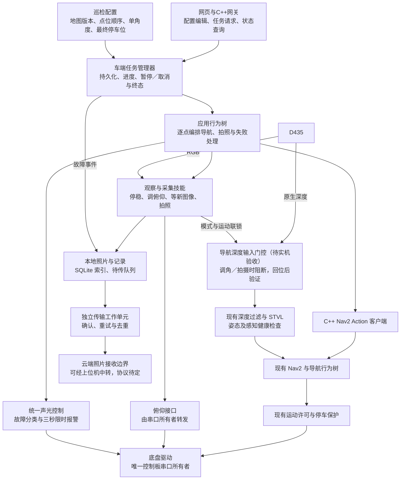

# carcar_inspection

最后更新：2026-10-15。本文是第一版巡检应用的实现与设计入口。APP-001-R1新增Vue网页、C++控制台／任务行为树、SQLite点位与任务存储、RGB采集及逐步舵机示教接口，离线验证通过（结果见测试记录）；**尚未实机验收**。默认入口只允许配置编辑，不启动硬件或自动导航。云端协议及上传工作程序仍未实现，照片明确记录为待配置上传，不返回假成功。

## 1. 本轮确定的范围

用户已确定：单层室内、手动启动、现场看护；通过网页录入观察停车位、车头朝向和相机俯仰角，安排巡检顺序及独立的最终停车位。每个巡检点只有一个固定拍摄角度，每次到点取得一张 RGB 彩色照片；导航动作结束并确认车体停稳后才调整单轴俯仰舵机，照片本地保存并排队上传云端。全部点位采集完成后，须到达最终停车位并确认停稳才算整轮成功。任务经车端接受并持久化后，网页关闭或 WiFi 断开继续执行；手动遥控仍失联停车。

第一版仅拍照留存，车端和上位机／云端均不做开门／关门、危险状态或其他目标识别，不保存巡检深度图；D435 深度仍用于导航实验。网页产品流程见下文；云端接收方式、是否经上位机中转、部署、鉴权和传输协议后续单独设计。

APP-001-R1先实现和离线验证网页、配置管理、调角流程及任务执行。完整深度 Nav2 导航尚待实车验收，实车巡检仍须通过下层门槛，不能把替身接口测试当实物结果。当前事实、测试与操作分别见[项目路线](../../docs/项目现状与路线.md)、[测试记录](../../docs/测试记录.md)、[操作手册第35节](../../docs/操作手册.md#35-网页巡检与逐步舵机示教app-001-r1)。

### 1.1 已选相机方案：A + C

2026-10-11 用户确认采用 **A：导航时固定相机角度、停车后俯仰 + C：导航点云与巡检数据分开处理**。两路数据共用 D435，按用途和运行模式分开，不要求增加第二台相机。

| 模式 | 相机与车体 | 数据用途与放行条件 |
|---|---|---|
| 导航 | 相机保持经验证的预设导航角度，2D 雷达持续工作 | 原生深度沿现有过滤与 STVL 实验路线供局部避障；沿用该姿态对应的处理配置与 TF（相机数据到车体坐标的转换） |
| 巡检 | 本次 Nav2 动作成功结束、车体停稳且运动禁止后，抬起相机；稳定后获取新 RGB 帧 | RGB 只用于拍照、本地保存和上传；调角及拍摄期间的深度不得进入导航体素更新 |
| 恢复导航 | 相机回到预设导航角度，继续保持运动禁止 | 仅接受恢复后新鲜且坐标变换有效的深度观测；验证地图消费与历史体素处理结果后，才放行下一段行驶 |

选择理由是第一版只需到点拍照，固定行驶视场可避免运动中调角带来的坐标变换与视场变化，数据分路便于分别验收避障和照片留存。代价是每点需要停车、调角及恢复时间。R1已写入模式联锁、原生深度输入门控，以及回位后新数据／地图重建检查；它们仍须实机验收，不免除回位重复性和历史体素残留检查。本版不覆盖边行驶边抬头观察的方案 B。

### 1.2 网页产品流程

2026-10-15用户要求按可落地产品组织功能，并采用主流方案和框架。正常流程为：选择地图并确认定位 → 录入与试拍验证点位 → 排列顺序并设置最终停车位 → 检查并启动 → 查看进度 → 查看照片及结果。日常操作入口集中在网页，错误提示给出具体原因及可用的处理操作。

| 页面 | 职责 |
|---|---|
| 首页 | 就绪条件、当前任务、最近结果及遥控／巡检入口 |
| 地图与点位 | 地图标点、车头方向、实车示教、单一俯仰目标、参考照片和验证状态 |
| 巡检任务 | 选择点位、拖动排序、设置最终停车位、保存任务版本 |
| 运行页面 | 车端真实进度、当前步骤、已拍照片、暂停／继续／取消 |
| 巡检记录 | 按执行和点位查看照片、故障、最终停车及上传状态，下载结果 |

点位录入支持地图点击与实车示教，两种方式都须现场导航回访和试拍验证。示教照片用于配置验证，不计入正式巡检采集。浏览器显示舵机目标和发送状态，无反馈时不得显示虚构的实际到位角。

地图来自所选保存栅格，位置统一为该图 `map` 下的米制坐标；拟用白／黑／灰分别表示空闲／占用／未知，箭头表示车头方向。缩放只改变显示比例，编辑连线表示访问顺序，规划路径单独显示。车辆位置来自定位估计，并显示时间／有效状态。RGB预览来自相机实时流，参考照片是历史图像，两者均显示来源和时间；窗口大小、图像分辨率与镜头视场分别标明，不能以缩放推断物理尺度。

## 2. 总体架构与职责

下图表示拟议的数据和控制关系，不是当前正在运行的节点拓扑。方框是职责边界，第一版不必每个方框都拆成一个进程。



| 拟议模块 | 输入与输出 | 职责边界 |
|---|---|---|
| `web_gateway` | 网页请求 → 受校验的配置／任务请求；车端状态 → 网页 | 固定业务接口、操作者会话和本地网页资源；不执行网页提供的shell、任意话题或文件路径 |
| `mission_store` | 点位、任务配置 → 版本化配置及执行快照 | 配置与执行结果分别管理；任务运行中的编辑仅影响后续新执行 |
| `mission_manager` | 巡检请求、配置 → 持久化任务、进度、暂停／继续／取消与终态 | 唯一业务状态来源；脱离浏览器执行，不直接发速度或串口命令 |
| `mission_executor` | 已校验任务 → 应用行为树执行事件 | 编排技能；不重写 Nav2 的规划、控制和恢复 |
| `nav2_adapter` | `map` 下目标姿态 → Action 接受、反馈及终态 | 用 C++ `rclcpp_action` 调用 `NavigateToPose`；拒绝、超时、取消失败和导航失败分开记录 |
| `capture_skill` | 停车要求、俯仰目标 → 新采集的 RGB 照片或采集错误 | 确认停稳、相机准备和图像新鲜度；不宣称已识别设备状态 |
| `camera_tilt_adapter` | 俯仰命令 → 发送结果、可用状态 | 单轴俯仰；通过唯一串口所有者访问控制板，不复用独占串口的键盘测试节点 |
| `capture_store` | 照片、采集信息、故障事件 → 本地记录及待传项 | 区分照片落盘、索引提交、待传、接收确认；不能写入时返回失败 |
| `upload_worker` | 待传项 → 已确认或待重试 | 独立于任务执行生命周期；任务结束后仍可补传，断网不重新导航或拍照 |
| `indicator_coordinator` | 导航／巡检状态 → 唯一声光输出 | 复用并扩展现有声光能力；避免两个发布者竞争同一话题，任务报警优先于普通导航提示 |

以上为职责划分；R1将网页网关、ROS适配和任务控制集中在一个 `inspection_console` C++节点内，存储／示教／行为树分别封装在 `store`、`Teaching`、`Executor`，不为每项职责启动一个进程。巡检模块不直接调用厂商库，Launch采用XML。2026-10-15用户明确授权仅扩展既有 `rosmaster_node.py` 的舵机转发及必要停车联锁，相关Python测试属于同一适配范围，不新增Python节点；其他新增车端逻辑使用C++。既有驱动、底层测试和建图入口保留。

### 2.1 R1实际接口与安全默认

- 新服务：`/hardware/inspection/motion_hold`（`SetMotionHold`）和 `/hardware/inspection/camera_servo`（`SetCameraServo`）；既有驱动默认 `enable_inspection_interface=false`，显式启用后才提供接口，始终只有原驱动打开控制板串口。
- 仅新接口模式增加启动前只读fuser占用检查和打开后的Linux `TIOCEXCL` 独占，检查异常拒绝启动，不杀未知进程；设备关闭后独占解除。离线测试替代厂商库、fuser及ioctl，本轮未实际操作串口或内核设备状态。
- 停车保持按调用方令牌锁存，拦截后续非零速度；断开网页、命令超时或退出程序不会自动释放。只允许当前所有者在导航板端94档释放；仍须由应用检查轮式停稳、姿态及感知条件。驱动代次变化后旧命令失效，重新示教可显式取得新的代次。
- 示教每步目标变化最多1°，每次板端变化最多一档；同一命令编号重试不重复写串口。车端生成单调时钟截止时间，迟到请求拒绝；该时钟接口只用于同一Jetson的进程间调用。
- 新网页接口将量化后的板端范围限制在57～106，避免目标160°被取整为板端107、对应标称160.5°；未放宽85°～160°目标限制。板端94与目标140.5°均是命令约定，不是实体位置反馈。
- `console.launch.xml` 默认配置模式，不发布速度或下发角度；`inspection_robot.launch.xml` 默认 `real_hardware=false`。实机入口将导航最终速度重映射到 `/inspection/navigation/cmd_vel`，由控制台统一门控后发布 `/cmd_vel`；旧导航／建图不能并行运行。
- 实机专用深度过滤输入为 `/inspection/navigation/points`，由控制台在导航姿态下转发新的原生点云。回位后清理并等待局部／全局障碍地图更新及感知健康，再释放停车保持；具体效果待实机验收。
- 回位检查还要求本次新时间戳的标障／清除点云、有效测量诊断，以及清理之后两个STVL图层递增的新合并序号；旧健康true或单纯服务返回不能放行。RGB默认使用本仓库实际命名 `/camera/camera/color/image_raw`，不是网页压缩预览。
- 固定网页接口为GET `/api/state`、`/api/map.png`、`/api/video.jpg`、`/api/media/<id>`；POST `/api/map/select`、`/api/localize`、`/api/points/save`、`/api/tasks/save`、`/api/teach/begin`、`/api/teach/step`、`/api/teach/viewed`、`/api/teach/confirm`、`/api/manual/enable`、`/api/run/start|pause|resume|cancel`。写操作绑定 `/ws/control` 当前会话，不接受任意文件路径或shell。

## 3. 地图、点位与观察角度

2026-10-15 APP-001-R2补充可见位置标记入口：先载入地图，点击“在地图上选择巡检位置”，按住停车点向车头方向拖动后松开，再命名并“保存巡检点草稿”。未选位置的默认零坐标不能直接保存；“新增点位”不再要求已有实车定位。接入实车并完成定位后可“记录小车当前位置与朝向”，后续逐步调角／新画面确认保存实测示教点。任务页另有“在地图上选择最终停车位置”；“小车初始定位”独立折叠并保持实车／停稳门槛。入口与区别见[手册35.3.1](../../docs/操作手册.md#3531-网页位置标记入口app-001-r2)。本次只修改网页交互，不改变车端接口／执行器默认开关。

固定点位是可复现的部署方式；把点位放在配置里，后续增删设备不需要复制行为树代码。

2026-10-19起，一个拍摄目标可以有1个主停车位和最多2个备选，一共不超过3个。每个停车位单独保存`map`下的`x/y/yaw`和该位置的俯仰目标。到达其中一位并停稳后只拍一张。旧的单停车位记录仍可读取。点位示教仍使用 SLAM 保存的地图。旁边另有规划草图页，20 米 × 10 米，观测点数量由操作者选择，1 到 20 个；4 个只是建议。规划草图不能启动自动巡检，也不代替 8080 随行建图。

`map` 是所选保存地图的固定参考坐标系；`odom` 是连续但可能漂移的里程计参考系，不能把两者坐标混用。停车目标的 `x/y` 用米表示，`yaw` 表示车头在地图平面内绕 Z 轴的朝向，内部统一用弧度、逆时针为正。相机俯仰表示相机相对安装基准抬头或低头的角度，与车头 `yaw`、控制板整数命令值不是一回事。

| 配置项 | 含义与约束 |
|---|---|
| `mission_id` / `map_version` | 任务标识与地图版本；坐标随地图版本管理，换图后先重新验证点位 |
| `point_id` / `target_id` | 稳定点位编号与检查对象编号；编号不因点位顺序变化而改变 |
| `navigation_pose` | `map` 下 `x/y/yaw` 停车目标；是命令目标，不是实际到达位置 |
| `camera_tilt_target` | 每点唯一的固定俯仰目标，经已校准映射变成板端命令；单位、参考零位和映射版本必须显式保存 |
| `point_order` / `final_parking_pose` | 点位访问顺序，以及同一 `map` 下独立的最终停车 `x/y/yaw`；普通完整任务必须配置终点 |
| `config_revision` / `validation_status` | 点位／任务修订版本和待验证／已验证／需复核状态；换图或关联标定失效时重新验证 |
| `reference_capture_id` | 示教参考照片编号，用于人工比较构图，不代表自动视觉对准 |
| `navigation_view` | 行驶所需相机姿态及对应外参版本；不能把旧姿态的外参套到新角度 |
| `capture_policy` | RGB 流选择、新鲜度要求、等待稳定与采集超时 |
| `timeouts` | 导航总时间、取消／停稳确认、姿态准备、保存、上报和报警关闭的有限时间预算 |

具体点位与角度由网页示教保存。R1候选保护值为静止线速度<0.005m/s、角速度<0.01rad/s持续0.5s，图像最大年龄1s，姿态稳定等待0.75s，应用到点容差0.10m／0.15rad，最低空闲空间64MiB；这些是软件候选条件，不是实物精度、刹停距离或稳定时间通过。时间参数见 `config/console.yaml`；分辨率沿用实机入口640×480/6Hz候选。不得因业务配置放宽既有舵机安全范围。

仓库已有地图；只有场景与地图不一致、地图质量不足或版本变化才重新建图。部署顺序为：确认地图可用 → 教授／配置停车位和方向 → 配置单一观察角度 → 回访试拍校验画面 → 固定版本。本版按每点一个角度、一张正式照片实现，不预先增加多角度执行逻辑。被检查对象编号与小车观察停车位分开；导航目标不能直接放在墙上对象的占用位置。

## 4. 应用行为树与正常流程

导航树回答“怎样到达这个点”，应用树回答“去哪个点，到点后做什么”。保留现有导航有界恢复，不在应用层再叠加无限重试。

```text
校验地图、点位验证状态、最终停车配置与启动健康条件
└─ 按配置顺序逐点执行
   ├─ 恢复并验证导航观察姿态与深度健康
   ├─ 按该目标的停车位顺序发送导航目标；这一位失败就换下一位，都失败则记下未拍并继续下一目标
   ├─ 确认底盘停稳，并保持采集期间运动禁止
   ├─ 阻断导航深度输入，调整到该点唯一俯仰目标，等待稳定与新 RGB 帧
   ├─ 保存一张 RGB 照片、采集信息及待传记录
   ├─ 登记待传状态；接收端配置后由独立传输程序处理，不等待上传
   └─ 恢复并验证导航观察姿态与深度健康
全部点位采集完成
└─ 导航到独立的最终停车位，确认位置／朝向、停稳并撤销运动许可
最终停车完成 → SUCCEEDED；尚未上传的照片继续补传
```

每个动作须支持异步反馈、有限超时与取消。树节点等待时返回 `RUNNING`，不能在 `tick()` 中阻塞等待网络或睡眠三秒。`halt()` 发起中止，但不代表 Nav2 已结束或实物已停稳；取消请求、Action 终态和停稳证据分别检查。旧目标的迟到回复不得更新新任务。

当前舵机没有位置反馈，现有 `/joint_states` 来自最后发送命令的估算，仅用于静止调试。调角发送成功不能作为实际到位证据；到位／稳定判据、回位重复性和回位后的 TF 一致性须另行验收。A + C 不依赖调角过程中用动态 TF 继续避障；共享 D435 抬头后近地避障视野改变，不能带着巡检姿态行驶。恢复导航姿态后，须用新的有效观测确认 TF、深度和地图消费健康，不能只等固定时间就放行。

现有 `d435_navigation.yaml` 默认关闭 RGB，另有启用 RGB 的实验参照配置。未来采集入口必须确认所需 RGB 流已启用，并对 RGB／深度同时运行的负载和新鲜度重新验收；不能直接把低带宽显示预览当作正式拍照输入。本轮不改变任何相机配置。

### 4.1 车端任务生命周期与操纵模式

- 启动请求含稳定请求编号；车端校验并持久化配置快照与执行编号后确认接受。同一请求重试返回同一执行，网页响应丢失后先查询，不能重复启动。
- 自动巡检的步骤推进、健康检查与运动授权由车端维持。网页关闭、WiFi断开或云端不可达都不撤销已接受的自动任务；重连读取车端状态，浏览器不通过循环发导航目标执行路线。
- 手动遥控采用既有短期授权、松手归零、后台／失联停车规则。建图、示教遥控、自动巡检的运动所有权互斥；拍照和故障锁停可以禁止所有来源。现有建图会话断开和任务进程退出逻辑不能直接套用到自动巡检。
- 暂停先禁止运动、取消在途动作并确认停稳，进入 `PAUSED` 前显示 `PAUSING`；继续先检查定位、相机姿态和数据健康。已完整持久化的采集不重复拍摄，未完成的相机恢复步骤仍须完成；不能仅按浏览器显示的点位索引跳转。
- 接管遥控须先完成暂停／取消及停稳确认，再转移运动所有权；同一时刻只允许一个操作者修改执行或遥控，其他连接可查看状态。
- 网络失联继续执行不适用于车端执行器崩溃、关键传感器过期或定位丢失。进程崩溃仍由独立保护停车；重启恢复记录和待传项，旧执行标记中断，禁止自动重放运动。网页软件停车不替代实物紧急断电手段。

## 5. 失败、取消与三秒报警

以下为用户确认的业务要求，尚未实现或实机验证。

| 事件 | 处理与终态 |
|---|---|
| 到不了点 | 2026-10-19修订：该目标的当前停车位由Nav2做完有限恢复仍失败、被拒绝或超时后，取消这一位并试下一个备选位。三个停车位都失败则记下未拍，继续后面的目标，不因此结束整轮。定位丢失、雷达过期、照片存不下或最终停车失败仍停整轮 |
| 拍照或本地保存失败 | 同样停车、记录／限时上报、结束整轮为 `FAILED`；改为黄灯闪烁＋蜂鸣三秒，区别于导航失败 |
| 照片已保存，但传输失败 | 保持待传并补传；允许继续后续点位，不重复拍照、不把未确认传输标成成功 |
| 故障上报时云端不通 | 等待预算耗尽仍进入三秒报警并结束；故障保留待传，网络恢复后补传，不能为等云端无限挂起 |
| 人工取消 | 中止在途技能，取消导航并确认停稳；`CANCELING` 后进入 `CANCELED`，不启动下一点；原有本地照片与待传项保留 |
| 最终停车失败 | 按导航失败停车、记录和红灯／蜂鸣报警；整轮 `FAILED`，报告保留“采集已完成、最终停车失败”两个独立结果 |
| 姿态恢复失败或数据不健康 | 不放行下一段行驶，保留具体错误；未来实现须独立验收，不能伪装为拍照成功或普通上传失败 |
| 取消或停稳无法确认 | 保持运动禁止并发布锁停错误，不返回普通成功／已安全取消；故障反馈与限时报警仍尽力执行，底层保护继续运行 |

故障处理顺序为：先撤销运动许可并处理在途动作，再尽力记录和限时上报，收到云端确认或超时后启动三秒声光窗口，窗口结束主动关灯停鸣，最后结束本次任务。三秒指报警窗口，不是“导航失败到任务结束”的总耗时；上报、取消和关闭各有独立的有限预算。

取消或故障结束默认原地保持停车，不再启动前往最终停车位的导航；最终停车只属于正常完成流程。任何取消／停稳证据不足的情况仍按锁停错误处理。

黄色用于区分采集／保存故障，由本轮选择并获用户确认；实际 RGB 亮度、闪烁频率和波形仍待现场验收。报警期间不能让普通导航状态覆盖红／黄闪烁。退出指结束整轮任务，**不停止底盘驱动、运动保护或补传工作单元**；异常退出和急停时优先保证停车，报警完整性不成为停车前提。

当前 `/hardware/indicator/command` 已由底盘驱动转发；单次蜂鸣允许最高 3000 ms，但一秒无声光刷新会强制关闭，`navigation_indicator` 也在使用此话题。未来由唯一声光编排者维持报警心跳，在窗口开始触发有限时长蜂鸣，闪烁灭灯期间也维持心跳，窗口结束主动关闭；不能每次刷新都重新触发蜂鸣，也不能只发一次 3000 ms 然后退出。现有导航失败为红灯常亮、120 ms 短鸣，其三秒防重复间隔不等于本设计的三秒报警时长。

本地保存失败可能意味着磁盘已不可写：故障记录也可能保存失败，不能把“成功写下故障”作为上报／报警的前置条件。尽力使用可用事件存储、内存状态和云端反馈；若本地不可写且断网，必须报告证据可能丢失，不承诺重启后还能补传。照片保存、文件索引和队列的一致性，以及中断后恢复扫描，留到实现阶段验证。

## 6. 数据与云端边界

车端用照片文件＋SQLite 元数据／待传队列。只保存 RGB 图像，不保存本期巡检深度图。正式拍照先落盘，再写入`uploads`表。`upload_url`为空时状态保持`PENDING_CONFIGURATION`，不访问网络。配置为`http`或`https`地址后，独立线程POST照片字节，并带上编号和sha256；只有HTTP 200且响应JSON的编号、校验都一致才标`CONFIRMED`。超时、拒绝或校验不符保持`PENDING`并稍后重试，不删除文件，也不重新导航或重拍。示教参考照片不进入这条队列。

任务模板、点位配置、一次任务执行和采集记录分别标识，执行保存所用配置快照。R1照片先写临时文件、同步后重命名，再提交SQLite索引；文件与数据库不能假定天然构成同一事务。重启已提交记录保留，非终态执行标记中断且不重放运动；掉电恰在文件落盘和索引提交之间的自动关联修复仍待实现及故障注入验证，孤立文件保留、不静默删除。磁盘容量不足须明确拒绝启动或结束采集。网页分别显示点位采集、最终停车和上传结果。

每次采集至少关联 `mission_id`、`execution_epoch`、`point_id`、`capture_id`、`map_version`、图像原始时间戳、采集时间对应的车体定位估计及其坐标系、舵机目标／板端命令与映射版本、文件校验值、错误与传输状态。没有舵机测量值时不填写虚构的实际角度；定位估计也不能写成实物真值。

照片和故障事件均有稳定编号，传输重试复用同一编号，接收端须能去重。故障上报优先于大照片，避免照片积压阻塞限时故障反馈。“已发送”不等于“对端确认接收”；相机采集完成、照片持久化完成和传输完成分别记录。重启后先恢复待传项，不能自动恢复旧导航目标或旧速度命令。

云端是照片的最终接收端；上位机是否作为中转或查看端后续确定，不假设它们同机或同服务。后续需确定照片／事件接收、确认格式、鉴权、重试限额和查询界面；第一版不包含上位机或云端识别。暂不选择 HTTP、MQTT 或其他协议，也不新增模拟上传接口。

## 7. 目录与复用方案

当前使用 `carcar_inspection` 承载应用实现，不为每个模块新增空ROS包。R1新增 `src/`、`include/carcar_inspection/`、`config/`、`launch/*.launch.xml`、`test/` 和 `web/`；行为树在C++执行器中通过固定XML构建，网页不能提交任意树或插件路径。构建及测试使用独立的 `/tmp/carcar_app001_build`、`/tmp/carcar_app001_install`，未替换运行中的建图服务。

| 保留／拟使用位置 | 内容 |
|---|---|
| 本文 | 首版巡检业务设计的唯一详细入口 |
| `carcar_navigation/behavior_trees/` | 现有导航树；不塞入拍照、存储或上传业务 |
| `carcar_hardware`、`carcar_base` | 正式硬件适配及历史测试；串口始终单一所有者 |
| `carcar_camera` | 现有 D435 与导航深度处理；后续 RGB 采集只依赖稳定 ROS 接口 |
| [停用代码归档](../../docs/archive/停用代码/2026-10-10/README.md) | 两份未构建的历史草稿、原路径及替代关系 |
| [框架调研](../../docs/archive/2026-10-10-巡检行为树框架调研.md) | 官方来源、固定版本、许可证和候选取舍 |

推荐保持本机 BehaviorTree.CPP 3.8.7 与 Nav2 1.1.20，C++ Action 客户端替代 Python Simple Commander。Waypoint Follower 用作简单多点参考；PlanSys2 在确需动态任务规划时再评估，不引入额外框架或复制上游代码。详细来源只在上述调研维护。

### 7.1 主流方案与适配范围

2026-10-15用户确认采用主流方案开发，沿用 ROS 2 Humble、Nav2和BehaviorTree.CPP，不重写导航规划／控制算法。选择如下，其中未安装的依赖须在首次实现时固定版本和锁文件，记录许可证及构建环境，不将“主流”视为本车已具备可靠性或产品认证的证据。

| 层次 | 选择与适配 |
|---|---|
| 巡检网页 | Vue 3.5.44＋Vite 8.3.4＋官方Vue插件6.0.10，JavaScript与单文件页面模块；完整锁文件在 `web/package-lock.json`。本机构建Node 22.23.2，所选工具要求Node>=22.12；本地提供全部运行资源，不依赖CDN |
| 网页网关 | 复用现有C++ Boost.Beast／JSON协议与资源提供能力；保留建图入口、历史遥控实现和保护。巡检任务生命周期独立实现，不在浏览器暴露通用ROS或shell控制 |
| 任务执行 | 已有BehaviorTree.CPP 3.8.7（MIT），应用树组织可取消、有限超时的巡检动作；不引入要求v4的包装框架 |
| 导航 | 已有Nav2 1.1.20，C++ `rclcpp_action` 调用 `NavigateToPose`，沿用现有导航树与运动保护；该版本结果消息为空，错误须结合Action终态和本项目诊断分类 |
| 采集与持久化 | ROS图像接口、OpenCV及SQLite 3 C/C++接口；照片与结构化记录分开管理，传输独立补传 |

本机SQLite3.37.2、OpenCV4.10.0；网页单测使用Vitest5.0.4（MIT），真实浏览器自动化使用playwright-core1.64.1（Apache-2.0），均仅用于开发验证。Vue／Vite MIT许可及其依赖声明保留于安装依赖，未复制上游源码；首次部署须保留对应许可。C++HTTP复用现有Boost.Beast1.74（BSL-1.0）及JSON3.10.5（MIT）实现，新增不启用RTC的共享库，原建图WebRTC目标及协议保持。

Vue的响应式界面用于同步配置表单和任务显示，选用官方推荐的Composition API与单文件模块；Vite只负责开发／构建，产品运行时由C++网关提供静态页面，无需Node服务。代价是增加前端构建与依赖维护，因此只在新增巡检页面采用，不在本轮重写已用建图网页。已有地图显示和控制协议按稳定接口复用，具体共享代码在实现时按需要提取。

官方依据：[Vue 3完整应用建议](https://vuejs.org/guide/introduction.html)、[Vue官方Vite工具路线](https://vuejs.org/guide/scaling-up/tooling.html)、[Vue MIT许可证](https://github.com/vuejs/core/blob/main/LICENSE)、[Vite许可证及第三方声明](https://github.com/vitejs/vite/blob/main/LICENSE)。这些在线资料于2026-10-15核对，固定依赖版本时须保留对应版本的许可声明。机器人框架固定版本、许可证、异步节点及候选取舍见上述[框架调研](../../docs/archive/2026-10-10-巡检行为树框架调研.md)。

## 8. 后续验收门槛

离线开发可先进行；实车应用前须完成基础／深度导航数据消费、停车保护与低速移动验证。2026-10-11的深度接入验证属于历史计划，不是运动授权或实机通过记录。采用分段交付：点位／任务与网页 → 单点示教试拍 → 单点自动采集 → 多点顺序及最终停车 → 异常恢复与报告／补传；每段分别记录离线和现场证据。

应用实现后先离线验证取消、旧回复、断网、保存失败和报警窗口，再做现场两点采集。需观察：停止确认、是否使用新 RGB 帧、导航／采集错误是否不同灯色闪烁三秒、蜂鸣是否在窗口结束关闭、整轮是否只产生一个终态、断网上报是否有界、补传是否去重、调角／拍摄时是否阻断导航深度输入、相机恢复并验证前是否始终禁止运动、云端是否确认收到与本地编号及校验值一致的照片。采集完成与全部上传完成分别验收，不以识别结果作为首版验收条件。

产品流程须验证：每点只有一张正式照片、示教参考图不混入结果；重复启动请求不产生第二任务；自动任务断开网页／WiFi后继续、重连进度一致；手动遥控失联仍停车；暂停／接管互斥且不重复已提交采集；换图／标定失效点位被拦截；最终停车失败不会返回整轮成功；进程崩溃／重启后不自动运动。R1软件验证结果统一[测试记录](../../docs/测试记录.md)，现场项仍待验收。

构建、配置预览、逐步调角、独立实机入口及停止恢复只维护在[操作手册第35节](../../docs/操作手册.md#35-网页巡检与逐步舵机示教app-001-r1)，测试统一登记[测试记录](../../docs/测试记录.md)。真实角度、回位重复性、深度模式切换、完整巡检和三秒报警均不由离线通过转为实机通过。

